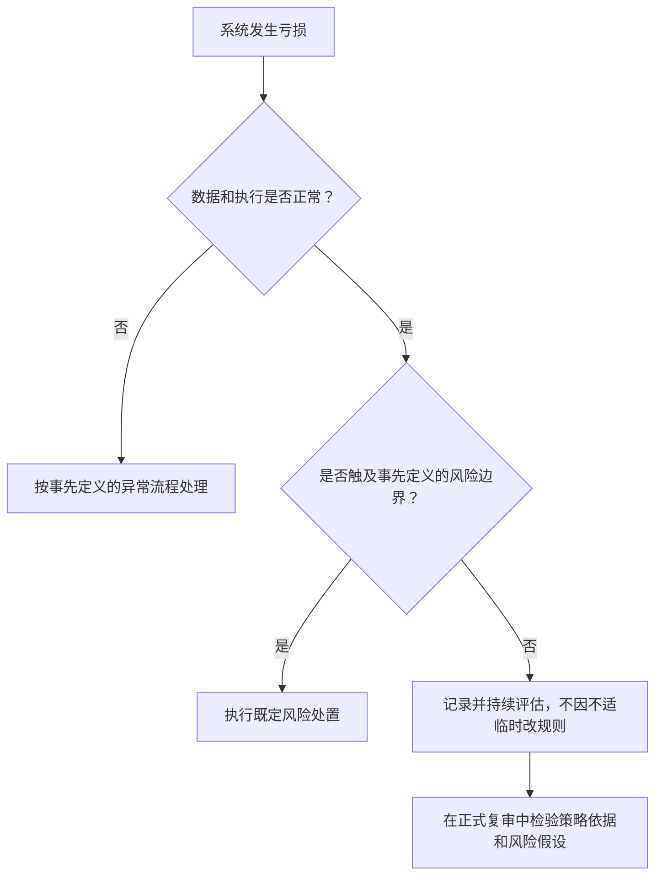

# 《Systematic Trading》第一章：有缺陷的人脑——深度拆解

> 原文标题：Chapter One. The Flawed Human Brain。
> 依据：用户提供的 `Systematic_trading_Chapter_One .md`。本文分析这一章，不用全书后续方法补齐缺失段落。
> 材料限制：行为金融与前景理论介绍之后，文本跳至图 2；过度交易之后，又跳至风险分布说明，缺少过度下注的完整引入。图 2—4 均为占位图片，附录 B 规则细节未提供。以下区分原文陈述、解释性推导与自拟示例。

## x → f → f(x)

- **x**：人能处理比简单规则更复杂的信息，为什么交易决策仍反复出错，而且把决策交给系统后还会出错？
- **f**：把临场判断改为事先明确、可以检验的客观规则，用承诺机制约束执行，同时检查设计规则时的过拟合、过度交易和过度下注。
- **f(x)**：评价系统不能只问“能赚多少”，还要问“规则是否明确、历史证据是否可信、亏损是否可承受，以及亏损时我能否继续按既定流程行动”。

## 核心命题

**系统化交易的价值，是把容易受情绪支配的临场决策，转移到可以提前定义、检验和约束的流程中。**

但这次转移没有消灭人：人仍设计规则、选择回测、设定仓位，也能关闭程序。因此，第一章真正要求建立的是一套同时约束“交易者”和“系统设计者”的决策制度。

这里的“制度”是对本章逻辑的概括，不是作者单独提出的术语。

## 关键洞见

### 1. 知道更多，不等于决策更好

作者承认，人比简单系统聪明，也能理解系统没有纳入的信息。问题在于：信息进入大脑以后，要经过心理偏差才能变成行动。

他的两次 BP 交易构成了同一个机制的两面：2004 年，赚约 5% 就卖出，错过后续上涨；2009 年再次买入，事故发生后仍受“上次卖早了”的记忆影响，最后在约 £3 卖出，而这事后看来恰好是底部。

关键不是用事后价格证明某次卖出必然错误，而是看见：**上一次的懊悔正在替下一次交易制定规则。** 同一个人，面对不同经历，能够为过早止盈和过久持亏分别找到理由。

逻辑链：复杂信息 → 经过记忆、情绪与自我解释 → 执行标准漂移 → 分析能力不能稳定转化为决策质量。

**反直觉之处**：需要约束的可能正是“我现在有充分理由破例”的能力。

### 2. 规则有两种潜在价值，不能混为一谈

作者认为，简单规则既可能纠正自己的偏差，也可能利用其他参与者的偏差。

| 层次 | 要解决的问题 | 能据此推出什么 |
| --- | --- | --- |
| 自我约束 | 我会过早兑现盈利、拖延实现亏损 | 明确规则可能让执行更一致 |
| 收益来源 | 其他人的偏差是否形成可交易的价格行为 | 需要机制解释与可信证据，才能讨论策略优势 |

作者报告，在 31 个期货合约的回测中，“较早止损者”在 27 个上胜过“较早止盈者”。这支持本章的比较，但它既不是完整策略说明，也不是未来收益保证。

由于附录 B 缺失，我们不能把书里的策略擅自还原成某个固定止损百分比，也不能推断“任何止损规则都有效”。

**重要区别**：执行一致只能让规则得到贯彻，不能把无效规则变成有效规则。

### 3. 承诺机制是在情绪出现前安排约束

作者把临时干预系统称为 meddling。其心理基础往往是过度自信：我理解得更多，所以这次可以比系统判断得更好。

但判断标准一旦能随盈亏改变，规则就很容易退化为辩解工具。“小亏卖出”中的“小”，可以从 5 扩成 10，再扩成“等反弹”。

奥德修斯提前要求船员绑住自己、忽略之后的请求，代表一种时间上的安排：**让冷静时的决定约束诱惑出现后的自己。** Niederhoffer 的白银故事则把它放回交易现场：他预先给出减仓和清仓条件，之后要求解除约束，助手仍执行原先指令。

逻辑链：预见自己会动摇 → 提前定义条件和权限 → 触发后减少重新解释的空间 → 提高执行一致性。

这并不推出“系统永远不能修改”。本章强调避免情绪性破例；区分临场干预与正式修订流程，是据此作出的实践推导。

### 4. 客观、自动化和可信，是三个不同条件

- **客观**：给定同样的数据与状态，能够按明确规则得到同样的行动。
- **自动化**：由程序完成计算或执行，减少人工接触。
- **可信**：对规则依据、证据局限和可能亏损有足够理解，可以承担其运行后果。

作者用“20 日均线高于 40 日均线就买入”说明客观规则。它可以由程序运行，也可以用表格计算后手工执行。因此，**系统化不等于必须全自动**。

自动化只是提高干预门槛。只要人能把普通亏损解释为“紧急情况”，就仍能关掉系统。作者关于电脑、人和狗的笑话，指出的正是这个问题。

理解上的关键顺序是：

**规则明确 → 可以检验并形成理解 → 承诺更有依据；自动化帮助执行，但不能替代前面的工作。**

### 5. 偏差会从交易现场迁移到研发现场

系统只是人设计的工具。作者试图纠正的心理偏差，也可能藏进工具本身。

| 风险 | 心理来源与传导机制 | 表面上为何吸引人 |
| --- | --- | --- |
| 过拟合 | 擅长找故事和模式 → 把历史噪声当规律 → 规则过度适应特定样本 | 回测更漂亮，解释更完整 |
| 分散不足 | 高估收益估计的精度 → 优化器给出极端配置 → 风险集中 | 看起来有精密数学支持 |
| 过度交易 | 高估自身优势 → 低估成本门槛 → 频繁交易吞噬收益 | 交易越多，越有控制感 |
| 过度下注 | 对收益与风险判断过于自信 → 持仓超出承受能力 | 短期收益和刺激更大 |

原文指出，这些问题还会相互强化：过拟合抬高预期收益，使高频交易成本看起来容易覆盖。对风险分布的过分乐观，也会让过大的仓位看起来可以接受。

因此，**程序会忠实执行人的设计，包括设计中的错误。**

## 最难理解的一点：为什么“相信系统”不能等于盲信

本章有一个容易误读的张力：一方面要求坚持，另一方面承认回测会骗人、模型有误差。

解决这个张力的关键，是区分“因为亏钱而不舒服”和“因为证据而判断系统有问题”。下面的分支是对本章的实践推导，不是作者原文给出的停机标准。

历史上出现过某种亏损，只说明它可能与既有经验相容，并不能证明当前亏损一定正常；历史上没有出现，也不等于未来不可能出现。

**可信意味着清楚自己承担什么不确定性，而不是确信系统不会失败。**

## 风险数字：均值漂亮，为什么仍可能扛不住

原文用一个极端教学例子：年化平均收益 200%，年化标准差也为 200%。按一年 256 个交易日，以及相邻收益零自相关等简化假设：

- 日均收益约为 `200% ÷ 256 ≈ 0.78%`。
- 日标准差约为 `200% ÷ √256 = 12.5%`。
- 低于均值三个标准差的日收益约为 `0.78% − 3 × 12.5% ≈ −36.72%`。

原文写约 −37.2%，图题又概括为亏损 40%；按该段列出的数值计算，应约为 −36.7%，存在小幅数值不一致。

正态假设下，低于均值三个标准差的单侧概率约为 0.135%，约对应每 741 个交易日一次，即按频率折算约 2.9 年一次。**这是概率频率的换算，不是每三年定期发生一次的预测。**

这个例子要表达的不是“能赚 200% 的策略值得做”，而是：**即使平均收益极高，风险规模仍可能制造无法承受的单日亏损。** 作者还提醒，正态分布可能低估极端亏损。

此处的收益和波动率是简化模型中的统计量，不能直接当成复利财富增长率或账户生存概率。

## 实践指引：把本章转成策略研究问题

以下是学习与研究用的检查框架，属于对本章的应用推导，不是具体交易参数建议。

### 研究一个规则前，先写清四件事

1. **行为定义**：输入数据、信号、持仓调整、退出条件分别是什么？换个人执行，结果是否一致？
2. **机制依据**：为什么这个规则可能成立？哪些观察会削弱这一解释？
3. **证据边界**：试过多少规则和参数？是否考虑成本？是否只在某段历史有效？本章提出问题，尚未提供完整验证方法。
4. **风险体验**：研究结果中的连续亏损、回撤和极端波动，是否超出预先设想的承受范围？

### 想破例时，记录“新证据”与“新感受”

自拟示例：某规则已经触发退出，研究者此时说“新闻其实没那么差”。需要辨别：新闻判断本来就是规则输入，还是因为出现亏损才临时获得决策权？

值得记录的不是一句“下次要自律”，而是这次干预的触发条件、所用证据、是否事先允许，以及如何纳入正式复审。

### 看待回测时，多问一个问题

除了“历史上赚了多少”，还问：**“假如这条净值路径在真实资金上重演，我会在哪一段忍不住关闭它？”**

回测因此有两种用途：检验策略，以及帮助理解自己是否可能执行它。但二者都依赖回测本身是否可信。

## 例子列表

- **两次 BP 交易**：一次过早兑现盈利，一次受前次懊悔影响而拖延退出。← 支撑 **x**：聪明和经验不足以保证稳定决策。
- **31 个期货合约比较**：作者报告较早止损规则在 27 个上胜过较早止盈规则；缺少附录，不能复现细节。← 展示 **f** 的经验支持。
- **赌博的三种刺激因素**：控制幻觉、差一点中奖、快速连续反馈，使频繁交易可能成为刺激循环。← 支撑 **x**。
- **黄金止损时找理由**：把原先的退出线不断往后移。← 展示 **f** 所要约束的干预机制。
- **奥德修斯与塞壬**：在诱惑到来前限制之后的自己。← 展示 **f** 中的承诺机制。
- **Niederhoffer 的白银头寸**：助手遵循预先指令，即使本人后来要求解除约束。← 展示 **f(x)**：提前安排改变临场行动。
- **电脑、人和狗**：自动化之后，人仍可能干预。← 检验 **f** 的边界。
- **优化器产生极端组合**：收益估计稍变，配置大变；数学形式不消除输入不确定性。← 展示设计阶段的偏差。
- **200% 收益与波动率例子**：高平均收益不能消除巨大单日损失。← 支撑 **f(x)**：仓位必须匹配风险承受能力。

## 结论列表

1. 更多信息只有经过可靠决策流程，才可能变成更好的行动。
2. 系统化交易把部分判断前移到规则设计阶段，没有消除人的判断责任。
3. 一致执行能减少偏离规则的错误，不能证明规则具有盈利能力。
4. 客观规则使偏离更容易识别，也为历史检验提供条件。
5. 自动化提高干预门槛，不能提供规则有效性的证据。
6. 回测越漂亮，越需要追问规则筛选过程有没有制造幻觉。
7. 精密优化无法消除收益估计的不确定性。
8. 策略可能有优势，持仓规模却仍可能使其无法坚持或生存。
9. 对系统的信任，应建立在理解证据与风险上，而不是排斥反证。

## Q-A 问答链

### Q-A 问题结构图

### Q1：聪明为什么还会交易失误？

- **结论**：分析能力会被影响行动的心理偏差抵消。
- **形式化**：信息丰富 ≠ 行动可靠。
- **论证**：① 人能理解复杂信息。② 记忆、懊悔和对亏损的反应会改变执行标准。③ 所以理解更多，不保证在压力下更稳定。
- **边界**：这不能证明每个人、每次主观交易都逊于规则，也不能用一个事后失败案例完成普遍证明。

**Q1 → Q2**：因为能力并不自动带来可靠行动，但还不知道替代机制怎样减少偏差，所以要问简单规则的作用。

### Q2：简单规则凭什么有帮助？

- **结论**：明确规则可以减少临场重释，并可能利用他人的行为偏差。
- **形式化**：事前定义 + 一致执行 → 减少临场标准漂移。
- **论证**：① 冷静时明确条件。② 条件触发时减少即兴解释。③ 若规则还捕捉到有依据的市场行为，就可能同时具有收益价值。
- **边界**：约束执行和创造收益是两回事；无效规则即使严格执行，也仍然无效。

**Q2 → Q3**：因为规则的帮助依赖执行，但人仍保留否决权，所以要解释为何写下规则之后仍会破例。

### Q3：有了规则为何还会破例？

- **结论**：过度自信让人相信当前例外判断优于预先制定的规则。
- **形式化**：短期不适 + 我更懂这次情况 → 干预。
- **论证**：① 规则可能要求接受令人难受的亏损。② 人能找到规则未考虑的信息。③ 把信息更多误当成判断更优，就会临时覆盖规则。
- **边界**：发现数据或执行故障不能简单归类为情绪干预；需要辨认有证据的异常与事后辩解。

**Q3 → Q4**：因为否决权给干预留下空间，所以自然会问，交给程序能否关闭这条通道。

### Q4：全自动能解决干预吗？

- **结论**：自动化可以减少干预机会，但人仍能通过紧急覆盖关闭系统。
- **形式化**：自动化 → 干预更难；自动化 ≠ 干预消失。
- **论证**：① 自动执行减少逐笔人工选择。② 正常系统仍需要异常处置能力。③ 缺少信任时，普通亏损就可能被解释为异常。
- **边界**：自动化对复杂、多品种或快速运行的系统仍有实际必要；本章质疑的是它能否单独提供纪律。

**Q4 → Q5**：因为程序不能代替信任，而盲目信任也不可取，所以要继续追问信任的证据来源。

### Q5：怎样建立有依据的信任？

- **结论**：理解规则、机制和可信回测，比仅看到高收益更能支持承诺。
- **形式化**：明确规则 + 可解释依据 + 诚实检验 → 有条件的信任。
- **论证**：① 客观规则让行为可追溯。② 简单透明的机制有助于理解为何交易。③ 回测帮助认识历史表现，但必须防止过拟合和成本误判。
- **边界**：可解释故事也可能是叙事谬误；回测和行为解释都不足以单独保证未来有效。

**Q5 → Q6**：因为对规则依据的信任仍未回答账户能承受多少损失，所以最后必须检验持仓风险。

### Q6：好规则为何仍可能撑不住？

- **结论**：风险规模过大，会使有依据的规则也无法持续执行。
- **形式化**：规则可能有效 + 仓位超出承受能力 → 被迫退出或情绪干预。
- **论证**：① 平均收益不描述全部亏损路径。② 高波动会产生很大的短期损失。③ 损失超过资金或心理承受能力，就会破坏继续执行的条件。
- **边界**：降低仓位不能修复无效策略，历史波动率和正态模型也不能穷尽未来风险。

## 局限与盲区

**第一，行为解释提供假说，不完成盈利证明。** 作者从“人存在稳定偏差”推向“相关规则应继续有效”，其间仍需要解释偏差如何进入价格、优势是否已被竞争消耗，以及收益能否覆盖成本。这里是本章的论证缺口，不是对该类策略无效的断言。

**第二，个案、回测和未来有效性是不同层次的证据。** BP 故事能说明心理机制，31 个合约的比较能提供一定经验支持，但缺少完整规则、期间与研究过程，不能据此独立验证结果。

**第三，对理性金融和市场效率的介绍过于压缩。** 个人会犯错，不直接推出市场价格容易预测；“市场存在非理性”也不直接推出某个可执行交易优势。

**第四，坚持与修订之间仍需要治理流程。** 本章强调承诺的重要性，但这份材料没有提供完整的系统失效判定、复审和停机标准；这些不能靠“永远坚持”代替。

**第五，风险模型是教学简化。** 零自相关、波动率稳定与正态分布均有限制，极端事件的实际风险不能仅由本章数字确定。

读完本章应保留的核心追问是：**这套流程如何让冷静时的我，约束压力下的我，又允许有证据的修正？**
