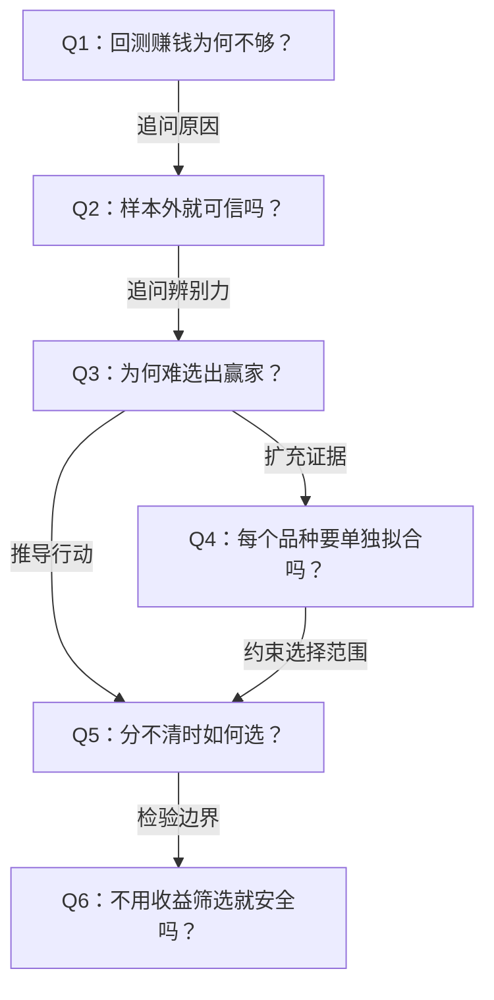

# 《Systematic Trading》第三章：拟合（Fitting）——深度拆解

## 材料与覆盖范围

- S1：Robert Carver，《Systematic Trading》，Chapter Three: Fitting，书内 pp.51–68，对应附件 PDF pp.1–18。附件不含版权页，版次未确认。
- 原件：`/Users/minyanhua/Desktop/Systematic_Tradingding_Chapter3.pdf`；SHA256：`0bb9da3e8efd9b0b4795cfab8fb9109e43b865a33bff0239695c9f791af59e12`。
- 已读取全部18页文字，使用 PDFium 渲染核对 p.57 图9–10、p.59 表3、p.60 表4、p.62 图12及表5、p.64 表6。其余图已读文字说明，未逐图复算曲线；页码连续，未发现缺页。文本解析器报告部分对象偏移异常，但完成全部页提取；关键表格另据渲染核对。
- S2：[作者配套资源页](https://www.systematicmoney.org/systematic-trading-resources)，访问日期2026-11-01。页面未列第三章专属表格或勘误；这不证明本章无错。未取得本章模拟代码、随机种子或原始收益序列。
- S3：Andrew Lo（2002），[The Statistics of Sharpe Ratios，作者机构出版摘要](https://alo.mit.edu/publications/page/18/)。本次只核对摘要，未通读论文；用于提醒夏普估计和年化依赖收益过程，不作为本章表格已复现的证据。

以下明确区分“作者报告”“独立教学计算”和“解读建议”。历史夏普、相关性及年数均不能直接成为当前系统默认参数。

## x → f → f(x)

- **x**：当许多规则都能在历史上赚钱、彼此收益又充满噪声时，怎样选择和校准规则，才不会把历史幸运者误当成未来赢家？
- **f**：先约束候选规则和变体的数量，再坚持只用过去拟合未来；当证据不足以区分优劣时，保留合理变体，通过分散和承认估计不确定性的权重处理差异。
- **f(x)**：研究流程从“批量搜索并留下最高夏普”改成“少量机制假说、行为筛选、时间隔离、跨品种检验、保留不确定性”；后续每次筛选和调权都留下记录。

## 核心命题

**历史表现提供的辨别力，通常远小于研究者拥有的选择自由。选择越激进，越可能将噪声固化成规则。**

本章并非禁止拟合，而是要求拟合的野心服从证据的分辨率。作者自己的方法把收益筛选推迟到预测权重分配，但这只是减少早期筛选偏差，不能保证后面的权重估计天然安全。

与前两章的连接：第一章约束人的临场冲动，第二章要求规则具有可解释的依据，第三章进一步说明：有道理的规则，也会被不诚实或过度灵活的研究流程毁掉。

## 五个关键洞见

### 1. 过拟合发生在整个研究过程，不只发生在模型内部

p.52 的团队用软件大量搜索，得到50条回测盈利规则；真正应追问的是总共试过多少条，以及失败者去了哪里。即使每条规则只有一个参数，研究者反复改想法、换市场、换区间，也在扩大选择空间。

p.54 更尖锐：你读过的教材、知道的成功策略，本身已经受过历史筛选。“想法优先”仍可能继承隐性过拟合。

机制：候选增多 → 幸运极值增多 → 只保留赢家 → 回测收益带有筛选溢价。AI提高搜索速度，也会加速这条链，除非完整记录失败试验。参见 CL001、CL002。

### 2. 样本外解决时间作弊，却不能独自解决统计无力

书内 pp.54–57 区分四种方法：

| 方法 | 拟合信息 | 测试方式 | 主要代价 |
| --- | --- | --- | --- |
| 全样本内 | 使用整段历史 | 回头报告同一历史的收益 | 早期决策使用了未来信息 |
| 单次切分 | 用前段选参数 | 在后段固定测试 | 可评估历史较短；难体现后续重估 |
| 扩展窗口 | 累积截至当时的历史 | 下一期测试，再扩展 | 旧制度数据可能失去代表性 |
| 滚动窗口 | 截至当时最近一段历史 | 下一期测试，再滚动 | 窗口过短时估计噪声巨大 |

作者偏好扩展窗口；滚动窗口用丢弃旧数据换取适应性。两者都要面对“足够长才能估准，足够短才能适应”的冲突。本章没有给出通用最佳窗口。

p.58 的反例恰好按时间滚动：每年从90个变体中选过去一年最高夏普，下一年交易，结果仍然最差。**时序合法，只是可信研究的一项必要条件。**参见 CL003、CL004。

### 3. “有收益”与“比另一条更好”是两种难度

表5报告，真实夏普0.3的模拟规则，平均约37年才通过作者的盈利检验。表6报告，与基准规则相比，夏普优势0.25、收益相关性0时，需要约45年辨别；优势0.5、相关性0时为37年，相关性0.95时为3年。

直觉：两个结果分别抖动时，差值也抖动；高度同步的规则，其共同噪声较容易在比较中抵消。但现实中相近变体往往同步且收益差很小，因此仍难选优。

这不是“必须等37年才能研究”，而是“不能用一年排名，装作已知道谁具有更高的真实夏普”。表格是特定模拟的结果，不能当作所有市场的样本量计算器。参见 CL005。

### 4. 池化数据是在约束故事，也是在增加证据

pp.64–65 指出：每个品种各自拟合，表面上尊重市场差异，也可能让每个品种都获得一套迎合自身历史噪声的参数。

作者建议先设计通用规则，合并多品种证据；确有差异时再考虑分开。成本差异是他明确承认的例外。

必须区分两件事：同时交易多个品种，可借分散提高组合夏普；把不同品种收益序列首尾拼接，只是形成更长的序列，夏普通常接近单品种平均。p.65 脚注54明确作此区分。两者不能用同一个“样本变多”含糊带过。

跨品种也不是复制独立样本：共同宏观冲击、同一交易日的相关性、相似制度都会降低新增信息。参见 CL006。

### 5. 不知道赢家时，组合可以比淘汰更诚实

pp.67–68 的作者流程是：少量机制 → 少量行为不同的变体 → 用预测权重表达对收益的有限判断。

他允许按速度、相关性和成本删减变体，而不是先按回测收益删除输家。几乎没有权重的变体，之后可为减少实现复杂度而移除。

这里的目标并非无限保留规则：同一机制的高度重复实现增加复杂度，未必增加分散。作者以相关性超过95%作为删去一项的经验建议，但本章没有明确估计窗口和相关对象的完整定义，因此不能硬编码成普适阈值。

等权也是重要对照，但等权差规则不会创造优势，相关性高的变体也不会带来90份独立机会。参见 CL007、CL008。

## 关键案例与数字

| 案例 | 原文位置 | 论证作用 | 证据限制 |
| --- | --- | --- | --- |
| 一个月找到50条盈利规则 | p.52，PDF2 | 支撑x：搜索规模被成功数量掩盖 | 轶事；公司倒闭不构成过拟合的因果证明 |
| GBPUSD偏离年均价±5% | pp.52–53，PDF2–3 | 展示f：规则、阈值及回看期都能形成选择 | 作者明确说是人为例子，不推荐交易 |
| 黄金期货90变体 | p.58，PDF8 | 展示f(x)：去年冠军不如随机选择或组合 | 作者报告SR分别0.07、0.20、0.33，未取得完整成本与数据规格 |
| 100条零收益规则 | p.59，PDF9，表3 | 展示f：门槛高仍能搜出幸运赢家 | SR门槛2时平均约2.3条过关，为模拟结果 |
| 夏普0.3规则约37年 | p.62，PDF12，表5 | 支撑x：微弱优势需要大量证据 | 模拟平均检验通过时间，不是固定到期保证 |
| 两条规则相差0.5 | pp.63–64，PDF13–14 | 展示f：比较优劣还依赖相关性 | 表6相关性0时37年、0.95时3年 |
| 多品种组合改善辨别力 | p.65，PDF15 | 展示f(x)：同规则跨品种分散 | 作者报告单品种SR 0.05/0.30，组合0.13/1.13；非本次复现 |

黄金例子中的90变体：止损参数B为1至10；获利目标A取B、1.5B……5B，共9项，所以10×9=90。组合方法是等权平均预测，不能擅自改写成未经风险处理的等资金持仓。

## 实践指引：怎样交给AI做研究

以下为依据本章提出的工程建议，尚非作者完整算法。

1. **看结果前写候选清单。** 记录机制、候选参数、预期交易速度、成本约束和删除依据。AI更换提示词、样本起止日、指标、市场或窗口，若影响选择，都进入研究台账。
2. **先做时间审计。** 每个测试区间只能使用此前已可得的输入、参数、归一化统计及权重。今天回填的历史数据不等于当时可得版本。
3. **比较研究流程，而非只比较最终冠军。** 同时报告少量合理变体等权、预先指定规则与收益选优流程；所有对照使用一致成本、时序和风险尺度。
4. **保留差异的误差范围。** 对差距小的候选，不把排名当成确定事实。需要估计误差时处理时间依赖、跨品种相关性和重复试验。
5. **把终局检验留到规则冻结后。** 反复看样本外结果再改规则，该段历史就参与了选择；“walk-forward”标签不会洗掉这一事实。
6. **把权重估计列为下一道研究关。** 规则不按收益预选，并不代表可以在全样本上寻找完美权重。第四章和第八章的权重方法尚待读取。

## 可独立引用的结论

- 候选规则的总数，比最终留下多少条盈利规则更能揭示筛选风险。（CL001）
- 合法的样本外时序不能弥补过短窗口和过多候选造成的估计噪声。（CL003–004）
- 证明规则具有正收益，与证明它比另一条规则更好，是不同的统计任务。（CL005）
- 没有可靠的差异证据时，逐品种定制参数可能只是逐品种定制噪声。（CL006）
- 收益证据不足时，保留少量合理变体并表达权重不确定性，比强行宣布唯一赢家更符合证据。（CL007）
- 把收益用于后续权重估计，只是转移了拟合位置，不能自动消除拟合风险。（CL008）

## Q-A论证链



### Q1：回测赚钱为何不够？

- **结论**：盈利既可能来自优势，也可能来自大量试验后的幸运筛选。
- **形式化**：试得多 → 极值多 → 赢家不等于强者。
- **论证**：①有限历史含噪声。②候选足够多时会出现高估值。③只展示通过者会隐藏筛选成本。
- **边界**：这不能证明所有高夏普都是假的；需要研究过程和额外证据区分。

**Q1 → Q2**：既然同段历史内选出的赢家可能是噪声，就要问隔离测试数据能解决多少问题。

### Q2：样本外就可信吗？

- **结论**：样本外避免一种时间作弊，但不保证选择稳定。
- **形式化**：不偷看未来 ≠ 过去足以选优。
- **论证**：①只能用过去拟合。②过去一年仍可能由偶然行情主导。③从90变体选冠军会把这种偶然性放大。
- **边界**：若不断按测试结果改研究方案，“样本外”本身也受到污染。

**Q2 → Q3**：即便时序正确，选优仍会失败，因此需要解释数据究竟能分辨多大的真实差异。

### Q3：为何难选出赢家？

- **结论**：真实收益差距小，而差值的估计噪声大。
- **形式化**：可辨别性 = 差距相对噪声的大小。
- **论证**：①单个夏普需要估计。②比较时还要估计两者差值。③相关性、偏度及样本长度都会改变差值的不确定性。
- **边界**：高度相关且真实收益差很大的候选可能较快区分；不能一概要求几十年。

**Q3 → Q4**：既然单品种历史不足，就需问能否合并品种证据，而不是替每个品种再开一轮搜索。

### Q4：每个品种要单独拟合吗？

- **结论**：先考虑通用规则，品种定制需要差异证据。
- **形式化**：共同机制 → 合并证据；可靠差异 → 再分组。
- **论证**：①单独拟合增加选择自由。②合并历史能改善估计。③但成本与制度差异可能使统一规则不合适。
- **边界**：相关品种不是独立重复试验；不能把品种年数简单相加。

**Q3 → Q5**：差异证据不足时，唯一冠军缺乏依据，必须改用能保留不确定性的决策方式。

**Q4 → Q5**：池化限制了无依据的品种定制，但未必消除候选之间的不确定性，因此仍要决定怎样共存。

### Q5：分不清时如何选？

- **结论**：保留少量有机制且行为互补的变体，通过组合表达有限认知。
- **形式化**：难以判胜负 → 组合；明显重复或成本失效 → 删减。
- **论证**：①排名差异可能来自运气。②多变体可降低押错单一参数的风险。③速度、相关性和成本有助于控制冗余。
- **边界**：组合没有优势的规则不会凭空盈利，等权也不是普适最优。

**Q5 → Q6**：既然权重仍决定资金如何暴露，就必须检查后续调权会不会重新引入同样的筛选偏差。

### Q6：不用收益筛选就安全吗？

- **结论**：延迟使用收益可以减少预选偏差，但权重估计仍需要时间隔离和不确定性约束。
- **形式化**：少一次筛选 ≠ 零拟合风险。
- **论证**：①机制库可能继承历史知识偏差。②相关性和速度也由数据估计。③若在全样本上挑权重，仍能利用未来并追逐噪声。
- **边界**：本章只提供方法方向，尚未给出完整权重公式，不能据此实现整套组合。

## AI reference：关键命题登记

所有出处均为S1；书内页与PDF页满足“PDF页=书内页−50”。以下“来源已核对”只证明原文如此表述，不等于经济事实得到独立证明。

| ID | 命题及类型 | 定位与适用条件 | 当前证据 | 反例、修订条件与下游影响 |
| --- | --- | --- | --- | --- |
| ST-C03-CL001 | 搜索越多，越可能接受幸运的零优势规则；数学机制及作者模拟 | pp.59–60/PDF9–10，表3–4；依赖候选相关性及收益分布 | 表格已核对；理想模型下局部算术复核，未复现原模拟 | 全部候选相同不会增加独立搜索机会；影响试验台账与多重比较 |
| ST-C03-CL002 | 想法优先也可能继承隐性历史筛选；作者方法论观点 | p.54/PDF4；已有教材与成功规则知识 | 来源已核对，未量化偏差 | 真正事前形成且未选择的假说偏差较小；影响证据评级 |
| ST-C03-CL003 | 滚动或扩展拟合只用过去选择未来测试参数；方法定义 | pp.54–57/PDF4–7 | 文字与图9–10已核对 | 发布滞后、重叠目标、全样本归一化会使表面切分失效；关联MOD001 |
| ST-C03-CL004 | 短窗口从许多变体中选优可劣于随机与组合；作者实证报告 | p.58/PDF8，黄金期货、90变体、一年滚动 | SR 0.07/0.20/0.33已核对，未数值复现 | 若优势稳定且可辨别，选优可能有效；需完整数据与执行规则验证 |
| ST-C03-CL005 | 盈利和相对优劣的检验需要不同样本量；作者模拟 | pp.60–64/PDF10–14，表5–6 | 表5–6已核对；随机机制、截断及停止细节未取得 | 分布、依赖、相关性及重复检验变化需重估；禁止硬编码年数 |
| ST-C03-CL006 | 通用规则和跨品种证据可减少逐品种拟合噪声；作者观点及例子 | pp.64–66/PDF14–16；有共同机制，差异未充分证明 | 来源已核对，组合SR例子未复现 | 显著成本或制度差异可支持分组；关联后文品种与成本章节 |
| ST-C03-CL007 | 用行为选择少量变体，再以权重处理收益差异；作者方法 | pp.67–68/PDF17–18 | 来源已核对；相关性95%为作者经验建议 | 行为筛选也可被事后调节；相关对象与窗口未完备；依赖第4、7、8章 |
| ST-C03-CL008 | 权重估计也需防止选择偏差；解读建议 | 从pp.67–68推导，非本章完整公式 | 方法论推论，未做回测 | 不依收益或不估权重时具体风险不同；关联MOD001及后文 |

## 技术接口：只落实本章已定义的时间结构

### ST-C03-MOD001：按时间拟合与测试

**状态：规格部分明确。** 本章定义窗口结构，未提供完整交易策略和拟合器。

- 输入：带可用时点的历史数据D、事先登记的候选集合V、最小拟合跨度、更新边界、拟合函数F。频率与资产参数化；书中示例常用日数据、按年更新，不能据此强制所有系统如此运行。
- 输出：每段拟合得到的参数及版本、适用测试区间、对应样本外结果与数据血缘。参数单位由策略定义；收益为一致账户口径的无量纲比例。
- 窗口：扩展窗口用固定起点至更新时点τ以前的数据；滚动窗口用τ以前最近L长度的数据。严格以可用时点而非仅观测标签筛选。
- 算法：在τ以已可知训练数据调用F，冻结所得参数，测试下一段；到下一边界再估计，保留每段记录。候选规则本身若是在看到以后结果后创建，需另记外层选择偏差。
- 信号与成交：不得把收盘后才能计算的信号视为已按同一收盘价无摩擦成交；具体延迟和成交机制留待实现规格决定。
- 状态：拟合参数按区间冻结；波动等动态状态是否更新，必须由策略提前定义，不能误认为所有状态都冻结。
- 边界：历史不足不拟合；缺失和品种上线时间明确处理；重叠收益区间、数据修订和幸存者偏差需单独审计。零波动与换月是下游收益计算问题，本章没有定义其规则。
- 验收计划：预先给定训练截止日，检查所有输入当时可用；改变未来数据不应改变过去已生成的参数与信号。若拟合器或候选集合因此改变，定位泄漏。

教学时序样例：用1990年拟合，1991年测试；用1990–1991年拟合，1992年测试。五年滚动至1996年测试时，用1991–1995年拟合。此样例只验窗口，不验盈利。

### 暂不能实现的模块

预测缩放、风险归一化、候选参数完整定义、预测组合权重、仓位和损益计算、交易成本均未在本章定义完备。黄金“A and B”例子依赖附录B；不能只凭90组A/B关系重建作者回测。相关性95%建议也不构成可直接验收的独立模块。

## 独立计算与验证记录

### ST-C03-EXP001：参数组合数

- 工具：Python标准库；输入：5个参数，各10个可选值；精确期望：10的五次方。
- 输出：100,000。p.58正文写10,000，存在算术错误；这不改变组合爆炸与过拟合的方向性结论。
- 另核对黄金参数网格10×9=90，与脚注47一致。

### ST-C03-EXP002：多重筛选的理想模型

教学假设：零真实夏普、候选相互独立、估计夏普近似正态，T年估计标准误近似1/√T。此处T为年数；这是独立说明，不是作者精确模拟设定。

若门槛为c，候选数K：

```text
单条误过关概率 p ≈ 1 − Φ(c√T)
平均误过关条数 ≈ Kp
至少一条误过关概率 ≈ 1 − (1−p)^K
要将后一概率设为α：c ≈ Φ⁻¹((1−α)^(1/K)) / √T
```

Python `statistics.NormalDist` 计算，α=0.05：

| K | T=1门槛 | T=30门槛 |
| --- | --- | --- |
| 1 | 1.6449 | 0.3003 |
| 10 | 2.5679 | 0.4688 |
| 100 | 3.2834 | 0.5995 |

100条规则、一年、门槛2：平均误过关约2.2750条，与表3的2.3数量级一致。这里只是理想近似计算；表4相应数值存在差别，不能声称原模拟复现。注意：平均误过关数量的线性相加不要求独立，但“至少一条”的乘积公式需要独立假设。

### 未运行的验证计划

- 取得作者原模拟代码、随机数设定和停止规则后，复核表3–6，而非用近似公式强凑原表。
- 取得黄金历史数据、附录B规则、执行和费用定义后，对比冠军、随机和等权预测三个流程；随机选择要报告分布，而不只报一次结果。
- 对新增研究建立完整试验台账，在冻结的测试段核查未来信息、净成本和基准暴露；相关性与非平稳性需进入误差评估。

本次没有运行市场回测、模拟盘或策略显著性检验。

## 局限与统计纠偏

1. **p值不是盈利概率。** pp.61–63把“两标准差越过零”叙述为系统实际亏损的可能性约2.5%，混淆了频率学检验与假设的后验概率。更严谨的说法是在给定零假设和检验假设下，出现同样或更极端统计量的概率较小。有限样本t分布的临界值也未必正好为2。
2. **逐年重复检验不是一次检验。** 图11–13不断等待下界越过零，涉及序贯查看。若不校正停止规则，不能把第一次通过理解为保持同一整体错误率；“通过所需年数”也不同于固定年限下达到指定检验功效所需样本量。
3. **表5–6的生成细节不足。** 表内部分年数聚集在四十多年，需要知道模拟上限、未通过路径如何处理、区间估计及分布设定才能解释；不能据此断言存在某种截断，更不能宣布已复现。
4. **夏普不能替代尾部和基准分析。** 作者在p.66提醒正负偏规则不宜仅比较夏普。相对基准收益也需与绝对风险一起看，不能靠换基准掩盖尾部损失。
5. **宏观历史叙事不是未来定律。** p.67将过去数十年股债表现归因于通胀下降，并判断不会重复；这是成书时解释，不是本次验证的因果事实或2026年的预测。
6. **跨品种与行为筛选仍会出错。** 共同风险、品种进入退出和当下才可取得的历史序列都可影响结论；以相关性、速度筛选也需要预先定义，不能在结果出来后无限微调。

## 跨章节交接与四项审查

| 依赖 | 当前已知 | 尚缺与阻塞范围 |
| --- | --- | --- |
| 第1–2章 | 已有笔记提供行为偏差、规则机制、偏度与分散背景 | 未将前章历史数字升级为当前参数 |
| 第4章与第8章 | 作者将收益判断留给配置和预测权重 | 未读本次后文，权重算法与不确定性处理待补 |
| 第7章 | 通用规则应便于跨品种使用 | 趋势/carry及预测尺度完整定义待补 |
| 第12章 | 成本可以支持排除不可交易变体 | 成本口径、速度、容量关系待补 |
| 附录B及数据 | A/B网格90组已明确 | 出入场、数据和账户规格未完备，无法复现黄金例子 |
| 用户决策 | 本次为章节研究 | 市场、频率、资本、数据及执行方式均未指定；不擅自补齐 |

- **专业遗漏审查**：最危险的是把样本外等同无偏、把表格年数当通用门槛、把等权预测当等资金仓位，以及忽视权重估计的新一层选择。
- **一手材料审查**：完整附件为主要依据；作者资源页已检查，Lo机构摘要已读；原模拟代码、原始收益和论文全文未取得或未读。
- **方法工具审查**：已做文字提取、关键表图渲染和标准库算术核对；未做交易回测或完整统计复现。
- **独立证据审查**：组合数和理想多重比较公式可独立复核；它们支持局部数学机制，不证明作者报告收益可以重现，更不证明策略未来盈利。

**交付状态：章节解释完成，关键表格来源及两组教学计算已核对；研究时间结构部分明确，交易及权重模块受后文与数据缺口限制，尚不可据此实施完整系统。**
