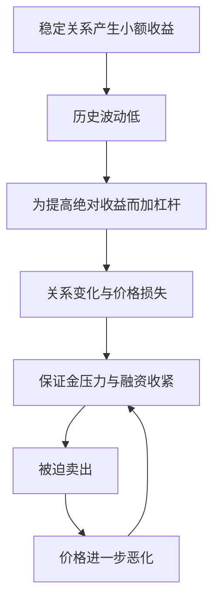
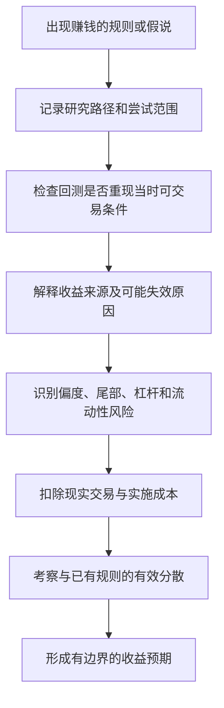

# 《Systematic Trading》第二章：系统化交易规则——深度拆解

> 原文：Chapter Two. Systematic Trading Rules，书内页码 25—48，对应用户提供 PDF 第 1—24 页。
> 材料：`/Users/minyanhua/Desktop/Systematic_Trading_chapter2.pdf`。已读取全部文字，并核对图 5、表 1、表 2 的页面图像。
> 本文是章节解读。文中的市场案例、夏普预期与成本数字均按本章写作时的语境理解，不作为当前市场估计。“解读推论”和“自拟示例”另行标出。

## x → f → f(x)

- **x**：一条历史上赚钱的交易规则，凭什么值得相信它以后还能赚钱，而且这些利润是否值得承担相应风险与成本？
- **f**：同时检查规则的研究过程、收益来源、失效机制与收益分布，再用成本和有效分散程度校正收益预期，而不是只凭回测曲线挑规则。
- **f(x)**：面对一个漂亮策略，先解释它为什么赚钱、谁在承担代价、什么变化会使它失效，再判断它是否适合进入组合，以及如何检验和管理它。

## 核心命题

**好规则需要可解释的收益来源与可信的历史检验；好系统还必须把规则放进成本、分散、杠杆和尾部风险的约束中。**

本章最后明确指出：找到最好的交易规则，没有正确设计整个交易系统重要。它没有否定规则研究，而是在纠正“只要找到神奇信号，其余问题自然解决”的思路。

### 与第一章的连接

第一章解决“为什么不能完全信任临场判断”，第二章解决“为什么也不能轻易信任一条规则”。

两章合起来：**不能用主观自信代替纪律，也不能用程序和回测代替证据。**

## 关键洞见

### 1. 先有想法不天然严谨，先看数据也不天然有罪

书内 pp. 26—28 比较两条研究路径：

| 路径 | 运作顺序 | 优点 | 最容易忽略的风险 |
| --- | --- | --- | --- |
| Ideas first，想法优先 | 收益机制假说 → 客观规则 → 数据检验 | 规则通常更简单，较容易解释收益和行为 | 不断换想法直到成功；借用已发表的“常识”，隐含继承历史筛选 |
| Data first，数据优先 | 搜索数据 → 找到模式 → 构造规则与解释 | 可以发现新模式；搜索过程显式时，较容易记录试验规模 | 无节制搜索、参数过多，以及结果出来后编故事 |

作者偏好想法优先，但承认数据多、结构变化快的某些高频场景可能适合数据优先。

关键逻辑：

**研究路径决定偏差藏在哪里；它不能自动证明偏差不存在。**

例如，先写好一个假说，再试一百个“同样有道理”的变体，只展示最好的那个，仍然存在筛选问题。反过来，数据挖掘如果完整记录搜索过程并严格检验，也不应仅因名称而被否定。

这是第二章对第一章的自我纠偏：容易理解的故事可以帮助信任，也可以制造虚假的安全感。作者要求的组合是“有解释的机制 + 严格回测”，而不是二选一。

### 2. 赚钱不等于预测更准，也不等于具有纯粹技巧

书内 pp. 31—37 给出的收益来源，比“我猜中了价格”宽得多。

| 来源 | 为什么可能有收益 | 应追问的失效条件 |
| --- | --- | --- |
| 持续性风险溢价 | 承担别人不愿承担的风险，获得预期补偿 | 风险是否被低估？溢价是否足够？ |
| 风险溢价随时间变化 | 风险偏好变化，使保险或风险资产阶段性便宜、昂贵 | 对“合理价格”的判断错了怎么办？偏离持续多久？ |
| 偏度与稀有事件偏好 | 别人愿付钱规避极端损失，或追求小概率大奖 | 自己是否实际上在出售灾难保险？ |
| 杠杆约束 | 一些投资者不能加杠杆，偏好高波动、高绝对收益资产 | 利用这一结构的人能否承受融资收紧？ |
| 流动性、规模溢价 | 资本愿意为容易交易付溢价，不易交易的资产可能提供补偿 | 需要退出时，流动性是否恰好消失？ |
| 非盈利目标和被迫交易 | 对手方为对冲、税务、监管或政策目标交易 | 约束与政策是否改变？可套利资本是否已足够多？ |
| 提供即时流动性 | 为着急成交的人承接订单、赚取价差 | 不利价格跳跃能否吞掉累计价差？ |
| 进入壁垒与工作量 | 基础设施、研究、法律与尽调工作限制竞争 | 扣掉这些投入后，还剩多少经济利润？ |
| 行为偏差 | 参与者的偏差与套利约束形成可利用的价格行为 | 偏差是否真正转化为价格效应？是否已被竞争消耗？ |
| 自我实现 | 足够多人关注同一水平，行为相互强化 | 参与者不再相信时会怎样？ |
| 纯 alpha、技巧 | 有人可能具有现有解释未捕捉的能力 | 能否排除运气、未识别风险和样本选择？ |

这些类别会重叠。例如 carry 可能同时关联风险补偿、偏度、政策结构与投资者偏好，不能把类别当成彼此独立的收益引擎。

**解读推论**：理解收益来源，就是理解自己提供了什么服务、承担了什么负担，以及哪种变化会终止这笔交换。不能指出某个具体“输家”，并不意味着没有收益来源；风险溢价不必对应一个判断愚蠢的对手方。

作者还提醒，因投入时间和专业劳动获得的回报，可能只是成本补偿，不能全部记作超额技巧。

### 3. 同样的夏普率，可能对应完全不同的持有体验和破产风险

书内 pp. 32—34 的图 5 与表 1，是本章最重要的理解关口。

夏普率主要压缩平均超额收益与波动率的关系，不能完整描述收益发生的方式。作者展示两种均值、波动率和夏普率相同，但偏度相反的分布。

下表选录原文表 1；这是作者构造的对比，不是所有正负偏策略的固定参数。

| 指标 | 负偏示例 | 正偏示例 |
| --- | --- | --- |
| 年化夏普率 | 1.0 | 1.0 |
| 正收益日占比 | 59% | 46% |
| 日收益中位数 | +1.4% | −0.6% |
| 平均盈利／平均亏损幅度 | 0.8 | 1.4 |
| 预期年度最差单日收益 | −22% | −10% |
| 预期年度最佳单日收益 | +10% | +22% |

这不是两个“差不多的系统”：

- **正偏的典型画像**：常见小亏，偶有大赚，类似买保险。坚持的难点往往是长期支付成本、等待少数大机会。
- **负偏的典型画像**：常见小赚，偶有大亏，类似卖保险。管理的难点往往是尾部损失在平静历史中尚未充分显现。

直观形状如下，横向表示单期收益；是示意，不按原图比例绘制：

```text
负偏：左侧长尾                  常见小赚
      大亏 ← ······· ▂▃▅▇█▆▂

正偏：常见小亏                  右侧长尾
            ▂▆█▇▅▃▂ ······· → 大赚
```

**精确边界**：偏度描述分布的不对称性，不能单靠偏度符号推导胜率、最大亏损或每次盈亏大小。上述画像是本章关注的典型策略机制，不是普遍数学定理。趋势跟随也不保证任意期间都正偏。

作者在结尾特别澄清，他并非反对所有负偏策略，他自己的系统约三分之一属于这一类别。这是当时的配置说明，不是建议读者复制的比例。

### 4. 低波动最危险的误读，是把“没发生”当成“不会发生”

书内 pp. 44—45 用希腊国债相对价值交易说明一个反馈过程：买入四年期、卖出五年期国债；平时关系稳定，收益很小、观测波动也很低，于是使用较高杠杆。

后来救助前景的不确定性使两种债券的关系脱离历史经验。一边的损失大于另一边的盈利，经纪商又提高保证金要求，交易者被迫在最差时点平仓。



真正的危险并非“杠杆倍数高”这一个数字，而是：

**平静时的低波动估计 + 压力时的关系变化 + 资金期限和保证金约束。**

本章区分可建模风险与模型未充分覆盖的风险：近期波动率是有用尺度，却不等于完整风险。拥挤交易还会把个人平仓变成集体退出，进一步放大反馈。

### 5. 提高夏普率靠的是有效独立机会，不是机械增加交易次数

书内 pp. 41—43 介绍主动管理基本法则的简化表达：在单位机会能力相同、下注充分独立等条件下，绩效随独立下注数量的平方根增长。

**解读时必须把“独立”圈出来。**

- 四个不相关、质量相当的机会，理论上可以把夏普率提高到约两倍。
- 四次围绕同一行情的操作，可能只是在重复同一个风险。
- 把月度策略改成日内策略，不能假定预测能力仍然相同。
- 加速还会提高交易成本，所以毛收益改善不等于净收益改善。

书内 p. 48 表 2 给出理论情景：

| 持有期 | 理论成本前 SR | 平均期货成本后 SR | 平均 spread bet 成本后 SR |
| --- | ---: | ---: | ---: |
| 1 个月 | 0.40 | 0.37 | 0.28 |
| 1 周 | 0.83 | 0.71 | 0.27 |
| 1 天 | 1.8 | 1.2 | −0.75 |
| 半天 | 2.6 | 1.4 | −2.5 |
| 1 小时 | 5.2 | 0.28 | −16.4 |

这组数字假设加速后的成本前优势能够实现，再扣作者设定的成本。它不是实测收益承诺，也不是当前经纪商报价比较。

重要的是关系：**理论机会增多的收益，可能被成本反向吞掉。** 在该示例里，即使便宜的期货到了每小时交易，净夏普也显著恶化。

作者因此强调跨品种、跨资产类别分散。但分散的有效性取决于策略收益的相关性及其稳定程度，不能仅靠品种名称不同来保证。

## 一套完整的规则筛选逻辑

把上述洞见连起来，可以形成下面的研究流程。这是本章逻辑的整理，不是作者提供的现成算法。



### 回测赚钱、实盘失败，先分清两种问题

本章 pp. 29—30 的区分很重要：

1. **它过去就没有真正可赚的钱。** 过拟合、提前使用未公布的数据、幸存者偏差、成本遗漏、不能实施的卖空，或样本过短而遗漏灾难，都可能制造收益幻象。
2. **它过去有效，后来世界变了。** 竞争消除了错价，市场结构变化，或策略拥挤改变了退出条件。

两种诊断的含义不同：前者要求修复研究有效性，后者要求检验机制变化。不能把所有失败都归因于“市场变了”，以此保护原来不可靠的回测。

## 风格分类：不只看“趋势还是均值回归”

书内 pp. 38—45 的分类可以转成策略说明书：

| 维度 | 需要说明什么 | 为什么影响系统设计 |
| --- | --- | --- |
| 静态／动态 | 获取资产持有收益，还是通过预测调整头寸 | 区分风险再平衡与主动价格预测 |
| 正偏／负偏 | 收益来自少数大赚，还是常见小赚与罕见大亏 | 影响体验、风险预算和尾部评估 |
| 快／慢 | 机会持续多久，数据和执行要求多高 | 决定成本、样本量、容量和基础设施 |
| 技术／基本面 | 输入价格，还是微观、宏观数据，或混合 | 决定数据可得性、发布日期与可比性 |
| 单品种／多品种 | 真正独立的收益机会有多少 | 决定分散收益与实施复杂度 |
| 杠杆与流动性 | 是否依赖融资和正常交易条件 | 决定压力下能否继续持有 |
| 逆势／顺势及拥挤度 | 在市场下跌时加仓还是退出，别人是否也这样做 | 决定压力时买卖流和集体退出风险 |

### 为什么会交易的组合，还可能被称为“静态”？

作者区分四种程度：买入持有；保持现金权重；初始按风险配置；持续保持风险配置。后两者涉及波动率标准化。

这里“静态”不是绝对不下单，而是没有通过主动预测未来价格来改变方向。为了维持风险配置而交易，与为了预测涨跌而交易，是两件事。

作者用苹果和微软说明：价格相同，不代表风险相同；即使价格涨跌后回到起点，波动率也可能已经改变。因此等资金配置不等于等风险配置。

**边界补充**：完整组合风险还依赖相关性；不能把按单资产波动率缩放，直接当成所有情况下都实现严格的等风险贡献。

波动率标准化在本章中的更大作用，是把不同资产放到较一致的风险尺度，方便统一应用、组合交易规则。它统一的是估计风险单位，没有消灭模型风险。

## 可实现的夏普：读的是预期校准，不是今日收益表

书内 pp. 46—47 给出作者当时的判断，适用于他所讨论的投资方式与成本语境：

| 情景 | 作者给出的年化 SR 预期 |
| --- | ---: |
| 单只股票长期持有 | 约 0.15 |
| 国内行业分散股票组合／指数 | 约 0.20 |
| 全球股票分散 | 约 0.25 |
| 多资产静态配置 | 约 0.40 |
| 多种规则作用于单一品种 | 约 0.40 |
| 跨资产类别的系统化动态交易 | 约 0.80，即前项约两倍 |
| 有能力的半自动交易者，单品种 | 作者乐观假设约 0.25 |
| 半自动交易者，跨资产分散 | 作者推测不超过约 0.50 |

这些数值是经验估计与预测，不能看作数学上限，更不能直接用于当下预期回报计算。作者自己也提到少数其他系统化基金可能持续超过 1，并警惕部分高夏普来自负偏。

本章用一个虚构例子展示统计指标与财富结局的分离：前 20 年交替赚 100% 和 65%，第 21 年亏 100%。账户归零后，按整段年度收益计算的夏普仍约为 1.7。

它不是说“夏普没有用”，而是：**账户是否生存，不能交给一个均值与标准差的比值代为回答。**

## 实践指引

以下用于策略学习与研究，不提供买卖标的或仓位参数。

### 1. 给每条规则写一页“可反驳说明书”

依次写明：输入与客观条件、收益来源、可能的替代解释、试过的假说与参数、历史可实施条件、成本、尾部风险、预期失效情景、与已有组合的相关风险。

自拟示例：“价格上涨后继续买入”不够。还需要说明为何预期存在延续、适用期限、何时延续会变成反转，以及成本后是否仍有优势。

### 2. 把研究失败记录下来

一个成功回测的可信度，与此前失败的搜索过程有关。只保存获胜规则，会让想法优先也变成看不见的数据挖掘。

这是对本章关于显式与隐式拟合讨论的应用推论；完整的拟合方法要等第三章，不能把本章当成验证方案已经完备。

### 3. 为每条规则写出两种“难受的日子”

- 趋势类：连续小亏、反复反转，会不会诱使你在大趋势前停止？
- 相对价值或卖保险类：罕见大亏、流动性消失、追加保证金，会不会使你必须在关系修复前退出？

这些是典型压力情景，不是对所有风格收益分布的保证。

### 4. 改进组合前，先辨认改进来自哪里

分清是新增独立收益来源、降低成本，还是只是提高杠杆、加快交易或接受了尚未出现的尾部损失。

只有前两者也仍需验证；后几种更不应仅凭夏普或净值变漂亮，就记作研究进步。

## 例子列表

- **想法优先与数据优先的对照**：好故事也有隐含筛选风险，数据搜索也可被记录和约束。← 展示 **f** 的研究审查。
- **2006 年买信用违约保险与 2009 年买风险资产**：不同阶段，风险的价格可以变化。← 展示 **f** 的收益来源分析；案例均按原文语境。
- **买卖保险与期权式收益**：相同夏普可能对应相反的偏度与持有体验。← 展示 **f** 的分布审查。
- **VIX、V2TX 期货**：作者用它们说明保险买卖与偏度、收益预期的关系。← 展示 **f**；并非直接买入现货波动率指数，也非今日收益断言。
- **杠杆限制下偏好高风险资产**：投资约束可能影响资产价格与风险调整收益。← 展示 **f** 的结构性解释。
- **央行汇率政策与 2015 年瑞郎事件**：收益机制依赖政策，退出条件可能突变。← 支撑 **x**：历史有效不保证机制永久存在。
- **年末税务交易、保险公司买长期债券**：交易者可能为收益最大化之外的目标下单。← 展示 **f**。
- **长期持有不流动资产与即时做市**：两者都涉及流动性，但提供的服务和风险不同。← 展示 **f**。
- **技术设施与私企尽调**：高回报可能只是投入和工作量的补偿。← 展示 **f** 对纯技巧的审慎归因。
- **斐波那契水平**：作者以共同信念讨论自我实现，也承认持续性难判断。← 检验 **f** 的解释边界。
- **苹果与微软的配置**：等现金不等于等风险，风险配置可能需要再平衡。← 展示 **f(x)**。
- **四次独立下注与提高交易频率**：次数只有在能力和独立性等条件下才转化为绩效。← 展示 **f(x)**。
- **希腊四年与五年国债价差**：低观测波动、杠杆和保证金约束联手制造被迫退出。← 检验 **f** 的风险边界。
- **LTCM 与 2007 年 Quant Quake**：拥挤策略的共同退出会放大损失。← 支撑 **x**。
- **前 20 年高收益、第 21 年归零的虚构策略**：较高的全样本夏普仍可能伴随财富归零。← 支撑 **f(x)** 的评价标准改变。
- **持有期与成本表**：理论成本前收益随频率增加，净收益却可能转负。← 展示 **f(x)**。

## 结论列表

1. 可信规则需要合理的收益解释与可信检验，二者不能互相替代。
2. 想法优先和数据优先都可能过拟合，关键在于完整研究过程。
3. 收益可能补偿风险、流动性、约束或劳动，不必来自更高预测能力。
4. 找到收益机制，也意味着找到应监测的失效条件。
5. 同样的夏普率可以对应完全不同的尾部风险和持有体验。
6. 高胜率不是低风险的充分证据，平静样本可能遗漏罕见损失。
7. 低波动可以支持风险缩放，但不能证明关系在压力下稳定。
8. 杠杆会把暂时的价格偏离，变成无法继续等待的资金问题。
9. 提高交易次数不等于增加独立机会，成本会改变加速的收益。
10. 多资产、多规则的价值取决于有效分散，不能仅靠数量判断。
11. 为维持风险配置而交易，不等于主动预测价格。
12. 组合规则应考察机制互补与风险约束，而非只追逐单条规则的最高历史夏普。

## Q-A 问答链

### Q-A 问题结构图


### Q1：回测赚钱为何还不可信？

- **结论**：回测既可能制造过去不存在的机会，也不能保证真实机会持续。
- **形式化**：历史模拟赚钱 ≠ 当时可实现 ≠ 未来仍有效。
- **论证**：① 回测可能漏掉发布日期、成本和交易限制。② 即使历史可实现，也可能靠筛选偶然获胜。③ 即使过去真实有效，机制也可能改变。
- **边界**：这并非否定回测，而是要求回测承担与其证据能力匹配的作用。

**Q1 → Q2**：因为回测结果依赖研究过程，尚未解决哪种过程更可靠，所以要检查想法优先能否免除这些问题。

### Q2：先有好想法就更可靠吗？

- **结论**：想法优先有解释优势，但无法自动免除筛选偏差和叙事谬误。
- **形式化**：好想法 + 反复择优 ≠ 独立证据。
- **论证**：① 想法通常缩小规则范围。② 但研究者仍可能不断更换想法和变体。③ 最终展示的故事因此可能掩盖整个搜索过程。
- **边界**：数据优先也需要约束；作者承认它在一些数据充分且结构变化快的场景中有用途。

**Q2 → Q3**：因为故事的吸引力不足以证明持续盈利，所以必须进一步辨认它指向什么真实收益机制。

### Q3：规则赚的钱到底是什么？

- **结论**：它可能是风险与约束的补偿，也可能来自行为效应，不能直接归为纯技巧。
- **形式化**：观察到的收益 → 拆解风险、约束、成本、行为与未解释部分。
- **论证**：① 市场参与者的目标和限制不同。② 承担别人不愿承担的负担可能产生补偿。③ 只有排查替代解释，才能审慎讨论剩余优势。
- **边界**：机制分类可以重叠；找到一个可能解释，不等于已经识别真正原因或证明因果。

**Q3 → Q4**：因为收益可能是承担风险的补偿，但均值不能说明承担了哪种损失，所以要检验分布形状。

### Q4：夏普一样，风险就一样吗？

- **结论**：夏普相同，只说明均值与波动率之比相同，不说明尾部风险相同。
- **形式化**：相同 SR + 不同偏度 → 不同亏损路径与承受要求。
- **论证**：① 夏普压缩均值和标准差。② 两个分布仍能具有相反长尾。③ 因此只比较夏普，会遗漏策略最难承受的情景。
- **边界**：偏度也不是完整风险指标；相同偏度仍可能具有不同尾部厚度、流动性和最大损失。

**Q4 → Q5**：因为风险可能隐藏在尚未发生的尾部，便要继续问为什么平静历史反而会诱使人扩大危险。

### Q5：低波动为何也会致命？

- **结论**：低观测波动若诱发高杠杆，关系失效和融资压力就可能触发被迫平仓。
- **形式化**：低波动估计 → 高杠杆 → 冲击与追保 → 被迫退出。
- **论证**：① 稳定价差使历史风险看起来很低。② 放大头寸后，关系变化带来的损失被放大。③ 保证金约束剥夺了等待修复的选择。
- **边界**：低波动资产和杠杆并非必然危险；关键在估计误差、尾部、流动性及融资条件的组合。

**Q3 → Q6**：因为理解收益来源后仍要寻找提升绩效的方法，所以要检验增加下注次数是否真的增加有效机会。

### Q6：多交易就能提高夏普吗？

- **结论**：只有增加质量相当的独立机会，并覆盖新增成本，交易增多才可能改善绩效。
- **形式化**：有效广度 ≠ 下单次数；净优势 = 毛优势 − 成本拖累。
- **论证**：① 简化法则依赖独立下注和稳定能力。② 加速可能改变预测机制，并重复同一风险。③ 成本随交易增长，使毛夏普上升也可能伴随净夏普下降。
- **边界**：不能据此否定高频交易；作者指出它需要专门的执行、数据、设施与风险控制。

**Q5 → Q7**：因为单条规则可能因尾部和资金约束失去生存能力，所以选择规则时必须纳入组合风险与持有条件。

**Q6 → Q7**：因为机械加速不能可靠提高绩效，所以要考察跨品种和跨机制是否提供真正有效的分散。

### Q7：那该怎样选一组规则？

- **结论**：选择有依据、成本可覆盖、风险可承受且在不同环境下具有互补性的规则组合。
- **形式化**：规则可信度 + 机制互补 + 实施约束 → 可研究的系统方案。
- **论证**：① 先排除回测幻象和无法解释的风险。② 再检查规则之间是否共享隐藏敞口。③ 最后把组合放入现实成本、资金和执行条件中评估。
- **边界**：本章提供原则，没有给出完整拟合和权重算法；“多风格”也不保证危机时相关性不会上升。

## 局限与盲区

### 1. 夏普率可以用于非对称分布，但不能单独概括其风险

作者为了强调偏度，把只关注夏普与分布对称联系得很紧。更精确的说法是：计算夏普不要求收益正态或对称；问题在于用它独自排序，会忽略高阶分布和资金生存条件。即使对称，也未必没有厚尾。

### 2. 保险类比解释补偿，不保证任何一方必然获利

原文把保险买方描述为长期必然亏损，表达过强。应理解为在含定价加载的合理模型下，保险买方通常支付预期成本来转移风险，而非每个实现路径必然亏损。保险卖方也可能定价错误或破产。

### 3. 主动管理法则是条件关系，不是加速盈利的公式

本章已经指出能力跨期限不恒定、成本不可忽略。还应注意收益相关性和机会质量不等。日夏普按时间平方根年化，也依赖收益相关结构等条件；不能不加检查地套用。

### 4. 夏普预期与工具可行性具有写作时代边界

作者当时对股票超额收益、低利率、数据历史长度和某些风格能否系统化的判断，都不能直接当成今日事实。例如“数据难转成算法输入”描述的是实施门槛，不是逻辑上永久不可能。

本笔记未作当前收益预测，也未验证案例在此后的表现。

### 5. 很慢的主动规则不应被一概判为无效

作者对慢速规则较为否定，主要担忧机会少、统计证据弱与收益低。但“难以检验”不等于“必然没有经济价值”。是否有跨市场样本、是否依赖长期风险溢价，仍需分别讨论。

### 6. 来源分类和风格标签不能替代因果识别

“行为偏差”“流动性溢价”“纯 alpha”都可能被用作事后解释。真正的挑战，是给出能区分不同解释的证据，并明确机制失效的观察条件。

本章提供的是判断规则的思维框架；第三章将继续处理其中最关键的证据问题：如何避免把历史噪声拟合成可相信的策略。
