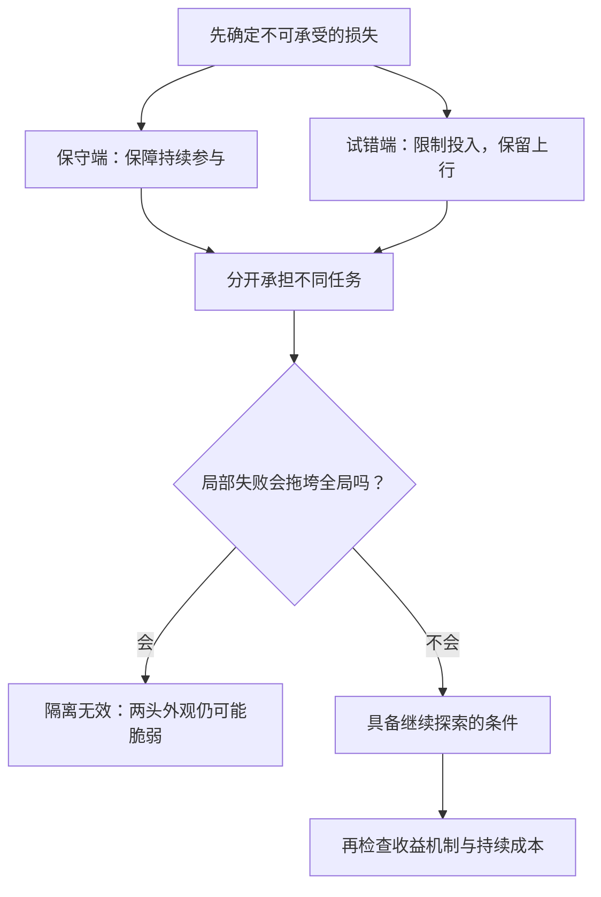

# 《反脆弱》第十一章：千万别嫁给摇滚明星——深度拆解

> 依据：用户提供的第十一章 Markdown 原文及章末注[26]。人物职业、历史增长和生物行为等均按作者叙述分析，未作独立核验。本章的婚配、饮酒、训练与社会政策例子，是作者用来说明结构的材料，不在本文中转化为行为建议。以下检验框架与应用场景为本文推导。

## x → f → f(x)

- **x：当罕见风险难以测准时，怎样既避免一次失败毁掉全局，又保留从不确定性中获益的机会？**
- **f：先排除不可承受的毁灭性敞口，再把保障生存的部分与承担有限风险、争取上行的部分分开；不让一个看似温和的统一方案，把整个系统暴露在同一套错误估计之下。**
- **f(x)：先确定哪些损失不能发生，再限定试错预算、隔离失败传播并保留退出能力；评价策略时，看它能否活着走完路径，而非只看名义回报、平均强度或两端比例。**

因为一次不可逆失败可能终止所有后续机会，作者把生存置于收益之前；把这个顺序落实为结构，就形成了保守底座与开放探索相结合的杠铃。

## 核心命题

**先保证坏运气不会终止游戏，再让好机会有进入的空间。杠铃的价值来自风险隔离与有利不对称，而不是同时选择两个极端的外观。**

第十章说明“减少下行、保留上行”的方向，第十一章回答怎样安排：有些部分极其谨慎，有些部分开放试错。结尾又明确限定，杠铃结构不是反脆弱的充分条件。因此，不能把本章简化成“凡事走极端”或“九成保守、一成冒险”的配方。

## 关键洞见

### 1. 生存有逻辑优先级，不能与收益平行打分

破损包裹的比喻说明：环境恢复，不代表损坏自动恢复。类似地，先经历无法承受的损失，之后再出现好机会，也可能已经没有参与资格。

这就是本章路径依赖的实质：**终点收益不仅取决于有哪些事件，还取决于事件发生的顺序，以及中途是否越过不可恢复的边界。**

用一个本文自拟的数字例子说明：某项目只有一笔维持运转的资金，第一阶段若耗尽，就无法执行原本可能获利的第二阶段。把第二阶段的潜在成功放进平均收益，不能替代第一阶段的生存条件。若有备用资金或可恢复机制，结论就需要相应调整。

作者由此批评脱离灾难损失谈回报、脱离事故风险谈效率。较严谨的读法不是“效率没有意义”，而是：**只计算顺利状态的效率，遗漏了实现该效率所依赖的存续条件。**

### 2. 杠铃不是平均分配，而是让两类任务各司其职

杠铃有两个不同的模式，比例不必对称，也不要求两端都具有同样的风险。

| 部分 | 主要任务 | 关键问题 |
|---|---|---|
| 保守端 | 保住基本生活、履约和持续参与的能力 | 在相关冲击下，它是否仍能提供保障？ |
| 试错端 | 承担可承受失败，保留较大上行 | 最坏损失是否真被限定，收益能否兑现？ |
| 两端之间 | 防止局部失败危及整体 | 债务、担保、时间和共同依赖会不会把失败传回去？ |

第三行是本文对机制的展开。本章没有系统列出这些隔离条件，但如果它们缺失，“保守端”就可能只在标签上保守。

### 3. “中等风险”的问题是被低估，而不是数值处于中间

作者批评中间路线，因为风险分布估计容易出错。把所有资源交给一组被称作“中等风险”的安排，可能使整个系统依赖同一套测量假设。

相比之下，若风险端投入被真正封顶，即使低估了那部分的失败概率，整体损失仍可能受到结构约束。它减少了对精确概率知识的需求，并没有让概率或价格从此不重要。

因此，需要分清两种“中间”：一种是隐藏巨大下行、却被包装成温和的风险；另一种是经过约束、真实可承受的适度风险。本章有力批评前者，却没有证明后者在所有场景下都劣于极端组合。

### 4. 90/10是解释损失边界的例子，不是普遍比例

原文假设九成资金为安全现金，且不受通胀影响，一成投入极高风险证券，因而声称最大损失不超过一成。这个结论依赖几项前提：

1. 九成部分在考察情景中确实保全，而非仅被命名为安全。
2. 风险端损失不超过投入，不附带额外债务或追索责任。
3. 风险端失败不改变保守端的安全条件。
4. 比较是在明确的一段期间内，而非无限补仓和反复重启。

若每次失败都从保守端再拿出资金，单轮一成上限不等于长期累计损失也只有一成。反过来，剩余一成能否带来足够上行，也要看所持有的具体权利与成本；“极高风险”不自动等于“收益无上限”。

这不是替本章设计资产配置，而是检验其示例中的逻辑条件。原文比例不能脱离这些假设直接执行。

### 5. 杠铃可以分空间，也可以分时间，但都需要保留能力

作家用稳定、下班后不再占据心智的工作支持自主创作，是空间上并行的双重安排。工作十年后转向高不确定职业、必要时回归旧业，则是分阶段的安排。

二者共有的机制是：不强迫探索活动立刻供养全部生活。但“稳定工作”如果耗尽时间与精神，就无法支持另一端；“可以回去”如果没有实际岗位、技能或关系基础，也只是口头保障。

高强度工作与充分恢复的例子则强调节奏。它不证明所有任务都适合集中冲刺，更不能把强度越大越好当成结论。有效性仍取决于任务性质、恢复条件和实际后果。

## 实践指引

### 场景一：在保有工作时尝试创作或新业务

先列出基本生活、家庭责任和必要支出，再划出明确的时间与资金预算。让探索拥有自主空间，不要求它马上替代工资；同时检查本职工作是否真的给探索留下精力。

每轮结束后决定继续、停止或改变方向，而不是因“迟早会成功”持续从生活底座抽血。这里的保护对象是继续选择的能力，不只是某个账户数字。

### 场景二：团队尝试新产品

让维持现有服务的资源与实验预算分开。实验不仅要限制花费，也要限制客户影响、人员负担和对共同基础设施的占用。

一个小团队使用很少经费，却能修改全体客户的数据，仍可能造成巨大下行。因此，试验规模不能只按投入金额衡量，还要看失败会触及谁、是否能恢复。

### 场景三：评估“高增长、高效率”的方案

要求同时呈现顺利情况下的表现，以及导致中断的条件。追问：收益出现之前要承担哪些承诺？最坏状态会否使组织无法履行基本责任？如果是，先处理这条路径，再谈提高回报。

这不是要求零风险，而是识别哪些损失只是一次挫折，哪些会取消所有后续选项。

### 场景四：职业分阶段转换

把回归路径具体化：哪些技能要维持，哪些人或机构仍愿意合作，允许探索多久，出现什么情况就启动替代方案。

先安全后冒险并不天然构成杠铃；若旧路径已经完全关闭，就必须重新评估转换后的生存条件，不能借过去的稳定替现在担保。

### 一份行动前检查表

- **保护对象**：什么能力或责任不能被一次失败摧毁？
- **损失边界**：投入限额是否也是实际最大损失，还是另有追索与连带后果？
- **隔离程度**：两端是否依赖同一客户、收入来源或基础设施？
- **上行机制**：成功如何带来收益，是否存在现实兑现途径？
- **时间预算**：能试多少次、等待多久，何时停止追加？
- **反证条件**：什么事实说明“安全端”不安全，或试错端没有值得保留的上行？

## 例子列表

| 原文例子 | 逻辑位置 | 能说明与不能说明的内容 |
|---|---|---|
| 破碎包裹不能随环境恢复而复原 | 支撑 x | 说明不可逆损害；不是所有损失都不可恢复 |
| 麻醉与手术的顺序 | 展示 f 的前提 | 说明顺序影响结果；本文不将其作为医疗指导 |
| 高速驾驶却无法到达目的地 | 支撑 x | 区分名义速度与有效到达，不提供风险定量 |
| 大学捐赠基金高收益后遭重损 | 支撑 x | 说明收益记录可能遗漏灾难敞口；本章未提供完整数据 |
| 债务推动GDP增长 | 支撑 x | 提醒检查未来承诺；不能证明所有负债增长都不可持续 |
| 九成现金、一成高风险证券 | 展示 f | 在严格条件下限制单期损失；不是通用配置比例 |
| 牛排与甜点分别上桌 | 展示 f | 说明不同功能可分开；味觉类比不能证明经济策略优越 |
| 会计师与摇滚明星的婚配类比 | 展示 f | 表达稳定与刺激分开；不证明真实成本已隔离 |
| 稳定工作支持自由写作 | 展示 f(x) | 展示生计与探索分工；取决于工作是否留下精力 |
| 编辑工作十年后转向冒险职业 | 展示 f(x) | 展示阶段转换；回归能力须真实存在 |
| 行动者隐退后思考，以及西姆农集中写作 | 展示 f(x) | 展示时间分段；不是普遍最优工作节奏 |
| 保留小压力、避免严重伤害 | 展示 f | 表达试错与保护分工，不是具体训练或育儿方案 |
| 饮酒、举重、社交与阅读的两端安排 | 展示 f | 体现作者广泛使用杠铃比喻；各领域效果须分别论证 |
| 戴利奥关于不可接受灾难的铁律 | 展示 f | 强调生存约束；不代表现实风险已能证明为零 |

## 结论列表

1. 无法活到收益兑现的时刻，名义回报就失去了实际意义。
2. 不可逆损害使事件顺序成为策略的一部分，平均表现不能替代路径分析。
3. 杠铃策略把生存保障与有限试错分开，而不是机械地选择两个极端。
4. 中等风险的标签不能证明损失温和，尤其当标签依赖不可靠的尾部估计时。
5. 真正的损失上限来自结构约束，不能仅靠投入比例或心理接受来保证。
6. 单轮损失有限不代表反复追加后的累计损失有限。
7. 安全底座若耗尽探索所需的时间与精力，也会使杠铃失去功能。
8. 杠铃结构不是反脆弱的充分条件，还需要有效上行、可承受成本和失败隔离。

## Q-A 问答链

### Q-A 问题结构图

### Q1：为什么先保命再谈收益？

- **结论**：一次不可恢复的失败可能取消全部后续获益机会。
- **形式化**：先失去参与资格 → 后来的好机会无法兑现。
- **论证**：① 有些损失会破坏继续行动的基础。② 之后条件改善不一定修复基础。③ 所以收益评估必须以可存续路径为前提。
- **边界**：可恢复的小损失不等于毁灭；要先明确系统边界与恢复能力。

**Q1 → Q2**：Q1 要求守住生存条件，但“只承担温和风险”听起来已经足够，因此需要检查温和标签是否可靠。

### Q2：温和冒险为什么也危险？

- **结论**：风险看似温和，可能只是严重损失尚未被模型识别。
- **形式化**：估计风险较低 ≠ 实际损失受限。
- **论证**：① 罕见事件难以从有限记录中估准。② 全部资源可能依据同一套估计安排。③ 一次共同误判便可能威胁全局。
- **边界**：并非所有中等风险都隐藏灾难，不能只按名称否定方案。

**Q2 → Q3**：Q2 指出风险估计可能失灵，下一步就要寻找对准确估计依赖较少的安排。

### Q3：两头配置怎样减少误判？

- **结论**：若保守端能独立存续、风险端损失被限定，就不必准确预测每次试错的成败。
- **形式化**：守住底座 + 限额试错 → 减少对概率精度的依赖。
- **论证**：① 基本责任不靠每次冒险成功来履行。② 局部失败在已接受的范围内结算。③ 因而多次探索仍可能继续。
- **边界**：这依赖真实的安全与隔离，还没有证明探索收益足够大。

**Q3 → Q4**：Q3 依赖“局部失败被限定”，但小投入未必带来小后果，所以必须检查上限来自哪里。

### Q4：小额投入就能限制损失吗？

- **结论**：只有投入之外不再附带重大连带后果，小预算才可能对应小损失。
- **形式化**：投入限额 + 无额外追索 + 失败隔离 → 有效损失边界。
- **论证**：① 资金只是资源与责任的一部分。② 债务、担保或共同依赖可能放大失败。③ 因此应限制全部后果，而非只限制初始支出。
- **边界**：隐藏依赖很难完全列尽，边界需要持续复核。

**Q4 → Q5**：Q4 表明隔离要检查资金之外的后果；推广到职业时，就必须看稳定工作是否仍占用探索所需的资源。

### Q5：安全工作真能托住探索吗？

- **结论**：稳定工作只有同时留下可用时间与精神空间，才可能支持自主探索。
- **形式化**：生计稳定 + 心智可用 → 探索有底座。
- **论证**：① 工资可以降低立即变现的压力。② 探索也需要注意力与持续投入。③ 若本职工作耗尽这些资源，收入保障就无法完成支持功能。
- **边界**：闲职不易获得，岗位要求也会变化；阶段转换还须验证回归路径。

**Q5 → Q6**：Q5 说明功能分工必须在现实中有效；即使两端都能运行，仍需回答这样的组合是否一定因变化受益。

### Q6：有了杠铃就反脆弱吗？

- **结论**：杠铃可以提供生存与探索条件，但不能保证探索具有正面价值。
- **形式化**：两端结构 ≠ 自动受益；仍需上行机制、成本与适用范围。
- **论证**：① 限制损失可以增加强韧性。② 反脆弱还要求某类变化带来有利反应。③ 若试错只有成本或收益无法兑现，两端结构仍不能完成这一步。
- **边界**：原文把杠铃称作必要而非充分条件；是否所有反脆弱机制都必须采取这种结构，本章没有完整证明。

## 局限与盲区

**“所有解决方案都是杠铃”超出了本章展示的证据。** 本章给出大量相似类比，却未逐一证明这些领域具有相同的收益反应。结尾强调非充分条件是重要限定，但不能替代必要性的证明。

**“零毁灭概率”更适合作为设计目标。** 可以主动避免已知致命敞口，却很难仅凭一个配置标签证明未知风险为零。安全端本身的共同依赖、环境变化与维持成本仍须检查。

**婚配类比隐藏了成本归属。** 原文及注[26]承认行为解释并不确定。从鸟类推到人类，再推到基因优势或快乐，并不是本章已经完成的实证论证。对一方有利的安排也可能把风险转给伴侣与家庭；这不等于整体消除了下行。

**医疗、饮酒与训练例子不能跨域照搬。** 本章未在这些段落提供足够的适用条件或对照证据，尤其“部分日子不饮酒、其余自由饮酒”的断言不能因符合两端形状就成为可执行建议。举重与压力的例子也只宜保留结构启发。

**社会群体的两极划分不等于政策论证。** 贵族、冒险家、中产阶层以及不同国家作家的对照，包含作者强烈的价值判断与概括，不能单凭这些叙述推导公共政策或职业优劣。

**有些领域可以分开，有些不能。** 食物分开上桌容易做到；收入、创作、信誉、健康和家庭责任却常互相影响。应用本章时，最重要的检验不是是否看起来像杠铃，而是：失败是否真的被隔离，上行是否真实存在，以及谁在承担没有写进账本的成本。
