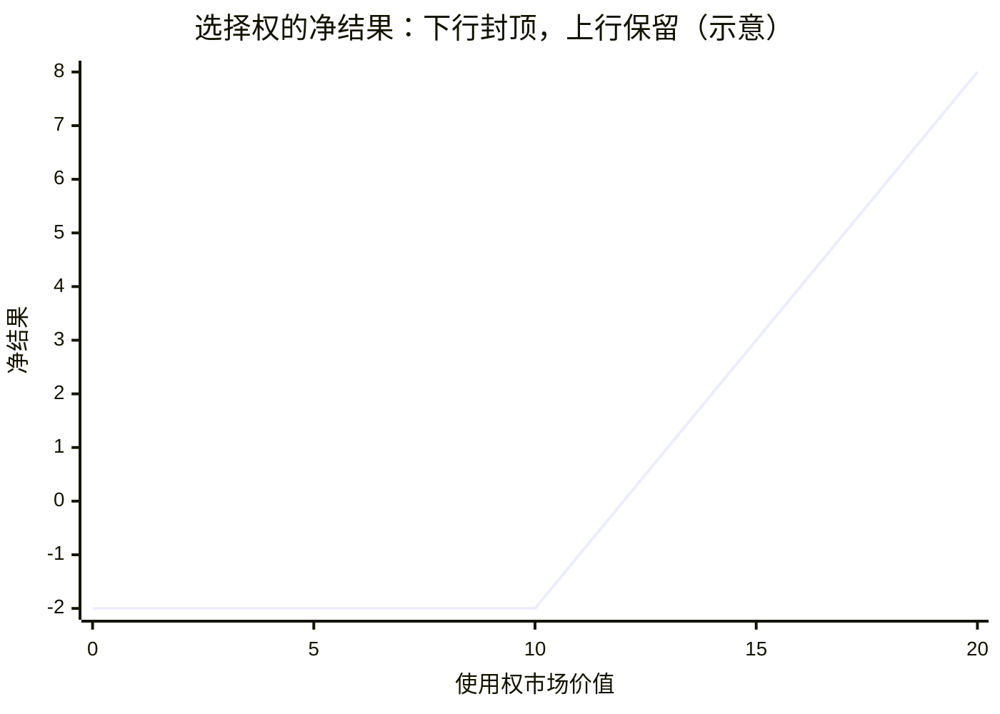
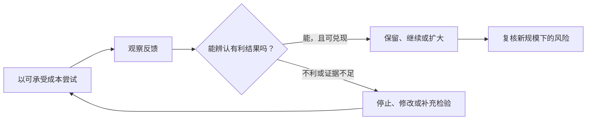

# 《反脆弱》第十二章：泰勒斯的甜葡萄——深度拆解

> 依据：用户提供的第十二章 Markdown 原文及章末注[27]—[29]。本文分析作者的论证，不将古代轶事、社会群体比较、房地产和生物学描述视为已经独立核验的事实。原文的图片链接不是本仓库资源，以下用独立示意图呈现核心机制，不复原原图数据。应用框架、数字示例和边界条件为本文推导。

## x → f → f(x)

- **x：未来难以预知、知识总不完整时，怎样仍然抓住好机会，而不必为每次判断错误付出同样巨大的代价？**
- **f：获得成本可承受的选择权，把行动安排为“有权但无义务”；先以有限代价接触不确定性，再根据反馈放弃不利结果、保留并利用有利结果，使少数成功不必依赖每次预测正确。**
- **f(x)：从“我能否事先猜中”转向“错了能否停、对了能否继续、收益能否归我”；为试错设置预算，保护退出权、观察窗口和扩大成功的能力，同时计入选择权的价格与他人承担的成本。**

因为缺乏完整知识不等于必须承担无限后果，作者把重点转向结果筛选与收益结构；这种结构若能以合理成本维持，就降低了对事前预测的依赖。

## 核心命题

**判断未来与从未来获益不是同一件事。你可以不掌握完整的成因与预测，只要错误的代价受限、成功的好处被保留，而且能够在结果出现后作出有效选择。**

第十章提出有利的不对称，第十一章用杠铃分开生存与冒险，本章则为冒险端提供更具体的机制：选择权。它不仅是一份金融合同，也是一种“先观察、再决定是否继续”的行动能力。

## 关键洞见

### 1. 泰勒斯的优势未必只是比别人更会预测

亚里士多德版本强调泰勒斯用天文学预见橄榄丰收；塔勒布则要求看他签下的权利：事先支付较小代价，保留使用压榨机的机会，却不必在需求不利时继续承担同等规模的成本。

作者改变了解释对象：**不是只问横轴上的需求能否猜中，而是问需求变化如何通过合同变成纵轴上的收益。** 同一判断，配上不同责任结构，可能有完全不同的后果。

但需要区分两个命题：故事可以说明一种有限下行的获利机制，不等于已经证明历史上的泰勒斯完全没有预测能力。原文也没有提供完整合同，不能由叙事直接核实所有法律与成本条件。

### 2. “有权但无义务”改变了收益曲线的形状

若条件不利，可以不行使权利；若条件有利，可以行使。这使损失端不再随环境恶化无限延伸，而上行仍有进入空间。

下面是本文构造的简化例子：预付成本为2，约定使用成本为10；市场价值低于10时放弃，超过10时才行使。净结果可写为：**净结果＝较大者（市场价值－10，0）－2。** 数字只说明形状，不是对泰勒斯交易的估值。

图中：市场价值低时，最多损失预付的2；高时，收益随之增加。转折处表现出非线性。在这个示例里，行使权利从10以上开始，但净结果要超过12才转正——**值得行使不等于已经收回全部成本。**

还可比较两个平均市场价值同为10的情景：始终为10，净结果为－2；一半机会为0、一半为20，平均净结果为3。这说明在该收益形状、相同成本和指定分布变化下，分散可能有利；不能据此推断任意一种不确定性增加都改善所有结果。

### 3. 选择权替代的是部分预测知识，不是全部能力

“可以变得无知”的准确读法是：无需事先详知所有成功路径，但仍需识别结果、判断是否继续，并拥有利用好结果的能力。

作者给出的压缩关系是：**选择权＝不对称性＋理性。** 这里的理性不是计算无误，而是能保留有利结果、放弃不利结果。

试错因此包含四步：

失败本身不会神奇地产生价值。只有反馈能用于后续选择，且重复试验的总成本可承受，错误才可能成为探索资源。面对不可逆损害，事后判断往往来不及，仍须遵守前章的生存约束。

### 4. 免费与嵌入式选择权，首先意味着不必单独买一份合同

伦敦聚会邀请提供一个保底去处，同时允许作者寻找更喜欢的安排；租客的例子则把继续居住的权利与搬离的自由组合起来。两者都用来说明：一些选择权已经嵌入生活安排，不需要像金融产品那样单独标价。

但“没有单独支付权利金”不等于零成本。聚会有时间、出行和关系成本；住房选择可能有资格、搬迁及维持条件。原文将后者写作假设场景，不能当作现行租赁法律说明。

真正需要检查的是：可否保留选择到信息更充分的时候？等待会失去什么？条件变化后能否实际行动？一个不能及时行使的名义权利，未必是有用的选择权。

### 5. 喜欢分散，是因为接住尾部收益而非按平均评分

作者用少数狂热读者、奢侈品客户和创新者说明：某些活动主要从分布的一端获得收益。若不喜欢作品的人不会形成对等的负销售，少数真正愿意购买、传播的人可能比大量温和好评更重要。

这里关键的不是“争议越大越好”，而是**负面结果是否真的受限，正面尾部能否转成自己的收益。** 不喜欢可能带来声誉、渠道或合作损失；作品还有制作成本。因此，没有负销量不代表没有负后果。

同样，分布更分散与平均值更高是两类不同变化。平均数不能独自解释尾部机会，但这也不证明扩大不平等对整体社会有利。企业受益与社会福利属于不同判断层次。

## 实践指引

### 场景一：研究或产品开发不知道哪个方向有效

把大承诺拆为小规模验证。每轮预先写明预算、需要观察的证据、停止条件和扩大条件，再根据反馈决定下一步。

例如，先用小样本演示验证用户是否愿意完成关键任务，而不是先建完整系统。若反馈好，再检验更大范围下的成本与风险；若反馈不好，停止或修改。小样本成功只是获得下一轮信息的理由，不是全面成功的证明。

### 场景二：在几个职业方向间犹豫

在不危及基本责任的前提下，通过短期项目、交流或有限投入了解真实工作内容。比较这些行动能保留哪些后续路径，以及哪些承诺会过早关闭路径。

选择权的价值来自未来可采取的行动，不来自永远不作决定。若持续观望正在消耗技能、关系或机会，就必须把等待成本计入。

### 场景三：创作时被平均评价牵着走

分别记录“普遍觉得还行”与“少数人真正使用、购买、推荐”。围绕后者检验作品是否解决了具体问题，同时继续关注实质批评。

不要把遭到反对当成价值证明；反对也不是自动损失。应检查实际转化机制及声誉等外部后果，而非追求极化本身。

### 场景四：面对“低成本试试看”的提议

检查六个条件：能否拒绝继续，损失是否止于预算，是否能及时获得反馈，能否辨认成功，是否有权保留成果，是否有人替你承担未计入的代价。

若实验经费很低，却能损害客户数据或使别人承担不可逆后果，它并不是完整意义上的低成本探索。

## 例子列表

| 原文案例 | 逻辑位置 | 关键限定 |
|---|---|---|
| 泰勒斯预付压榨机使用权 | 展示 f：权利与义务不对称 | 合同条件与成本未完整披露 |
| 泰勒斯赚钱后重返哲学 | 展示 f(x)：以财务自主支持兴趣 | 不能推出贫穷必然来自能力不足 |
| 酸葡萄与甜葡萄的对照 | 支撑 x：自称不想要可能不同于真能拒绝 | 有选择也不保证了解全部偏好 |
| 度假地提供多种活动 | 展示 f：选择可降低事前了解偏好的要求 | 选项仍可能有成本或同时失效 |
| 伦敦周六的开放式聚会邀请 | 展示 f：保留备用去处而无赴约义务 | 不把原文“无成本”无限外推 |
| 假设中的租金管制公寓 | 展示 f：上涨受保护、下跌可换房 | 不是现行住房权利说明 |
| 少数忠诚读者与维特根斯坦追随者 | 展示 f(x)：尾部支持可能比平均评价重要 | 声誉与传播机制不能省略 |
| 奢侈品与高收入尾部 | 展示 f：收益可能依赖分散而非均值 | 不等于不平等普遍有利 |
| 萨默斯争议及科学家比例的解释 | 展示作者关于均值与尾部的区分 | 群体差异与职业代表性因果未被本章证明 |
| 雅各布的拼装与自然选择 | 展示 f：变异加筛选可产生复杂结果 | 自然过程没有人类式目的与道德意志 |
| 技术试错与加州式快速失败 | 展示 f(x)：低成本错误后保留成功 | 累计成本与扩张风险仍需计算 |
| 拉比兼交易员的“生活就是长伽马” | 展示 f：以非线性理解生活机会 | 是格言，不能据此认定所有生活敞口都受益于波动 |
| 彩票与现实创新的对照 | 支撑 x：已知奖池不能概括开放探索 | 创新也可能失败、昂贵或收益受限 |
| 高管获利而他人承受损失 | 检验 f(x)：有利敞口可能转嫁成本 | 个人反脆弱不保证集体受益 |
| 波利比奥斯笔下的罗马制度演进 | 展示 f：经验筛选与事先设计的对照 | 不证明历史胜者的所有制度均由正确筛选产生 |

## 结论列表

1. 预测准确度与行动收益之间隔着收益结构，二者不能直接画等号。
2. 选择权的要点是保留行动权而不承担对称义务，而不是拥有更多菜单条目。
3. 有限下行和保留上行可以降低对事前预测的要求，但不能消除成本与兑现条件。
4. 能够事后识别并保留好结果，是试错发挥价值的必要环节。
5. 不单独收取权利金的机会，仍可能消耗时间、资源或他人的利益。
6. 平均值相同的环境，可以因分散程度不同而对非线性收益产生不同影响。
7. 少数热情支持者可能很有价值，但反对本身不构成价值证明。
8. 对个人有利的选择权可能以他人的下行为代价，必须检查成本归属。
9. 自由探索不是无限试错，而是在预算内持续形成、检验和行使选择权。

## Q-A 问答链

### Q-A 问题结构图

### Q1：泰勒斯一定靠预测赚钱吗？

- **结论**：故事中的获利可以由有利的合同结构解释，不能只归因于预见丰收。
- **形式化**：判断需求 → 经由合同 → 形成收益。
- **论证**：① 同一需求变化对不同合同的持有人作用不同。② 泰勒斯保留使用权而限制不利后果。③ 所以必须分析合同，不能只解释知识来源。
- **边界**：证明结构重要，不等于证明泰勒斯历史上没有预测知识。

**Q1 → Q2**：Q1 把解释从预测转向合同，但尚未说明权利如何使错误与正确的后果不对称。

### Q2：权利怎样改变得失关系？

- **结论**：可以放弃不利行使、保留有利行使，使下行有限而上行仍在。
- **形式化**：付出有限成本 + 有权无义务 → 不利可停，有利可取。
- **论证**：① 不利条件下不继续行动。② 有利条件下行使权利。③ 两侧的收益反应因此不再对称。
- **边界**：须计入全部预付成本与义务，不能把合同名称当作损失担保。

**Q2 → Q3**：Q2 得到不对称曲线，下一步要解释它为何可能从更分散的结果中获益。

### Q3：为何分散有时更有利？

- **结论**：当坏结果被截断、好结果仍被接住时，分散可能增加上行而不同比例增加下行。
- **形式化**：相同均值 + 指定的分散增加 + 凸形收益 → 平均收益可能改善。
- **论证**：① 低端结果越差，损失未必继续扩大。② 高端结果越好，收益仍可增加。③ 两侧变化对收益的作用不抵消。
- **边界**：需要明确分布变化、收益函数和成本；不是所有“不确定性增加”都满足这一关系。

**Q3 → Q4**：Q3 说明结构可能替代一部分预测优势，但没有解释行动者还需要具备什么能力。

### Q4：不会预测就能随便试吗？

- **结论**：可以少知道未来，却仍须控制错误代价并识别有利反馈。
- **形式化**：少预测 + 有限损失 + 有效筛选 ≠ 盲目尝试。
- **论证**：① 随机尝试会产生不同结果。② 没有筛选就无法保留有价值的部分。③ 没有损失限制则可能在成功前退出。
- **边界**：延迟反馈、真假难辨或不可逆后果，会削弱事后筛选的作用。

**Q4 → Q5**：Q4 找到了试错的条件，但满足这些条件的选择权仍可能过贵，所以要继续检查价格与维持成本。

### Q5：有选择就一定值得保留吗？

- **结论**：选择权的价值必须与取得、等待和维持它的总代价比较。
- **形式化**：选择带来的好处 − 全部成本 → 是否值得保留。
- **论证**：① 选择权可能需要支付费用。② 免费邀请也可能占用时间或关闭其他机会。③ 因此，更多选择不是自动更好。
- **边界**：收益与成本有时难以精确计量，但不能因此假定成本为零。

**Q5 → Q6**：Q5 说明获得一个便宜机会仍不是终点，必须接着检查如何在窗口内利用它。

### Q6：怎样把机会变成实际收益？

- **结论**：预先保留观察、决策和执行能力，在反馈足够时停止失败或扩大成功。
- **形式化**：尝试 → 反馈 → 筛选 → 行使与保留 → 再检验。
- **论证**：① 机会可能随时间失效。② 好信号只有转成行动才可能产生收益。③ 扩大后风险会改变，因此还需重新评估。
- **边界**：无法取得成果所有权、没有执行资源或收益被他人截取时，发现成功也不等于自己获益。

**Q6 → Q7**：Q6 追求的是自己兑现收益，但仍未回答试错失败时的代价究竟由谁承担。

### Q7：对自己有利就够了吗？

- **结论**：个人拥有有利不对称，不等于这种安排对他人公平或对整体有益。
- **形式化**：我的有限下行，可能来自他人的无限承担。
- **论证**：① 收益权与成本责任可以分配给不同的人。② 个人风险受限可能通过外部承担实现。③ 因此应把受影响者的后果一起纳入评价。
- **边界**：并非所有不对称都属于剥夺，应检查责任、同意、补偿和真实成本分配。

## 局限与盲区

**低估知识不是消除知识。** 原文反复强调选择权替代智力，但筛选需要识别、反馈和执行能力。本章更有力的结论是“减少对事前完整解释的依赖”，而不是“无知本身产生优势”。

**历史轶事不能提供完整反事实。** 泰勒斯成功的一次故事，没有呈现其失败可能、合同价格及同期其他交易。它说明机制，但不足以证明一切被归于技能的成功实际都来自选择权。

**“免费”容易遗漏成本。** 自然和技术创新中的尝试并非无资源消耗。若只记录胜者成果、遗漏失败者付出，就会把总体探索成本隐藏起来。以成功企业证明选择权有价值，也仍需警惕幸存者偏差。

**自然选择不是目的性挑选，更不是道德规范。** 原文借自然过程说明变异与筛选，并在注[28]明确反对自然主义谬误。不能把其胚胎筛选的拟人化措辞推广为人的价值等级；相关数量也未在本章交代口径。局部适应与保留不意味着生物演化总在实现一个统一的“最佳”目标。

**群体差异和社会增长的推论需要另行证据。** 均值与分散不同是数学问题；群体智力差异、科研代表性的原因、收入不平等与创新增长则是实证问题。本章的举例不能替代这些问题各自的因果论证。

**“长伽马”是对有利曲率的比喻，不是整体收益保证。** 一种安排可以受益于某类波动，同时因价格、持续成本或别的风险而受损。图中的凸形与现实收益之间，仍需核对合同、期限、分布变化和兑现条件。

本章最值得带走的检验问题是：**我能否用可承受的代价保留选择，在反馈到来后辨认好结果，并且有权、有能力把它留下？** 若答案缺少任何一环，“可选择性”就仍只是一个好听的名字。
