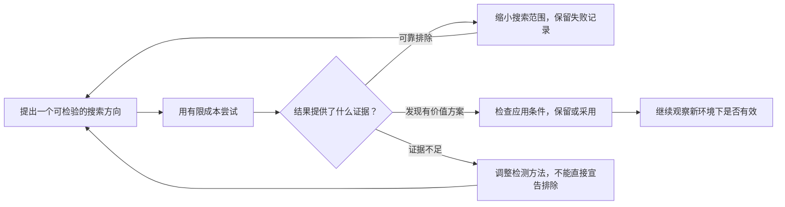
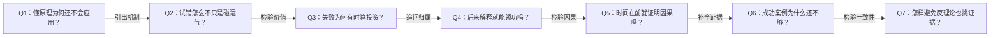

# 《反脆弱》第十三章：教鸟儿如何飞行——深度拆解

> 依据：用户提供的第十三章 Markdown 原文。本文区分作者主张、案例的说明作用与本文推导；旅行箱、古代技术、医学史、沉船价值及人物经历未逐项作独立史实核验。格兰杰因果的技术边界另据文末所链论文校核。本章不是对教育、科研资助或具体医疗实践的全面评估。
>
> 文本提示：原文轮子与旅行箱之间“将近600年”的时间表述，以及轮子发明者、带轮玩具文明的叙述存在疑点，本文不据这些数字和归属建立结论，也不擅自改成已考证版本。

## x → f → f(x)

- **x：如果许多有效技术先在实践中形成，为什么我们仍习惯把成果归功于事后的理论解释，而忽略真正使发现得到应用的过程？**
- **f：把发明、应用和解释分开，沿时间顺序追查贡献；把试错理解为能积累排除信息、保留有效方案的学习过程，并用完整结果、失败记录和替代解释检验理论的功劳。**
- **f(x)：评价创新时不只问“谁解释了它”，还要问“谁先做成、谁让它可用、如果没有该理论是否仍会发生”；组织探索时记录失败、更新搜索范围，并检查解释者是否只展示有利案例。**

因为会写出理论的人更容易留下可见记录，成果叙事可能倒置知识的来源；把顺序与证据补回来，才能更准确地配置对实践、应用和解释的重视。

## 核心命题

**解释一种能力，不等于创造这种能力；发现一个原理，也不等于已经找到它的用途。真正有价值的探索，会让失败改变下一步，而不是只在成功之后为它编出一个必然如此的故事。**

第十二章提出“选择权＝不对称性＋理性”，本章追问理性在哪里发挥作用：一方面要识别眼前发现的应用价值，另一方面要从失败中缩小搜索范围。本章又把选择权反过来用于审视叙事：讲述者也有选择权，可以只展示让自己显得成功的结果。

## 关键洞见

### 1. 发明与应用是两个不同的瓶颈

滚轮旅行箱的作用在于提出一个反直觉问题：轮子与行李早已存在，为什么组合并未因此自动出现？作者借此反对“知道原理便自然会应用”的假设。

从拥有部件到形成有用方案，中间仍需要察觉痛点、识别组合、完成制造并让人接受。鼠标与图形界面的例子进一步强调“半发明状态”：某物已经存在，但其价值还没有在可使用的场景中充分实现。

这里应避免另一种英雄叙事。作者强调乔布斯的应用愿景，不等于仅凭本章就能把相关技术的贡献全部归给一人。发明、改进、整合与推广可以由不同主体完成。

**可以表述一个机制，不等于拥有一种可用技术；拥有可用技术，也不等于它已经被广泛采用。** 每一步都可能有独立的障碍与贡献者。

### 2. 试错的输入可以随机，更新过程不能毫无记忆

找钱包的例子最适合解释本章所谓“试错并不随机”：你不一定知道钱包在哪儿，却知道认真找过、确认没有的地方不必原样再找一次。

随机性可以帮助产生候选方向，理性负责更新。没有记忆的重复不等于探索；但“没有找到”也不自动等于“这里没有”。检测若有遗漏，搜索记录需要保存覆盖范围和可信程度，而不只是一个完成标记。

钱包位置固定、可查范围有限的场景，尤其有利于排除法。开放创新的目标、环境和技术可能变化，失败结论必须附带条件，不能照搬“不必再试”。

### 3. 失败可以购买信息，但不能靠改名变成投资

寻宝的例子把连续开支却没有发现的年份，重新理解为搜寻过程的一部分。关键不在于把“损失”叫成“投资”，而在于这笔支出是否提高后续决策质量。

一次无发现的搜索若可靠排除了某片海域，就改变了剩余候选范围；若没有可靠覆盖、没有记录，也不调整后续行动，花费本身不产生这样的价值。

因此，可把搜索支出拆为三个问题：**取得了什么信息，信息改变了什么决策，继续探索的累计成本是否可承受？** 即使信息确实增加，也可能因太贵、剩余机会太小或预算耗尽而不值得继续。

原文沉船的金属估值也不能直接等同于寻宝者实际可得收益。取得发现、确认权属、支付打捞成本和兑现所得，是不同环节；本章没有完整展开这些条件。

### 4. 理论与成果的共存，不足以证明理论创造了成果

“教鸟儿飞行”讽刺的不是研究鸟类本身，而是错误归功：课程出现，鸟随后起飞，就说课程造成了飞行，却不看鸟在课程之前是否已经会飞。

| 可观察到的现象 | 容易作出的解释 | 仍需检查的替代解释 |
|---|---|---|
| 有理论，实践也成功 | 理论导致成功 | 实践先行，理论后来总结 |
| 富裕地区研究发达 | 研究造成财富 | 财富支持研究，或二者受共同因素影响 |
| 思想相似的人相互来往 | 较年长者教出了较年轻者 | 相似思想促成结交，或双方有共同来源 |
| 资助项目出现成功案例 | 定向资助有效且不可替代 | 未资助项目也可能成功，失败与成本未被展示 |

表中的替代解释是需要检验的可能性，不是把每个原因果方向机械反转。**反驳“总是理论先行”，不等于证明“理论从无贡献”。** 原文也承认原子弹等例外。

### 5. 讲故事者也拥有选择权，而且可能把成本留给听众

第十二章的选择权用于保留成功结果；本章指出，同样的筛选能力也可以被用来只保留成功叙述。报告者展示最佳项目，忽略失败项目、无效方法及损害，听众便高估整套方法的价值。

这里有两种不同的筛选：

- **实践中的筛选**：承认试过什么、失败什么，再决定保留什么方法。
- **叙事中的筛选**：只让外界看到有利结果，把完整尝试过程藏起来。

前者可以改进现实，后者可能只改进报告。结果越分散，越容易从许多尝试中选出一个耀眼案例，却不让它代表的全部成本出现。

本章对学术界的批评本身也必须接受这个标准：列举理论误导的例子，不能自动证明所有理论或所有基础研究贡献很少。

## 实践指引

### 场景一：团队发明了新方法，却迟迟无人使用

分别列出“已经证明能做什么”和“用户实际完成任务还缺什么”。把适配、可靠性、成本、权限与推广当作独立工作，而不是说一句“用户不理解创新”。

先用一个小范围应用检验价值，再记录阻碍。这样能判断瓶颈究竟在原理、产品化还是采用过程，而不把所有迟滞都归因于保守或愚蠢。

### 场景二：研究或调试屡次失败

为每次尝试记录假设、条件、结果和排除强度。例如，一次测试失败只能排除特定环境下的方案，未必排除整个方向。下一轮应明确哪些条件改变了，避免无记忆重复，也避免过早关闭有价值路径。

### 场景三：有人用几个成功案例证明一种方法

索取完整分母：一共试了多少次，多少失败、多少未报告，累计投入与损害是什么，未采用该方法的相似对象表现怎样。

若拿不到这些资料，就将结论限定为“存在成功案例”，而不是“已经证明方法更优”。这套标准同样适用于成功的创业者、咨询者和反学术的批评者。

### 场景四：复盘一个成果究竟归功于谁

先画时间线，分别记录想法出现、首次尝试、实际生效、理论解释和推广的时间。再问每一环节的新增贡献，而不是只按谁发表了最完整的文章分配功劳。

先后顺序能排除部分不可能的来源，却不足以独自确定因果；还需考察传播路径、共同来源、选择效应和对照证据。

### 场景五：制度问题被解释为人品不好

原文用贪婪解释危机的争论，提醒读者把稳定的人性倾向与变化的风险结构分开。若贪婪长期存在，为何某些条件下会放大成系统性灾难？

据此可检查行为激励、损失承担和失败传播，而不是只要求人更警觉、更有道德。但这并不证明贪婪没有作用；长期存在的因素仍可能与新制度相互作用。

## 例子列表

| 原文案例 | 逻辑位置 | 阅读限定 |
|---|---|---|
| 滚轮旅行箱迟迟才成为常用品 | 支撑 x：知道部件不保证想到用途 | 本章年代与发明归属需另作史实核验 |
| 带轮玩具与实用运输的对照 | 展示 f：发明与应用之间有断层 | 不忽视道路、材料、运输条件等可能约束 |
| 希罗的蒸汽装置 | 展示 f：机制展示不等于工业采用 | 玩具装置与工业动力系统不能直接等同 |
| 鼠标、图形界面与乔布斯 | 展示 f：整合应用也创造价值 | 不能压缩成单人完成全部创新 |
| 骆驼与轮式运输的替代 | 支撑 x：技术不必按单一路线前进 | 属作者历史叙述，不证明自然手段始终更好 |
| 医学发现与采用的时间差、旧治疗延续 | 支撑 x：知识与实践可能脱节 | 不据此作当前医疗选择；时序与数字未逐项核验 |
| 在客厅寻找钱包 | 展示 f：失败排除候选范围 | 要求目标相对固定、搜索可靠 |
| 斯德姆搜索沉船 | 展示 f(x)：以信息积累组织探索 | 估值不等于可兑现收入，仍有预算与权属条件 |
| 石油、天然气勘探 | 展示 f：类似的搜索与筛选结构 | 潜在收益有实际边界，不能当作字面无限 |
| 创造性破坏与熊彼特 | 检验 f：破坏本身不等于有利不对称 | 作者对其思想的评价没有在本章完成文献论证 |
| 哈佛鸟类飞行课程的寓言 | 展示 f：事后相关被误作事前贡献 | 是虚构比喻，不是对机构贡献的实证估计 |
| 罗盘显示航向 | 展示 f：伴随或反映不等于造成 | 现实罗盘也可被用于导航，类比有适用范围 |
| 贪婪与危机归因 | 展示 f(x)：转向约束和风险结构 | 不能从贪婪古老就推出其没有因果作用 |
| 作者否认早期思想来自曼德布罗特 | 展示 f：相似与影响方向不同 | 为作者自述，不能推广否认所有师承关系 |
| 旅游手册、交易业绩和数学应用清单 | 展示 f：选择性报告扭曲评价 | 反向挑选坏例子也会制造同类偏差 |

## 结论列表

1. 解释一种能力，不等于创造这种能力，成果与解释之间需要独立的因果证据。
2. 原理出现、技术可用与广泛采用，是可能各有瓶颈的不同阶段。
3. 有效试错以反馈更新下一步，而不是无记忆地重复随机行动。
4. 失败只有在提供可靠、可用信息时，才可能成为后续探索的资源。
5. 未找到不等于不存在，排除结论必须匹配检测能力与环境条件。
6. 成功案例没有完整分母，不能单独证明方法有效或优于替代方案。
7. 记录者对历史的可见贡献，可能大于其对实际成果的因果贡献。
8. 个人获得讲述成功的选择权，可能让听众承担对方法的误判。
9. 把理论一律归零，与把实践一律归功于理论，都可能省略关键证据。

## Q-A 问答链

### Q-A 问题结构图

### Q1：懂原理为何还不会应用？

- **结论**：原理知识并不自动包含具体用途、整合能力和采用条件。
- **形式化**：发现原理 ≠ 做出可用方案 ≠ 实现采用。
- **论证**：① 同一部件可以有许多潜在用途。② 用途需要被识别并验证。③ 现实采用又受到成本和组织条件制约。
- **边界**：有些领域理论确实直接指引应用，不能用时滞证明理论无用。

**Q1 → Q2**：Q1 指出原理到应用之间仍有未知空间，所以需要解释探索如何跨越这个空间。

### Q2：试错怎么不只是碰运气？

- **结论**：候选方向可以随机，但保留、排除和下一步行动应由反馈更新。
- **形式化**：尝试 + 可靠反馈 + 更新记忆 → 有方向的探索。
- **论证**：① 尝试产生差异化结果。② 结果提供方案好坏或范围信息。③ 使用信息改变后续行动，便不再原样盲试。
- **边界**：反馈失真或环境变化时，记忆也会误导，必须记录适用条件。

**Q2 → Q3**：Q2 说明了失败可能提供信息，但尚未证明取得信息所花的钱值得，所以必须检验失败的经济价值。

### Q3：失败为何有时算投资？

- **结论**：失败支出若改善未来决策且成本可承受，就可能具有投资性质。
- **形式化**：失败 → 有用信息 → 更好的后续选择；支出本身不等于价值。
- **论证**：① 可靠排除可以缩小候选范围。② 搜索资源因而能转向更有希望的部分。③ 若改进足以覆盖成本，这次失败才可能值得。
- **边界**：信息增加不保证最终获利；预算、权属和收益兑现仍可能限制结果。

**Q3 → Q4**：Q3 把学习贡献定位在探索过程，但成果出现后往往由理论来解释，所以要检验解释者是否获得了不属于自己的因果功劳。

### Q4：后来解释就能领功吗？

- **结论**：事后解释能够帮助理解或传播，却不能仅凭出现于成果旁边就宣称造成了成果。
- **形式化**：解释伴随成功 ≠ 解释导致成功。
- **论证**：① 成果可能先于理论存在。② 理论可能只是总结实践。③ 因此需要追查贡献发生的时间与传递路径。
- **边界**：后来形成的理论仍可能改善后续实践，不能因未创造最初成果就否定全部贡献。

**Q4 → Q5**：Q4 要求恢复时间顺序，但顺序只能提供部分约束，所以还要说明它能证明到哪里。

### Q5：时间在前就证明因果吗？

- **结论**：先后顺序可以限制某些因果说法，不能独自排除共同原因或其他解释。
- **形式化**：先发生是线索，不是充分证明。
- **论证**：① 某事件不能用事后才出现的特定信息解释。② 但较早事件也可能只与真正原因相伴。③ 所以还要检查机制、对照和信息来源。
- **边界**：预测上的领先关系与干预造成的因果效应不同，不能混用。

**Q5 → Q6**：Q5 说明顺序不足以完成归因；如果现有案例又是选择性呈现，连用于判断的基础也会偏斜。

### Q6：成功案例为什么还不够？

- **结论**：没有失败、成本与替代方案，成功案例不能说明一套方法的总体表现。
- **形式化**：最佳个案 ≠ 全部尝试的净效果。
- **论证**：① 大量尝试可能产生少数亮眼结果。② 只公布这些结果会隐藏分母与损失。③ 补全记录后，才可能比较方法的真实贡献。
- **边界**：成功个案仍能证明某事可能发生，但不能单独量化发生机会与相对优势。

**Q6 → Q7**：Q6 揭示了挑选证据的危险，这个危险同样适用于作者反对线性理论的案例集，因此必须把标准对称使用。

### Q7：怎样避免反理论也挑证据？

- **结论**：对理论先行与实践先行都检查时间、失败、成本和替代解释。
- **形式化**：同一证据标准 → 分领域判断贡献 → 避免整体归零。
- **论证**：① 两种路径都可能真实存在。② 每种路径都有成功和失败。③ 应比较具体机制与边界，而非先按身份确定谁有功。
- **边界**：资料缺失时应保留不确定性，不能用“不知道”替任何一方完成证明。

## 局限与盲区

### 格兰杰因果不能由“谁先发生”直接读出

原文一度把格兰杰方法说成建立因果关系的唯一严谨技术，随后又承认其不足以使作者相信“A导致B”。需要保留后面的谨慎，不能沿用前面的绝对表述。

技术上，格兰杰关系考察：加入一个变量的过去信息后，是否改善对另一个变量未来的预测；这种预测关系甚至可以在没有两者直接物理作用机制时出现。因此，它不是单纯排序，也不是自动证明干预因果。[Lima 等关于格兰杰因果的推导与应用论文](https://arxiv.org/abs/2106.03990)明确说明了这一点。

### 强烈反线性，不足以证明反方向普遍成立

本章有力指出实践可能先于解释，但“大学贡献很少”“可解释知识作用微不足道”等总括判断，需要系统样本和反事实比较。存在实践先行案例，可以反驳单一路径的必然性，不能估计全部科研的净贡献。

### 简单发明的事后明显，不是事前成功必然

轮子旅行箱看起来组合容易，但历史采用还可能取决于材料、需求和基础设施。若不核验这些条件，把延迟完全归于人类缺乏想象力，也是一种过于顺畅的事后解释。

### 谨慎采用与拖延采用之间需要证据

作者承认等待验证可能合理，却又将某些拒绝转换斥为无能。具体区分仍需比较新旧方案的收益、风险、可逆性和证据强度。不能因为新方案简单、旧方案不自然，就断言转换没有副作用。

### 搜索空间不是永远固定

钱包例子要求位置稳定且检查可靠。现实研发可能因条件变化，让以前无效的方法变得可行。记录失败的价值在于限制结论的适用范围，而不是把失败永久封存成禁令。

### 结构解释与人格解释不必互相排斥

贪婪长期存在，不代表其强度、激励环境或与系统结构的互动不重要。更可取的实践含义是设计能承受正常人性弱点的制度，而不是宣告人性因素毫无作用。

本章可转成一条持续使用的检验原则：**让成功回到真实发生的顺序，让失败回到完整的记录，让贡献回到能够支持它的证据。**
