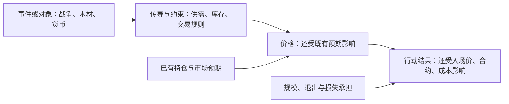

# 《反脆弱》第十四章：当两件事不是“同一回事”时——深度拆解

> 依据：用户提供的第十四章 Markdown 原文、表14–1及注[30]—[31]。本文分析本章的逻辑与案例，不将教育研究、国家收入比较、交易收益及人物经历视为已经独立核验的事实。涉及“如今”的数据均属于作者写作时点。下文的检验框架与实践场景为本文推导，不是投资或教育政策方案。
>
> 文本提示：托尼收益数字“1 / 800万美元”存在断行，本文不据此计算收益倍数；原表“行驶更好的期权”按上下文理解为行使更好的选择权。未据OCR文字推定精确底本。

## x → f → f(x)

- **x：为什么懂背景、能解释、会考试的人，不一定能做好实际决策，而缺少某些显眼知识的人反而可能成功？**
- **f：把关于事物的叙述、决定行动的知识，以及从事物到结果的映射分开；评价知识时追查它究竟改变哪一步，评价行动时检查价格、预期、选择权和损益结构，而不是拿谈吐与理论熟练度替代实践能力。**
- **f(x)：先定义要完成的任务，再识别真正影响结果的变量和错误代价；用工作样本与反馈检验能力，用有限试错保留改进空间，不因某人欠缺背景常识就否定他，也不因他曾成功就接受他的全部解释。**

因为显眼知识未必是任务中的关键知识，作者要求追查知识到结果之间的连接；接受这一点后，评价标准就从“说得像专家”转向“在明确条件下能否做成，并控制失败后果”。

## 核心命题

**事物与事物的结果不是同一件事，关于能力的解释也不是能力本身。真正需要掌握多少知识，取决于任务、反馈和收益结构，而不是外行认为一个行家理应知道什么。**

第十三章质疑“实践成果必然来自事前理论”，本章进一步追问：即使某种知识确实正确，它是否就是眼前任务所需的知识？这是对知识相关性的审查，而不只是对知识来源的审查。

## 关键洞见

### 1. 绿色木材谬误：显眼常识不等于关键能力

原文中的成功交易者把“绿色木材”误以为涂成绿色的木材，而非未干燥的新木材。按外行直觉，连这个词都不懂，怎么可能做好生意？作者的回答是：他可能掌握订单流量、行业惯例和实际买卖中的重要细节，而词义并不是决定其交易成绩的那一环。

这里不应把“他不懂”当成成功原因。**更准确的关系是：他欠缺一种知识，却可能掌握另一种更贴近任务的知识。**

| 层次 | 木材案例中的问题 | 不能混同的内容 |
|---|---|---|
| 对象知识 | 木材是什么，有哪些材料特性？ | 对产品的了解 |
| 任务知识 | 如何识别订单、报价和交易机会？ | 对具体行动的把握 |
| 结果机制 | 订单、价格、执行与责任怎样形成收益？ | 知识经过哪些环节才能变成成果 |

材料知识在检验质量、加工或承担交付责任时可能非常重要。因此，案例不是证明绿色木材的含义永远无用，而是反对未定义任务就替别人规定“必要知识”。

### 2. “不是同一回事”意味着不能省略中间映射

本章从木材转到汇率、战争和石油，反复指出：知道对象的情况，不代表知道结果会如何变化。

这张图是本文对作者“事物与事物的函数”的展开。对象、价格和个人收益至少是三个不同层次：对象判断正确，价格方向可能猜错；价格方向猜对，也可能因成本、期限或风险安排而没有获利。

作者强调不对称和非线性会拉大这些层次的差异。但非线性不等于毫无关系，只说明不能把输入与输出简单画等号。即使映射是线性的，遗漏预期和成本也可能出错。

### 3. 战争发生与油价上涨不同，因为价格已经包含预期

在托尼的故事中，分析者依据“战争威胁供应”判断油价上涨；托尼注意到战争已经被广泛预期，并认为市场事先作了准备。原文还指出库存与囤积情况。

关键不是“战争其实不影响石油”，而是：**一个事件的经济影响，与事件相对于原有预期新增的信息，不是同一个量。** 事件若已被预先反映，真正发生时的价格反应可能与朴素故事不同。

因此，“科威特和石油不是一回事儿”应读成不能把战争预测直接当作交易结论，不能照字面读成二者没有因果联系。

也不能把故事反转成“只要所有人看涨，就一定会跌”。一致预期可能正确，市场也可能尚未充分调整。原文的收益叙述没有披露具体合约、成本和风险限额，不能据此复制交易。

### 4. 学问、正规教育、个人回报与国家增长是四个问题

作者借教育与财富的箭头，反对从“富国教育程度高”直接推断“多办学校就必然创造增长”。他又明确承认教育能够提供文凭、稳定家庭收入，并具有自由、平等、文化和公民价值。

| 要检验的命题 | 需要的证据 | 本章不能替代的工作 |
|---|---|---|
| 某个人受教育后收入更高 | 个人层面的比较与机制 | 区分教育影响与原有差异 |
| 全国教育扩张提高增长 | 国家层面的比较与因果识别 | 检查制度、质量、技能匹配等条件 |
| 财富支持更多教育 | 资源增加后教育如何变化 | 不把这一方向当作另一方向不存在的证明 |
| 学习有独立价值 | 对文化、自由与生活目标的判断 | 不必全部折算成GDP收益 |

作者援引的国家对比可以质疑“教育水平一高，增长就必然高”的简单版本，却不足以单独证明教育对增长没有贡献。两个箭头还可能同时成立，并经由其他条件相互作用。

所以，本章较稳固的结论是：**不能把一项投入的道德或文化价值，偷换成未经检验的经济效果；也不能因经济效果未被确证，就抹去它的其他价值。**

### 5. 可选择性降低对完美解释的需求，但仍需要会比较结果

表14–1把依赖叙述的行动与自由探索并置。作者所谓普罗米修斯式行动，不是先知真的能预知未来，而是预先保留可逆错误与上行空间：不知道未来，也能在反馈出现后选择。

相反，一套心理上令人安逸的故事，若促使人承担不可逆的大损失，就会使行动脆弱。这里的危险来自故事与承诺之间的连接，不是因为任何叙述都坏。

原文也承认故事可以是工具，例如帮助人遵守某种约束。必须区分：故事能激励行动，不代表故事的事实解释为真；故事古老、持有人存续，也不证明其每个命题正确或每种做法都值得保留。

## 实践指引

### 场景一：招聘实际执行岗位

先列出交付目标、限制和失败后果，再设计贴近任务的工作样本。例如，让候选人完成一个真实程度合适的小任务，并解释取舍与风险，而不是仅凭行业趣闻、谈吐和名校经历判断能力。

评价沟通能力时也要对应职责：有些岗位确实需要准确说明方案与责任。反对把口才当成全部能力，不等于沟通能力毫无价值。

### 场景二：听到一个非常顺畅的市场故事

把它拆成“事件判断—传导机制—既有预期—可执行安排—实际损益”。逐段问：这里新增了什么信息？哪些条件已经被反映？即使方向对了，什么仍可能让行动失败？

若这些问题没有答案，就把它当作解释候选，而非完成的决策。也不因故事流行就自动采取反向立场。

### 场景三：决定是否购买课程或引入培训

明确目标是取得资格、学习具体技能、文化兴趣，还是提高某项产出。每个目标用相应的证据评价，不把知名讲师、漂亮教室或完整术语体系当成实际迁移的证明。

如果目标是工作表现，就安排小范围应用和前后反馈；如果目标是阅读与理解，则可以按学习本身的价值判断，不必编出收入增长的理由。

### 场景四：专家提供了理论上漂亮的方案

请其说明适用条件、失败情景、执行约束与结果验证方式。先在可恢复、有限成本的范围测试，再决定是否扩大。

这里不是让实践者天然压过专家，而是把两类贡献接起来：理论提供候选解释，实践检验迁移；结果又促使双方修正。

### 场景五：使用传统经验法则

把规则连同原环境一起记录：它原来保护什么、付出什么成本、哪些条件可能已经改变。先保留低成本的保护功能，再用反馈检查是否仍有效。

不要只因无法解释就丢弃，也不要只因祖辈使用就宣称科学。存续提示值得研究，但仍需要考察共同环境、选择偏差以及承担代价的人。

## 例子列表

| 原文案例 | 逻辑位置 | 不能直接推出什么 |
|---|---|---|
| 阿布扎比进口大学与石油财富 | 支撑 x：投入与预期产出之间需要机制 | 作者的观察与预测不是项目净效果评估 |
| 阿密欧居民流亡后重建 | 展示 f：压力可能激发适应与机会 | 幸存者成就不证明战争对所有人有益 |
| 普里切特、伍尔夫与国家教育比较 | 展示 f：相关与因果方向需分开 | 本章引述不等于完整研究复核 |
| 教育帮助家庭保持中产地位 | 展示 f：个人效果与宏观效果不同 | 个人有益不自动推出同幅度总体增长 |
| 晚餐谈吐与招聘印象 | 支撑 x：晕轮可能跨领域误导 | 谈吐好不证明能力差，口才差也不证明务实 |
| 绿色木材交易者误解词义 | 展示 f：显眼知识未必决定任务 | 无知本身不是优势 |
| 瑞士法郎交易者不熟悉瑞士地理 | 展示 f：对象常识与交易技巧不同 | 不能否定全部宏观或地理信息的作用 |
| 纽约、伦敦交易者的行业语言 | 展示 f：实务知识有独特沟通形式 | 粗俗或非标准表达不自动意味着能力高 |
| 托尼在科威特战争期间的石油交易 | 展示 f(x)：事件与价格、收益分开 | 不能复原未披露的交易结构或推广为反向定律 |
| 基金经理的伊拉克地图与事后亏损 | 支撑 x：背景研究未覆盖结果机制 | 单次亏损不证明背景研究始终无用 |
| 西蒙斯的模式识别交易 | 展示 f：不依赖宏大解释也可行动 | 文中的比较性赞誉不是独立业绩检验 |
| 鲁宾斯坦与小贩讨价还价 | 展示 f：理论迁移需承认边界 | 一次迁移失败不证明全部博弈论无效 |
| 专业化的强制实施与渐进形成 | 展示 f(x)：同一理念的实施路径不同 | 本章未提供完整政策对照 |
| 普罗米修斯与埃庇米修斯 | 展示 f：可逆探索与事后叙述对照 | 神话是结构隐喻，不是经验数据 |
| 祖母的启发法与注[31]基金比较 | 检验 f：知识要看后果和存续 | 不证明传统必真，也不证明学位造成脆弱 |

## 结论列表

1. 必要知识必须由具体任务界定，不能由外行对专家形象的想象界定。
2. 缺少某项背景知识而成功，不等于因为缺少知识才成功。
3. 预测事件、预测价格与取得收益，是三个需要分别说明的任务。
4. 已被预期的事件，其发生本身未必提供同等规模的新信息。
5. 学问、正规教育、个人收入与国家增长不能被当作同一个变量。
6. 良好谈吐可以帮助协作，却不能独自证明实际执行能力。
7. 可选择性通过可逆错误与事后筛选降低预测负担，不以无知本身为目标。
8. 叙述能够激励行动，但激励有效不等于事实解释正确。
9. 传统的存续值得考察，却不是每条传统规则必然正确的证明。

## Q-A 问答链

### Q-A 问题结构图

### Q1：不懂木材为何能做成生意？

- **结论**：他可能不懂一个显眼词义，却掌握了决定特定交易任务的实务知识。
- **形式化**：缺少对象常识 ≠ 缺少全部任务能力。
- **论证**：① 交易涉及多类信息。② 不同信息对具体任务的作用不同。③ 某一词义错误不足以否定所有相关能力。
- **边界**：若任务变为检验、加工或承担质量责任，该知识缺口就可能非常重要。

**Q1 → Q2**：Q1 排除了按单个常识题判定能力，却尚未给出筛选相关知识的标准，所以必须回到具体任务。

### Q2：哪些知识才算真正相关？

- **结论**：能改变关键行动、约束或结果判断的知识，才是该任务的相关知识。
- **形式化**：知识 → 影响哪一步决定 → 改变哪种后果。
- **论证**：① 先定义目标与限制。② 再追查行动到结果的连接。③ 最后检验知识对连接中哪一环有效。
- **边界**：直接影响之外也有长期、间接价值，不能只按一次收益评价全部学问。

**Q2 → Q3**：Q2 要求追查连接；战争案例正好显示知道事件仍可能遗漏价格与个人损益的中间层。

### Q3：猜中战争为何仍会亏钱？

- **结论**：市场可能已提前反映战争，实际交易又受到价格、合约与成本约束。
- **形式化**：事件正确 ≠ 价格方向正确 ≠ 净收益为正。
- **论证**：① 价格会受预期影响。② 事件发生后的变化还取决于实际与预期之差。③ 个人收益再受具体敞口与执行条件影响。
- **边界**：战争仍可能影响供需；本章不是证明事件与价格完全无关。

**Q3 → Q4**：Q3 否定了直线式因果故事，但读者可能反过来把逆向立场当成新定律，所以需要排除这种替代迷信。

### Q4：反着共识做就能赢吗？

- **结论**：共识存在不等于价格失真，逆向行动也必须说明自己的优势与损失边界。
- **形式化**：众人相信某事 ≠ 该事错误 ≠ 反向敞口有利。
- **论证**：① 共识可能基于可靠信息。② 即使预期已经反映，也未必产生相反变化。③ 行动仍需独立分析价格与收益结构。
- **边界**：托尼的故事具有解释作用，未披露的合约与风险不能由读者补成确定方案。

**Q4 → Q5**：Q4 说明不能靠换一个故事解决不确定性，因此必须把重点转向容许错误的行动结构。

### Q5：怎样少预测也能行动？

- **结论**：保留可逆、可承受的尝试，并在反馈出现后选择更好的结果。
- **形式化**：限制下行 + 获得反馈 + 保留上行 → 降低预测负担。
- **论证**：① 事前知识不完整。② 小错不终止行动，便能继续学习。③ 选择权允许在更多信息出现后决定是否继续。
- **边界**：若损失不可逆、反馈失真或收益无法取得，这种结构就不成立。

**Q5 → Q6**：Q5 减少的是对事前完整预测的依赖，仍需要识别与执行能力，因此要明确教育和理论在其中的位置。

### Q6：教育和理论因此无用吗？

- **结论**：本章要求检验理论与教育如何迁移到结果，并未充分证明其作用为零。
- **形式化**：解释或文凭 ≠ 自动成果；不等于解释或学习无价值。
- **论证**：① 正规教育可以服务资格、文化或具体技能。② 不同目标需要不同评价。③ 理论的实践贡献则须通过适用条件与反馈确认。
- **边界**：作者关于宏观增长的强断言，不能单凭本章个案和研究转述完成论证。

**Q6 → Q7**：Q6 不让正规知识凭身份获得豁免，也意味着不能让传统经验仅凭存续获得豁免，所以要用同一标准检验后者。

### Q7：传统能活下来就该照做吗？

- **结论**：存续可以提示潜在价值，但仍须检查环境、成本与真实保护作用。
- **形式化**：长期存续 → 值得研究；长期存续 ≠ 全部正确。
- **论证**：① 规则可能随持有人一同延续。② 延续也可能来自惯性、权力或其他共同条件。③ 因而应保留并检验具体功能，而不是接受全部解释。
- **边界**：难以完整言说的经验不应被轻率丢弃，但不可逆风险也不能因传统身份被忽略。

## 局限与盲区

### 作者也可能把“不充分”说成“完全无效”

本章一方面断言阿布扎比教育支出不会有效果、教育不产生财富，另一方面又明确承认大学可以产生知识并有益于经济。阅读时应保留后一层限定。研究若未发现某个总体关系，不自动等于所有情景下的效果都为零；财富促进教育，也不排除教育反过来发挥作用。

### 压力有收益，不代表越多越好

阿密欧重建的故事呈现幸存居民与可见建筑，未把死亡、永久流离失所和未能恢复者的损失放入同一比较。它可以说明人会适应逆境，却不能证明战争或贫困整体有利，更不能把制造伤害当成创新政策。

### 案例中的知识缺口，不是完整的能力检验

绿色木材交易者、地理知识不足的交易员与满墙地图的基金经理都是鲜明对照，但原文没有给出完整长期业绩、职责与风险资料。既要防止因缺常识而否定能力，也要防止因故事中的成功而授予能力无限通行证。

### 结果导向仍须检查运气与外部代价

本章反对用漂亮语言评价工匠与创业者，有实用价值。但只看产品或一次收益也可能遗漏运气、潜在损失及他人承担的代价。实际结果是重要证据，仍需结合过程、重复表现与后果范围判断。

### 对叙述与实践的二分过强

表14–1把两者写成对立类型，容易掩盖理论与试验的循环。可解释的模型也能支持小规模验证，经验做法也可能因过度自信而脆弱。关键不是持有人属于哪一类，而是他如何处理错误与未知。

### 传统的筛选机制不是完整的科学认证

持有某规则的人幸存，不证明该规则使其幸存，更不证明其叙述为真。与学校研究一样，传统经验也要面对共同原因、选择性记忆和环境改变的检验。作者“祖母的智慧因此也是科学的”是立场表达，不是已经完成的逐项验证。

本章最有用的追问是：**我现在掌握的是关于对象的故事，还是决定任务结果的知识？即使判断正确，什么仍可能让我失败？** 这两个问题把“不是同一回事”从一句警句变成可执行的检查。
