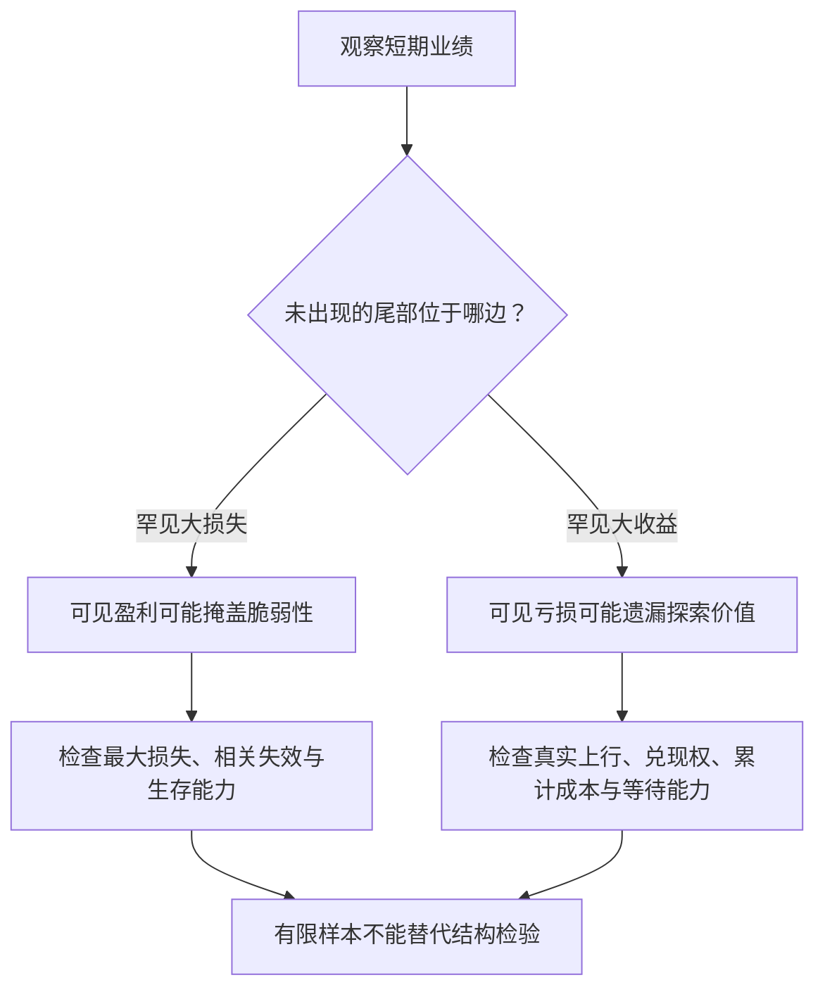

# 《反脆弱》第十五章：失败者撰写的历史——深度拆解

> 依据：用户提供的第十五章 Markdown 原文、表15–1及注[32]—[33]。本笔记拆解作者论证，不把技术起源、药物发现比例、人物行为和机构业绩的转述视为独立核验后的史实。所有“如今”与研究数字属于作者写作时点。本文构造的数字例子、检验框架与应用场景均另行标明，不用于具体医疗、投资或科研政策决策。
>
> 文本校读：原文负面不对称段落称样本记录“低估长期的平均值”，又称其“隐藏缺陷、展示优点”。若平均值指净收益，两句方向不一致；结合“火鸡问题”应理解为漏看灾难会低估损失、夸大收益。本文保留这一歧义，不擅自声称已核对底本。

## x → f → f(x)

- **x：如果创新常由难以预先解释的试错产生，我们怎样避免在历史上把功劳归错，又在现实中因短期成绩不好而扼杀真正有上行的探索？**
- **f：把实践、理论整理和应用漂移分别追溯；评价探索时先看损益不对称、罕见结果和累计成本，再看短期平均表现；以小额多次、允许调整方向的方式支持能识别并利用机会的人，同时保住生存底线。**
- **f(x)：复盘成果时找原始记录与传播路径，资助探索时保留转向权、分散尝试并检验反馈；面对短期亏损或盈利，都先问样本遗漏的是大收益还是大损失，不用漂亮历史或未知未来替任何方案免除检验。**

因为可见记录与实际贡献、有限样本与长期结果都可能错位，作者同时审查叙事方向和收益方向；据此，创新评价应从“是否符合原计划、是否多数成功”转向“怎样探索、谁承担失败、谁保留成功”。

## 核心命题

**历史记录可能偏向会解释成果的人，短期业绩可能偏向没有暴露尾部风险的方案。要理解和支持创新，既要追查知识的真实来源，也要看清未出现的极端结果对自己究竟意味着收益还是损失。**

“失败者”是作者对有时间书写、却未必创造实务成果者的讽刺，并非“失败者叙述天然更真”。同样，本章赞扬的自由探索也不是为失败本身加冕，而是要求失败有限、反馈可用、成功能被识别并保留。

## 关键洞见

### 1. 理论可以整理实践，却不因此成为实践的最初原因

作者以自己与豪格对期权定价史的调查为主要证据，主张交易者早已通过惯例、师承和试错掌握一些后来被正式化的技术。工程、建筑和控制论的例子进一步扩展同一问题：后来写出的解释，是否被追认为先前能力的来源？

应分开至少四种贡献：

| 贡献 | 要问的问题 | 不能混同的功劳 |
|---|---|---|
| 首次做成 | 谁先在现实中完成了什么？ | 创造可行做法 |
| 解释与形式化 | 谁说明了机制、条件或关系？ | 提高理解与表达能力 |
| 传授与改进 | 谁让方法可复制、可检验？ | 扩散及改良 |
| 后续应用 | 谁发现新的用途并完成落地？ | 扩大价值实现范围 |

形式化未必是起点，仍可能有独立价值；实践先行也不证明此后的所有理论都无用。作者在“烹饪与物理学”的对照中，明确承认相对论、希格斯玻色子和海王星等理论驱动案例。

标题的真正问题是记录权不均：实践留下的证据可能少于理论叙述。但解决办法是补充档案、时序与机制，而不是仅把学者与工匠的可信度排名倒置。

### 2. 意外用途不等于没有科学贡献，也不等于一切都能规划

本章用计算机、互联网、药物新用途和企业转型说明：最终创造价值的用途，未必是最初投入所瞄准的目标。

**资源与知识投入 → 可用能力 → 新场景组合 → 实际用途 → 后续反馈**，每个箭头都可能出现机会性变化。

因此，可以同时承认两件事：某种基础研究提供了必要能力；这项研究并未预见最终用途。后一个命题不能抹去前一个，前一个也不能证明原计划准确预测了全程。

“目的论”的靶子是把路线锁死、只承认计划内成果的组织方式。设定问题、预算和安全约束，不等于必须锁死发现的用途。开放探索仍可以有纪律。

### 3. 反火鸡问题：样本可能把上行藏起来

经典火鸡问题是：很多次平稳好结果，掩盖一次罕见的大损失。反火鸡则是：很多次小支出或失败，尚未出现一次可能覆盖它们的大成果。

| 结构 | 常见可见结果 | 尚未出现的尾部 | 可能的误判 |
|---|---|---|---|
| 负面不对称 | 小而稳定的正收益 | 大损失 | 把平稳当成安全 |
| 正面不对称 | 小损失或持续成本 | 大收益 | 把多数失败当成整体无价值 |

下例仅为本文自拟，用来比较一次罕见结果的重要性，不估计任何行业概率：

- **探索型**：九次各亏1，一次赚20，合计为11；在大收益出现前，九次记录看起来都不好。
- **灾难型**：九次各赚1，一次亏20，合计为－11；在大损失出现前，九次记录看起来都很好。

最重要的限定是：**图中的“可能”不能删掉。** 没看到大收益，不证明大收益必然存在；不能用反火鸡概念把无前景的失败包装成未来成功。

### 4. 看多数公司是否盈利，与看整体或投资者回报不同

作者批评以“大多数生物技术公司无利润”来推断整个方向潜在回报微薄。若回报集中在少数成功者，多数公司的状态不足以说明总体结果。

但还必须区分三个层次：

1. **公司比例**：多少公司盈利，多少公司亏损？
2. **整体净值**：所有成功收益减去全部失败和维持成本后，还剩多少？
3. **参与者所得**：某个投资者、研究者或资助者能否实际分享成功，付出了什么价格？

社会获得巨大价值，不保证每个参与者获利；少数赢家很大，也不保证其收益足够覆盖所有成本。作者其实承认，悲观结论可能正确，只是不能由所展示的数据直接推出。

同一证据标准也适用于再保险：过去灾难少，不自动说明保费过高；但指出可能遗漏灾难，也不能无需模型和成本证据就证明任何保费合理。

### 5. 小额多次、支持探索者，是保留选择权的方法而非通用最优公式

作者提出“投资骑师而非马匹”、广泛分散尝试和1/n方式，意在避免错过难预测的大赢家，并让人有权根据反馈改变原先的项目。

这个机制有四个条件：试验确实有机会产生有价值的信息，单次失败可承受，后续能筛选并扩大成功，全部试验不会因同一原因一起失效。

若每份投入太小，以至于没有任何一次能完成有效验证，分得更广反而可能降低信息产出。复杂实验存在设备、人员和时间门槛，也不能从“回报有厚尾”直接推出“等额分配在所有条件下最优”。

支持人同样不意味着停止审查。应评价其如何更新判断、控制代价和利用机会，而不是用名望、谈吐或熟人关系替代项目口号，重新制造绿色木材谬误。

## 实践指引

### 场景一：研发方向尚不清楚，团队却被要求承诺完整路线

区分不可改变的底线与可调整的路径。底线包括责任、预算、安全和证据质量；路径包括技术方案、用户场景与成果用途。

每轮尝试留下假设、成本、反馈、停止条件及下一步。定期讨论“什么意外结果值得保留”，而不是只按原计划完成率评价。这样既能容许漂移，也不让漂移成为无法问责的借口。

### 场景二：探索连续几轮没有显著成果

检查是否仍在获得新信息，候选空间有没有更新，剩余预算能否支持有效试验，以及成功后收益能否被保留。将继续、修改与停止都作为真实选项。

若没有可验证反馈，只是反复承诺“黑天鹅会来”，应提高证据要求；若失败可靠排除了若干方向，则不要仅按本轮收入为零就把信息价值归零。

### 场景三：一个方案长期表现平稳

不要仅凭历史曲线判断安全。检查平稳是否来自尚未结算的责任、共同依赖或小概率大损失；问清正常时期赚的是什么，异常时期会付出什么。

也不要只因存在未知，就断言它必然危险。目的是识别具体敞口与承受能力，而不是用另一种故事替换评估。

### 场景四：分配多个探索项目的预算

先保证每个被选择的尝试能完成有意义的验证，再限制总预算，减少重复方向，保留后续根据证据追加的空间。

比较等额、小额分散和分阶段投入等安排各自的成本；本章提供的是多保留机会的方向，未证明某个固定分配公式适合所有项目。

### 场景五：撰写创新史或项目复盘

分别记录首次使用、理论发表、后续改善、商业应用的时间和证据。成功故事旁边放失败、费用与替代解释；实践者的回忆与学者的文章都按同一标准核对。

区分“没有预见用途”和“没有任何贡献”，也区分“有理论解释”和“事前由理论指导”。功劳可以分环节归属，不必只有一个创造者。

## 例子列表

| 原文案例群 | 逻辑位置 | 阅读限定 |
|---|---|---|
| 弗莱德问不懂吉尔萨诺夫定理如何做交易 | 支撑 x：形式知识被误认为操作前提 | 不懂定理不等于不需要任何定价与风险知识 |
| 骑自行车、开心果小贩定价 | 展示 f：会做不以完整理论解释为前提 | 不证明所有复杂任务都能照搬直觉 |
| 豪格与作者调查期权技术的前史 | 展示 f：追查时序与实践来源 | 为作者自述；争议与指控未独立核验 |
| 论文出版及百科条目编辑事件 | 支撑 x：记录权可能影响功劳归属 | 不能从单方叙述判定全部学术过程 |
| 表15–1中的喷气机、控制论、建筑 | 展示 f：技术可能先于系统解释 | 表格是作者结论，不是本章已完成的逐项史证 |
| 烹饪与食谱演化 | 展示 f：可比较反馈推动集体试错 | 口味试验不能替代其他领域的安全验证 |
| 海王星、相对论、希格斯玻色子 | 检验 f：作者承认理论驱动路径 | 并非所有理论成功都可被称为与复杂系统无关 |
| 计算机和互联网的意外应用 | 展示 f(x)：投入与用途之间可能漂移 | 原文年代与起源叙述需另行考证 |
| 英国牧师、业余爱好者与纺织改进 | 展示 f：稳定底座支持自主探索 | 贡献清单和人数比例不是完整比较样本 |
| 支持探索者、风险投资与1/n | 展示 f(x)：让路线可调整，保留多个机会 | 不代表熟人投资、等额分散或无限尝试必优 |
| 药物偶然发现、用途转移与军事线索 | 展示 f：发现来源不等于最终用途 | 数量、日期和病理叙述未核验，不转化为医疗判断 |
| 阿尔加惹尔的扣针与里德利的合作论述 | 展示 f：分布式知识与自发组合 | 人物年代、思想承接及物种概括需另证 |
| 可口可乐、蒂芙尼、诺基亚等业务变化 | 展示 f(x)：公司可以偏离起点 | 成功转型案例未包括失败转型与稳定经营者 |
| 墨西哥财富样本与斯利姆 | 展示 f：极端值影响总体估计 | 人数、财富和所需样本量为作者估计，不能作抽样定律 |
| 生物技术盈利比例与再保险灾难 | 展示 f：尾部方向改变样本解读 | 各行业仍需检查价格、资本与具体敞口 |
| 历史经验医者被污名化的讨论 | 支撑 x：身份与记录不能替代效果证据 | 不据此为无证诊疗或未经验证的方法背书 |

## 结论列表

1. 实践先行、理论整理、方法传播和用途转移，是可以分别产生贡献的环节。
2. 无法预先安排最终用途，不等于基础投入没有价值，也不等于一切规划无用。
3. 有限样本可能漏掉罕见大损失，也可能漏掉罕见大收益，方向取决于敞口结构。
4. 多数项目失败不能独自证明总体无价值，少数项目巨大成功也不能独自证明总体值得。
5. 未出现的上行值得保留检验空间，但不能被当作必将发生的收益。
6. 单次试错成本有限，不代表累计试错成本可以忽略。
7. 分散尝试只有在试验有效、可筛选、可兑现且不过度相关时，才可能发挥探索优势。
8. 支持人的适应能力不等于免除审查，熟人和声誉也不能替代证据。
9. 历史身份、正规资格和反正规身份都不能单独完成对方法效果的证明。

## Q-A 问答链

### Q-A 问题结构图

### Q1：谁解释成果就该领功吗？

- **结论**：解释有独立价值，但不自动等于创造了被解释的能力。
- **形式化**：先做成 → 后解释，不能改写成先理论 → 后应用。
- **论证**：① 实践可以先于正式理论。② 书面记录往往更易传播。③ 归功必须追查原始时序和传递机制。
- **边界**：若理论确实事先指导了设计，就应承认相应贡献，不能反向预设实践永远先行。

**Q1 → Q2**：Q1 要求把贡献拆开，而发现与用途之间同样可能分离，所以需要检验意外用途是否取消了原投入的价值。

### Q2：用途漂移证明研究无用吗？

- **结论**：意外应用否定的是全程可预设，不是否定全部基础贡献。
- **形式化**：提供能力 ≠ 预见用途；未预见用途 ≠ 没有贡献。
- **论证**：① 某项投入可能创造可用工具。② 后续人群发现计划外用途。③ 两阶段都可产生价值，而不能互相冒领全部功劳。
- **边界**：不能只列成功漂移，仍要统计未被利用的投入及其成本。

**Q2 → Q3**：Q2 保留了研究价值却否定用途必能预见，因此资助方式要给未预见的方向留下空间。

### Q3：怎样资助不可预见的发现？

- **结论**：限定总体代价，支持能更新判断的人，并保留多个有效尝试与转向空间。
- **形式化**：保守底座 + 多次有效试验 + 转向权 → 选择权组合。
- **论证**：① 不确定性削弱押中单一路线的能力。② 多个有效尝试扩大接触机会的范围。③ 转向权让意外结果能进入后续行动。
- **边界**：试验有最低资源门槛，相关性和管理成本会限制分散的好处。

**Q3 → Q4**：Q3 接受多次试验，但多数尝试可能短期失败，因此需要适配这种结构的评价方法。

### Q4：多数尝试失败为何还能有用？

- **结论**：若少数成功能覆盖全部成本，多数失败与总体有价值可以同时成立。
- **形式化**：成功次数少 ≠ 总收益低；看全部收益与全部成本。
- **论证**：① 各次收益大小不相同。② 少数结果可能主导总量。③ 所以盈利比例不能替代总体净值及参与者所得。
- **边界**：覆盖成本只是需要检验的条件，不是所有探索行业自动具备的事实。

**Q4 → Q5**：Q4 允许少数大成功解释价值，但还没出现大成功的方案也能声称同样理由，因此必须限制无限等待。

### Q5：没有大收益就该继续等吗？

- **结论**：尾部可能未出现，只能支持继续检验，不能保证继续投入合理。
- **形式化**：未观察到 ≠ 不存在；可能存在 ≠ 必将到来。
- **论证**：① 有限样本可能漏掉罕见结果。② 仍需独立证据说明上行机制存在。③ 再结合反馈、预算与时间决定继续、修改或停止。
- **边界**：无反馈、无兑现权或生存预算不足时，反火鸡概念不能成为追加投入的理由。

**Q5 → Q6**：Q5 说明短期不好不必然长期不好；同一逻辑在另一侧意味着短期良好也未必长期安全。

### Q6：过去赚钱就证明安全吗？

- **结论**：若利润背后附带罕见大损失，平稳记录可能只是风险尚未结算。
- **形式化**：多次小盈利 + 未暴露大损失 → 可能的火鸡错觉。
- **论证**：① 罕见损失可能不在观察窗口。② 样本会因而显得过于平稳。③ 应补查负债、责任上限和极端情景，而不只外推历史收益。
- **边界**：可能遗漏尾部不等于灾难必然发生；结构与成本仍需具体证据。

**Q6 → Q7**：Q6 与Q5共同说明样本不足的双向风险，最后必须给出对探索者和稳定获利者都适用的检查标准。

### Q7：怎样不让可选择性变借口？

- **结论**：把可选择性写成可检查的权利、代价和反馈，而不是不能被证伪的成功承诺。
- **形式化**：明确下行 + 上行机制 + 筛选能力 + 累计预算 → 可检验的探索。
- **论证**：① 先界定失败由谁承担。② 再确认成功如何被识别和保留。③ 持续公开完整结果并调整资源，防止只挑有利叙述。
- **边界**：真实机会可能仍无法精确估值；诚实的不确定性不能被包装成确定性收益。

## 局限与盲区

### 作者的反叙事，也需要接受历史核验

本章大量依靠作者经历、二手历史和尖锐对照，尚未逐一展示其证明链。诸如中世纪只有极少数人会除法、罗马工程师不懂数学、新工程更易损坏等强断言，不能只靠叙述接受。现存古建筑还存在幸存者筛选：留下来的坚固建筑不代表当年的全部建筑。

### 承认理论有边界，不意味着可把理论贡献缩为装饰

作者明确承认理论驱动案例，但又多次把复杂领域的理论说成背景装饰。这是比案例所能支持的更强判断。实践与理论可以相互改进，经验知识也不等于没有结构或推理。

### 火鸡镜像是有限窗口的风险，不是样本均值必然有偏的定理

若每次观察是同分布、随机抽取，且总体均值存在，样本均值并不会仅因偏态就自动成为有偏估计。这里更适宜理解为：许多有限记录可能没包含主导尾部，因而不稳定、易误导。极端尾部下均值是否存在、记录是否代表总体，都需另行检查，不能轻率声称已知道长期平均值。

### 无上限、未知上限与高上限不相同

资源勘探、企业增长和药物发现的收益可能很大，却仍受资源、需求、成本和所有权制约。作者常把“不知道上限”写成“无限”，阅读时应区分。上行大也不能省略收益归属、估值与失败成本。

### 非目的论资助不等于取消组织与公共责任

本章明确反对由其论证推出政府不应花钱，并提出支持开放探索。1/n、投资人而非计划等只是候选安排，仍需比较实验门槛、资源协同、公平准入和评价成本。企业漂移案例也不能证明所有战略规划无效。

### 医学史材料不能转化为诊疗可信度排名

芥子气、药物来源比例、“安全药物只有1/4”等叙述未在本章提供足够方法与条件，本文不据此作临床判断。偶然出现一个信号，与证明疗效、安全性并完成应用是不同阶段；正式和非正式身份也都不能替代效果证据。

原文关于非学术行医者的集合推理，需要额外留意：命题“所有不严谨者都是非学术者”并不推出其逆命题；但它本身也尚待证明。逻辑上排除“一概无效”，只保留逐案检验的必要性，不给任何疗法赋予有效性。

### 文明与合作的概括超过了案例证据

本章对阿拉伯思想、宗教怀疑论和集权创新的评价带有整体化叙述；具体人物年代、思想传承与制度效果需独立考证。合作可能产生非线性收益，也可能新增协调成本与共同失败，不能只保留好的一侧。

本章真正值得贯彻的不是“永远相信下一次成功”，而是：**把遗漏尾部的可能性纳入判断，同时让每一次继续投入都能交代成本、证据和退出条件。**
