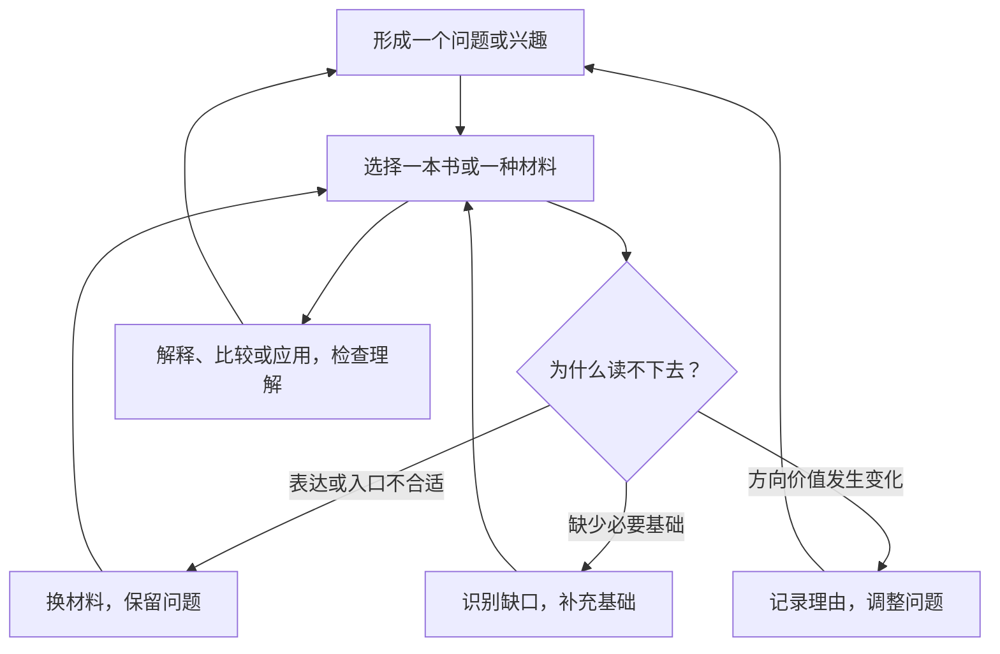
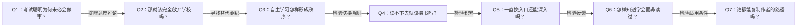

# 《反脆弱》第十六章：混乱中的秩序——深度拆解

> 依据：用户提供的第十六章 Markdown 原文。本章包含自传、比喻和对教育研究的转述；本文据此解释作者的学习机制，不将其视为所有学习者均适用的实证结论。棋类迁移、算术表现、学校选择及注意特性的叙述未作独立研究核验。下文的学习流程、检查表和例子为本文推导。

## x → f → f(x)

- **x：怎样避免把“在规定环境中答对题”误当成“能应对真实世界”，并形成既自主、又能深入积累的学习方式？**
- **f：把必要的制度要求与开放探索分开，以真实问题和好奇心组织学习；允许在材料间切换，却持续保留阅读、验证和追问的活动，用反馈而非单一课程顺序来选择下一步。**
- **f(x)：先明确必须履行的要求，再给自主问题留下时间；遇到不合适材料可以换路径，遇到必要障碍则补基础，并通过解释、应用和复查检验理解，使自由不退化为无积累的跳跃。**

因为结构化环境中的成绩不能自动说明现实能力，作者把学习的组织权更多交给学习者；这种自主若能持续追踪问题并利用反馈，就可能将不确定的阅读路径变为累积性的探索。

## 核心命题

**学习的秩序未必来自事先排定的课程，也可以来自持续的问题、好奇心和择优反馈。可以厌倦一本书，但不必因此厌倦阅读；可以改变路线，而不放弃深入理解。**

第十五章讨论怎样支持不可预见的创新，第十六章把相同结构缩到个人：保留生存与制度底线，让探索路线有余地。作者的重点是自主学习的可选择性，不是把“不按课程学习”本身当成知识。

## 关键洞见

### 1. 游戏内的高分，不能未经检验地外推为生态能力

本章把规则明示、任务边界固定的环境称为游戏领域，把规则不全、变量相互牵连的现实称为生态领域。作者怀疑将前者的成功直接当成后者的能力证明。

| 维度 | 较封闭的任务 | 开放的现实任务 |
|---|---|---|
| 问题 | 通常已由出题者选定 | 可能先要判断什么问题值得解决 |
| 规则 | 相对明确 | 可能不完整或变化 |
| 反馈 | 对错、分数较清楚 | 延迟、模糊，可能有多种解释 |
| 目标 | 在规定条件下表现好 | 在约束中行动、更新并承担后果 |

这是一种分析对照，不是所有课堂与现实的绝对分类。课堂可以引入开放任务，真实工作也包含可标准化的部分。

真正需要检验的是迁移链条：原技能包含哪些成分，新任务共享哪些条件，又增加哪些未知。作者用盲棋、算术和健身作类比，但本章未提供足以支持“课堂所学只能留在课堂”的完整证据。

### 2. 学校可能筛选某种能力，而非创造或测出全部能力

作者回忆父亲的优秀学业、同班差生的商业成功，以及自己观察到的“好学者需要明确任务”。这些片段让他区分：适应清晰评价体系的能力，与在模糊环境里自行发现事情、等待和周旋的能力。

这里有两个不同问题：**谁更容易在某种学校获得高分？学校又实际改变了哪些能力？** 前者是筛选，后者是培养。只观察优秀学生的特征，不能直接确定二者各占多少。

因此，成绩可以说明在一定规则下的表现，不是对人的综合判决。反过来，成绩不好也不是自主、创造力或商业能力的证明。作者挑出的成功差生是反例材料，不是全体差生的成绩单。

### 3. 杠铃式教育保护的是持续探索的空间

作者并非完全脱离学校，而是取得学位、通过必要考试，同时把大量时间放在自己的阅读与问题上。这比“教育或自学二选一”更接近他的实际经历。

| 部分 | 作者叙述中的安排 | 机制 |
|---|---|---|
| 必要底线 | 不被开除、满足考试与学位要求 | 避免制度失败过早关闭后续路径 |
| 开放探索 | 自选书籍、跨主题阅读、追踪概率问题 | 保留机会与自主投入 |
| 连接条件 | 父亲的容许、书店账号、可用时间 | 使探索有实际资源支持 |

“只求过关”是作者在特定处境中的策略，不是普遍学习比例。若某门课是职业资格、后续理解或履行责任的基础，维持底线所需的投入可能很高。杠铃的关键是分清功能，不是刻意学得少。

### 4. 放弃局部材料，可能保护整体学习

本章最可操作的一句话是：可以厌倦某本书，但不要厌倦阅读行为。把一本教材设为唯一入口，可能使对这本书的挫折变成对整个主题的放弃；多本材料则提供替代解释和其他入口。

流程是本文补充的操作化方法。原文强调无趣就切换，但“无趣”可能来自表达差、基础不足，也可能来自必要但困难的练习。把这些原因区分开，才能使退出权帮助学习，而非始终绕过尚未掌握的部分。

可选择性在这里不是囤积无限选项，而是有权换入口，同时继续实际阅读、消化和检验。

### 5. 路线可以无预设，问题却可以长期稳定

作者先广泛读文学与哲学，后来因对罕见事件的疑惑，连续几年集中读概率和随机性相关书籍。这两段共同揭示一种秩序：探索方向由兴趣形成，材料路线可调整，核心问题却可能越来越集中。

**广泛接触 → 发现牵引性问题 → 多路径深读 → 逐渐形成专门能力。** 这不是每天换一个主题来避免困难；他的专注期恰恰持续多年。

作者最后提出“先发现问题，再寻找适用数学”，反对先有一个模型，再改造现实使之适配模型。应保留的原则是模型与任务匹配；并非只有眼前有用途时才允许学习理论，事先储备也可能帮助后来发现问题。

## 实践指引

### 场景一：读一本书卡住，开始怀疑自己不适合这个主题

先写一句“我想从这部分弄懂什么”，再辨认障碍：术语不熟、论证跳步、基础缺口，还是问题本身不再重要。对应选择术语解释、另一种讲法、补基础或换题。

切换之前留一句记录：卡在哪里，暂时接受什么，什么还不知道。这样回来时能接续问题，而不是重复从头翻阅。

### 场景二：教材都能做，真实任务仍然不会

选一个有边界、可恢复的小任务，让问题不完全由教材替你定义。记录自己如何识别目标、选择信息、应对条件变化，再比较与课堂例题有什么差异。

目的不是否定基础练习，而是找出迁移缺口：缺的是提问、判断条件、执行、沟通，还是检验结果。随后针对缺口补学。

### 场景三：想自学，却总在收藏书单和材料

把选择数量与实际投入分开。每轮至少留下一个产物：解释一个概念、复现一个例子、列出一处矛盾，或说明为什么停止这条路径。

记录的目的在于检查反馈，不必用页数竞赛替代分数竞赛。若材料越多、问题却从未变清楚，应减少同时打开的入口。

### 场景四：既有考试与工作要求，又想探索兴趣

列出真正不可忽略的责任与所需能力，再在剩余空间中安排自主探索。为两部分设定各自标准：必要要求要可靠达成，探索部分允许成果和路线发生变化。

不要复制作者每周30—60小时的阅读量，也不把他的家庭资源当作人人已有的条件。需要复制的是争取自主空间的机制，而不是时间数字。

### 场景五：发现一个值得长期投入的问题

围绕同一个问题读取不同难度和立场的材料。遇到某种解释不合适可以换书，但要返回最初问题，比较各自解决了什么、遗漏什么。

定期用不依赖原书措辞的方式解释，或在适合的低风险任务中应用。如果只能复述作者结论，应继续检查，而不是把熟悉感当成理解。

## 例子列表

| 原文案例 | 逻辑位置 | 阅读边界 |
|---|---|---|
| 21点规则与现实生态的对照 | 支撑 x：规则内能力不能自动覆盖开放情境 | 不能由此断言所有形式训练无迁移 |
| 盲棋与棋盘外记忆 | 展示 f：能力可能具有领域特定性 | 研究范围和迁移指标未在本章展开 |
| 15根柱子之间的间隔问题 | 支撑 x：形式训练可能干扰直接理解 | 单类题表现不能证明算术教育总体有害 |
| “足球妈妈”与排满日程的生活 | 支撑 x：过度预设可能挤压自主试错 | 是对控制方式的批评，不能把一类家长整体定性 |
| 野生与圈养狮子的对照 | 展示 f：保障与自主并非同一价值 | 是价值比喻，不是人类教育效果的证据 |
| 父亲的优等生成绩与学校选择 | 展示 f：学业成功者也可能重视课外自主 | 父亲动机与学校效果均为作者回忆 |
| 差生成为成功商人 | 检验 x：成绩不是全部人生表现 | 不能推广为差生更易成功 |
| 交易所等待、社交与周旋 | 展示 f：任务模糊时需要课堂之外的能力 | 依赖特定工作环境，不是普遍用人法则 |
| 健身器材、搬石头与斗殴比喻 | 展示 f：能力需检验适用范围 | 不作训练有效性判断，不复制危险行为 |
| 学位底线加大量课外阅读 | 展示 f(x)：杠铃式学习安排 | 资源、责任与必要基础因人而异 |
| 换书而不放弃阅读 | 展示 f：局部退出保护整体探索 | 需区分材料不合适与必要困难 |
| 20天读20本左拉小说 | 展示 f(x)：主动挑战也存在于自学中 | 不把阅读数量当作理解指标 |
| 英语阅读与跨学科书单 | 展示 f(x)：自主选择拓展路径 | 个人书单不是人人适用的课程 |
| 对概率教材缺口的长期追问 | 展示 f(x)：兴趣可组织多年深入研究 | 发现疑点仍需检验，怀疑本身不是证明 |
| 父亲“不要被开除”的要求及后续骚乱 | 检验 f：底线与实际后果不能混同 | 冲突经历不构成学习自主性的必要条件 |

## 结论列表

1. 在规则明确的环境中表现优秀，不足以单独证明能够处理开放情境。
2. 成绩是特定条件下的表现，不能直接变成人的综合能力标签。
3. 自主学习与取得学位可以并存，关键在于是否保留自己的问题和探索权。
4. 放弃一本不合适的书，可以帮助继续学习，但也可能掩盖必须补足的基础。
5. 路线经常调整，不妨碍围绕同一个问题长期深入。
6. 自学的价值来自选择、持续投入与检验，不来自拒绝课程这一身份。
7. 有效迁移需要检查原任务与新任务的相同条件及新增约束。
8. 学习中的自由需要时间、材料和现实责任的支持，不能只靠态度获得。
9. 问题可以引导工具选择，工具也应接受现实适用性的反向检验。

## Q-A 问答链

### Q-A 问题结构图

### Q1：考试聪明为何未必会做事？

- **结论**：考试与真实任务可能要求不同的提问、信息选择和错误处理能力。
- **形式化**：固定规则内答对 ≠ 规则不全时行动有效。
- **论证**：① 考试常预先给定问题与边界。② 现实可能要求自行识别问题与条件。③ 因而前者的表现不能替代后者的检验。
- **边界**：二者可以共享基础能力，差异不等于零迁移。

**Q1 → Q2**：Q1 限制了成绩的解释范围，却没有证明学校不存在其他价值，所以不能直接跳到全面退出。

### Q2：那就该完全放弃学校吗？

- **结论**：作者的实际安排是保留必要制度路径，同时争取自主探索空间。
- **形式化**：必要要求达成 + 自主问题探索 → 杠铃式学习。
- **论证**：① 作者仍取得学位。② 他没有把课程当成全部知识来源。③ 两部分承担不同功能，而非只能二选一。
- **边界**：必要要求的范围依处境而定，不能统一降为只求低分过关。

**Q2 → Q3**：Q2 给自主探索留下空间，但取消单一课程顺序后，仍需说明什么来组织学习。

### Q3：自主学习怎样形成秩序？

- **结论**：问题、兴趣与反馈可以组织材料选择，而不必预先确定所有步骤。
- **形式化**：问题牵引 → 选择材料 → 得到反馈 → 更新路径。
- **论证**：① 好奇心使某些问题值得持续投入。② 阅读暴露未知与新入口。③ 根据收获和障碍调整下一步，便形成动态秩序。
- **边界**：只有刺激、没有反馈和回访，会变成无积累的游走。

**Q3 → Q4**：Q3 把路径更新视为核心，但何时更新、何时坚持还不清楚，因此要检验换书的理由。

### Q4：读不下去就该换书吗？

- **结论**：先区分材料不合适、基础不足和目标改变，再决定换书、补课或坚持。
- **形式化**：不想读 → 诊断原因 → 选择处理；不等于自动放弃。
- **论证**：① 相似的厌烦可能有不同来源。② 换入口能够解决表达不合适。③ 基础缺口与必要练习则需要另一种处理。
- **边界**：这是对原文策略的补充限定，作者本人更强调以无趣作为切换信号。

**Q4 → Q5**：Q4 允许合理切换，但若路径始终变化，仍需解释深度如何保留。

### Q5：一直换入口还能深入吗？

- **结论**：入口可以变化，只要持续回到核心问题并累积比较结果。
- **形式化**：多种材料 + 稳定追问 + 持续投入 → 可能深入。
- **论证**：① 一本书未必提供最佳解释。② 多个入口可补全视角。③ 返回同一问题时，材料差异能转成更清楚的理解。
- **边界**：若每次切换都换掉问题且不保留所得，便没有同样的积累机制。

**Q5 → Q6**：Q5 描述了可能的积累，却还不能排除只是读得多，因此必须检验理解是否形成。

### Q6：怎样知道学会而非读过？

- **结论**：用自主解释、比较与适用性检查，观察知识能否支撑明确判断。
- **形式化**：阅读输入 → 解释或应用 → 暴露缺口 → 修正。
- **论证**：① 熟悉书面表述不等于理解。② 换一种说法或条件会暴露缺口。③ 根据缺口回读，才使反馈进入学习过程。
- **边界**：不同主题验证方式不同，不应强迫所有文学或理论阅读立即产生实用成果。

**Q6 → Q7**：Q6 为个人学习提供检验方法，但是否有时间和资源持续执行，仍取决于现实条件。

### Q7：谁都能复制作者的路径吗？

- **结论**：可以借鉴自主选择的机制，不能把作者的资源、时间和成功当成普遍前提。
- **形式化**：可借鉴机制 ≠ 可复制全部人生条件。
- **论证**：① 作者获得书店账号与家庭容许。② 他也有学位、语言基础和长期投入。③ 他人的方案必须重新适配责任、资源和基础。
- **边界**：条件受限不取消自主空间的价值，但会改变范围与节奏。

## 局限与盲区

### 从领域特定性到“课堂所学只能留在课堂”，跨度过大

能力不能自动迁移，不等于绝不能迁移。棋类与算术例子需要考察样本、任务、比较组及学习阶段，本章没有提供足够细节。它们可以提示检验迁移，不能完成对学校教育的整体否定。

### 自传呈现了成功路径，没有呈现所有同样选择者

差生致富、作者自主阅读成功，与成绩好者可能出现的局限，被放在鲜明对比中。尚缺按相同标准比较的全体结果。拒绝教材、逃课和自主投入可能有不同后果，不能只由成功者回忆判断净效果。

### “自由探索”背后有大量稳定支持

书店账号、父亲的容许、已有基础与每周大量阅读时间，都是机制的一部分。若忽略这些条件，仅复制低课程投入，可能同时失去必要能力与现实保障。

### 不喜欢与不值得，不是同一个判断

厌烦可以提示材料不合适，也可能意味着尚未获得理解所需的熟练度。作者长期专注概率问题、挑战密集阅读的经历，反而表明自学并不排除艰难投入。“毫不费力”更宜理解为动机强烈时的主观体验。

### 反对按成绩贴标签，不应改为按性格贴标签

本章把好学生、首席执行官、学校学习者与“书呆子”紧密相连，容易重复其所批评的评价替代。需要检验的是具体表现与适用环境，而不是把不合群、厌学或擅长社交中的任何一种特征认定为能力保证。

### 自主性不能由危险经历证明

战争、街头冲突和作者被拘押的经历属于叙事背景，不是获取现实能力的必要路径。本文保留的是在可承受后果下自主探索的机制，不把不可逆伤害纳入学习安排。

### “宝贵知识不在数据库”是立场，不是普遍事实

职业所需知识可能来自文献、数据库、导师、实践和协作。关键在于是否相关、可信、可迁移，而不是是否远离某个中心。对正规知识的怀疑，也应接受与经验直觉相同的检验。

本章提供的更可持续做法是：**保护必要底线，允许改变材料路线，持续回到值得追问的问题，并用反馈判断是否真的学到。** 混乱发生在路径上，秩序来自投入、问题和更新。
