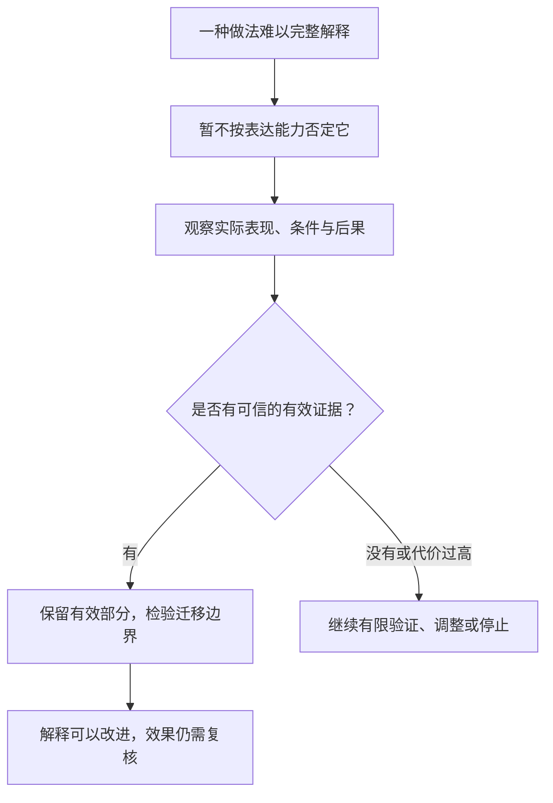

# 《反脆弱》第十七章：胖子托尼与苏格拉底辩论——深度拆解

> 依据：用户提供的第十七章 Markdown 原文。托尼与苏格拉底的对话是塔勒布构造的思想实验，不是历史会面；哲学家观点、人物评价和教育预言主要按作者解释分析，未逐项作思想史考证。本文另据柏拉图对话译文与NIST统计手册校核术语，链接置于相应段落。下文流程与应用场景为本文推导。
>
> 两项校读：① 附件把《欧蒂弗罗篇》的核心概念多次写作“孝顺”，但该对话讨论的是虔敬、敬神与不敬神，不能直接套成中国语境的孝道。② 附件把95%置信水平解释为结论有5%概率错误，混同了统计置信程序与具体命题概率。后文分别说明。

## x → f → f(x)

- **x：一个人说不清自己为何做对，是否就不算知道？当事件真假难以确定时，又该根据什么行动？**
- **f：把定义能力、实践能力与决策后果分开；不因缺少解释便否定隐性知识，也不以一次实践成功免除检验；在不确定条件下比较不同错误的损害，先调整自己的敞口，再决定需要多精确的判断。**
- **f(x)：评价做法时同时看可观察表现、适用边界和代价；面对不能准确预测的事件，追问“判断错了会怎样、能否承受、有哪些可逆保护”，而不是等到穷尽定义与概率后才行动。**

因为表达和推理不能穷尽行动能力，作者要求承认不完全可叙述的知识；又因为同样的判断错误可能造成截然不同的后果，决策必须把损益结构放回分析。

## 核心命题

**无法完整说明一种能力，不足以证明这种能力不存在；相信某件事大概率不会发生，也不足以证明无需防护。行动质量既取决于对世界的判断，也取决于判断出错时自己承担什么。**

作为第四卷收束，本章把绿色木材谬误推进到定义与知识的层面，再把问题收回风险敞口：第十二章的选择权、第十三至十五章的实践与创新、第十六章的自主学习，都不要求事前理解一切，但要求控制错误并识别更好的结果。

## 关键洞见

### 1. “能定义”“能解释”“能完成”是不同能力

托尼质疑的关键前提是：必须先说出一个概念的本质，才能正确使用它或据之行动。他以婴儿、狗和骑车作反例，说明某些能力可以先于语言解释存在。

| 能力 | 主要检验 | 不能直接推出的结论 |
|---|---|---|
| 定义 | 能否明确词语的使用边界？ | 不能据此保证执行有效 |
| 解释 | 能否说明某种做法为何有效？ | 不能据此保证自己能做到 |
| 实践 | 能否在一定条件下完成任务？ | 不能据此保证解释正确或跨情境有效 |

这不是宣布解释多余，而是取消其对所有能力的独占证明权。一个人不会用公式描述骑车，不等于他不会骑；一个人能说清骑车理论，也不等于能稳定骑行。

反过来，婴儿摄食的例子不能直接解决审判、敬神或公共道德问题。后者涉及他人的权利与可争议的标准，要求解释可能有独立价值。托尼的反例能打破“所有行动必须先定义”的全称命题，却不能使所有反思失去必要性。

### 2. 不能证明不存在，不等于已经证明有效

本章借火鸡问题强调：我们没看见某种知识，不代表它没有作用。一个人表达困难，也可能掌握经验中的细微差异。

但仍需分清两步：**不能因说不清便判无效；也不能因说不清便判高深。** 对实践的尊重，应转成观察、比较和适用条件记录，而不是给直觉颁发免检证。

作者也为苏格拉底留下一个位置：即使无法定义某物，追问仍可能排除错误定义。澄清与实践并不必然互相破坏；真正危险的是在没有替代方案与后果评估时，把“解释不完备”当作摧毁现有做法的充分理由。

### 3. 阿波罗与酒神：产生候选，与筛选候选互相补充

作者借尼采把阿波罗理解为秩序、逻辑与约束，把酒神理解为本能、未驯服的变化及难以理解的部分。然后把二者重新解释为可选择性的两个环节：随机探索生成候选，理性比较保留更好的结果。

**没有变化，只剩对既有方案的重复；没有筛选，变化也不自动累积为进步。**

这是塔勒布对尼采的机制化阅读，不是证明尼采已经提出了现代意义上完整的反脆弱理论。塞内加加入力量的第三维，则可理解为提醒：仅发现好方案还不够，行动还需要承受与执行能力；这一操作性解释是本文推导。

### 4. 真或假提供信息，后果决定信息应怎样进入选择

安检例子的逻辑不是“每个乘客很可能有危险”，而是“即使危险概率低，漏掉危险的损失也可能非常大，而适当检查有其成本与保护作用”。

| 判断层 | 要回答的问题 |
|---|---|
| 事件 | 某件事可能发生吗，证据支持到什么程度？ |
| 敞口 | 发生时会如何影响我或其他人？ |
| 行动 | 采取保护能减少什么损失，又新增什么成本与伤害？ |

因此，低概率不等于低风险，高概率也不等于值得行动。作者反复说概率不重要，更稳妥的读法是：**概率不能脱离后果单独完成决策，且在估不准时，应优先检查不可承受敞口。**

后果也不能脱离概率与保护有效性单独决策。否则，只要能编出足够可怕的情景，就能为无限防护辩护。必须比较证据、措施效果、成本以及新产生的风险。

### 5. 事件难预测，不妨碍先改变自己受影响的方式

“黑天鹅会不会出现”与“出现后我会不会被毁掉”，延续第十四章“不是同一回事”的区分。可以在不知道触发事件细节时，减少对某种顺利情景的依赖。

例如，组织不必先点名下一次中断来自何处，才开始检查单点依赖和恢复能力；个人也不必确信某种失败必然发生，才限制不可逆承诺。这里是结构上的谨慎，不是把所有未知都列为灾难。

作者说风险比知识重要，核心在于：知识的价值要经过行动及其后果检验。但正确事实仍能帮助识别敞口，不能由此把真实性降为可随意替换的装饰。

## 《欧蒂弗罗篇》的概念校准

柏拉图的[《欧蒂弗罗篇》译文](https://classics.mit.edu/Plato/euthyfro.html)围绕虔敬或神圣展开，讨论起诉父亲是否虔敬，以及虔敬与诸神喜爱的关系。因此，附件中的“孝顺”会制造额外歧义：读者可能误以为对话只是争论起诉父亲是否符合孝道。

本章需要保留的冲突是：**是否必须先给虔敬一个充分定义，才有资格确信自己的虔敬判断？** 这与“有些能力不依赖先行定义”相连，但道德与公共行为比骑车有更多可争论的责任，不能单靠技能类比裁决。

托尼说“应处死苏格拉底”是作者刻意制造冲突的修辞。即使认为苏格拉底的论证有问题，也不能推出处死他的正当性；思想批评与刑罚判断是不同命题。附件中的想象对话也不能作为历史上苏格拉底会如何回答的证据。

## 实践指引

### 场景一：评估一个不擅长说理的实践者

让他在职责相关、风险可控的任务中展示能力，观察结果稳定性、异常处理和适用范围。允许示范、对比与实例说明，不强迫所有经验先被压成抽象定义。

同时保留责任边界：若工作涉及团队协作、安全或公共决策，必要的说明与可复核记录仍不可省略。尊重隐性知识不等于放弃问责。

### 场景二：遇到一个听起来错误、却似乎有效的经验法则

把“做法是否有效”与“持有者的解释是否正确”分别记录。在低风险条件下检验实际效果；有效部分可以暂时保留，解释仍允许修改。

若做法涉及不可逆伤害，不能以“祖辈都这么做”“说不清的智慧”绕过证据要求。传统提供研究线索，不自动提供正确答案。

### 场景三：因概率低而准备忽略某种风险

先列出不采取措施的可能后果，再列出措施的成本、有效性与副作用。如果潜在后果不可承受，优先寻找能显著降低敞口、又不引入更大损害的安排。

这里不要求编造精确概率，也不接受“概率未知所以一定要防到极致”。应把最关键的证据缺口写出来，并据风险性质选择进一步调查或可逆保护。

### 场景四：讨论陷入定义争执

先确认争论需要解决的任务：是避免词义混淆、裁定责任，还是改进某个操作？定义能够消除实际歧义时，继续澄清；定义暂时无法穷尽时，改用例子、边界和可观察结果推进。

不要因为语言不完备就宣布实践没有知识，也不要因为对话没有最终答案就宣布对话毫无价值。

### 场景五：想推翻一种旧制度或旧流程

分别检查旧做法解决过什么问题、如今造成什么损害、新方案如何处理同样约束，以及切换会否产生不可逆后果。可行时先局部试验，留下退出与修正空间。

这是一种对变化路径的谨慎，不是用复杂性替现存不公辩护。旧制度的成本也要进入比较，不能只检查改革风险。

## 例子列表

| 原文案例或人物群 | 逻辑位置 | 阅读限定 |
|---|---|---|
| 《欧蒂弗罗篇》无法给出满意定义 | 支撑 x：解释与行动判断可能脱节 | 核心概念为虔敬，不简化成孝顺 |
| 托尼与苏格拉底的想象对话 | 展示 f：拒绝把定义能力等同于全部知识 | 思想实验，不是历史记录 |
| 婴儿摄食、狗忠诚、骑自行车 | 展示 f：某些行为先于明确解释 | 不能直接解决道德争议与公共责任 |
| 诗人解释不了作品 | 展示 f：创作能力不等于诠释能力 | 不代表诗人的解释必差，或作品无需讨论 |
| 尼采的阿波罗与酒神 | 展示 f：变化与筛选的互补 | 是作者的反脆弱解读，不等同于完整思想史 |
| 塞内加的酒神、力量与理性象征 | 展示 f：多种能力共同构成行动 | 象征不能替代具体机制证据 |
| 勒南批评逻辑忽略细节 | 支撑 x：形式化可能遗漏情境 | 不证明逻辑在道德与政治领域一概无用 |
| 老加图及对苏格拉底的批评 | 展示 f：传统实践对概念挑战的反应 | 不据此确认处刑理由或政治立场的全部史实 |
| 伯克、奥克肖特、迈斯特 | 展示 f：尊重积累、警惕总体重构 | 思想家政治主张不同，不因共享一点就整体认同 |
| 维特根斯坦、哈耶克与列维–斯特劳斯 | 展示 f：语言、分散知识与具体知识的边界 | 作者的归类与批评仍需逐人文献核验 |
| 约翰·格雷的午餐讨论 | 展示 f(x)：共同思想走向行动讨论 | 友谊、趣味和共识不构成观点正确的证据 |
| 安检与核事件防护 | 展示 f(x)：小概率不等于可忽略后果 | 本章未作措施成本效益的完整比较 |
| 随意服药的设问 | 展示 f：不能仅因未确信有害就行动 | 不作为任何具体药物的使用建议 |
| 飞机安全的百分比例子 | 展示 f：同样数值在不同后果下意义不同 | 不混同置信水平与单次事件概率 |
| 名校奢侈品化与教育体系崩溃预测 | 检验 f(x)：价格、地位与实际价值分开 | 是作者判断，不是已经发生或已获证明的终局 |

## 结论列表

1. 无法完整表述一种能力，不足以证明这种能力不存在。
2. 实践有效与解释正确是不同命题，必须分别检验。
3. 定义可以澄清分歧，却不能独占所有知识的证明方式。
4. 尊重隐性知识不意味着放弃证据、责任或纠错。
5. 生成新候选与理性筛选相互补充，变化本身不保证进步。
6. 低概率事件仍可能重要，因为后果规模与承受能力不同。
7. 概率不足以单独决定行动，后果也不能脱离证据与成本独自决定行动。
8. 事件与风险敞口不同，预测困难时仍可能通过结构调整减少伤害。
9. 对现有做法的谨慎与对改革的谨慎，都应检查各自的实际代价。

## Q-A 问答链

### Q-A 问题结构图

```mermaid
flowchart LR
    Q1["Q1：说不清为何不等于不会做？"]
    Q2["Q2：那还需要苏格拉底式追问吗？"]
    Q3["Q3：怎样不把神秘感当智慧？"]
    Q4["Q4：探索为何还要理性筛选？"]
    Q5["Q5：判断大概率没事就够了吗？"]
    Q6["Q6：不知道概率还能怎样行动？"]
    Q7["Q7：只看后果会不会过度防护？"]
    Q1 -->|"检验反思价值"| Q2
    Q2 -->|"补充证据标准"| Q3
    Q3 -->|"引出筛选机制"| Q4
    Q4 -->|"区分真假与选择"| Q5
    Q5 -->|"推导敞口调整"| Q6
    Q6 -->|"检验行动边界"| Q7
```

### Q1：说不清为何不等于不会做？

- **结论**：完成任务的能力可能以经验和习惯存在，不依赖先给出完整语言定义。
- **形式化**：可操作的知道 ≠ 可完整说出的知道。
- **论证**：① 行动可在反复反馈中形成。② 语言化是另一项任务。③ 因而语言困难不能单独否定行动能力。
- **边界**：某些职责确实需要说明理由，技能存在也不保证在新环境中可靠。

**Q1 → Q2**：Q1 否定定义的独占地位，但还未说明追问能否改善判断，所以必须保留对反思价值的检验。

### Q2：那还需要苏格拉底式追问吗？

- **结论**：需要能澄清歧义和暴露矛盾的追问，不应以未得完整定义为由否定全部实践。
- **形式化**：追问澄清边界 ≠ 追问取消能力。
- **论证**：① 概念混淆可能导致错误判断。② 追问能够排除某些错误解释。③ 但排除解释不等于证伪相关技能。
- **边界**：在责任与公共争议中，不能以“我就是知道”终止一切讨论。

**Q2 → Q3**：Q2 同时保留追问与实践，仍需说明当解释缺席时该用什么判断做法的价值。

### Q3：怎样不把神秘感当智慧？

- **结论**：以可观察效果、代价和适用范围检验，不以难表达本身授予权威。
- **形式化**：解释不足 → 暂缓定论；不是自动无效，也不是自动高深。
- **论证**：① 隐性能力与错误直觉都可能难以表述。② 仅凭表达状态无法区分二者。③ 需要比较表现并记录条件和后果。
- **边界**：反馈延迟或难以观察时，更应控制试验代价，不能把证据缺失变成免责。

**Q3 → Q4**：Q3 要求结果检验，而不断探索会产生多种结果，因此必须解释筛选怎样使变化变成积累。

### Q4：探索为何还要理性筛选？

- **结论**：随机变化提供候选，识别、保留和利用更好结果才形成可选择性。
- **形式化**：候选变化 + 结果比较 + 保留能力 → 有效探索。
- **论证**：① 变化可能带来好结果，也可能带来坏结果。② 无差别继续不能保证改进。③ 理性筛选让反馈改变下一步行动。
- **边界**：更好需要明确评价范围，个人受益也可能把成本转给他人。

**Q4 → Q5**：Q4 把判断指向结果的好坏，而不仅是观点的真假，因此需要检验“大概率判断正确”是否足够行动。

### Q5：判断大概率没事就够了吗？

- **结论**：不够，同样的低概率在不同损失规模下会产生不同决策要求。
- **形式化**：事件可能性 + 后果规模 + 承受能力 → 决策相关风险。
- **论证**：① 少见不意味着后果轻。② 一次不可恢复损失可能取消后续机会。③ 因而还需检查敞口和保护办法。
- **边界**：后果严重也不自动证明任何防护都值得，仍需检验措施及成本。

**Q5 → Q6**：Q5 要求把后果加入分析，但在罕见事件中概率本身可能不可靠，所以还要找不依赖精确估计的行动途径。

### Q6：不知道概率还能怎样行动？

- **结论**：可以先降低不可承受依赖、限制损失，并保留恢复与退出空间。
- **形式化**：少依赖精确预测 → 多检查敞口、可逆性与生存边界。
- **论证**：① 触发事件可能未知。② 某些共同失效路径仍可识别。③ 调整路径上的承诺与依赖，可能减少多类冲击的损害。
- **边界**：保护本身会花费资源，所谓安全也可能有隐藏条件，必须复查。

**Q6 → Q7**：Q6 允许在概率不明时先保护，但若对所有想象的灾难都行动，会产生新的负担，因此必须限定保护原则。

### Q7：只看后果会不会过度防护？

- **结论**：会，必须同时检查证据、措施有效性、机会成本与新伤害。
- **形式化**：重大后果是检查理由 ≠ 无限防护的充分理由。
- **论证**：① 可想象的灾难没有自然终点。② 资源与行动能力有限。③ 所以应比较实际减损与新增代价，优先采取有效且可修正的安排。
- **边界**：部分不可逆风险需要提前约束，但约束仍须说明理由和适用边界。

## 局限与盲区

### 置信水平不是结论为真的概率

NIST的[置信区间说明](https://www.itl.nist.gov/div898/handbook/prc/section1/prc14.htm)解释：95%的置信水平描述在相应假设下重复抽样时，所用构造程序的区间覆盖真实参数的长期比例。它不能直接读为“本次结论有5%概率错误”，更不能直接转换成某次飞行的坠机概率。

本章真正有效的提醒是：单个把握程度数字不包含全部后果；但这需要与正确的统计术语分开，不能用术语混用来支持“概率无关紧要”。

### 对苏格拉底的反例，尚未解决其最强问题

会骑车不能证明一个人在起诉、伦理或政治争议中的判断正当。语言澄清与道德问责不完全等同于技能说明。作者对历史苏格拉底、柏拉图和虚构对手的处理，也有意为论战服务，不是中立的苏格拉底研究。

### “风险比知识重要”不应变成“真假无关”

识别风险仍需要事实：保护是否有效，做法是否有害，受益是否真实。后果导向纠正了只讨论真假的不足，却不能替代对真假本身的调查。有效解释与行动后果应当互相校正。

### 传统可能储存智慧，也可能储存权力与惯性

本章援引的思想家在政治立场上差异很大。认可隐性经验，不代表接受他们全部政治结论；反对突变的不可预见后果，也不能忽略维持旧制度的伤害。规则存续不是它对所有人有益的充分证据。

### 对名校和教育机构的批评，尚不是崩溃预测的证明

作者关于价格、地位与机构激励的质疑可以逐项研究，但“骗局终会揭穿”不能提供时间、路径和必要条件。本章末尾对教育体系的终局判断，是作者的前瞻主张，应与已经展示的证据分开。

### 对理论万能的批评，不应复制另一种万能说法

未能完整解释可能提示有隐性机制，也可能只是暂时缺乏证据。不能由此断言宗教与传统总优于科学、实践者总优于研究者，或不可理解天然值得保留。适用边界、效果和责任，仍是双方都要面对的标准。

本章最值得持续使用的两个问题是：**我是在评价一种能力，还是只在评价对它的解释？即使判断错了，我和别人会承担怎样不同的后果？**
