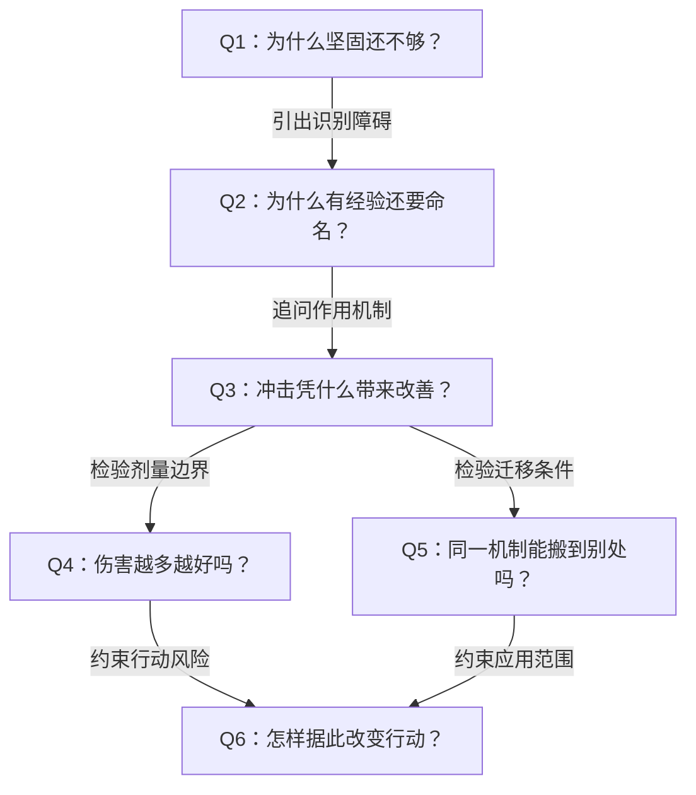

# 《反脆弱》第一章：达摩克利斯之剑和九头蛇怪——深度拆解

> 材料：用户提供的《反脆弱第一章》Markdown 原文。以下只拆解本章，不用全书后续理论补写本章尚未完成的论证。神话、历史和科学材料按作者的论证用途分析，不视为已经独立核验的事实。实践部分为据此推导的应用。

## x → f → f(x)

- **x：为什么我们把“不怕冲击”当成最好的状态，却看不见有些系统会因冲击而改善？**
- **f：按系统受到冲击后的变化，区分受损、保持或恢复原状、变得更好；再用“反脆弱”命名第三种反应，使原本分散的经验可以被共同识别。**
- **f(x)：面对不确定性，先判断具体系统面对具体冲击会怎样变化，再决定消除哪种风险、保留哪种可承受的刺激，以及如何让反馈带来改善。**

三者连起来：因为“抗住”遮蔽了“获益”，作者建立三分法；有了三分法，我们才可能把目标从单纯保护，推进到识别并设计有益的受扰过程。

## 核心命题

**脆弱的严格反面是受到冲击后获益，而不只是经受冲击后无损。**

本章首先完成的是分类和识别工作：把“会变得更好”从“不会变坏”中分离出来。它尚未证明所有系统都能做到这一点，也尚未完整交代如何建造这样的系统。

## 关键洞见

### 1. 抗打击和从打击中获益，属于不同的反应

香槟包裹受到颠簸会破损；牢固包裹受到颠簸仍然无损；设想中的反脆弱包裹受到颠簸反而改善。如果只使用“易碎／不易碎”，后两者就会被混在一起。

这里的逻辑不是争论日常词典里哪个反义词正确，而是建立一个更有分析价值的分类：**结果向下、结果不变、结果向上，不能压成两类。**

| 作者的意象 | 冲击之前 | 冲击之后 | 说明什么 |
|---|---|---|---|
| 达摩克利斯之剑 | 享用盛宴，表面安稳 | 悬挂处失效，灾难发生 | 平静可能掩盖脆弱性 |
| 凤凰 | 处于原有状态 | 毁灭后重生 | 恢复能力仍以回到原状为标尺 |
| 九头蛇怪 | 原有数量的头 | 砍掉一个，长出两个 | 冲击使其能力增加 |

凤凰是本章对复原能力的隐喻；“复原力”在其他学科中可能另有更宽的定义，不能据此把所有现实中的复原过程都判为完全不变。

### 2. 平静描述过去，脆弱性描述面对冲击的后果

达摩克利斯的财富、权力和眼前盛宴，都不能改善悬剑的支撑条件。只观察他过去过得多好，就会漏掉真正决定灾难的薄弱处。

逻辑链是：长期无事故 → 人们逐渐忽略薄弱处 → 暴露可能继续累积 → 一次冲击造成巨大损失。因此，安全判断不能只依赖过去的平静，还要看失效路径。

本章由此把注意力从“下一次意外何时来”转向“意外来时哪里会断”。但作者关于弱点可以识别、衡量和追踪的主张，在本章仍主要是方向提示，并非完整测量方法。

### 3. 没有名字，不等于没有经验；有了名字，也不等于已经解释

作者用颜色词说明：人可能辨认某种差异，却缺少表达这种差异的统一名称。同样，人们早已接受某些刺激会带来改善，却未把这些经验归入共同概念。

命名的作用在于让经验可以被比较、传授和迁移：从“这个例子很特别”，走向“这些例子是否具有同一种反应结构”。

但命名只是提出一个可讨论的对象。“反脆弱”三个字本身既不会创造适应能力，也不能代替对作用机制的验证。

### 4. 有益刺激的关键是反应与剂量，不是伤害本身

本章先谈米特拉达梯式解毒法，再谈毒物兴奋效应，意在把“耐受某种伤害”推进到“在一定条件下，刺激带来净改善”。作者为后一种现象提出的解释线索是过度反应或过度补偿。

可以把本章提示的机制写成：

**有限刺激 → 系统产生适应反应 → 反应可能超过恢复所需 → 某方面的能力提高。**

“可能”不可省略：刺激必须遇到合适的系统、剂量和条件，改善也必须实际发生。不能从“有些小刺激有益”推出“所有有害事物少量都有益”，更不能推出“伤得越重成长越快”。本章末尾才准备继续讨论过度补偿，尚未充分展开其普遍机制。

### 5. 理解概念的难处，是换了场景还能认出来

迪拜的银行家让门童搬行李，却在健身房主动举重。作者想指出：同一种负荷，一旦换上“麻烦”或“锻炼”的标签，就会触发不同判断。

这一故事的价值是暴露提问上的不一致，而不是证明银行家行为必然错误。他可能为了节省时间，也可能知道举重比搬行李更可控。**跨领域迁移应当迁移机制和检查问题，不能只迁移表面相似性。**

真正值得带走的问题是：我在这个场景里急于清除的负担，会不会恰好是另一个场景里主动购买的刺激？两者的差异是否足以支持不同处理？

## 实践指引

以下是概念应用，不是本章原有案例，也不是医疗或投资处方。

### 场景一：学习——让暴露错误产生可留下的改变

只反复阅读熟悉材料，可能让学习过程很顺，却没有暴露理解缺口。可以尝试闭卷解释一个概念，再核对原文，把错误改成下一次需要回答的问题。

这里的“刺激”是暴露不会的地方；适应机制是纠正和再次检索；改善证据是之后能独立解释或迁移。如果一直答错却没有纠正，失败本身并不构成反脆弱。

### 场景二：软件维护——把故障反馈变成改进

一次故障后恢复服务，体现恢复能力。若进一步消除故障原因、改善隔离方式，并验证相同触发条件下系统表现更好，才有理由说这次反馈带来了能力增长。

不能因故障后做了改进，就把原事故说成值得发生。主动验证应选用影响可控制的环境；评价仍要计入事故造成的损失。

### 场景三：项目探索——让小失败改变下一步

在投入大量资源之前，先用有限范围的试做检验一个关键假设。试做失败后，应能明确删去一个错误假设或改变下一轮方案。

如果试做既无法改变决策，也没有产生可用知识，它就只是一次损失。“失败很多次”不等于具备反脆弱性。

### 一个通用检查顺序

1. **定对象：**谁在承受冲击，谁获得好处？不要把整体受益当成每个成员受益。
2. **定刺激：**是何种冲击、何种强度？“压力”太笼统，无法直接判断。
3. **定改善：**受冲击后，哪种能力优于之前？回到原状不能自动算改善。
4. **找机制：**反馈通过什么过程转化为变化？重复承受不等于学会适应。
5. **查边界：**损失是否可承受，是否存在无法恢复的破坏，评价是否漏算他人的代价？

以上是对本章的操作化延伸，不是作者在此已经给出的完整设计法。

## 例子列表

- **香槟包裹与“请乱扔乱放”：**用同一种颠簸区分损失、不变与获益。← 展示 f。
- **达摩克利斯之剑：**富足与长久平静不能消除关键支撑处的脆弱。← 支撑 x，展示 f。
- **凤凰重生：**恢复原状提供了第三类反应的对照基准。← 展示 f。
- **贝鲁特重建：**作者以重建后的改善引出“超越恢复”的可能。← 展示 f；不能单独证明破坏带来净收益。
- **九头蛇怪：**被砍头后头数增加，直观呈现从冲击中获益。← 展示 f；属于定义性隐喻。
- **颜色识别与颜色命名：**行为中的辨别能力可以先于语言中的明确分类。← 解释 x，支持命名这一 f。
- **米特拉达梯与阿格里皮娜：**用传说中的毒物耐受展示适应的特定性；耐毒不能防刀剑。← 展示 f 及其边界。
- **小剂量刺激与毒物兴奋效应：**引出反应随剂量改变、适应可能带来改善的思路。← 展示 f 的机制线索。
- **热量限制：**作者用于讨论压力源缺失，但也承认人体寿命验证困难。← 展示 f 的候选应用，并暴露证据边界。
- **搬行李与举重：**同类负荷在不同场景中被赋予不同意义。← 支撑 x，提示 f(x) 中的迁移检查。
- **运动建议与感染用药：**作者用其批评领域依赖；本章没有给出足以评价具体用药的临床信息。← 展示作者对 x 的判断，不据此导出治疗建议。
- **商品价格与利率管理：**作者用类比质疑判断的一致性。← 提示 f(x)；类比本身不足以完成货币制度论证。

## 结论列表

1. 能承受冲击与能从冲击中获益，是两种不同能力。
2. 长期没有发生损失，不能单独证明系统不存在脆弱性。
3. 反脆弱性需要说明针对什么冲击、在什么范围内成立。
4. 经验可以先于命名，但命名有助于比较和交流经验。
5. 适应机制创造改善，伤害本身不保证改善。
6. 去除压力源是否有益，取决于该压力源对系统的具体作用。
7. 跨领域应用需要验证机制，不能只复用一个令人信服的比喻。
8. 一次灾难之后出现改善，不足以证明那场灾难带来了净收益。

## Q-A 问答链

### Q-A 问题结构图

### Q1：为什么坚固还不够？

- **结论：**坚固只能说明冲击没有使系统变坏，不能说明冲击使其变好。
- **形式化：**受损 ≠ 无损 ≠ 获益。
- **论证步骤：**① 易碎品受颠簸后损坏。② 坚固品保持原状。③ 九头蛇式对象却因攻击增加能力。④ 后两者需要分开讨论。
- **边界：**“不够”指分类不够，并非所有现实对象都必须追求反脆弱；对很多物品，无损已经是合理目标。

**Q1 → Q2：**因为 Q1 区分了两种长期混用的结果，所以必须追问：人们既然体验过改善，为何还需要一个新名称？

### Q2：为什么有经验还要命名？

- **结论：**命名让零散经验变成可以共同识别和比较的对象。
- **形式化：**局部会做 → 统一命名 → 可以讨论和比较。
- **论证步骤：**① 能辨别颜色不必先有颜色名称。② 能实践某种适应也不必先理解统一理论。③ 缺少共同名称使经验容易被困在原有场景。④ 命名为迁移提供认知支点。
- **边界：**颜色例子是类比；它不能证明所有认知障碍都源自缺词，名称也不保证正确理解。

**Q2 → Q3：**因为 Q2 解决的只是识别和交流，尚未解释真实系统为何会改善，所以必须继续追问作用机制。

### Q3：冲击凭什么带来改善？

- **结论：**在本章提示的适应型情形中，改善来自系统对刺激的反应，而非刺激自带好处。
- **形式化：**有限刺激 → 适应反应 → 可能产生超出恢复的改善。
- **论证步骤：**① 刺激使系统偏离原状态。② 某些系统会启动适应反应。③ 反应可能留下超过原有水平的能力。④ 只有观察到这种改变，才能确认获益。
- **边界：**不是所有系统都有适应机制；本章也未证明所有反脆弱现象都依赖这一机制。

**Q3 → Q4：**因为 Q3 把改善归因于特定反应，而不是归因于伤害本身，所以必须追问这种反应在哪个强度范围内成立。

### Q4：伤害越多越好吗？

- **结论：**某个范围内有益，不能推出更大范围内仍然有益。
- **形式化：**有限刺激可能有益 ≠ 无限加量持续获益。
- **论证步骤：**① 本章强调小剂量和大剂量可能产生不同结果。② 这说明结果不能按刺激数量简单外推。③ 若损伤超过适应能力，改善机制便不足以抵消损失。
- **边界：**具体阈值依对象和刺激而变，本章没有提供普适安全剂量；毒物故事不能作为自行尝试的依据。

**Q3 → Q5：**因为 Q3 的机制依赖系统具备适应能力，所以即使另一个领域也出现“压力”，仍须确认那里是否存在相同的因果过程。

### Q5：同一机制能搬到别处吗？

- **结论：**可以迁移待检验的机制，不能直接迁移已经成立的结论。
- **形式化：**场景相似 → 提出假设；机制相符＋结果验证 → 支持应用。
- **论证步骤：**① 举重与搬行李都包含负荷。② 负荷相似提示可能存在共同作用。③ 但可控程度、时间成本和目的可能不同。④ 必须核对这些条件后，才能判断处理是否一致。
- **边界：**个人适应、机构调整和社会变化可能使用不同机制，不能仅凭同一个词就认定等价。

**Q4 → Q6：**因为 Q4 确认收益有强度边界，所以行动必须先控制可能超出承受范围的损失。

**Q5 → Q6：**因为 Q5 确认跨领域结论需要验证，所以行动还必须设置可观察的改善指标，不能只增加压力。

### Q6：怎样据此改变行动？

- **结论：**先控制不可承受的损失，再用可承受的尝试检验反馈是否真正提高能力。
- **形式化：**界定对象和刺激 → 控制损失 → 获取反馈 → 调整 → 验证改善。
- **论证步骤：**① 先说明谁承担后果。② 再定义刺激与可接受范围。③ 让反馈进入真实调整。④ 比较调整前后的表现。⑤ 只有出现净改善，才有理由继续该过程。
- **边界：**这是由本章推导的实践顺序；对不可逆、高代价或后果难以界定的对象，不能因为“可能成长”而贸然制造冲击。

## 局限与盲区

### 隐喻让概念清楚，却不能代替经验论证

九头蛇的故事直接把“被攻击后增益”写进设定，因此能展示定义，却不能证明现实中普遍存在相同关系。现实例子仍需分别检查。

### “灾后更好”不等于“灾难有利”

重建后的城市更美，并未计入生命损失、流离失所、重建成本和本可通过其他路径实现的改进。若只观察灾后的新建筑，就可能把昂贵恢复误认为净收益。

### 传说、科学线索和制度主张的证据层级不同

古代毒物故事是叙事材料，剂量反应是需要明确条件的经验命题，利率与价格管理则涉及复杂制度差异。它们可以共同帮助提出问题，却不能相互充当证明。本章对颜色史、财政赤字和生物效应的若干强断言，也不应仅因叙述有说服力就全部照单全收。

### 适应能力不是整个对象的永久属性

对一种刺激获得耐受，不代表能承受另一种刺激；某方面能力提高，也可能伴随其他代价。作者用“耐毒却不耐刀剑”已经提示这一点。读者应用时应把对象、刺激、范围和评价指标放在一起。

### 第一章提出议程，尚未完成方法

这一章最扎实的收获是新的分类、观察方式和待检验问题。过度补偿如何发生、反脆弱如何建造，以及个体损失与系统收益如何区分，都还需要后续论证。把这些尚待回答的问题保留下来，比提前把第一章改写成万能生活原则更忠于原文。
