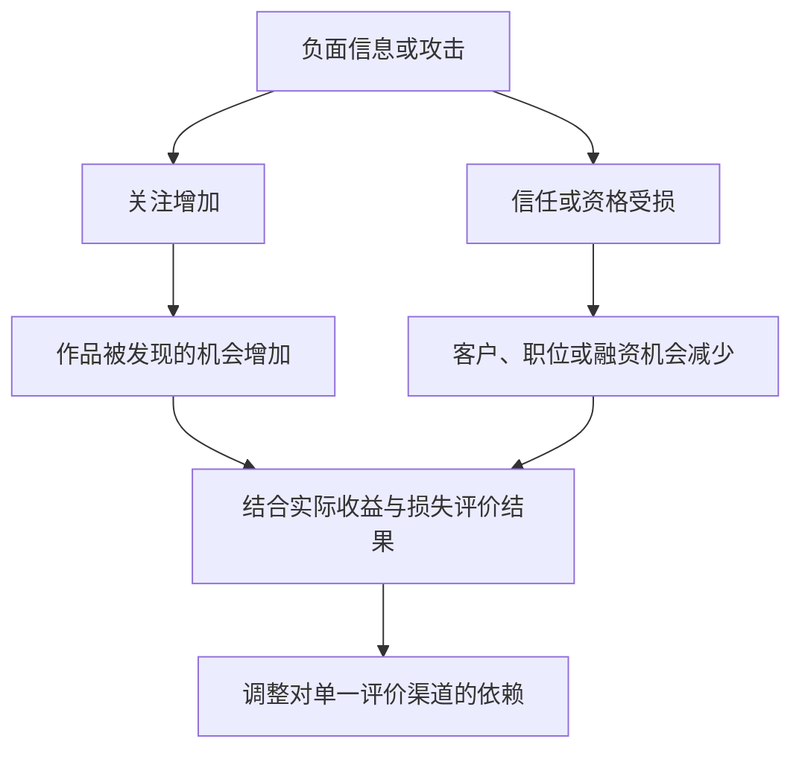
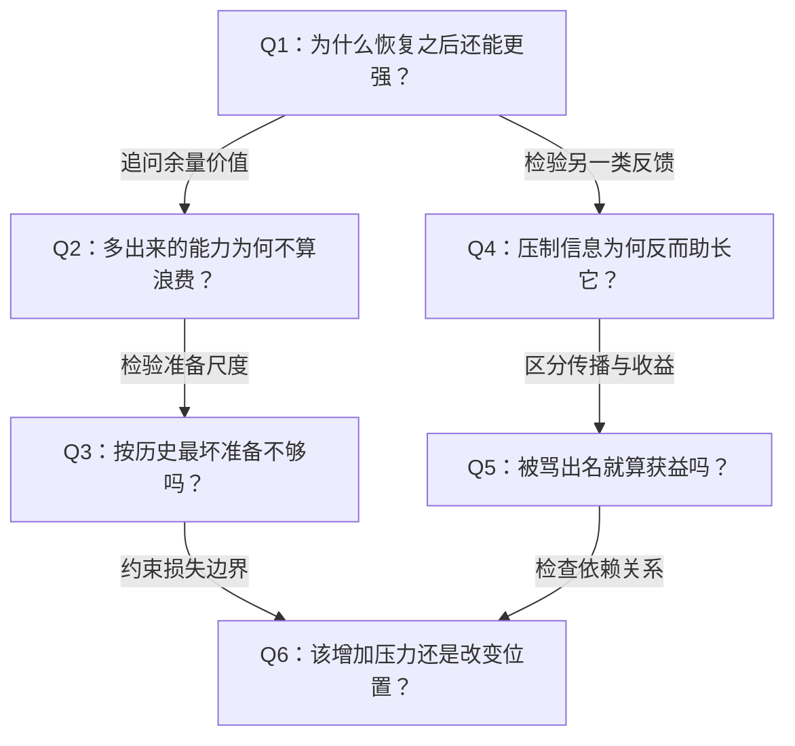

# 《反脆弱》第二章：随处可见的过度补偿和过度反应——深度拆解

> 依据：用户提供的第二章 Markdown 原文。本文分析作者的论证，不把书中历史、心理学、生理学或制度判断视为已独立核验的事实。实践建议为据此作出的有限推导，不包含医疗、训练或投资处方。

## x → f → f(x)

- **x：为什么有些系统受到挑战、打压或攻击之后，反而获得了超过原有水平的能力或影响力？**
- **f：检查冲击触发的反馈：适应反应可能超过修复需要，留下冗余；压制信息也可能引发好奇和传播。再检查这些变化通过怎样的依赖关系，变成谁的收益或损失。**
- **f(x)：评价压力时，不只看当下损失，还要追踪其后续反馈；设计行动时，保留有用途的余量和可承受的挑战，并降低自己对无法控制的信息与他人评价的依赖。**

因为同一种冲击可能引起不同反馈，所以作者用过度补偿、冗余与传播反作用解释“越受扰越强”；把它用于决策，就要同时检查反应机制、承受边界和获益对象。

## 核心命题

**系统对挑战的反应可能超过恢复原状所需，多出来的能力既能应付未来风险，也可能用于抓住机会。**

本章还把这一思路延伸到信息领域：攻击可能扩大被攻击者的影响，但影响扩大究竟是好事还是坏事，取决于当事人的收入、职位和生存方式如何依赖公众评价。

第一章回答“反脆弱与坚固有什么不同”；第二章开始回答“额外收益从哪里来，以及为什么换个位置就会换一种结果”。

## 关键洞见

### 1. 过度补偿的要点，是应对之后留下了什么

只修复损伤，结果是回到原状；若反应超过修复需要，系统就可能留下额外能力。这是作者把创伤后成长、创新动力和体能适应并置的原因。

**挑战 → 动员反应 → 超过恢复所需 → 留下额外能力。**

但这一链条包含需要验证的条件：反应必须确实发生，改善必须持续，而且收益不能被损害抵消。书中“严重但不致命的麻烦”也不是足够的安全标准：不致命仍可能造成不可逆损失。

作者把创新归因于困难激发的多余能量，并明确将其称为信念。本章没有凭这些故事排除资金、教育、基础研究、协作和稳定环境的贡献。“困难可能激发创新”与“舒适条件无法支持创新”是两个不同命题。

### 2. 冗余既是缓冲，也可能提供行动机会

作者将额外器官容量、现金储备、库存和受挑战后增加的能力放在同一框架中：它们都超过了眼下刚好够用的水平。

冗余有两种来源，不能混为一谈：

| 来源 | 本章中的例子 | 能说明什么 |
|---|---|---|
| 预先存在或主动配置 | 额外器官容量、现金、库存 | 有能力承受需求突增或供应中断 |
| 受到刺激后生成 | 适应后提高的承受能力、挫折激发的额外动力 | 反应可能留下超过当前需要的余量 |

第一种不必经过本次冲击才出现；第二种才直接对应本章的过度补偿过程。两者都可能有用，但不能因“有备份”就直接认定系统会从冲击中获益。

化肥库存的故事又推进了一步：短缺时，库存不只让持有者继续运作，还可能以更高价格出售。此时冗余由防御资源转为行动机会。

**余量 → 能撑过变化；余量＋可用机会 → 可能从变化中获益。**

“可能”仍有条件：库存有保存和占用成本，现金有机会成本，额外能力也未必找到用途。作者纠正了“闲置一定是浪费”的偏见，却未证明“冗余越多越好”。

### 3. 历史极值是观察纪录，不是世界的边界

“卢克莱修问题”是本章最有力的逻辑提醒：不能把见过的最高山，当作世界上最高的山。

作者把这一问题用于风险判断：若未来的最坏情况被设定为历史最坏情况，那么新纪录为何不再出现，就缺少了依据。历史极端事件在第一次发生前，同样没有被既往样本包含。

因此，应区分：

**历史最坏＝样本内极值；未来上限＝需要额外依据的判断。**

这并不意味着历史资料无用，也不意味着所有物理上限都不可知。有效批评的对象，是“仅凭未曾发生，就断言不会发生”。本章对压力测试整体的批评较宽，不能据此认定所有压力测试都只使用历史情境。

作者说身体比头脑更能“预测”，可以理解为适应会留下应对余量；不应理解为身体准确知道下一次负荷，更不能将个人极限训练经历直接改写成普遍训练方案。

### 4. 压制信息可能反过来为它提供传播动力

禁书、秘密和激烈批评的共同结构是：压制行为本身构成新信息，使旁观者觉得对象值得关注。

**试图压制 → 暴露对象的重要性或争议性 → 激发好奇 → 更多人传播。**

这与生物适应并非完全相同的机制。前者依赖受众的判断与传播网络，后者依赖系统的适应反应。它们相似之处在结果方向：某些攻击没有削弱对象，反而增强了对象的某个属性。

但这里至少要分开三个指标：

- **传播量：**更多人知道它。
- **认可度：**更多人相信、喜欢或信任它。
- **当事人的净收益：**关注增加后，收入、机会和生活是否真的改善。

负面曝光可能增加传播量，同时降低信任和净收益。批评的强度最多提示“值得关注”，不能独立证明作品质量或观点正确。

### 5. 改变依赖关系，有时比控制外部反应更可行

作者把作家、底层劳动者和负债的银行职员放在一起，想说明的不是职业名称本身，而是同一信息冲击如何沿着不同依赖关系传递。

作家若能把关注转为阅读，可能获益；职员若因信任受损而失去职位，可能遭受大损失。关键是**关注与收入如何连接，负面评价与损失如何连接**。

因此，“换份工作”的可取内核，是检查并调整自己的依赖关系。不能把它字面化为“被批评就辞职”，也不能接受“作家几乎不怕丑闻”“底层职业声誉无关紧要”等过宽判断。职业内部差异、法律责任和现实成本都需要单独考虑。

## 实践指引

以下是基于本章的延伸，不是作者已验证的通用方法。

### 学习：评价挑战之后是否留下可用能力

选择一个略超出现有水平的问题，独立作答后核对依据，再用相似问题检查是否真正掌握。

评估点不是“过程是否痛苦”，而是“之后能否完成此前做不到的任务”。若难度过高、缺少反馈，只会重复挫败，就没有证据表明过度补偿正在发生。

### 项目：给突发情况留下能使用的余量

做排期时，不把所有可用时间都填满；先说明余量对应哪些中断或返工，再规定空闲时可用于哪些改进。

这体现冗余的两重用途：突发任务来时缓冲冲击，平稳时支持探索。但若余量长期无法对应风险或用途，也应重新评估其成本。

### 内容创作：把热度和质量分开观察

受到批评后，先区分事实错误与偏好冲突，再观察传播、阅读、信任和合作机会分别怎样变化。

确有错误就纠正；不能因为争议增加了阅读，就认定批评无害，更不能因此主动制造丑闻。目标是让作品能够被检验，并减少对“所有人始终赞同”的依赖。

### 风险检查：多问一轮“超过纪录之后呢”

在项目评审中，把“过去最多延误两周”改写为一个待检验条件：如果延误四周，哪些交付先失效，有哪些备用路径？

超出历史的情境用于寻找薄弱处，不意味着任意想象极端情况就能算出概率。重点是发现单点依赖，而非声称已经预测最坏未来。

### 共用检查表

1. 冲击的强度、频率和持续时间是什么？
2. 受到刺激后，有什么可解释、可观察的反馈？
3. 留下的是恢复、额外能力，还是额外损伤？
4. 谁获得收益，谁承担代价？
5. 冗余能否实际调用，成本是否值得？
6. 如果结果超过历史纪录，哪条依赖会先断？

## 例子列表

- **哈尔彭提出创伤后成长：**连倡导反脆弱的作者，也可能不了解另一领域的相近现象。← 支撑 x，衔接第一章的领域依赖。
- **困难激发艺术与创新：**用古典表达提出困难可能动员超额动力的主张。← 展示 f；主要是论点线索而非因果验证。
- **自动驾驶与飞行技能钝化：**作者借此说明清除挑战可能伴随能力退化。← 支撑 x；本章不是完整航空事故分析。
- **强对手、繁忙同事、轻声演讲：**作者用它们展示额外要求可能激发投入。← 展示 f；不能推出工作越多或听讲越费力越好。
- **咖啡馆背景噪声与机场跑道：**用适度干扰和过强干扰的反差提示强度边界。← 展示 f 的条件。
- **额外器官容量、闲钱与食物储备：**把额外能力与预先储备并置。← 展示 f 中的冗余。
- **短缺时出售化肥或石油库存：**余量可能从防御资源转为机会资源。← 展示 f(x)。
- **最高山、尼罗河水位与历史压力情境：**批评把样本极值当成世界上限。← 支撑 x，推动 f(x) 中的风险检查。
- **福岛与格林斯潘的例子：**作者用重大事件强调“此前未发生”不是充分保证。← 支撑 x；具体技术和政策归因需另行核验。
- **作者与教练“蛋糕”的训练：**用个人经历呈现负荷、适应与额外能力。← 展示 f；不能独立支持普遍训练建议。
- **长颈动物的筛选脚注：**筛选后幸存者的平均特征可能超过生存门槛。← 展示作者对“超出最低要求”的解释；不是个体适应机制的直接证明。
- **镇压与反抗、小说中的依恋、思想控制反作用：**把“阻碍可能强化对象”扩展到社会和心理现象。← 展示 f 的候选迁移；机制与条件不同。
- **禁书、秘密与激烈书评：**攻击可能带来额外好奇和传播。← 展示 f 中的信息反馈。
- **伏尔泰与弗雷龙：**名人的反击可能为批评者带来声量。← 展示 f 中的相互反馈。
- **作家与银行职员的对照：**同一争议在不同依赖结构中产生不同后果。← 展示 f(x)。
- **公开“恢复信心”的声明：**作者认为安抚可能被解读为危险信号。← 展示 f 的反作用路径；不能断言所有声明都会失败。

## 结论列表

1. 挑战之后留下超过恢复所需的能力，才体现本章所说的过度补偿。
2. 冗余的价值不能只用日常使用率衡量，还要考虑突发需求和可用机会。
3. 有备份可以提高承受能力，但有备份不自动等于从冲击中获益。
4. 历史最坏情况是样本纪录，不是未经论证的未来上限。
5. 压制信息可能增加传播，但传播增加不等于信任增加。
6. 同一信息冲击的后果，取决于当事人的具体依赖关系。
7. 幸存者从打击中成长，不能证明所有遭受打击的人都会成长。
8. 适度挑战的价值需要结果验证，不能以受苦程度代替能力指标。
9. 改变自己对某种评价的依赖，可能比试图控制所有评价更可行。

## Q-A 问答链

### Q-A 问题结构图

### Q1：为什么恢复之后还能更强？

- **结论：**某些系统的适应反应会超过恢复所需，留下额外能力。
- **形式化：**刺激 → 适应反应 → 恢复＋可能新增的能力。
- **论证步骤：**① 冲击触发系统反应。② 反应不必刚好止于原水平。③ 若超出部分持续存在，就形成更强能力。④ 是否形成必须以事后表现判断。
- **边界：**反应可能不足、失调或代价过高；这条机制不保证每次挑战都有净收益。

**Q1 → Q2：**因为 Q1 将改善解释为多出来的能力，所以必须追问：超出当前需要的部分，为什么值得保留？

### Q2：多出来的能力为何不算浪费？

- **结论：**暂时不用的能力，可以在需求变化时成为缓冲或机会资源。
- **形式化：**余量＋突发需求 → 缓冲；余量＋可用机会 → 潜在收益。
- **论证步骤：**① 当前需求不代表未来全部需求。② 额外容量能覆盖一部分意外。③ 若外部出现有利用途，余量还能支持行动。④ 所以日常闲置不足以证明无用。
- **边界：**余量有成本且可能无法调用，保留多少仍需比较用途与代价。

**Q2 → Q3：**因为 Q2 确认余量用于应付超出当前需要的变化，所以必须追问：仅以历史最高需求作为准备尺度，依据是否充分？

### Q3：按历史最坏准备不够吗？

- **结论：**历史纪录可以提供参考，却不能单凭自身保证未来不会超出。
- **形式化：**见过的最大值 ≠ 可能的最大值。
- **论证步骤：**① 样本只包含已经观察到的事件。② 每项新纪录出现前都曾超出旧样本。③ 若没有其他上限依据，就不能排除再创新纪录。④ 准备时应检查超出纪录后的失效路径。
- **边界：**这不否定历史资料，也不否定有物理或制度依据的边界；本章没有据此算出应留多少余量。

**Q1 → Q4：**因为 Q1 解释的是适应反应，而作者还主张信息会因攻击增强，所以必须检验另一类反馈是否通过不同机制得到相似结果。

### Q4：压制信息为何反而助长它？

- **结论：**压制行为可能使旁观者更好奇，并为信息提供新的传播理由。
- **形式化：**压制 → 关注信号 → 好奇与转述 → 传播可能增加。
- **论证步骤：**① 攻击使对象进入公众视野。② 攻击投入可能被解读为对象重要。③ 旁观者因好奇寻找并转述原信息。④ 原本要削弱的传播因此可能增强。
- **边界：**路径依赖可接触的受众、可用的传播渠道和受众反应；压制也可能有效，不能把禁书畅销案例当成普遍规律。

**Q4 → Q5：**因为 Q4 只确认传播可能扩大，尚未确认当事人得到什么，所以必须继续区分关注、信任和净收益。

### Q5：被骂出名就算获益吗？

- **结论：**关注增加只有在收益超过声誉、法律与生活成本时，才可能构成当事人的净获益。
- **形式化：**曝光增加 ≠ 信任增加 ≠ 净收益增加。
- **论证步骤：**① 负面信息可能扩大知名度。② 它也可能损害资格、客户关系或职业机会。③ 不同人的收入依赖不同评价渠道。④ 必须综合这些结果才能判断获益。
- **边界：**不能用职业标签代替具体分析，也不能以收益可能增加为伤害行为辩护。

**Q3 → Q6：**因为 Q3 表明未来可能超过既有准备，所以行动必须保留余量并控制无法承受的损失。

**Q5 → Q6：**因为 Q5 表明同一刺激会沿不同依赖关系产生相反后果，所以行动不能只问要不要更多压力，还要问是否需要改变自己的位置。

### Q6：该增加压力还是改变位置？

- **结论：**有可验证适应机制时尝试可承受的挑战；损失主要来自脆弱依赖时，优先调整依赖关系。
- **形式化：**能适应 → 有限尝试并验证；依赖过强 → 减少单点约束并保留余量。
- **论证步骤：**① 明确目标能力和收益指标。② 检查刺激能否通过反馈带来改善。③ 若能，用可承受范围内的尝试验证。④ 若不能，检查收入、资格或交付是否过度依赖单一条件。⑤ 根据实际成本逐步调整。
- **边界：**两条路径都受资源和现实责任约束；不是所有人都能立即换工作，也不是所有挑战都值得主动制造。

## 局限与盲区

### 1. 多种机制共享一个名字，不等于它们是同一过程

个体适应、群体筛选、注意力传播和社会动员，都可能出现“受扰后某指标上升”，但因果过程不同。长颈动物的筛选例子说明幸存群体的分布变化，不能直接证明同一个体受到压力后变强。分析时必须区分对象和层级。

### 2. 看见成长者，容易漏掉未能恢复的人

本章从创伤后成长切入，却未在所给文本中系统比较成长、长期受损与其他结局。它还通过畅销禁书和成功作者说明攻击的反作用，容易忽略被压制后消失的信息和遭到严重损害的人。

创伤后成长可能存在，与创伤值得制造，是完全不同的命题。评价需要把没有留下成功故事的人也计入。

### 3. “过度反应”可能对某指标有利，对整体不利

小说中受冷遇后更强的依恋，显示的是依恋程度上升，不代表当事人更幸福。政治冲突中动员增加，也可能伴随巨大生命与社会成本。指标增强不能自动改名为整体受益。

### 4. 对创新、职业与信息的概括有时超过证据

作者对商学院、规划创新、作家声誉和职业外表的判断带有强烈修辞。本章列举的个人经历和文学故事不足以独立证明这些普遍结论。“不修边幅”也不能可靠替代对收入、资格和声誉依赖的分析。

### 5. 好的方向判断，还不是完整设计方案

本章有力地纠正了两个直觉：余量总是浪费，攻击总会削弱对象。但它没有提供统一方法来确定挑战剂量、冗余规模或职业转换时机。最值得保留的是三个检查问题：**反应留下什么？余量何时可用？最终是谁获益？**
