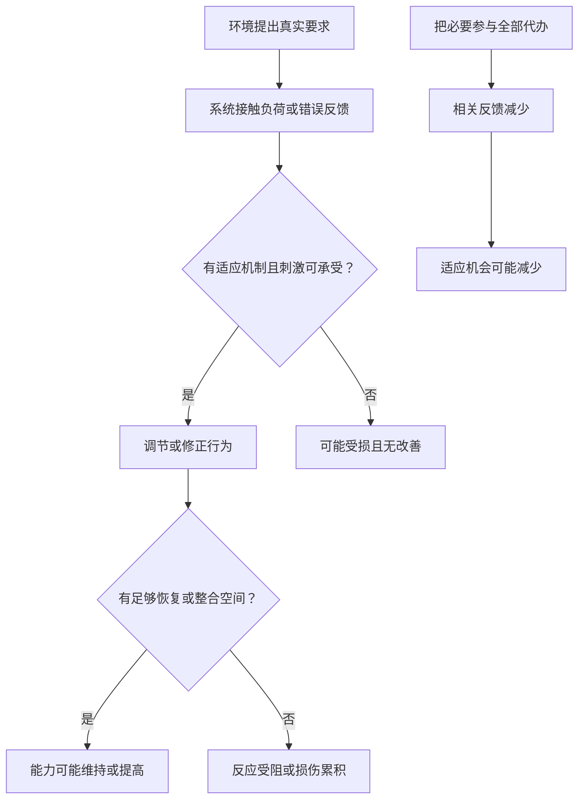
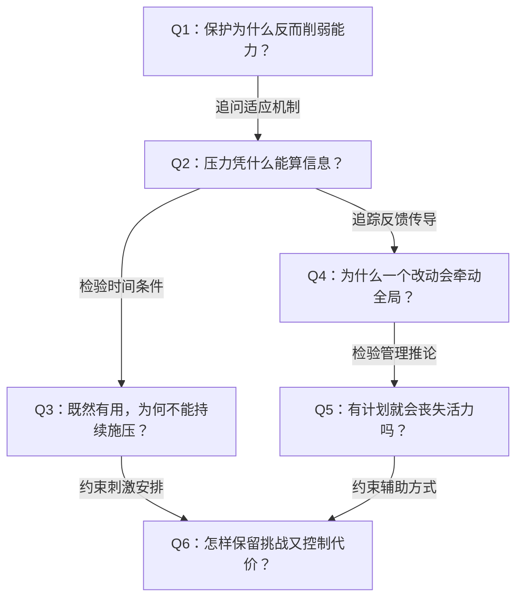

# 《反脆弱》第三章：猫与洗衣机——深度拆解

> 材料：用户提供的第三章 Markdown 原文。本文以章节文本为依据，区分作者的解释、例证与本文推导，不将书中医学、历史和科学断言当作已经独立核验的事实。原文在急性与慢性压力的对照处存在语句断裂；以下只依据上下文提炼明确可辨的意思，不补造缺失原句。

## x → f → f(x)

- **x：为什么旨在消除压力、波动和不便的安排，有时反而会削弱人和复杂系统的能力？**
- **f：把具有适应反馈的系统与主要承受损耗的物件区分开：对前者，某些压力既是负荷，也是环境信息；消除它可能切断适应过程，而持续施压、不给恢复时间，又会破坏这一过程。**
- **f(x)：面对保护或优化方案，先检查对象如何适应、反馈是否被代办或屏蔽，再保留可承受的真实任务与恢复空间；评价目标应是能力和功能，而非一味消除波动。**

因为某些保护会消除系统维持能力所需的反馈，作者提出“猫与洗衣机”的区分；把这个区分用于行动，就需要同时判断什么刺激该保留、什么损害该避免、什么恢复条件必须保障。

## 核心命题

**对具有适应能力的系统，压力不一定只是损耗，也可能提供维持和调整能力所需的信息；保护若切断这一信息渠道，反而可能使系统退化。**

但有益作用依赖刺激的类型、强度、时序与恢复条件。第三章不是在鼓励更多受压，而是在追问：我们是不是把需要参与环境、借反馈维持功能的生命，错当成只需减少磨损的机器？

## 与前两章的衔接

| 章节 | 主要解决的问题 | 新增内容 |
|---|---|---|
| 第一章 | 怎样区分无损与获益？ | 脆弱、强韧、反脆弱三分法 |
| 第二章 | 冲击之后为何可能留下收益？ | 过度补偿、冗余、信息传播的反作用 |
| 第三章 | 什么系统可能需要刺激，刺激怎样才有用？ | 适应反馈、压力的信息作用、恢复与时间结构 |

第二章容易使人问“该不该多找挑战”；第三章补充的约束是：**先判断对象，再判断刺激怎样到达、反应怎样发生、恢复是否被允许。**

## 关键洞见

### 1. 猫与洗衣机，是两种看待系统的方式

洗衣机的日常使用通常消耗既有零件，需要外部维护；猫则有代谢、修复和适应过程，某些活动会帮助它维持能力。把前者的“减少使用以降低磨损”直接套到后者，就可能把闲置误当保护。

作者随后把类比从生物推广到社会、市场和文化：它们虽非生物，却可能通过个体互动、复制、竞争和反馈形成自组织行为，因此不能简单按按钮式控制。

| 判断维度 | “洗衣机”式直觉 | “猫”式直觉 |
|---|---|---|
| 对象如何变化 | 使用主要带来消耗 | 活动可能触发维持与适应 |
| 如何获得改善 | 外部修理、替换、调整 | 也可能依靠内部反馈与更新 |
| 刺激的角色 | 主要是负担 | 某些刺激也提供信息 |
| 保护的潜在副作用 | 少使用往往少磨损 | 保护过度可能减少必要活动 |
| 干预评估 | 关注部件和直接结果 | 还需关注反馈、连锁反应与恢复 |

这是一种启发式，不是严格分类学。作者自己列举了会自我强化的非生物材料，也承认存在过渡类型。**生物性、复杂性与反脆弱性并非同义词**：复杂系统也可能非常脆弱，机器也可能包含自适应机制。

### 2. 压力源即信息：负荷让系统接触真实需求

作者以骨骼负重、手掌起茧和语言习得说明：系统不必先在意识中理解环境，环境要求就能通过实际作用触发变化。

这里有两层不同的含义：

- **生理层面：**负荷等刺激可能触发调节与适应，不等于人在主观上学会一条知识。
- **行为层面：**错误及其后果让人发现当前做法与任务要求之间的差距。

本章可提炼的共同结构是：

“信息”不是“有益”的同义词。某种刺激能传递环境状况，也可能已经造成严重损害；得到信息不意味着值得支付任何代价。

### 3. 恢复是机制的一部分，不是挑战之外的空白

第二章强调反应可能超额；第三章强调，产生反应也需要条件。九头蛇的伤口被灼烧后无法再生，正是作者用来说明“恢复过程被打断”的隐喻。

本章要求读者关注的不是一个抽象的压力总量，而是**压力怎样分布在时间中**：是否持续、是否重复作用于同一部位或任务、能否退出、有没有恢复窗口。

**适当刺激＋恢复 → 可能适应；持续刺激＋恢复不足 → 可能累积损害。**

这是条件性机制，不能简化成“急性压力都好，慢性压力都坏”。急性冲击也可能造成不可逆伤害，规律而持续的活动也不必然有害。作者用蛇、吸血鬼和水刑形成的强烈对照，说明了时序问题，却没有提供普适的安全强度与恢复时长。

### 4. 复杂系统的局部改善，可能通过反馈造成别处损失

消灭捕食者不只是“少了一种危险动物”，还可能改变猎物数量、植被和其他生态关系。银行的关闭也不只影响一家机构，还可能沿关联传导。

作者借这些例子指出：**干预作用于一个节点，结果却沿多条关系传播。**只看直接目标，容易漏掉延迟后果和反向反馈。

这一点与“压力即信息”连接起来：干预不仅改变负荷，也可能改变各部分获取信息和作出调整的方式。

但“因果隐蔽”不等于“因果不存在”或“分析全部无效”。更稳妥的结论是：对单一解释保持谨慎，检查反馈与替代机制，在可行时通过范围可控的干预验证结果。本章不足以据此否定所有规划或自上而下管理。

### 5. 动态维持不能被误解为毫无变化

作者用浴缸漩涡说明：有些有序状态依赖持续的流动，而不是依靠完全静止。对生命和某些动态系统而言，维持功能需要持续交换与调节。

这为批评“消除一切波动”的目标提供直觉，但有两个概念必须分开：

- 物理意义上的热力学平衡，与经济学中的均衡不是自动等价的概念。
- 远离热力学平衡的结构，不因此必然反脆弱，也不因此需要更多外部随机冲击。

所以本章最可取的推论是：**不能用一个静态指标恒定不变，代替对系统功能的判断。**不能进一步推出“经济均衡就是死亡”或“波动越多越健康”。

### 6. “观光化”批评的是参与机会被脚本替代

翻译助理的故事最清楚地展示作者的意思：助理消除了沟通困难，也减少了作者亲自尝试、犯错、澄清和记住词语的机会。便利确实增加了，但某项能力的发展机会也可能减少。

“观光化”因此不只指旅行，而指将活动预先安排到无需探索和判断的程度：人完成脚本，却未必接触真实问题。

**便利 → 参与减少 → 反馈减少 → 某些能力的发展机会减少。**

需要补上目标条件：如果目标是准时完成一次跨语言业务，助理可能非常有用；如果目标是学习当地语言，全面代办可能适得其反。计划、教材和工具本身并不是敌人，关键是它们帮助了参与，还是取代了需要保留的参与。

## 实践指引

以下是从章节概念推导的应用，不是原文已经验证的通用方案。

### 学习语言：保留可纠正的真实表达

选一个后果轻微的交流任务，先自己表达，请对方确认理解，再查遗漏的表达方式。记录实际卡住的句子，比只记录“今天学习了多久”更能显示反馈来自哪里。

工具可以帮助准备和复盘，但若目标是表达能力，就需要让学习者保留一定的表达过程。不必以故意陷入危险或完全禁用工具来制造所谓真实压力。

### 使用 AI：让辅助支持判断练习

如果目标是掌握一个概念，可以先写下自己的解释，再请 AI 指出漏洞，最后自行重述并核对原文。若一开始就接受完整答案，可能完成了交付，却没有练习原本希望获得的判断能力。

这是对本章“翻译代办”结构的迁移，不是关于所有 AI 使用效果的经验结论。赶交付与练能力是不同目标，应据此选择辅助程度。

### 团队管理：保留反馈，避免惩罚掩盖反馈

对可逆、低影响的任务，允许成员自己作出判断并复盘偏差。管理者要提供必要信息和纠错条件，而不是把所有决策都收回。

与此同时，重大责任不能被重新包装成训练机会。还要检查成员是否有自主权、资源和恢复空间；持续被打断、没有结束点的任务堆积，不会因被命名为“挑战”就自动有益。

### 规划与探索：有目标，但不把路径全部锁死

在一次研究或阅读活动中，保留少量可调整时间，用来追踪出现的新问题；同时记录探索是否带来了可用线索。

这不是“取消日程”。计划可以保障探索空间，关键是允许反馈改变下一步，而不是只检查是否按原脚本执行。

### 通用检查顺序

1. **对象：**它通过什么机制适应？不能只贴“有机”或“复杂”的标签。
2. **刺激：**究竟是什么要求，类型、强度与持续时间如何？
3. **信息：**系统从中得到什么反馈，能否据此改变？
4. **恢复：**能否停止刺激，反应有没有完成的条件？
5. **指标：**能力真的提高了，还是只提高了耐受、服从或表面表现？
6. **代价：**损失由谁承担，是否存在不可逆或被遗漏的伤害？

## 例子列表

- **猫与洗衣机：**用适应性生命与主要承受磨损的物件对照，纠正“少受力就一定更好”的直觉。← 提出 x，展示 f。
- **骨骼负重与沃尔夫定律：**作者以骨骼对负荷的反应说明压力可能参与功能维持。← 展示 f；不据此提供训练或治疗方案。
- **碳纳米管复合材料：**作者列举非生物自我强化的例外，提示二分法并非绝对边界。← 限定 f。
- **磨破的牛仔裤：**外观更有品位不等于材料更强。← 澄清 f 中的改善指标。
- **衰老与功能失调：**作者试图区分不可避免的老化与环境错配造成的退化。← 支撑 x；本章不足以量化二者各占多少。
- **狮子、山羊与植被：**通过食物关系说明局部行为可能引发连锁后果。← 展示 f；具体历史链条未独立核验。
- **银行关闭的跨地域影响：**用金融关联提示局部故障的外溢。← 展示 f。
- **手掌起茧、肤色变化与负重：**用身体反应说明环境可在意识理解之前触发调节。← 展示 f；适应反应不等于整体健康净收益。
- **儿童疼痛与错误后果：**作者借此说明反馈的学习作用。← 展示 f；“疼痛是唯一信息”的说法过强。
- **骨骼与激素的双向关系：**作者借此反对把复杂关联割裂为单向原因。← 展示 f；具体疾病结论不作为本文已核验事实。
- **蛇、吸血鬼与持续滴水：**用戏剧化反差提示刺激时序和恢复的重要性。← 展示 f 的边界。
- **灼烧九头蛇的伤口：**再生被阻断后，反脆弱反应无法完成。← 展示 f 中恢复的地位。
- **浴缸中的漩涡：**持续流动可维持动态结构。← 展示 f；不能独立证明经济政策主张。
- **作者的情绪起伏与诗人：**作者据此反对把所有不适都视为应消除的病态。← 支撑 x；不证明治疗会损害创造力。
- **翻译助理与机场接待：**便利减少了亲自表达与试错的机会。← 展示 f(x)。
- **朋友在莫斯科被迫隔离后提高俄语：**困境可能带来学习，但这只是个案，不能使强制与危险变得合理。← 展示作者对 f 的应用。
- **固定行程、电子日历与预定活动：**作者借“观光化”批评探索被脚本替代。← 展示 f(x)；不等于任何计划都有害。
- **不平地面与重复器械动作：**作者用负荷分布差异讨论重复应激。← 展示 f 的时序与变化维度；不推出自然地面总是安全。

## 结论列表

1. 对有适应机制的系统，某些刺激既是负荷，也是环境信息。
2. 保护若取消必要的参与和反馈，可能减少能力维持与发展的机会。
3. 恢复条件是适应机制的一部分，不能只增加挑战而不允许反应完成。
4. 相同压力总量不代表相同后果，类型、频率、持续时间和作用位置都重要。
5. 生物性、复杂性与反脆弱性不能相互替代。
6. 局部干预的效果，需要结合连锁反应与反馈变化来判断。
7. 适应现象的存在，不足以证明刺激带来了整体净收益。
8. 便利的价值依目标而定：它可能帮助完成任务，也可能替代能力练习。
9. 消除一切波动不是可靠目标，增加随机性本身也不是可靠目标。
10. 好的安排应支持反馈、调整和恢复，而不是只保证流程永远不出偏差。

## Q-A 问答链

### Q-A 问题结构图

### Q1：保护为什么反而削弱能力？

- **结论：**某些保护取消了系统维持能力所需的活动和反馈。
- **形式化：**取消必要活动 → 反馈减少 → 适应机会减少 → 能力可能下降。
- **论证步骤：**① 某些能力通过使用和适应维持。② 全面代办或隔绝刺激会减少实际参与。③ 若没有替代途径，维持能力的过程可能受阻。
- **边界：**保护也能防止严重损害；只有明确刺激的作用与承受范围，才能判断是否保护过度。

**Q1 → Q2：**因为 Q1 把能力变化归因于反馈被切断，所以必须解释压力怎样传递反馈，而不只是消耗系统。

### Q2：压力凭什么能算信息？

- **结论：**某些刺激能暴露环境要求与现有能力的差距，并触发调节。
- **形式化：**真实要求 → 可感知差距 → 调节或纠错。
- **论证步骤：**① 环境要求通过负荷或任务作用于系统。② 系统由反应结果获得差距信号。③ 有相应机制时，差距能触发适应或行为修正。
- **边界：**信息并不自动有益；刺激也可能不可识别、不可应对，或在得到反馈前已造成不可逆损害。

**Q2 → Q3：**因为 Q2 说明刺激可以启动调节，却未保证调节能够完成，所以必须继续追问持续施压是否会破坏适应条件。

### Q3：既然有用，为何不能持续施压？

- **结论：**适应需要完成反应的条件，持续负荷可能使损伤超过恢复能力。
- **形式化：**刺激＋恢复 → 可能适应；刺激不停＋恢复不足 → 可能受损。
- **论证步骤：**① 反应需要时间与资源。② 刺激若持续到来，系统可能无法完成恢复。③ 未解决的损伤或负担可能累积。④ 所以频率和间隔不能被忽略。
- **边界：**不能仅用“急性／慢性”二分决定安全；仍须结合刺激类型、强度、对象和实际反应。

**Q2 → Q4：**因为 Q2 中的信号和调节会在组成部分之间传递，所以必须追问：改变一个环节后，反馈会怎样影响其他环节？

### Q4：为什么一个改动会牵动全局？

- **结论：**复杂系统中的组成部分相互依赖，干预后果会沿关联传播并反馈回来。
- **形式化：**局部变化 → 多路径传导 → 次级后果 → 反向反馈。
- **论证步骤：**① 部分之间并非彼此隔离。② 改变一个部分会改变其他部分的条件。③ 后者的反应又可能回到原处。④ 只计算直接效果便可能漏掉重要后果。
- **边界：**并非每个变化都会扩散成灾难，也不能把“复杂”当作拒绝所有分析和干预的理由。

**Q4 → Q5：**因为 Q4 指出干预可能改变反馈，尚未证明所有事先安排都有害，所以必须检验作者对计划和脚本的批评应限定在哪里。

### Q5：有计划就会丧失活力吗？

- **结论：**问题在于计划是否阻断参与和调整，而不在于有没有计划。
- **形式化：**辅助参与的计划 ≠ 替代参与的脚本。
- **论证步骤：**① 计划可以提供资源和练习机会。② 全部代办也可能取消试错与判断。③ 两者对能力的作用不同。④ 应按目标检查参与和反馈是否保留。
- **边界：**有些任务优先要求可靠交付，而不是训练执行者；不能强行把每项活动都变成探索。

**Q3 → Q6：**因为 Q3 确认适应依赖刺激之外的恢复条件，所以实践必须同时安排挑战与反应完成的空间。

**Q5 → Q6：**因为 Q5 确认辅助是否有益取决于目标与参与方式，所以实践还必须决定哪些过程由当事人保留、哪些可以交给工具或他人。

### Q6：怎样保留挑战又控制代价？

- **结论：**用范围可控、能够纠错的真实任务保留参与，同时允许停止、调整和恢复。
- **形式化：**明确目标 → 保留参与 → 有限试错 → 反馈纠正 → 恢复整合 → 验证能力。
- **论证步骤：**① 定义希望维持或增加的能力。② 找出能够提供相关反馈的任务。③ 限制损失并提供必要辅助。④ 允许根据反应调整或停止。⑤ 用后续独立表现验证改善。
- **边界：**这是本章的实践推导，不是通用安全标准；不能以学习为由让他人承担未经同意的重大风险。

## 局限与盲区

### 1. 二分法有启发性，也容易遮蔽真正重要的变量

作者从有机体／机械体转向复杂／非复杂系统，但这些分类没有一一对应。相互依赖程度、反馈、适应和修复机制需要分别检查。仅凭“像猫”无法证明一个经济制度或组织会从扰动中受益。

### 2. 本章对衰老与健康的部分推断过宽

把衰老拆成老化与功能失调，有助于避免把所有退化都归于年龄；但这不等于已经证明“自然环境下人不会衰老”。群体比较还需处理死亡选择、生活条件、观察范围和测量差异。

同样，骨骼适应、肤色变化或手掌起茧，不能独立证明相应刺激的整体净收益，更不能证明负重优于所有药物或某类器械必然有害。本文保留机制层面的启示，不据这些段落给出诊疗结论。

### 3. 情绪波动、疾病与创造力不能互相替代

作者反对把普通悲伤或日常差异一律病理化，这一问题可以讨论；但“某些诗人有情绪困扰”不能证明治疗会使其作品消失，更不能据此评价具体患者是否需要药物。本章没有提供相应的临床比较证据。

### 4. 从动态结构跳到政策判断，中间仍缺论证

漩涡与生命需要持续交换，不能直接证明经济均衡概念失效，也不能自动排除公共管理、规划研究或结构化教育。相似意象只能提出问题，具体制度效果仍需对应机制和证据。

### 5. 自然与随机性并不天然安全

作者最后的脚注承认可以兼得两个时代的优势，这比“回到原始生活”更合理。天然地形也可能使人受伤，无计划生活也可能制造长期压力；现代工具既可能屏蔽反馈，也可能降低无谓负担、保障参与和恢复。

因此，更稳妥的阅读方式是把“自然／现代”的价值对立，改写成可检查的问题：**哪种安排保留了有效反馈，哪种安排制造了不可承受的负担，哪种安排帮助系统完成适应？**
