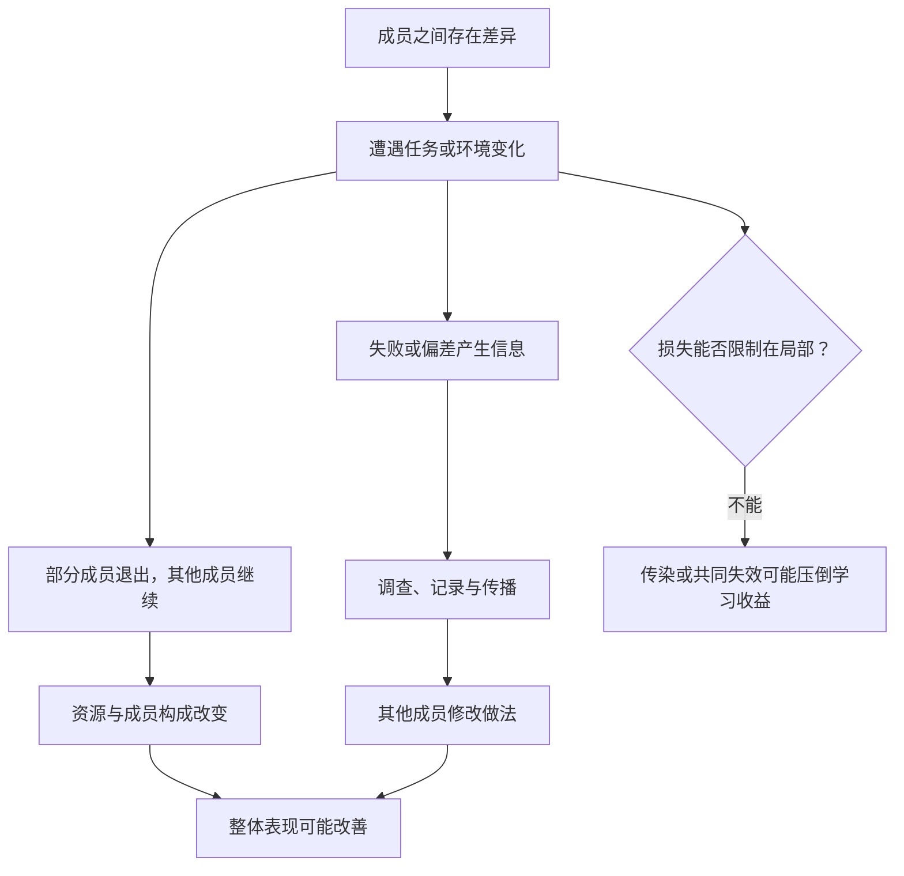
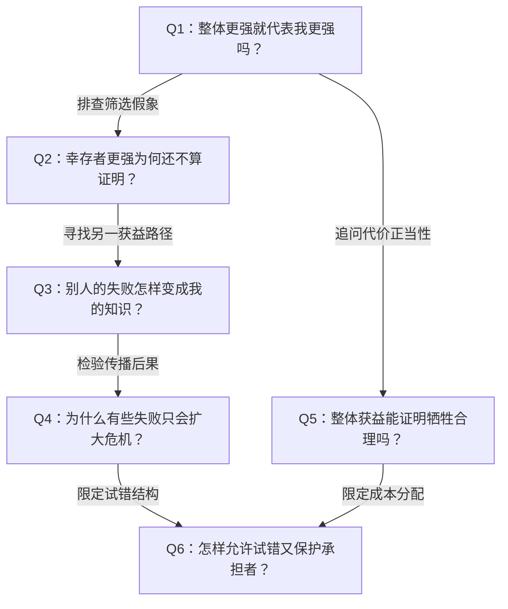

# 《反脆弱》第四章：杀死我的东西却让其他人更强壮——深度拆解

> 依据：用户提供的第四章 Markdown 原文。本文拆解本章论证，不把原文中的历史、进化、医学或经济学判断视为已独立核验的事实。数值示例和实践指引为本文推导，均明确区别于作者案例。

## x → f → f(x)

- **x：当一个系统在冲击后变得更好，究竟是谁变强了，谁承担了改善的成本？**
- **f：将系统拆成个体、群体和信息延续等层级，区分同一个体的适应与成员被替换后的筛选；再追踪局部失败能否被隔离、被记录，并转化为其他成员可用的知识。**
- **f(x)：判断反脆弱性时，必须说明获益层级和损失承担者；设计系统时，让错误范围可控、经验可以共享，同时保护承担试错成本的人，而不是用集体进步替个体受损作辩护。**

因为整体改善可能掩盖个体损失，作者引入层级与筛选；把这一分析用于现实，就要同时评价学习机制、风险传染和成本分配。

## 核心命题

**系统的反脆弱性不等于成员的反脆弱性：整体可能通过淘汰、替换或吸收失败者的经验而改善，承担损失的个体却未必得到任何好处。**

因此，“错误有益”必须补全为：哪种错误、对谁有益、收益通过什么渠道产生、代价由谁支付。本章的力量在于揭示这个被省略的账本。

## 与前三章的衔接

| 章节 | 核心问题 | 本章新增的约束 |
|---|---|---|
| 第一章 | 抗住冲击与因冲击获益有什么不同？ | 获益究竟发生在哪个层级？ |
| 第二章 | 过度补偿怎样留下额外能力？ | 看见更强的幸存者，是否真是过度补偿？ |
| 第三章 | 刺激、反馈与恢复如何支持适应？ | 学习者和付出损失的人，是否是同一个？ |
| 第四章 | 局部失败如何影响整体？ | 必须区分适应、筛选、知识外溢与成本分配 |

前三章容易使读者想到“我怎样从压力中成长”；第四章迫使读者承认：**有时系统学会了，而你只是付出了学费。**

## 关键洞见

### 1. “更强”可能来自个体改变，也可能来自成员构成改变

作者用集中营幸存者的例子，反对把幸存群体的强壮归因于磨难的锻炼作用。即使每个人都变弱，只要弱者被大量排除，幸存者的平均指标仍可能提高。

下面是本文构造的逻辑示例，数字仅用于说明筛选，不代表真实测量：

| 人员 | 冲击前能力值 | 冲击后状态 | 冲击后可观察值 |
|---|---:|---|---:|
| 甲 | 2 | 被淘汰 | 不再进入幸存者样本 |
| 乙 | 4 | 被淘汰 | 不再进入幸存者样本 |
| 丙 | 8 | 幸存但受损 | 7 |
| 丁 | 10 | 幸存但受损 | 9 |
| 平均 | 6 | 只统计幸存者 | 8 |

幸存者平均值从原群体的 6 变成 8，但丙和丁各下降了 1。**群体均值提高，并没有证明任何人变强。**若只比较幸存者自身，他们的平均值其实从 9 降到了 8。

因此，“杀不死我的让我更强”至少包含两种不同假设：

- **适应：**同一成员经历刺激后，相关能力真的提高。
- **筛选：**不同成员经历冲击后，一部分退出，留下者原本就更适合该条件。

现实中两者可能同时发生，需要分别识别。仅凭事后幸存者的表现，无法区分。

### 2. 反脆弱性有层级，不能把顶层收益记到每个成员名下

餐馆可能倒闭，餐饮业却可能通过新店进入、经营经验传播和资源重配改善；个体生物死亡，某些可遗传特征却可能在后代中延续。

作者借此把“谁”扩展为多个层级：

**细胞 → 个体 → 群体；个人 → 企业 → 行业 → 经济。**

这个观察比“整体等于部分之和”更细：不同层级可以有不同的结果，信息的延续也不同于载体的延续。

但不能反过来把层级关系理解为必然对立。企业内部的小试验可能改善组织，同时保全参与者；个体和群体也可能共同获益。作者反复强调“整体需要局部牺牲”，揭示了一种重要机制，却没有证明它是所有系统改善的唯一条件。

### 3. 失败不会自动成为知识，需要有传递和使用的路径

一家企业失败，不必然教会整个行业什么。若失败原因不清、记录失真，或别人无法获得经验，同样的错误仍可能不断重演。

本章可以提炼出两条不同的整体改善路径：

第一条是筛选与替换，不要求失败者亲自学习；第二条是经验传播，不要求一定有人退出。二者可能相互配合，但不应混用。

作者称失败创业者提供了“什么不可行”的知识，也需要限定：**一次失败说明某个具体组合在某些条件下没有成功，不自动证明整类方案永远不可行。**

### 4. 好的错误不是“损失小”这么简单，而是能被控制和转化

作者对航空与银行的对照，核心不在于哪个行业天然高尚，而在于失败后的两种传播方向：

| 失败后的路径 | 对其他成员的影响 | 系统后果 |
|---|---|---|
| 学习传播 | 调查、修改规则或设计，减少同类错误 | 可能改善未来表现 |
| 损失传播 | 资金链、共同依赖或恐慌引发连锁失效 | 可能放大危机 |

航空事故中的损失对乘客与家庭极其严重；称其“局部”，只能指影响相对于整个系统的范围，不能指个体代价微不足道。

作者说每次飞机失事降低后续事故概率，是对学习型系统的概括，而非本章已经证明的普遍统计规律。共用设计、软件或规程也可能带来共同风险。银行也并非只会传播损失，它们同样可能学习；关键是实际的关联结构与应对机制。

**有用的制度方向，是让经验能传播，让损失不轻易传播。**这比“允许更多失败”更准确。

### 5. 进化提供了无需精确预知未来的更新方式，但并不保证进步

作者将个体永存与代际替换对照：若要求同一个体承受一切未来变化，要求极高；若存在差异、繁殖与选择，群体可以在变化中持续更新，而不必先拥有完整预测。

这里最可保留的机制是：**不确定未来下，可以依靠多样性和更新，而非把成败押在单一方案永久正确上。**

但自然选择没有关心整体福祉的意图，也不保证后代全面“更优质”。适合某个环境的特征，换个环境未必有利；筛选也可能夹杂偶然死亡，群体可能衰退甚至灭绝。作者多次说“大自然希望”“进化服务于自然”，应作为修辞阅读，而不是有目的的因果解释。

### 6. 承认失败的公共价值，不等于认可把损失推给他人

本章末尾从机制分析转向伦理：作者既承认局部失败可能支持更新，也反感以个体牺牲换取集体收益，因而提出社会保障、尊重失败创业者等方向。

这里必须区分两个问题：

- **机制判断：**这次失败是否真的改善了他人的决策或系统表现？
- **正当性判断：**谁有权承担、施加或分配这种代价？是否自愿，是否获得保障？

前者成立，不会自动使后者成立。“创业者日”的象征意义，是社会承认知识贡献与私人回报可能不匹配；但感谢和英雄叙事不能代替实际保障。

作者建议避免一味保住所有企业，同时保护人不至于陷入绝境。可提炼为：**允许方案和组织被替换，不等于放弃对人的责任。**如何具体实现，仍需单独分析制度条件，本章没有给出完整政策方案。

## 实践指引

以下是本文的操作化延伸，不是作者已经验证的制度处方。

### 评估“逆境成长”：先看原来的那批人

当看到“经过淘汰，平均能力提升”的报告时，至少追问：原有多少人？谁退出了？幸存者自身前后如何变化？退出者的损失有没有计入？

只看到成功者访谈，应把它当作经验线索，而不是证明该磨难具有因果益处。

### 团队试验：让方案失败，不让信息消失

将探索任务设计为范围有限的试验，事先写下假设、观察指标和停止条件。结束后记录哪些条件成立、哪里失败、哪些结论仍无法判断，并把记录交给下一位使用者。

评价参与者时，区分诚实检验失败与掩盖问题、违反约束。若“创新”只意味着下属承担损失、上级获得成功声誉，所谓反脆弱就可能只是成本转移。

### 软件系统：共享修复，控制故障范围

在受控环境中检验故障处理；对真实事件记录触发条件和影响路径，将有效修复推广到相关系统，同时检查共用依赖是否会使同一错误一起发生。

隔离限制损失，复盘传播知识，二者缺一不可。不能把生产事故本身当作值得主动追求的训练方式。

### 阅读创业案例：分析失败，不浪漫化破产

从失败案例中提取当时的客户、成本、渠道、团队和环境条件，再判断哪些与自己的任务相同。不要只记“这个赛道不行”，也不要把“社会会受益”当作自己应承担无限风险的理由。

可以认可诚实探索的价值，同时承认具体项目可能没有产生足以弥补损失的知识。

### 一张层级账本

每次声称“这个系统具有反脆弱性”，都补全下面几项：

| 项目 | 必须回答的问题 |
|---|---|
| 对象与层级 | 是个人、企业、行业，还是某种信息？ |
| 结果指标 | 是同一对象能力提高，还是群体组成改变？ |
| 作用机制 | 适应、筛选、经验传播，还是几种机制叠加？ |
| 损失范围 | 是局部可隔离，还是会传染和共同失效？ |
| 知识路径 | 谁记录，谁接收，谁据此改变？ |
| 成本分配 | 谁受损、谁受益，承担是否自愿，保障是否充分？ |

## 例子列表

- **餐馆倒闭与餐饮业更新：**单店失败和行业改善可以同时出现。← 支撑 x，展示 f 的层级区分。
- **个体生命与遗传信息：**载体终结不等于信息终结。← 展示 f；不表示所有信息必然永续或改善。
- **不死有机体的思想实验：**作者用永久承受未来冲击的极高要求，对照代际更新。← 展示 f；不是关于不朽必然需要完美预测的严格证明。
- **十个后代与环境淘汰：**用后代差异和差异化存活解释群体构成变化。← 展示 f 的筛选路径。
- **抗生素耐药性与肿瘤治疗：**作者借其说明幸存成员的筛选。← 展示 f；不能据此推导停药、拒绝治疗或疗效结论。
- **树枝、细胞、个体与物种：**用嵌套结构帮助看见被顶层外观遮蔽的层级。← 展示 f。
- **细胞更新与自噬：**作者将其作为个体内部淘汰与更新的解释。← 展示 f 的候选机制；不同生物过程不宜直接等同。
- **泰坦尼克号与福岛：**作者强调灾难可能为后人暴露问题。← 展示 f 中的知识外溢；“必然避免了更大灾难”属于未证反事实。
- **航空事故调查与银行倒闭：**对照知识传播和损失传染。← 展示 f，导向 f(x)。
- **巨灾再保险：**作者用幸存公司在灾后获得更高保费的故事说明机会依赖先活下来。← 展示 f(x)；不能假定未来提价足以抵消损失。
- **错误暴露他人的宽容或行为：**行动后果也可能提供关于关系的信息，而代价由另一些人承担。← 展示 f 的成本分配。
- **咖啡壶与被淘汰产品：**消费者使用的胜出产品可能依托大量未获回报的探索。← 展示 f 的公共收益。
- **集中营幸存者：**幸存者较强可能来自选择偏差，而不是磨难使其变强。← 检验 f，揭示伪反脆弱。
- **群体英雄主义与黑手党沉默规则：**作者用其呈现个人利益被集体利益压过的情形。← 支撑 x 的伦理维度；不是认可相关行为。
- **创业者日与感谢词：**为承担试错成本却未获得收益的人争取承认。← 展示 f(x) 的补偿方向。

## 结论列表

1. 系统改善必须说明发生在哪个层级，不能直接归功于每个成员的成长。
2. 幸存群体的平均水平上升，不足以证明幸存者自身能力提高。
3. 个体适应与成员筛选是不同机制，即使它们可能同时发生。
4. 失败只有通过可靠记录、传播和调整，才可能成为他人可用的知识。
5. 系统是否善于学习，取决于能否传播经验并限制损失传染。
6. 系统范围内的局部事故，对受害者仍可能是不可弥补的灾难。
7. 从灾难中学到东西，不足以证明灾难不可避免或总体值得发生。
8. 自然选择的存在，不会自动赋予社会淘汰制度以道德正当性。
9. 允许失败方案退出，与保障承担试错成本的人，可以是两个分别设计的目标。
10. 对承担风险者的尊重，不能代替对风险来源、外部损害和保障的具体审查。

## Q-A 问答链

### Q-A 问题结构图

### Q1：整体更强就代表我更强吗？

- **结论：**整体可能靠替换成员或使用他人的经验改善，而原成员未必获益。
- **形式化：**整体改善 ≠ 每个成员改善。
- **论证步骤：**① 系统包含多个成员。② 成员可能退出或被替换。③ 其他成员也可能获得失败信息。④ 整体表现因此可能提高，却不能据此判断某个原成员的结果。
- **边界：**个体和整体也可能共同改善；层级差异不意味着必然利益冲突。

**Q1 → Q2：**因为 Q1 表明成员构成可能改变，所以即使幸存群体看起来更强，也必须检查是否只是弱者不再进入样本。

### Q2：幸存者更强为何还不算证明？

- **结论：**幸存者较强可能源自原有差异被筛选，而不是冲击提升了能力。
- **形式化：**事后均值上升＝可能的个体变化＋可能的构成变化。
- **论证步骤：**① 不同成员原本存在差异。② 冲击可能使部分成员退出。③ 剩余者平均值可以提高，即使其各自受损。④ 因而必须检查同一成员前后的变化与退出情况。
- **边界：**筛选偏差不否定真实适应；同一个体的前后变化也还需排除其他原因，不能单凭时间顺序确定因果。

**Q2 → Q3：**因为 Q2 排除了“大家被锻炼得更强”这一自动解释，所以还要追问：即使失败者没有改善，其他人是否能通过信息获得收益？

### Q3：别人的失败怎样变成我的知识？

- **结论：**失败需要被解释、记录、传递并用于调整，才能成为他人可用的经验。
- **形式化：**失败 → 可用记录 → 传播 → 决策改变 → 可能减少同类错误。
- **论证步骤：**① 失败暴露某些条件下的问题。② 调查区分可迁移原因与偶然因素。③ 记录使他人获得信息。④ 他人据此修改做法，才可能产生公共收益。
- **边界：**原因不明、情境不同、激励阻碍采纳时，失败不一定带来学习；经验传播也不要求必须先有惨重事故。

**Q3 → Q4：**因为 Q3 依赖信息能够被利用，但失败也可能同时摧毁其他成员，所以必须比较学习传播与损失传染哪一种占主导。

### Q4：为什么有些失败只会扩大危机？

- **结论：**高度依赖与共同风险可能使局部失效扩散，速度和损失超过学习机制的应对能力。
- **形式化：**局部失效＋传染路径 → 连锁损失；局部失效＋隔离和学习 → 可能改进。
- **论证步骤：**① 成员间可能共享资金、资源或关键依赖。② 一个成员失效会改变他人的生存条件。③ 多个成员可能在得到纠错机会前一起失效。④ 因此仅有复盘意愿不足以保障系统学习。
- **边界：**关联也能传播救助和知识；不是关联越少越好，而是要检查具体传播路径与失效模式。

**Q1 → Q5：**因为 Q1 确认公共收益可能由个体损失换取，所以必须另问：这种成本分配是否有正当性，不能只算整体结果。

### Q5：整体获益能证明牺牲合理吗？

- **结论：**机制上的受益不自动证明让某人承担代价是正当的。
- **形式化：**产生公共收益 ≠ 获得施加伤害的授权。
- **论证步骤：**① 收益与代价可能落在不同人身上。② 获益者不能仅凭收益决定他人应受损。③ 自愿、权利、保障与可替代路径仍须审查。④ 所以描述自然选择不能直接变成社会规范。
- **边界：**完全消除所有风险也不现实；具体权衡需要明确对象、程序和可行替代，不能靠抽象的个体或集体口号完成。

**Q4 → Q6：**因为 Q4 说明失败能否带来学习受传染结构限制，所以制度设计必须限制风险范围，而不是单纯鼓励冒险。

**Q5 → Q6：**因为 Q5 说明公共收益不足以正当化个体损失，所以制度还必须保障承担者，避免只分享收益、不承担成本。

### Q6：怎样允许试错又保护承担者？

- **结论：**限制试验影响、共享可用经验，并把人的基本保障与具体项目能否继续分开考虑。
- **形式化：**有限试验＋失败隔离＋经验共享＋人员保障 → 可持续探索的条件。
- **论证步骤：**① 让损失不至于摧毁整体。② 让结果能够被解释和使用。③ 不因保护人就要求错误方案永久存在。④ 也不因允许方案退出就放弃承担者。⑤ 检查实际收益是否值得代价。
- **边界：**这是从本章推导的设计方向，不是已经解决所有冲突的方案；共享范围、保障方式与成本来源仍需具体讨论。

## 局限与盲区

### 1. 从“可能有益”跳到“必然必要”

作者有时把失败或死亡写成整体进步的必要条件。但知识也可能来自仿真、近失事件、受控试验和主动纠错。成员退出与个体遭受毁灭性损失也不是一回事。需要保留可修正性，并不等于必须制造严重伤害。

### 2. 灾难避免更大灾难的说法，没有在本章得到证明

泰坦尼克号和福岛暴露问题，可能促进改进；但“若没有这次灾难，必然出现更大灾难”“被挽救的生命一定更多”是反事实断言。原文称其毫无争议，超过了所给文本的证据。还应考虑是否存在无需灾难就能发现问题的路径。

### 3. 自然选择不是为整体谋划，也不是全面进步的保证

本章用“自然希望”概括选择机制，容易掩盖局部适应、偶然性、环境变化及灭绝风险。基因信息也不保证永远延续。对进化的解释不能简单变成对企业退出或社会竞争的完整论证。

### 4. 不同生物过程不能只因涉及更新就画等号

个体内的修复、自噬、细胞替换与跨代遗传选择，机制和层级不同。原文关于毒物、禁食、耐药性与癌症的叙述有助于提出层级问题，但不足以据此形成治疗或健康建议；尤其不能把选择压力的存在当作否定治疗价值的理由。

### 5. 错误既非可靠性的充分条件，也非必要条件

作者称犯过罪的人或犯过许多错误的人更可靠，属于修辞性的过强判断。应检查是否诚实复盘、行为是否改变、损害是否得到处理，而不是仅凭有过错误就增加信任。对他人的个人道德故事，也不能替代系统证据。

### 6. 创业者的公共贡献需要尊重，但不能一概预设

不是每个项目失败都生成有价值的知识，也不是每次创业风险都只由创业者承担，员工、家庭、客户和债权人同样可能受损。因此，认可探索不能替代对外部成本的检查；“英雄”称号更不能成为鼓励轻率冒险的理由。

### 7. 保护个体与允许更新之间，仍存在需要具体解决的冲突

本章最重要的伦理收束，是既不承诺永久保住每个组织，也不把失败者视为耗材。作者提出社会保障和尊重的方向，却未说明制度边界与资源安排。这是有价值的议程，而不是完成了的政策答案。
