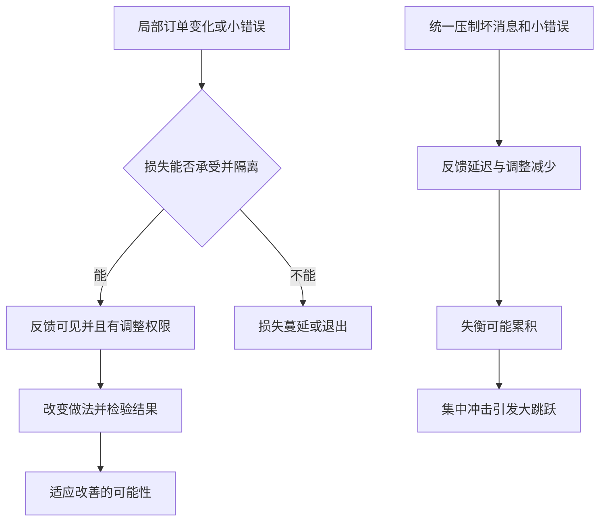
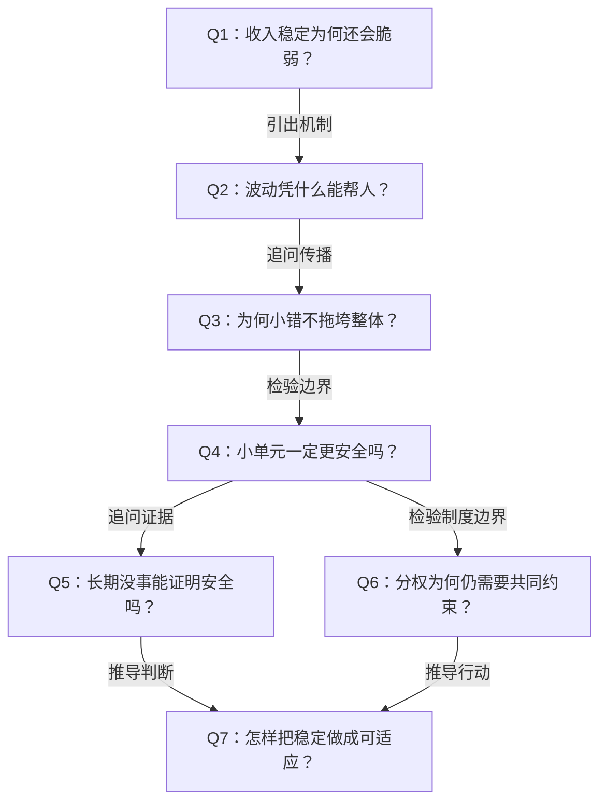

# 《反脆弱》第五章：露天市场与办公楼——深度拆解

> 依据：用户提供的《反脆弱》第五章 Markdown 原文（章题“露天市场与办公楼”）。本文分析该章内部的论证，不把其中历史叙事、国家比较和统计数字视为已独立核验的事实。“如今”等表述均属于作者写作时点。实践场景与数值示例为本文推导，不是原书案例。原文末尾部分注释残缺，本文不补造缺失内容。

## x → f → f(x)

- **x：为什么每天都在波动的生计或社会，可能比长期平静的系统更安全，而追求稳定反而可能制造崩溃？**
- **f：区分分散、可承受、可反馈的小波动与集中、隐蔽、可能致命的大跳跃；追踪压制小错是否同时切断学习、集中依赖，并使错误能够扩散到整体。**
- **f(x)：评价稳定时，先检查收入或权力依赖是否集中、局部失败能否隔离、反馈能否促成调整，以及最坏冲击是否会摧毁生存条件；保留可逆试错，同时为共同灾难设置约束。**

因为表面的平稳可能掩盖集中风险，作者用两类随机性重构“稳定”的含义；把这个区分放回现实，行动重点就从消除一切波动，转向限制毁灭性损失并保留适应渠道。

## 核心命题

**稳定应当用系统承受和消化冲击的能力衡量，不能只用平静时期的表现衡量。**分散的小扰动若能提供信息、触发调整且不蔓延，便可能支撑长期稳定；把这些扰动压下去，却保留集中依赖和累积失衡，可能只是在推迟一次更大的失败。

“露天市场”与“办公楼”因此是两种组织逻辑的意象：前者容纳分散交易、局部调整和持续反馈，后者代表作者所批评的自上而下统一规划。建筑形式本身并不决定反脆弱性。

## 与前四章的衔接

前三章建立了脆弱、强韧与反脆弱的区分，解释适度刺激如何支持适应；第四章追问整体获益与个体受损之间的层级关系。第五章进一步追问：**怎样组织局部活动，才不会让一次失败击穿整体？**

这也继承了第四章的伦理约束：即使许多小单元的更替让整体更稳，也不能推定退出者因此受益。不能用系统的学习为个人承担无限损失辩护。

## 关键洞见

### 1. 收入的平滑程度与收入中断的结构，是两件事

约翰在银行任职，收入长期固定，却依赖一个雇主；乔治开出租车，收入每日变化，却面对许多客户。一个客户流失通常只损失一笔收入，一个雇主裁员则可能中断全部工资。

作者的反转是：**可见的小风险容易引起焦虑，隐蔽的大依赖容易被误认为保障。**

但“客户多”还不够。若客户需求共同依赖旅游业，或经营依赖唯一平台、车辆与执照，那么看似分散的交易仍可能有共同失效点。反过来，受雇者也可能拥有可迁移技能、储备和多个就业机会。真正需要比较的是依赖结构，而非职业名称。

| 观察维度 | 约翰式结构 | 乔治式结构 | 判断重点 |
|---|---|---|---|
| 平时表现 | 收入平滑 | 收入起伏 | 起伏不能独立衡量安全 |
| 单次关系断裂 | 可能失去全部工资 | 通常损失一笔交易 | 最大单点损失多大 |
| 环境反馈 | 可能延迟到裁员时显现 | 经常从订单变化中显现 | 信号能否提前被行动利用 |
| 调整权限 | 受组织限制 | 可调整路线、客户和时间 | 是否真有可行替代选项 |
| 共同冲击 | 行业衰退、雇主失败 | 需求骤降、平台或车辆失效 | 多个来源是否一起出问题 |

### 2. 波动只有进入反馈闭环，才可能转化为反脆弱性

出租车司机订单减少，可以调整地点、时间或技能；小错因此带来环境信息。作者把这种关系概括为“压力就是信息”。

这句话需要补全：**压力必须可识别，行动者必须有调整空间，损失必须允许他活到下一轮。**否则压力可能只是伤害，既不产生学习，也不产生收益。

图中两条路径是作者机制的条件化表达，不是“一有波动就改善、一干预就崩溃”的定律。若干预消除了共同失效点，反而可能降低尾部损失。

### 3. 小单元的价值在于限制错误半径，而非“小”天然正确

作者借瑞士自治市说明：地方事务中的争吵不一定妨碍国家层面的稳定。决策贴近受影响的人，错误更容易被发现、追责和调整；同样一个错误，也未必被同步复制到全部地区。

规模扩大还会改变关系的性质：面对面的责任可能变成抽象指标，纠正一处的成本与全国统一政策的成本也不同。作者对游说的分析延伸了这一点：影响一个集中决策中心，可能获得覆盖全局的回报。

但地方并不天然免疫于利益俘获，熟人社会也可能排斥异议。有效条件是**局部权限、局部责任、可纠错程序和跨单元的风险隔离**；只有机构数量多，却共享同一脆弱基础，并不能获得这些好处。

### 4. 平均斯坦与极端斯坦，区别在极端事件能否支配总结果

原文用日常热量摄入与图书销售作对比：前者单日量存在现实限制，某一天通常难以主导全年；后者可能由少数畅销书支配。这个区分比“有没有异常”更关键：**一个异常能否改写整个总量？**

作者进一步把分散的小波动与集中后的大跳跃联系起来。不过应分清两个层次：

- **分布层面：**总量是由许多普通事件组成，还是由少数极端事件主导？
- **机制层面：**依赖、相关性、反馈和损失传播怎样改变极端结果？

分散治理是作者解释第一类结果的一种机制，不等于自治市必然服从正态分布。短期平滑的曲线本身，也不足以确定尾部究竟属于哪一种分布。

**本文示例：**十个单元各损失一份资源，若错误发生在不同时间、彼此隔离且有恢复余量，系统可能逐次消化；若它们依赖同一个基础设施，同一冲击就可能让十份损失同时到来。单元数没有变化，风险结构已经改变。

### 5. “火鸡问题”是把观察不到危险，当成危险不存在

火鸡连续得到喂养，便将这些数据解释成屠夫会永远保护它。真正缺失的，是对屠夫目的与自身处境的理解。更多同类数据能加强错误信念，却不能排除样本没有覆盖的终止机制。

这里有两个重要区分：

- **相对视角：**屠宰对火鸡是意外，对屠夫不是；“黑天鹅”与观察者掌握的信息有关。
- **证据力度：**平安记录可以说明已观察阶段的表现，却不能自动证明系统不存在致命失效路径。

作者据此反对只用过去少见的大灾难估计未来安全。更可操作的补充是：既看历史频率，也检查暴露机制、损失上限和恢复能力。不能由此推导出“数据没有价值”。

## 实践指引

以下是对本章的应用推导，不是作者给出的现成方案。

### 场景一：审视个人职业的稳定性

画出“收入来源—依赖条件—替代路径”：工资依赖哪个雇主，副业依赖哪个平台，技能能否迁移，某个条件消失后还能做什么。

优先检查那些会让全部收入同时中断的节点，再通过有限成本的小项目、技能练习或外部交流，持续验证替代路径。不要仅凭自雇者收入更波动，就认定其风险更大；也不要为了“反脆弱”直接辞职。转换身份不会自动改变集中依赖。

### 场景二：团队怎样容忍小错

对可逆业务变化，先在有限范围试行，设定损失上限、停止条件与回退方式，并记录结果供其他团队使用。衡量一次试验，要同时看损失是否受控、暴露了什么问题、后续是否调整。

如果容错只是让一线承担损失、决策者继续扩大试验，那么既没有可靠学习，也重演了第四章的成本转移。对不能安全回退的任务，应先改变试验环境，不能直接把真实伤害当作反馈。

### 场景三：识别“统一管理”是否有益

每项统一措施都问三件事：它减少了哪种共同风险？是否把所有单元绑定到同一失败点？是否还允许局部发现问题并纠正？

例如，统一备份规范可能减少数据丢失；全部备份放在同一故障域，却可能制造共同失效。评价对象应是具体风险路径，不能只看组织图上是否集中。

### 场景四：区分有效规划与压制现实

制定有资源余量、反馈节点和退出条件的计划；当假设失效时允许修改。每次复盘检查：“坏消息减少了，是问题解决了，还是没人愿意报告了？”

作者批评僵化规划，但实践上不能把“未来不可预测”转译为“不做准备”。准备多个应对路径，恰恰是在承认预测能力有限。

## 例子列表

以下均来自本章，按论证用途整理；历史案例呈现作者的解释，不代表已经完成因果验证。

| 原文例子 | 一句话概括 | 逻辑位置 |
|---|---|---|
| 约翰与乔治 | 固定工资与分散订单，呈现平稳外观和依赖结构的差别 | x：问题；f：对照机制 |
| 司机接到远途订单并可拒绝 | 调整权与选择权让意外有机会成为收益，而非只有损失 | f：选择空间 |
| 雇员错误被记入人事档案 | 对小错的永久惩罚可能抑制试错与调整 | f：反馈受阻 |
| 列宁与流亡者在瑞士避难 | 作者用集中化蓝图与分权庇护地的反差引出治理问题 | x：政治层面的反差 |
| 瑞士自治市的日常争执 | 局部噪声可以与整体稳定并存 | f：局部与整体的关系 |
| 面对面责任与抽象报表 | 规模扩大可能拉远决策与后果之间的距离 | f：责任反馈 |
| 布鲁塞尔的游说 | 集中决策可能提高一次俘获的收益和覆盖范围 | f：集中影响路径 |
| 莱奥尼对判例与法典的比较 | 作者借多样判决说明避免统一复制错误的思路 | f：规则多样性 |
| 瑞士学徒模式 | 作者以实践技艺说明适应知识不只来自理论设计 | f：经验学习 |
| 热量摄入与畅销书 | 单次变化受限与少数事件主导总量，属于不同随机结构 | f：平均斯坦与极端斯坦 |
| 火鸡被喂养千日 | 平静样本可能强化对终止机制的错误理解 | x：认知陷阱；f：机制审查 |
| 伊拉克政权被推翻后的混乱 | 作者用强制秩序消失后的剧烈动荡说明伪稳定问题 | x：集中风险暴露 |
| 黎凡特集市被办公楼替代 | 作者将商业网络受损与统一现代化政策联系起来 | f：标题意象的落地 |
| 黎巴嫩内战与商人的“监狱”比喻 | 商业自由不等于军事失控，经济活力也不抹除战争代价 | f：边界检验 |
| 罗马与奥斯曼的地方自治 | 作者提出商业自治与抑制地方战争可以组合 | f(x)：制度分工 |
| 城邦战争、世界大战与核风险 | 作者用灾难规模提醒读者，事件减少不等于潜在损失下降 | f：尾部风险 |
| 茨威格的流亡 | 作者将政治统一的讨论延伸到地方文化与个人归属的损失 | x：制度变迁的个人代价 |

## 结论列表

1. 收入的平滑程度不能代替对收入中断机制的检查。
2. 压低可见波动只有在同时降低真实风险时，才构成安全改善。
3. 小错误只有在损失可承受、反馈可用且行动可调整时，才可能成为学习资源。
4. 分散的价值取决于共同失效点和传播路径，不能用机构或客户的数量代替判断。
5. 系统保持强韧与系统因冲击变得更好，是两个不同的结论。
6. 没有观察到灾难，不能自动证明灾难路径不存在。
7. 商业与地方事务的自治，可以与约束军事冲突的共同规则并存。
8. 灾难频率下降与单次潜在损失上升，可以同时发生。
9. 整体消化了局部损失，不等于承担损失的人从中获益。
10. 有效规划应容纳反馈与修订，不能以计划的完成度取代对环境的适应。

## Q-A 问答链

### Q-A 问题结构图

### Q1：收入稳定为何还会脆弱？

- **结论：**平时不变的收入，也可能依赖一个会突然失效的关系。
- **形式化：**月度平滑 ≠ 单点中断后仍能生存。
- **论证：**① 约翰的工资由一个雇主支付。② 裁员可能一次切断全部工资。③ 过去工资的连续性没有消除这一依赖。
- **边界：**储备、保障和可迁移技能可以降低中断后果；雇员身份本身不是脆弱性的证明。

**Q1 → Q2：**既然少波动不能证明安全，就需要解释乔治面对更多波动时，为什么反而可能获得适应能力。

### Q2：波动凭什么能帮人？

- **结论：**可承受的波动能揭示环境变化，并让行动者及时调整。
- **形式化：**小扰动 + 有效反馈 + 调整权限 → 适应改善的可能。
- **论证：**① 订单变化暴露需求差异。② 司机可以改变路线或时间。③ 调整结果又成为下一轮反馈。
- **边界：**不可承受的损失、无法辨认的噪声或没有替代选项，都可能切断闭环；有反馈也不保证每次调整成功。

**Q2 → Q3：**波动只有不先摧毁学习者才有帮助，所以必须追问，局部错误如何被限制在系统能承受的范围。

### Q3：为何小错不拖垮整体？

- **结论：**损失能够隔离、其他单元仍可运行时，局部失败才不必升级为整体失败。
- **形式化：**局部损失 + 传播受限 + 其余单元可续存 → 整体有机会消化。
- **论证：**① 分散单元可以采用不同做法。② 一处错误不必同步复制到所有地方。③ 其余单元继续运行，系统保留修复与替换的余地。
- **边界：**共同负债、基础设施或外部冲击可能让多个单元同时失败；整体存续也不证明受损成员获益。

**Q3 → Q4：**隔离是稳定的必要机制之一，但小单元未必真的独立，因此必须检验“小”与“分散”是否只是外观。

### Q4：小单元一定更安全吗？

- **结论：**小单元只有减少共同失效和错误扩散时，才具有相关优势。
- **形式化：**单元多 ≠ 风险分散；隔离有效 + 共同暴露受控 → 分散才有意义。
- **论证：**① 多个单元可能依赖同一平台或资源。② 共享节点失效会同步打击它们。③ 判断必须穿透数量，检查依赖与责任结构。
- **边界：**共同标准、公共设施和协调机制也可能减少风险；不能用分散原则否定一切集中安排。

**Q4 → Q5：**既然真实结构可能藏在分散或平稳的外观背后，就不能仅靠“过去一直没事”判定风险已经消失。

### Q5：长期没事能证明安全吗？

- **结论：**长期平安可以提供信息，却不能排除尚未在样本中出现的致命机制。
- **形式化：**缺少危害证据 ≠ 已证明不存在危害。
- **论证：**① 火鸡只观察到喂养期。② 喂养期的数据不揭示屠夫的终止安排。③ 继续累积同类观察，不会自动覆盖未观察的机制。
- **边界：**不能反过来说任何平安记录都毫无意义；关键是样本覆盖、机制知识和结论强度是否匹配。

**Q4 → Q6：**小单元并非天然安全，在制度设计上尤其需要追问：哪些局部行为会把风险重新扩散给所有人？

### Q6：分权为何仍需要共同约束？

- **结论：**地方自治需要约束会伤害其他单元的行为，特别是失控的武装竞争。
- **形式化：**地方商业自治 + 跨单元冲突约束 → 保留活力并限制灾难外溢。
- **论证：**① 黎巴嫩案例在本章中显示松散并不排除内战。② 地方军备竞赛会把局部决策变成共同威胁。③ 作者因而肯定商业自治与更高层次限制战争的组合。
- **边界：**共同约束也可能被滥用或过度扩张，需要问责；作者对帝国的功能分析不构成对其全部统治方式的认可。

**Q5 → Q7：**过去平安不足以担保未来安全，行动上便需要用失效路径与损失承受力补充历史记录。

**Q6 → Q7：**分权仍需共同约束，最终方案便必须同时安排局部纠错与整体保护，而不能只要求减少管理。

### Q7：怎样把稳定做成可适应？

- **结论：**让局部问题尽早显现并可修正，同时阻断会让整体无法恢复的风险路径。
- **形式化：**暴露可见 + 损失有界 + 反馈可用 + 调整可行 → 可适应的稳定。
- **论证：**① 找出能切断全部收入或运行能力的共同节点。② 为可逆活动设置有限试验、反馈和回退。③ 对不可逆的共同损失设置约束，并检查承担成本的人是否受到保护。
- **边界：**这套检查提高判断质量，不保证不存在未知风险，也不意味着增加波动本身就是改善。

## 局限与盲区

### 1. 从对照故事到一般因果，仍有缺口

约翰和乔治是解释机制的思想案例，不能证明所有出租车司机都比银行雇员安全。瑞士、叙利亚、黎巴嫩与帝国的历史对照，涉及许多本章没有控制的因素。它们支持提出机制假说，不能独立完成因果识别。

### 2. “分散必然进入平均斯坦”过强

多个小单元可能面对同一个冲击，局部竞争也可能通过网络传播风险。只有在单次影响受限、共同暴露与依赖关系得到控制等条件下，聚合才更有机会平滑波动。本章没有为所有列举的社会系统提供这些条件成立的证明。

### 3. 强韧与反脆弱有时混在一起

客户多而不容易断收，主要说明抗冲击；能从需求变化中学习并改善，才涉及反脆弱。瑞士吸收外部冲击带来的资本流入，又是另一种获益渠道。不能因为都出现在同一章，就当作同一种机制已经得到证明。

### 4. 地方责任与集中协调都不能被浪漫化

面对面关系可能增强责任，也可能形成地方保护和排斥。共同规则可能放大错误，也可能限制跨地区的外部伤害。需要具体比较纠错、退出、问责与风险传播，不能由“小有优势”直接跳到“大必然失败”。

### 5. 战争与“监狱”的比较不能替受害者排序

商人的比喻表达他对经济与政治自由的偏好；作者所述国家财富差异，也不能推出战争整体上更可取。财富指标没有穷尽死亡、流离失所和分配后果。本章自己对军事失控的批评，已经阻止了这种简单推论。

### 6. 风险频率与灾难规模必须共同评价

作者有力地指出，事件少不代表损害小；但潜在灾难大，也不能单独证明风险必然上升。完整比较仍需研究发生机制、可能频率、损失范围和不确定性，不能只选择其中一个维度。

## 回读本章时最值得追问的一句话

**眼前的平静，是系统已经消化了问题，还是问题暂时失去了显现的渠道？**

要回答它，就沿着“谁依赖谁—谁看得到错误—谁能调整—损失传给谁”逐项追踪。这样才能把本章的反直觉判断，落实为可检验的结构分析。
