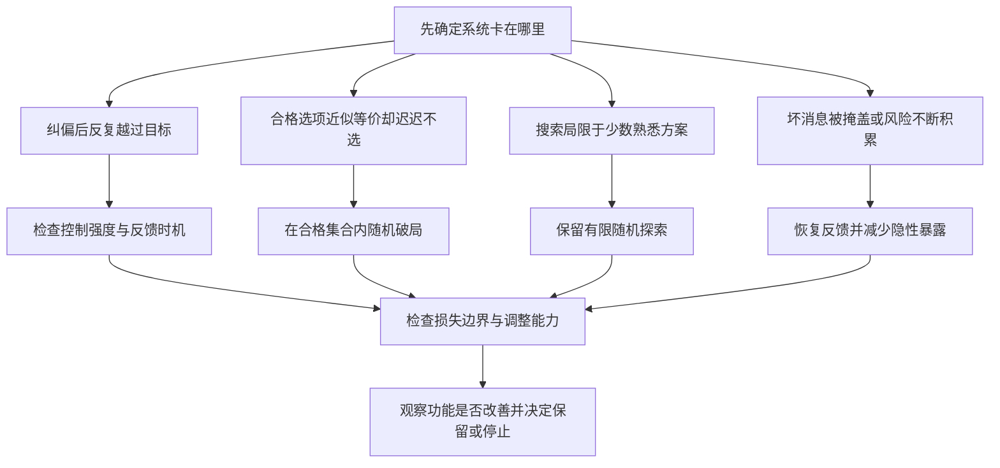
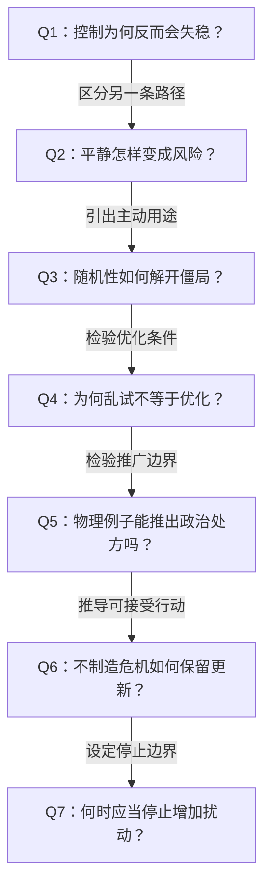

# 《反脆弱》第六章：告诉他们我爱随机性——深度拆解

> 依据：用户提供的第六章 Markdown 原文。本文拆解本章论证，不对其科学史细节、实验结果与政治史解释作独立事实核验。国家状况与“如今”等时间表述均指作者写作时点，不是当前判断。下文的实践方案、机制分类和反例为本文分析，不是原书直接给出的方案。

## x → f → f(x)

- **x：为什么越想把系统控制得平稳，越可能使它失稳；而主动加入一点随机性，有时反而能改善运行？**
- **f：区分随机性的不同作用：它可以暴露失衡、维持适应，也可以打破对称僵局、帮助越出局部困境；同时检查控制行为是否因过度纠偏、阻塞反馈或积累隐性暴露而放大风险。**
- **f(x)：先诊断系统到底卡在哪里，再决定是减少过度控制、保留可承受扰动，还是引入有限的随机探索；用损失边界、退出机制和反馈评价结果，不能把“增加波动”本身当作目标。**

因为平稳外观不能保证系统运行良好，作者把随机性从“应消灭的干扰”改写为“可能有功能的输入”；接受这一点后，设计的任务便是匹配扰动与机制，而非一味追求更安静或更混乱。

## 核心命题

**随机性有时是系统纠错、搜索和更新的条件；控制若破坏这些功能，可能制造它原本试图消除的不稳定。**

但“有时”不能删去。证明一种系统受益于特定噪声，不等于证明所有系统都会从任意扰动中获益，更不等于证明战争或重大危机是必要代价。

## 从第五章到第六章

| 章节 | 核心推进 | 阅读时应守住的区别 |
|---|---|---|
| 第五章 | 分散的小波动可能支持长期稳定，集中风险可能藏在平稳外观下 | 波动程度与毁灭性暴露不同 |
| 第六章 | 随机性可以主动进入机制，帮助解锁、探索和更新 | 自然波动、随机探索与不可逆伤害不同 |

第五章主要问“为什么不要抹平所有波动”；第六章进一步问“什么时候值得主动给系统一点扰动”。作者也由此为第七章的干预问题、第八章的预测问题铺路：如果看不清系统如何适应，就可能既过度纠偏，又过度相信自己能预知结果。

## 关键洞见

### 1. 控制器也会改变系统，不能只看它的稳定意图

本章开头借麦克斯韦的调节器研究，说明纠偏装置本身可能产生不稳定。作者由此挑战一个直觉：发现偏差就立刻加大控制，未必使偏差越来越小。

关键是把分析对象从“原系统”扩大为“系统与控制行为的相互作用”。本文用一个简化场景解释：若调节依据的是已经过时的信号，行动又过猛，下一次看到的偏差可能正是上一次纠偏制造的；继续加码，便可能让系统反复越过目标。

**少一点控制可能改善结果，不是因为控制天然有害，而是因为控制也有强度、时机与副作用。**本章并没有提供一套可直接套用于所有市场和政治制度的控制参数。

### 2. 伪稳定可能通过三条不同路径制造脆弱

作者把守时者的家人、森林火灾、市场洗牌和政权稳定放在一起，它们却并不拥有完全相同的因果链。

| 路径 | 本章例子 | 平静改变了什么 | 风险如何出现 |
|---|---|---|---|
| 预期收窄 | 每天准时回家的人偶尔迟到 | 观察者习惯极窄的正常区间 | 微小偏差引起过强反应 |
| 暴露累积 | 防火与市场长期缺乏洗牌的叙述 | 可燃物或脆弱参与者未被清理、纠正 | 后续冲击可能造成集中损失 |
| 纠错被阻断 | 对政治波动的持续压制 | 不满、责任和利益冲突缺少公开调整渠道 | 问题可能隐蔽化并以更剧烈形式显现 |

这一区分能防止把“长期没有危机”误当作危机的充分原因。需要追问：平静期间究竟积累了什么，谁的行为发生了变化，哪个纠错渠道被堵住？如果暴露持续下降、反馈渠道畅通，平静也可能是真实改善的结果。

### 3. 随机性不只传递信息，还能改变搜索所处的位置

“布里丹之驴”面对对称选项，迟迟无法行动；随机推动一步，作用是打破平局，而不是找到更准确的答案。随机点餐与维吉尔卦，在作者叙事中也承担了减轻选择僵局和后悔的功能。

退火则讨论另一类障碍：系统已停在一个相对稳定、但未必最好的位置。扰动让它有机会离开原位置，冷却与选择则帮助其重新落定。**跳出去和留下来是两个环节：只有跳动，没有评价或收敛，不等于优化。**

这两类机制不能混为一谈：

- 对近似等价的合格选项，随机化可以低成本结束争论。
- 对未知的候选方案，随机化可以扩大探索，但仍需检验结果。
- 对明显不合格或损失不可承受的选项，抽签不会使它变得合理。

### 4. 噪声的作用取决于系统结构，并非越多越好

本章的随机共振例子，强调弱信号在特定检测机制下可能借助噪声变得可检测；敲击晴雨表的例子强调解除卡滞；随机冲击使球的运动更规则，则用来挑战“输入更随机，输出必然更乱”的直觉。

这些例子共同否定了简单的单调关系：**噪声增加，不必然意味着功能下降。**但它们没有共同证明“噪声总能改善功能”。

尤其要避免把随机共振理解为普遍的音量放大术。按本章的阈值叙述，重点在信号、噪声和检测条件的配合，不是任何声音加入杂音都更清楚。本文不根据这些例子推导具体工程参数。

### 5. 随机更新可以挑战固化，但不能代替责任制度

“政治退火”把随机性引入人员选择：与其让统治者任意安排公民命运，不如由公民通过随机方式改变掌权者构成。其可讨论的机制是打断固定晋升路径、扩大进入机会，并减少某些职位被永久占据的可能。

然而，本章提到的议会模拟，只能在相应模型假设下支持某些结果，不能直接保证现实制度改善。政治人员的能力、权限、监督和退出条件，仍然决定结果。

作者又把暗杀与黑手党接班比作退火。这里存在明显的规范跳跃：**旧结构被打断，不等于新结构更好；更新收益也不能自动抵消被施加给他人的伤害。**可以保留的制度问题是如何允许轮换与纠错，而非把暴力当作更新工具。

## 理解阻力扫描：把“爱随机性”拆成机制

本章最容易误读的地方，是把一组不同机制压成“多点随机性就好”。实际选择应从故障类型开始。

这是本文从案例中提炼的诊断图，不是作者给出的算法。它刻意没有把所有故障都导向“增加噪声”：控制过猛时可能需要减弱干预，暴露累积时需要减少暴露，而不是再制造一次冲击。

## 实践指引

以下为本文推导，适用于能控制成本、保留反馈的日常或组织决策。

### 场景一：两个合格方案争论不休

先排除违反硬性条件的选项，再检查剩余差异是否值得继续研究。如果只是会议时间、展示次序或其他低成本且近似等价的选择，可以抽签决定，约定必要时如何修改。

这里随机性的收益是减少决策成本，不是提高答案的神秘准确率。不要把结果归于命运，从而免除自己的责任；候选集合仍由人筛选，后果仍须有人承担。

### 场景二：团队一直尝试同一种解法

把大部分资源用于已有证据支持的路径，留出明确额度探索不同方案。对探索记录假设、成本、观察结果和停止条件；无效就退出，有效才扩大。

随机性用来扩大搜索范围，评价负责筛选。不要同时随机改变所有条件，否则很难知道哪一步产生了影响；也不要把探索配额设成任何情况下都必须花完的指标。

### 场景三：管理者见到偏差就频繁改指标

先记录“偏差出现—收到信号—采取措施—结果显现”的时间顺序，检查当前波动是否是上一轮调整尚未结束的结果。对可逆事项，可以预设观察区间与调整节奏，避免每次短期变化都触发全员转向。

这里的重点是改善反馈与控制的匹配，不是要求管理者随机下指令。对于已经明确且不可承受的损失，也不能把等待合理化成“尊重自然”。

### 场景四：组织连续多年“零问题”

区分没有问题与没有报告：检查失败记录是否缺失、提出异议是否受罚、同一风险是否被反复延期，以及谁会在问题暴露时承担损失。

可用演练、有限试验、独立检查和轮换观察角度暴露问题。这些方式可以有计划地进行，不必故意制造事故。目标是恢复纠错，不能用“系统需要洗牌”要求某一群体承担无法恢复的伤害。

## 例子列表

| 原文例子 | 机制与用途 | 逻辑位置 |
|---|---|---|
| 蒸汽机调节器 | 控制装置本身可能参与制造失稳 | x：稳定意图为何失效；f：反馈相互作用 |
| 货币微小波动引发恐慌 | 缺乏日常波动可能让预期变窄 | f：预期适应 |
| 守时者偶尔迟到 | 偏离预期的反应，取决于平时容许的变化范围 | f：预期适应 |
| 森林防火与燃料累积 | 作者用累积可燃物解释延后扰动的潜在成本 | f：隐性暴露累积 |
| 市场新低与洗牌 | 作者引述老手经验，说明脆弱参与者集中退出的路径 | f：选择与集中损失；不是交易规则证明 |
| 布里丹之驴 | 随机一步打破对称选择僵局 | f：破局 |
| 随机共振 | 特定检测条件下噪声可能帮助弱信号越过阈值 | f：阈值机制 |
| 退火与模拟退火 | 扰动扩大搜索范围，随后需要收敛或筛选 | f：探索 |
| 敲击晴雨表 | 小扰动帮助摆脱卡滞 | f：解除约束 |
| 随机钻探论文 | 作者引述随机搜索可能胜过特定既有方法的主张 | f：探索；不能泛化为随机总优于专业方法 |
| 桌面上球的随机冲击演示 | 更随机的输入未必产生更混乱的输出 | f：反直觉的动态响应 |
| 随机分配公民职业的寓言 | 无约束的随机统治本身会造成负担 | x：谁被随机化、谁承担后果 |
| 雅典抽签与议会模拟 | 作者用随机选人讨论打破政治固化 | f(x)：制度更新的设想 |
| 弑君与黑手党接班 | 作者借暴力打断旧结构作退火类比，但改善与正当性均需另证 | f：类比；同时检验边界 |
| 维吉尔卦与随机点餐 | 随机化减轻选择僵局及主观后悔 | f(x)：低成本选择 |
| 迈斯特与欧洲战争 | 作者要求考虑冲突和压制冲突的后续效应 | x：反事实比较；不是战争必要性的证据 |
| 疫苗比喻 | 作者用有限刺激类比社会的适应训练 | f：类比；不能直接推出社会政策 |
| 埃及、沙特与伊朗 | 作者认为外部支持的高压稳定可能累积冲突并产生连锁反应 | f：作者的历史因果解释 |
| 动物园狮子与野外狮子 | 以舒适可预测和自由适应的反差批判其定义下的现代化 | x：价值取舍 |
| 必须先给“蓝色”命名的叙述要求 | 实践功能可能先于完整语言解释，过度要求故事可能压缩行动 | f：叙述与行动的错位 |

## 结论列表

1. 控制行为是系统的一部分，也必须接受失稳与副作用检查。
2. 平静可能来自风险降低，也可能来自反馈被压制，二者需要区分。
3. 随机化可以打破等价选项间的僵局，但不能使不合格选项变得合格。
4. 随机探索需要损失边界、评价与退出，才能转化为可保留的改善。
5. 特定系统受益于特定噪声，不能证明所有系统都需要更多扰动。
6. 风险积累的判断必须指明积累的对象和传导机制，不能只依据平静持续了多久。
7. 人员轮换可以打断固化，但随机选人不能替代监督、能力要求和责任分配。
8. 系统更新的收益不能自动抵消强加给个体的不可逆损失。
9. 随机性有用，并不意味着计划、规则和专业知识无用。
10. 评价干预要比较完整的后果链，也要比较不干预的后果链。

## Q-A 问答链

### Q-A 问题结构图

### Q1：控制为何反而会失稳？

- **结论：**纠偏会改变系统，强度与时机不匹配时，它可能放大原本的偏差。
- **形式化：**偏差 → 过度纠偏 → 新偏差 → 继续加码。
- **论证：**① 控制不是外在于系统的中立观察。② 它的结果会成为下一轮反馈的一部分。③ 若反应过猛或时机错配，纠偏便可能进入自我放大的循环。
- **边界：**本章的调节器例子不证明所有严格控制都会失稳，具体结论取决于系统结构与参数。

**Q1 → Q2：**过度纠偏解释了控制如何制造即时波动，却还没有解释为什么有些系统长期安静、后来才突然失稳。

### Q2：平静怎样变成风险？

- **结论：**当平静伴随暴露累积、预期收窄或纠错受阻时，后续冲击可能被放大。
- **形式化：**表面平静 + 暴露累积或适应下降 → 潜在脆弱。
- **论证：**① 小波动与小错误可能提前暴露问题。② 压制它们若同时阻塞调整，问题并未解决。③ 后续冲击便可能集中触发之前未处理的风险。
- **边界：**暴露累积必须得到说明；风险真正下降的长期平静，不属于同一种情况。

**Q2 → Q3：**保留波动可能防止纠错功能丧失，但作者还声称主动加入随机性可以改善功能，因此必须解释它具体改变了什么。

### Q3：随机性如何解开僵局？

- **结论：**它可以打破对称选择，也可以使搜索离开原来停留的位置。
- **形式化：**对称僵局 → 随机破局；局部停滞 → 扰动探索。
- **论证：**① 驴的困境来自两个选项对称而非缺少可行选项。② 一次推动使行动开始。③ 退火类例子则用扰动提供离开既有位置的机会。
- **边界：**破局不等于选择更优；扩大探索也不保证到达最佳方案。

**Q3 → Q4：**随机性给出了开始或跳出的机会，却没有说明如何避免持续乱跳和更差结果，所以需要补上优化条件。

### Q4：为何乱试不等于优化？

- **结论：**探索只有与评价、筛选和损失约束结合，才可能留下有益变化。
- **形式化：**随机探索 + 结果评价 + 保留与退出 → 改善的可能。
- **论证：**① 随机尝试可能同时产生好坏候选。② 没有评价，就无法知道应保留什么。③ 没有退出或损失边界，系统可能在找到可用结果前已经无法继续。
- **边界：**某些物理系统的筛选由动力学完成，社会系统不能假设存在同样自动且无代价的收敛过程。

**Q4 → Q5：**优化依赖具体的筛选结构，物理系统的筛选方式又未必存在于社会中，因此必须检验跨领域类比是否成立。

### Q5：物理例子能推出政治处方吗？

- **结论：**物理例子可以启发机制假说，不能独立证明具体政治干预有效或正当。
- **形式化：**机制相似 ≠ 因果已证 ≠ 行动正当。
- **论证：**① 晴雨表与退火例子针对特定约束。② 社会成员会调整行为，也拥有不能省略的利益与权利。③ 要提出制度方案，仍需检验实际反馈、替代方案及成本承担者。
- **边界：**不能因类比有限就否认一切借鉴；可借鉴的是问题结构，不能直接照搬结论。

**Q5 → Q6：**跨领域类比不足以授权重大伤害，但打破固化仍是有效问题，因此需要寻找能保留更新、又控制损失的方式。

### Q6：不制造危机如何保留更新？

- **结论：**用可问责的轮换、有限试验和反馈渠道替代对灾难的依赖。
- **形式化：**纠错渠道 + 有限探索 + 可逆更新 → 不以重大伤害换取变化。
- **论证：**① 固化的关键是缺少修订与退出。② 轮换、复核和试验可以有针对性地提供更新。③ 把变化限制在可承受范围，才能保留后续学习能力。
- **边界：**这些是本文的应用推导，并非保证成功的通用方案；轮换也须考虑连续性、能力和交接成本。

**Q6 → Q7：**即便采用有限试验，扰动也有成本，因此最后需要明确何时继续、何时减少、何时停止。

### Q7：何时应当停止增加扰动？

- **结论：**当扰动不再带来可用反馈，或开始威胁恢复、责任与生存条件时，就应停止并重新诊断。
- **形式化：**信息收益下降或不可逆损失上升 → 停止加码并检查机制。
- **论证：**① 随机性在本章中有价值，是因为它承担具体功能。② 功能不存在或已经实现，继续增加输入没有自动收益。③ 若损失破坏下一轮学习，手段便违背了保留适应的目标。
- **边界：**停止标准应提前约定并允许复核，不能事后只凭成功与否倒推风险是否合理。

## 局限与盲区

### 1. 统一口号覆盖了多种不同机制

调节器失稳、燃料累积、随机破局、随机共振和退火探索，不是同一个现象。它们可以共同反驳“随机性总是坏事”，却不能共同证明“随机性总是必需燃料”。读本章时，应保留案例之间的机制差异。

### 2. “无危机必然积累风险”仍需条件

人们可能在平静期扩大隐性暴露，也可能在平静期降低暴露、改善维护。作者有力指出了前一种可能，却常把它写成普遍必然。平静持续时间本身不能替代对具体积累过程的检查。

### 3. 战争类比没有解决反事实与伦理问题

“小冲突是否避免更大战争”需要比较同一条件下不同路径，而历史只呈现实际发生的一条路径。不能仅凭大灾难之前有长和平，就判定小战争本可防止它；更不能假定发动者可以控制战争规模。

修剪、疫苗和火灾的比喻同样不能替社会政策证明因果。在社会系统中，受损者、获益者与决策者往往不是同一群人，这正是第四章要求追踪的成本分配问题。

### 4. 政治模拟不等于现实政策验证

本章提及随机议员的计算机模拟，但没有在本章完整呈现模型条件。结论可能依赖偏好设定、议程、投票规则和评价标准。模拟能够展示某种机制可能成立，不能保证现实制度照搬后得到相同结果。

### 5. 对“现代化”的定义带有论战目的

作者把现代化定义为大规模平整环境、排除压力和控制波动，并将许多不同现象纳入批判。这是本章采用的分析定义，不是一个中立且唯一的历史定义。

其中更值得保留的机制判断是：叙述要求可能压缩实践空间，统一决策可能集中错误；但“需要解释”也可以是问责条件，“实践有效”也需要证据。不能把能说清与能做成永久对立，更不能仅凭自然或古老就判定方法优越。

### 6. 受益于扰动，不一定就是严格意义的反脆弱

一次随机选择解决了犹豫，说明随机化有工具价值；敲击解除卡滞，说明扰动能恢复功能。它们不一定证明系统随着更大变动持续获益。反脆弱、适应、搜索改善与恢复运行需要分别描述，不能因都包含随机性便混为一谈。

## 回读本章的检查问题

**这份随机性究竟在帮助系统发现问题、跳出困境，还是只是在增加损失？**

回答时明确四件事：它作用于哪个机制，改善以什么衡量，谁能停止试验，代价由谁承担。这样才能把“我爱随机性”转化为有条件、可检验的判断。
