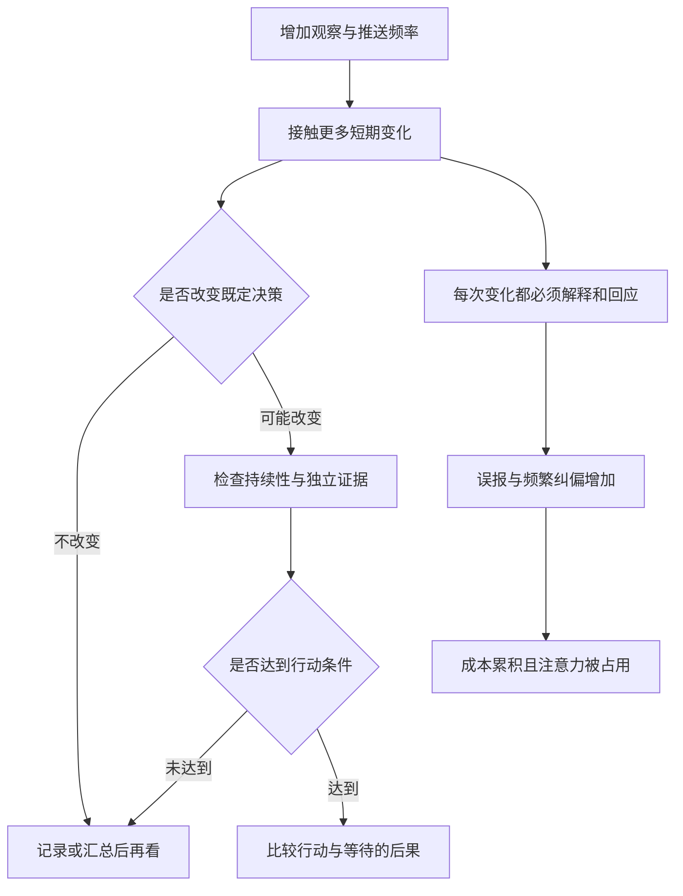
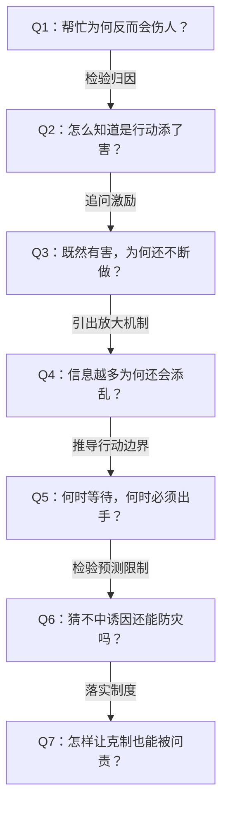

# 《反脆弱》第七章：天真的干预——深度拆解

> 依据：用户提供的第七章 Markdown 原文。本文分析本章的论证结构；书中的医疗数字、历史叙事、国家比较和研究引述未在此独立核验。涉及疾病、治疗与就医的段落仅作为文本案例分析，不作为诊疗建议。文中的决策框架、组织场景和反例为本文推导，区别于作者原有案例。

## x → f → f(x)

- **x：为什么专家、管理者和政策制定者出于改善问题的意图采取行动，仍可能造成净伤害，而且不断重复这种行动？**
- **f：把“医源性损伤”推广为干预造成的伤害，比较干预与不干预的完整后果；再追踪行动偏好、代理激励与噪声反应如何让收益被看见、损失被隐藏，并把注意力从预测触发事件转向减少结构性脆弱。**
- **f(x)：每次行动前写出基准路径、预期改善、副作用、等待成本和停止条件；对可逆且不紧急的问题保留观察与修订，对可能造成不可逆共同损失的风险及时约束，并按净效果而非动作数量评价贡献。**

因为“做了事情”不等于“改善了结果”，作者引入干预伤害与风险结构的分析；把它用于决策，就必须让行动和等待接受同一套后果比较。

## 核心命题

**善意、专业身份与忙碌程度都不能证明干预有益；真正需要证明的是，相比可行的替代路径，干预是否带来足以覆盖其伤害与机会成本的改善。**

作者明确反对把本章读成“不干预主义”：低收益处过度动作，可能同时挤占高收益处的必要行动。更好的问题是在哪些地方克制、在哪些地方坚定，而非选择一种永远动作或永远放任的姿态。

## 与前六章的衔接

| 前文建立的认识 | 第七章新增的问题 |
|---|---|
| 压力可能触发适应，波动不必然是坏事 | 干预会不会破坏原本存在的适应与恢复？ |
| 整体获益与个体承担成本可能分离 | 干预者获得报酬，后果是否由别人承担？ |
| 平稳外观可以掩盖集中风险 | 专家是否正在消灭信号，却没有消灭危险？ |
| 随机性有不同功能，须检查适用条件 | 哪些信息值得行动，哪些只会诱发无效纠偏？ |

第六章讨论“扰动怎样有用”，第七章讨论“想纠正扰动的人怎样造成伤害”。末尾对预测的批评，则为第八章继续讨论预测能力的边界铺路。

## 关键洞见

### 1. 评价干预必须有一条“不这样做”的比较路径

开篇的扁桃体案例中，每轮检查都会从剩余儿童里找出一批被建议手术的人。作者用它提示：专家的判断可能受到“需要做点什么”的倾向影响，反复咨询也可能不断增加动作，而不是只减少不确定性。

不过，重复推荐比例本身不能独立证明每项手术都无必要。它提出的可靠问题是：**推荐依据、收益证据和伤害成本是否足以支持行动？**

必须区分三个账本：

| 账本 | 要问的问题 | 常见遗漏 |
|---|---|---|
| 干预后的变化 | 做完后，结果如何？ | 把自然恢复也归功于行动 |
| 不干预或替代路径 | 不这样做，结果可能如何？ | 把等待当作必然恶化 |
| 干预新增的代价 | 行动制造了什么新损失？ | 隐藏、延迟、外部转嫁和资源占用 |

可以把本文的比较原则压成一行：

**干预的增量价值 = 相比替代路径新增的改善 − 新增伤害 − 资源与机会成本。**

这是一条核对思路，不是假装所有后果都有精确概率。若涉及无法恢复的共同损失，还必须先设约束，不能只用一个乐观的平均收益抵消它。

### 2. 系统奖励可见动作，却不容易奖励避免掉的损失

作者把医生、文字编辑、经理和政治家放在同一条激励链上：动作可以展示，费用与奖金可以计算；克制后没有发生的坏事，很难被看见和归功。

于是即使个人并无恶意，也可能形成偏差：

**需要证明价值 → 增加可见动作 → 获得认可 → 隐性成本由别人或未来承担。**

这比“专家贪心”更有解释力。代理问题既可能来自直接经济利益，也可能来自声誉、免责、职业晋升与绩效口径。如果只奖励改了多少、处理了多少，理性的职业反应也可能是制造更多工作。

作者的编辑经历补上另一层代价：改写了大量表达，却漏掉唯一重要的年份错误。过度干预不只新增损害，也消耗了识别真正问题的注意力。

### 3. 克制可以是行动策略，但必须计算等待的代价

本章赞美费边的拖延、老子的无为，以及作者自己暂缓写作或某次手术的经历。它们共同提出：**等待可能保留选择权，让问题自行变化，并过滤冲动信息。**

但“等一等”要与“没有决策”区分。有效等待至少说明：观察什么、等到何时、什么变化会触发行动，以及等待本身可能失去什么。

| 选择 | 可能收益 | 必须检查的损失 |
|---|---|---|
| 立即行动 | 阻断恶化、抓住时机 | 误判、副作用、不可逆改变 |
| 有条件等待 | 获得信息、保留修订、自发改善 | 错过窗口、损失累积 |
| 小范围试行 | 用有限成本检验假设 | 局部伤害、结果未必可推广 |
| 减少既有干预 | 降低维护和副作用负担 | 原干预承担的保护功能是否消失 |

作者也明确承认紧急情况下不会拖延。因此本章更有用的结论是把等待列入选项，而非把拖延升级成无条件美德。个人经验不能替其他人的情境决定等待是否合适。

### 4. 信息只有经过行动规则，才会变成帮助或伤害

本章批评高频查看数据与媒体填满版面的冲动。关键机制并不只是“看得多令人焦虑”，而是短期变化被反复解释为必须纠正的问题，继而增加误报、动作和副作用。

图中分流规则是本文推导。原文列举的年度、每日、每小时信噪比例是作者的示例，不能当作所有数据集通用的固定规律。

这里也能化解与第六章的表面矛盾：随机扰动可能帮助系统探索，不代表观察者应对每个随机变化采取动作。**输入是否有功能，与人是否该立即响应，是两个问题。**

### 5. 找出脆弱结构，往往比猜中最后一根稻草更能改变后果

章末用沙柱支撑的桥与最后一辆卡车作比喻：卡车可能触发倒塌，但仅追逐它，会遗漏桥为什么经不起正常载荷。

应当区分：

- **触发因素：**哪次事件使后果在此刻发生？
- **脆弱结构：**什么依赖、承载不足或传播关系，使事件能造成大损失？
- **后果机制：**局部损失如何变成连锁崩溃？

预测某辆卡车经过，不会自动加固桥；不能预测具体时间，也不等于不能检查承载结构。政治与经济情境中的类比同理：精确预测革命或危机，不应成为减少集中暴露的前提。

但触发与结构不是互斥解释。短期预警仍可能争取应对时间，触发因素也可能是可干预的原因之一。作者对预测的批评应保留这一边界。

## 如何区分天真与非天真的干预

作者同时赞成限制某些规模、集中度、速度和环境损害，又讨论减少局部道路标识的可能益处。两者不矛盾，因为干预对象与反馈机制不同。

| 检查项 | 天真的干预倾向 | 更审慎的做法 |
|---|---|---|
| 问题定义 | 有偏差就必须消除 | 先区分失效与正常变化 |
| 对照路径 | 做了总比不做好 | 比较等待、减法和替代方案 |
| 自发能力 | 不承认系统能恢复或适应 | 检查这种能力是否实际存在 |
| 副作用 | 只数直接收益 | 检查延迟、外部性和二阶效应 |
| 风险范围 | 单一方案大范围同步推广 | 允许局部试行并限制传播 |
| 责任 | 执行者获奖，别人承担损失 | 追踪完整后果与成本承担者 |
| 停止条件 | 继续做才能证明负责 | 预先写明何时停止或修订 |

这里“更审慎”不等于“永远更慢”。当等待会扩大不可逆伤害时，及时约束风险才符合这套原则。

## 实践指引

以下是本文推导的组织与日常决策方法，不是原书提供的操作清单。

### 场景一：团队频繁改流程，却没有改善结果

对每项改动写一张简短记录：具体问题、已有证据、替代方案、预计改善、可能新增负担、复核日期与回退条件。

复核时看解决了什么，而不是发布了多少制度。对只有措辞偏好、缺少明确收益的改动，可以保留原状；对影响正确性或可靠性的缺陷，应集中资源修复。这样落实编辑案例揭示的注意力分配问题。

### 场景二：仪表盘不断触发管理动作

把观察频率与行动频率分开。保留记录，但按业务的实际变化周期汇总；设置需要立即关注的少数事件，其余变化不自动要求解释或改计划。

判断一次通知是否值得出现，可以问：“它可能改变哪个决定？若没有人响应，会失去什么？”如果回答不出来，就先调整通知机制，而不是增加专人逐条回应。

### 场景三：负责人担心“不动就显得没贡献”

让评审允许三种结果：采取行动、有限试验、有条件维持现状。三种结果都说明证据、预计后果和复核时间。

评价克制也不能只凭“后来没出事”就认定功劳，否则会制造另一类不可证伪的邀功。更可靠的是同时检查当时依据、可行替代路径和后续证据，允许不知道某次灾难究竟是否被避免。

### 场景四：复盘时所有人都在争论诱因

先写事件时间线，再独立画出依赖、容量与损失传播路径。分别回答“为什么此刻发生”和“为什么能损失这么大”。

纠正措施也分两类：一类提高预警与响应，另一类减少对预测准确性的依赖，例如消除单点、增加余量和准备回退。不要因为修复了某个触发条件，就宣称结构风险已经消失。

## 例子列表

以下是本章关键案例及其逻辑用途；历史与研究结果均按作者叙述呈现。

| 原文例子 | 一句话概括 | 逻辑位置 |
|---|---|---|
| 儿童反复接受扁桃体检查 | 每轮检查都追加一批手术推荐，揭示行动偏好与损益比较的缺口 | x：问题；f：比较干预伤害 |
| 华盛顿的放血治疗 | 作者用治疗可能加速死亡说明善意与结果可以相反 | f：医源性损伤 |
| 塞梅尔维斯与医院感染 | 作者强调应正视伤害观察，而非用缺少理论解释拒绝检查 | f：证据与职业防御 |
| 股票经纪人、医生与政治家 | 受托者的收入或职业收益可能与服务对象的利益脱节 | f：代理激励 |
| 黑客攻击与批评带来知名度 | 恶意也可能在特定反馈结构下产生意外好处 | f：意图与后果分离 |
| 《制作人》与报复性交易 | 作者用蓄意求败却意外获利的故事说明结果不服从意图 | f：反向意外；不是可靠操作方法 |
| 表7–1的跨领域清单 | 医疗、教育、规划等被纳入干预成本的同一检查范围 | f：推广问题，而非逐项完成证明 |
| 物理理论与社会理论的对照 | 作者反对把某领域的可预测性无条件移植到另一领域 | f：适用域与模型误差 |
| 格林斯潘与布朗的稳定政策 | 作者将压制波动与隐性风险积累联系起来 | f：政策伤害的作者解释 |
| 多轮文字编辑与年份错误 | 可见的表达改写可能挤占真正的准确性检查 | f：动作激励和机会成本 |
| 高速公路限速与地方道路标识 | 同属交通管理，干预结论却取决于不同机制 | f(x)：按情境判断 |
| 费边延缓交战与费边社 | 作者把等待视为改变对局、保留修订的策略 | f(x)：有条件等待 |
| 老子与作者暂缓写作 | 克制可为自发选择与过滤提供时间 | f：等待的可能功能 |
| 作者暂缓背部手术 | 个人经历说明他为何重视自然恢复，不能推广成医疗指引 | f：作者的经验依据 |
| 冷静者与过度反应者 | 作者用人物对比展示按信号而非每个波动行动的差别 | f：信息过滤 |
| 私人医生与密集经济数据 | 专业服务与信息供给可能共同强化动作压力 | f：信息与代理激励的耦合 |
| 年、日、小时的信噪比例 | 以示意数字强调观察尺度可能影响信息价值 | f：时间尺度 |
| 媒体聚焦耸动事件 | 可报道性与风险重要性可能错位 | f：注意力分配 |
| 中国大饥荒中的粮食征购解释 | 作者引述研究讨论僵化集中政策怎样放大灾难 | f：局部信息与集中错误 |
| 苏联解体前后的分散种植及家庭纽带 | 作者把部分低效率解释为危机时的冗余与互助 | f：效率之外的恢复资源 |
| 法国与北欧的治理对照 | 作者主张区分政府规模、实际控制和地方决策 | f：拆开宏观标签 |
| 沙柱大桥与最后一辆卡车 | 诱因解释不能取代结构性脆弱分析 | f：触发与结构 |
| 埃及革命、次贷与商品价格 | 作者批评把危机只归因于某个可预测的触发事件 | f：因果层级 |
| 21点游戏的预测优势 | 作者反对把规则封闭的牌局概率直接类比开放社会系统 | f：预测边界 |

## 结论列表

1. 干预是否有益，需要比较它与不干预及其他可行路径的后果。
2. 干预造成伤害与干预总体净有害，是两个需要分别判断的结论。
3. 可见动作容易被奖励，未发生的损失却难以被归功，这会系统性地偏置行为。
4. 低价值的干预既可能增加直接伤害，也可能挤占必要行动的资源。
5. 有条件等待能保留选择权，但必须计算错过行动窗口的成本。
6. 随机变化对系统有功能，不等于观察者需要对每次变化立即响应。
7. 数据的价值取决于问题、尺度与决策规则，不能只按数量判断。
8. 制度规模、财政规模与实际决策集中度是不同变量。
9. 触发事件解释了发生时点，脆弱结构解释了损害为何能够放大。
10. 减少结构性风险，不必以准确预测下一次危机为前提。

## Q-A 问答链

### Q-A 问题结构图

### Q1：帮忙为何反而会伤人？

- **结论：**行动不仅可能解决问题，也可能新增伤害、阻断自发恢复或制造共同暴露。
- **形式化：**干预意图 ≠ 干预后果；改善须扣除新增损失。
- **论证：**① 行动会改变系统原有过程。② 被改变的过程可能包含恢复与适应。③ 若新增损失大于新增收益，帮助就成为净伤害。
- **边界：**伤害的存在不等于干预一定不值得；还要比较不干预的后果。

**Q1 → Q2：**意图不能担保结果，但结果变坏也未必都是行动导致，因此必须补上归因与对照问题。

### Q2：怎么知道是行动添了害？

- **结论：**需要比较可信的替代路径，并检查伤害与行动之间的机制证据。
- **形式化：**干预后变化 ≠ 干预造成的变化。
- **论证：**① 原问题可能自行改善或恶化。② 单看行动后的结果，会混入自然变化和其他因素。③ 因而需要对照、时序和机制支持，区分原有风险与新增伤害。
- **边界：**复杂历史情境可能无法精确识别因果，应保留不确定性；也不能等到完全确定才处理不可逆风险。

**Q2 → Q3：**净效果需要费力识别，可见动作却容易展示，这留下了一个激励问题：为什么组织持续偏向动作？

### Q3：既然有害，为何还不断做？

- **结论：**当行动者凭动作获益、损失却由别人或未来承担时，动作就可能被持续放大。
- **形式化：**可见功劳归自己 + 隐性代价外移 → 过度干预倾向。
- **论证：**① 做了什么容易汇报和计费。② 避免掉的损失难以证实和归功。③ 奖励结构因而可能筛选出更频繁行动的人，而非净改善更多的人。
- **边界：**不能据此认定每个专家都自利失当；专业规范、监督与结果评价可以改变激励。

**Q3 → Q4：**动作激励解释了为什么愿意出手，但还要解释不断出现的新理由从哪里来，密集信息正是一个可能的供给源。

### Q4：信息越多为何还会添乱？

- **结论：**当短期波动被当作行动信号，更多观察可能产生更多误报与无效纠偏。
- **形式化：**密集观察 + 低行动门槛 → 误报增加 → 干预成本累积。
- **论证：**① 高频数据包含许多与当前决策无关的变化。② 若每次变化都要求解释和处理，噪声就进入行动链。③ 资源消耗又可能削弱对重要变化的识别。
- **边界：**高频数据可以有价值，关键在任务和处理方式；不能直接套用书中的固定信噪比例。

**Q4 → Q5：**过滤信息可以减少误动作，却也可能漏掉真正危险，因此必须明确何时等待、何时立即行动。

### Q5：何时等待，何时必须出手？

- **结论：**比较行动与等待各自的不可逆损失、信息收益和修订空间，不能只按动作多少判断。
- **形式化：**等待有信息价值且损失可控 → 可观察；延误放大不可逆伤害 → 及时行动。
- **论证：**① 等待可能带来恢复、新证据和选择权。② 等待也可能错过窗口。③ 决策应明确观察项、期限和触发条件，并保留必要行动能力。
- **边界：**这是一般决策框架，不是临床判断标准，也不能替具体专业评估决定紧急程度。

**Q5 → Q6：**行动需要依据，但若系统的精确失效时间不可知，就必须追问能否在猜不中诱因时仍降低损失。

### Q6：猜不中诱因还能防灾吗？

- **结论：**可以先降低对单点、过度集中与连锁传播的依赖，而不等待猜中具体触发事件。
- **形式化：**未知触发时点 + 已知脆弱路径 → 先减少暴露与传播。
- **论证：**① 沙柱桥的危险并不取决于能否点名最后一辆卡车。② 加固和限制暴露可改变多种冲击下的后果。③ 防护因而可以部分独立于精确预测。
- **边界：**结构识别同样可能错误，预警也仍有用途；减少预测依赖不等于拒绝一切预测。

**Q6 → Q7：**防护和克制都可能让灾难不发生，结果便难以直接归功，因此必须建立能评价这类工作的问责方式。

### Q7：怎样让克制也能被问责？

- **结论：**记录当时依据、替代路径、行动条件与复核结果，让克制和行动都接受可追溯评价。
- **形式化：**明确依据 + 可复核决策 + 事后更新 ≠ 只数动作。
- **论证：**① 不记录依据，无法区分有理由的等待与逃避责任。② 不记录替代路径，无法识别行动是否值得。③ 定期复核与修订，才能奖励判断质量而非表演忙碌。
- **边界：**流程不能保证正确，更不能变成免责文书；若后果超出预设，应允许及时改变方案。

## 局限与盲区

### 1. “医源性损伤”与“净有害”需要拆开

本章有时把医源性损伤直接表述为超过治疗收益的损害，有时又用它泛指治疗造成的伤害。分析上应分别回答“是否新增伤害”与“总收益是否仍为正”。一项有副作用但总体有益的行动，不能仅凭副作用就被归为无价值。

同样，“不干预没有干预伤害”只是定义上的判断，不能证明不干预没有损失。遗漏必要行动也可能造成严重后果。

### 2. 医疗段落存在无法由本章证据支持的推广

把多动症、抑郁症等笼统写成“杜撰”的疾病，将私人医生直接描述成缩短寿命的工具，都是超出了本章所提供证据的断言。过度诊疗与代理问题值得检查，却不能用来否定疾病本身或一般性地否定医疗服务。

作者的背部恢复经历也不能证明其他人的手术或就医可以推迟。本文保留其作为行动克制的个人叙事，不转化为治疗建议。

### 3. “重要信号一定会触动你”过于乐观

本章认为从容且不受噪声干扰的人不会漏掉攸关生死的信号，但有些危险可能微弱、延迟或缺乏直观征兆。信息节制应减少无用响应，而不是取消针对明确风险的必要监测。冷静的外表也不等于判断可靠。

### 4. 更多数据不必然意味着更差判断

采样频率、数据质量、任务尺度与统计处理是不同变量。更多原始数据可以用于更好的汇总，也可能导致更多误报。本章的批评更适合指向“低阈值地对每个数据点行动”，不能普遍推成“减少数据才是科学”。

### 5. 经验观察与理论并非天然分属强韧和脆弱

作者强调不要因缺少理论解释而拒绝有效观察，这一点有价值；但观察也会受到混杂、选择偏差和环境变化影响。理论则可以帮助发现错误、界定适用域。需要检查的是错误后果、验证与修订能力，而非仅按知识形式排序。

### 6. 集中伤害不只存在于社会政策，分散也不自动安全

本章把医学伤害归为易分散的平均斯坦，把集中政策伤害归为极端斯坦，这种领域划分太粗。同一种广泛采用的错误方法可能造成相关损失；分散机构也可能共享相同依赖。应检验实际传播结构，而不是先用领域名称决定分布。

### 7. 国家案例不能免于反例检验

法国和北欧案例提醒人们区分政府规模与决策集中度，苏联案例提醒人们关注冗余与互助。但若所有成功都被解释为“实际上不够集中”，所有失败都归为“集中造成”，论点就会失去可证伪性。

应预先说明哪些观察能支持或推翻机制解释；对大饥荒、金融危机等多因事件，也不能用单一叙事替代完整的因果分析。

### 8. 催化剂与起因的区分有用，但不是二选一

商品价格、信用条件或某次决策，可能既是触发因素，也参与形成或放大脆弱性。结构分析不能成为忽略具体可干预因素的借口。更合理的是同时研究背景条件、触发路径与损失传播，并明确各项措施改变哪一环。

## 回读本章的检查问题

**如果没有这次干预，事情会怎样；如果继续干预，新增的代价又由谁承担？**

这两个问题把善意、忙碌与专业权威重新放回后果账本，也使“克制”从姿态变成需要证据和复核的决策。
