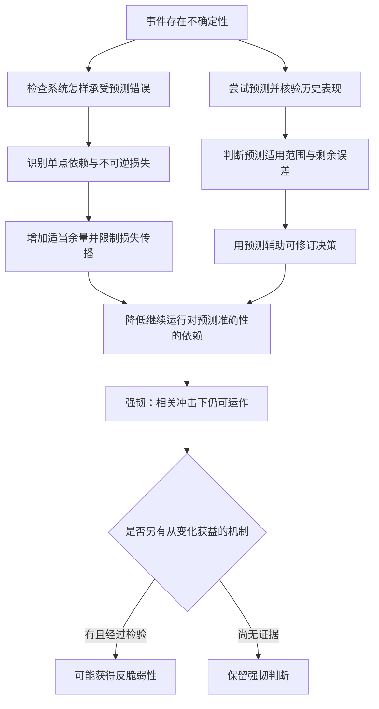
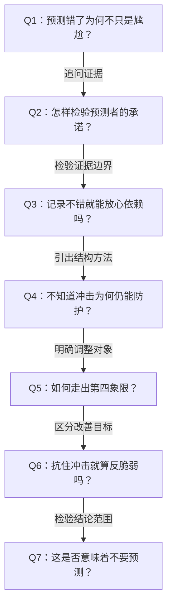

# 《反脆弱》第八章：预测是现代化的产物——深度拆解

> 依据：用户提供的第八章 Markdown 原文及章末注[23]。本文分析本章内部论证；关于会议、心理实验、核电行业与瑞典的叙述均按作者表述呈现，未作独立核验。国家状况及时间指称属于作者写作时点。下文的检验框架、组织场景和示例为本文推导，不是原书原有方案。

## x → f → f(x)

- **x：当关键罕见事件难以可靠预测时，我们怎样仍能作出不会被预测错误摧毁的决策？**
- **f：把事件发生的知识与事件作用于我们的风险敞口分开，不再只追求猜中未来，而是检查系统对误差与冲击的反应，通过冗余、限制损失和改变依赖结构，降低预测失误的代价，并在条件允许时保留意外收益。**
- **f(x)：先问“判断错了还能否继续”，再问“判断能有多准”；把预测用于辅助选择，让生存条件尽可能不依赖某一个预测成立，区分承受冲击的强韧与因变化受益的反脆弱。**

因为预测的知识边界不能靠意愿消除，作者把可操作对象转向风险敞口；接受这一转向后，决策质量便不仅取决于预测准确度，还取决于出错时后果是否可承受。

## 核心命题

**不必先知道下一次冲击是什么、何时来，才有可能减少它造成的伤害。我们可以先改变自己承受冲击的方式，让错误不再具有毁灭性。**

本章标题中的“现代化”延续第六章的批判性用法，指向对设计、控制与预测的过度信任，不宜读成“古代没有预测”。作者反对的是用未经检验的确定感组织高风险行动。

## 从第七章到第八章

第七章用医源性损伤说明“采取行动”可能新增伤害，并在章末区分危机的触发因素与系统的脆弱结构。第八章把这个问题推进到预测：**预测也会改变人的行为，因此预测错误并非只有知识上的尴尬。**

这一章也是后续方法讨论的转场。作者声称识别脆弱性比预测事件更容易，但本章主要给出方向与例子，尚未完整证明所有情境下都能轻易识别。阅读时应将“值得转向的任务”与“已经解决的任务”分开。

## 关键洞见

### 1. 预测不是中性信息，它可能改变风险承担

韩国会议的开场冲突并不只是作者反感专家自信。他提出了一个可检查的要求：在展示未来多年预测之前，先展示过去多年预测的表现，尤其是重大转折前的表现。

其深层逻辑有两步：

1. 声望、机构身份与演示形式不能代替预测业绩。
2. 预测若改变行动者的风险承担，失准就可能造成真实损害。

本章引述卡尼曼向作者展示的证据，声称即使人知道预测是随机的，也可能因此承担更多风险。这里呈现的是作者的研究引述；本章未交代实验设计，不能据此认定所有预测都会诱发同等程度的冒险。

更稳妥的提问是：**这项预测让哪些决定发生变化？它有没有在证据之外额外制造信心？**同样一句预测，若用于安排一个可回退的小试验，与用于支持不可逆的全局承诺，后果可能完全不同。

### 2. “未来会怎样”与“未来这样时我会怎样”，是不同任务

作者以冗余举例：保留额外资源，可以应对若干不同来源的困难，不要求事先精确点名事件。相比之下，依赖持续顺利条件的安排，必须让未来更符合预期才能维持。

原文关于负债者“预测的精准性更高一些”的句子，结合上下文应理解为：**负债等脆弱结构要求更高的预测准确性，并非它会让人预测得更准。**

| 任务 | 需要回答的问题 | 主要困难 |
|---|---|---|
| 事件预测 | 何时发生什么，概率与幅度多大？ | 样本、分布、环境变化与未知机制 |
| 敞口分析 | 若出现这类变化，哪些资源、承诺和依赖先出问题？ | 隐藏依赖、相关失效与反馈 |
| 结构调整 | 怎样减少不可承受的损失并保留运行能力？ | 成本、约束与保护范围 |

后二者并非不需要知识；它们只是可能不要求与第一项同样精细的时间、概率和幅度判断。

### 3. 四象限把“危险的世界”与“危险的处境”拆开

章末注[23]把随机性类型与对极端事件的风险敞口组合成四类。按该注释整理如下：

| 随机性类型 | 对极端事件敞口低 | 对极端事件敞口高 |
|---|---|---|
| 平均随机性 | 第一象限：普通变化为主，极端影响受限 | 第二象限：即便变化较温和，也需检查高敞口 |
| 极端随机性 | 第三象限：事件难测，但已降低自身极端暴露 | 第四象限：极端事件难测，且可能造成重大损失 |

作者给出的强韧化方向是：

**第四象限 → 第三象限：不必先改变世界的随机性，先降低自己对极端事件的暴露。**

这张表的价值在于解耦：同一场冲击，能给不同结构带来不同后果；身处不确定环境，不等于必须接受同等程度的脆弱。

但表格是定性框架，没有给出划分“低”与“高”的统一阈值。注释称前三象限中的知识错误无关紧要，这一说法也不能无条件照搬：若后果结构中仍有不可承受的损失，即使随机性较温和，也需要具体检查。

### 4. 强韧先解决“不被错误摧毁”，反脆弱才涉及“从变化获益”

作者列出的三点把目标逐步推进：识别脆弱性，减少错误危害，进而利用错误与缺陷。它们不是同一结果。

- **脆弱：**在某种相关冲击下，损失显著放大，甚至失去继续运行的能力。
- **强韧：**对给定范围内的冲击保持可接受的功能。
- **反脆弱：**相关变化通过特定机制带来改善或净收益。

保留备用资源主要说明承受力；要说明反脆弱，还需解释变化如何变成收益，例如有限试验产生知识、失败经验能够被保留并改进后续行动。不能因为“有储备”或“没倒下”，就直接判定具有反脆弱性。

本章的“榨柠檬汁”是方向性比喻，尚未给出任何坏事都能转化为好事的保证。**生存是继续学习的条件，收益则需要另有机制。**

### 5. 接受人的缺点，可以改变设计任务，但不能取消责任

作者认为，反复说教不足以消除贪婪，因此应让制度能承受它，甚至在一定条件下把私利导向公共收益。

这把问题从“先找到不会犯错的人”改成了：

**即使有人判断错误或追逐私利，哪些约束仍能限制其伤害范围？**

这一转向延续了第四章的成本分配与第七章的代理问题：谁决定冒险，谁拿到收益，谁承担错误后果？如果三者分离，预测和专业权威可能成为放大风险的工具。

不过，承认缺陷存在不等于放弃纠正违规行为。制度约束、行为改进和责任追究可以并存；本章也没有证明市场或其他制度会自动将所有私利转为集体利益。

## 理解阻力扫描：知识与后果之间还有一层设计

这幅图是本文推导。它没有把预测和结构设计排成二选一，而是要求预测即使继续使用，也不能取代对误差后果的处理。

## 实践指引

以下是本文对本章的应用推导，适用于日常与组织决策，不是投资或专业工程方案。

### 场景一：有人用多年预测为大型承诺背书

先要求展示历史预测，包括当时版本、期限、误差和失败记录；检查是否只挑有利案例，是否有可比较的简单基准。

再写出“预测正确”和“预测明显错误”两种情境下的后果。若一旦失准就无法退出，优先缩小承诺、分阶段安排或增加回退空间。历史表现再好，也不能替代这一步。

### 场景二：团队必须作计划，却不相信精确预测

保留计划，同时把计划分成需要连续满足的条件：需求、人员、交付依赖和可用资源。找出哪个条件失效会中断全部工作，准备可切换的路径。

把“必须命中某个日期与数值”改成“在明确范围内可以调整”。这不是免除交付责任，而是提前说明偏差如何被发现、谁能调整，以及哪些承诺不能再继续扩大。

### 场景三：准备冗余时担心浪费

先列出备用资源试图覆盖的功能中断，再检查备用是否与主系统共享失效点。例如，备份若与原件处于同一故障范围，数量增加也可能没有覆盖目标风险。

同时记录冗余的维护与占用成本。不是储备越多越好，而是用可承担的成本保护关键功能；覆盖范围外的风险仍需明确承认。

### 场景四：事后复盘又在追问“为什么没预测到”

把复盘拆成两栏：一栏检查当时是否有被忽略的可用信息，另一栏检查为什么一次误判能造成这么大的损失。

既改善信息，也减少对信息完美的依赖。若只能提出“下次更准一点”，却没有改变失效路径，结构性风险可能仍然保留。

## 例子列表

| 原文例子 | 一句话概括 | 逻辑位置 |
|---|---|---|
| 韩国会议与多年经济预测 | 作者要求用危机前的预测记录检验预测者的权威 | x：预测承诺与业绩落差 |
| 卡尼曼展示的研究证据 | 作者引述随机预测也可能增加冒险，说明预测会改变行为 | f：预测的医源性损伤 |
| 备用现金与储藏品 | 冗余可以应对多个来源的困难，不必逐一点名事件 | f：降低预测依赖 |
| 负债者对未来的依赖 | 脆弱承诺需要未来更符合预期，不会自动提高预测能力 | f：错误后果 |
| 柠檬与柠檬汁 | 作者提出从承受错误进一步走向利用错误的方向 | f(x)：获益目标的比喻 |
| 海啸、地震、战争与金融危机 | 作者把追问从事件为何没被预测转向建造物为何如此脆弱 | f：重新界定责任 |
| 贪婪与“坏牙” | 消除人的全部缺点不现实，可以先设计对缺点有承受力的安排 | f：改变设计前提 |
| 福岛事故后的核电设计叙述 | 作者用减少事故后果而非只争论概率，说明敞口思路 | f(x)：作者的工程方向说明，非安全保证 |
| 瑞典财政责任叙述 | 作者把降低危机影响与减少对经济预测的依赖相联系 | f(x)：作者的历史解释 |
| 行星运动与社会危机的对照 | 作者要求区分不同任务的可预测性 | f：知识适用范围 |
| 赢家通吃的作者、企业与明星 | 少数结果主导总量，作者据此担忧预测与控制更困难 | x：极端结果的重要性 |
| 使用复杂模型预测“黑天鹅” | 概念受到欢迎后，模型可能反而再次制造预测承诺 | f：形式复杂不等于边界消失 |
| 注[23]的四象限 | 随机性与敞口分别分类，明确第四向第三象限的转移 | f：本章最集中的操作框架 |

## 结论列表

1. 预测的可靠性应接受历史表现检验，不能由机构声望或展示形式替代。
2. 预测可能通过改变风险承担造成伤害，因此不是无后果的意见。
3. 预测错得多严重与出错后损失多严重，是不同的问题。
4. 冗余的价值之一，是让多个未知冲击不必分别被精确预测。
5. 脆弱结构需要更准确的预测，不意味着它能产生更准确的预测。
6. 强韧化可以先降低极端事件敞口，而不改变外界随机性的类型。
7. 承受冲击证明的主要是强韧，从冲击获益还需要独立机制与证据。
8. 制度可以按人会犯错的前提设计，同时保留约束与问责。
9. 不能准确预测触发时点，不等于不能分析依赖结构和限制损失传播。
10. 更复杂的模型不能仅凭复杂性证明自己突破了知识边界。

## Q-A 问答链

### Q-A 问题结构图

### Q1：预测错了为何不只是尴尬？

- **结论：**预测可能改变承诺和风险承担，失准后产生真实损失。
- **形式化：**预测 → 信心与行动变化 → 风险后果。
- **论证：**① 预测进入决策，而非只停留在表达。② 行动者可能据此加大或延长承诺。③ 若未来偏离预期，损失就由风险结构决定。
- **边界：**不是每条预测都影响行为，也不是预测引发的行动必然有害。

**Q1 → Q2：**预测会影响后果，便不能仅凭权威接受它，需要先检查其承诺有什么证据支持。

### Q2：怎样检验预测者的承诺？

- **结论：**检查可追溯的历史预测表现，并比较相同期限、任务和基准下的误差。
- **形式化：**名望与表达 ≠ 已验证的预测能力。
- **论证：**① 预测者可能只展示未来判断和过往成功。② 完整历史记录能暴露失败与适用范围。③ 可比较的简单基准有助于判断预测是否增加信息价值。
- **边界：**本章明确要求历史业绩；版本追踪与基准比较是本文补充。历史表现仍不能保证环境改变后的可靠性。

**Q2 → Q3：**业绩检验可以排除部分空洞承诺，却仍无法保证下一次关键变化落在历史经验内，因此还需检查依赖的后果。

### Q3：记录不错就能放心依赖吗？

- **结论：**不能；历史表现再好，也需要检查失准是否会造成不可承受的损失。
- **形式化：**过去有效 + 未来可能失准 → 仍需限制失败后果。
- **论证：**① 历史记录覆盖的是已经发生的环境。② 关键罕见变化可能没有被样本覆盖。③ 若一次错误即可终止运行，较好的平时表现也没有处理这个弱点。
- **边界：**这不是说所有历史证据无效，而是区分能力证据与安全保证。

**Q3 → Q4：**依赖预测仍有剩余风险，因此需要一种即使不知道下次冲击细节，也能降低损失的做法。

### Q4：不知道冲击为何仍能防护？

- **结论：**不同冲击可能损害同一关键功能，保护该功能便不必逐一猜中事件名称。
- **形式化：**多个未知冲击 → 共同功能中断 → 余量与替代路径提供缓冲。
- **论证：**① 困难来源可以多种多样。② 它们可能共同影响资源、供给或运行连续性。③ 针对这些后果准备缓冲，可以减少逐项预测的需求。
- **边界：**缓冲覆盖有限，也可能自身失效；本章的冗余例子不能证明任何储备都能应对所有冲击。

**Q4 → Q5：**针对后果的保护给出了方向，四象限则进一步说明被改变的是风险敞口，而不一定是外部随机性。

### Q5：如何走出第四象限？

- **结论：**在极端随机性仍存在时，先降低自身对极端事件的高敞口。
- **形式化：**极端随机性 + 高敞口 → 极端随机性 + 低敞口。
- **论证：**① 第四象限同时包含难测事件与严重后果。② 事件类型未必能被我们改变。③ 减少单点依赖、约束损失传播或增加有效余量，可能使处境向第三象限移动。
- **边界：**本章没有给出统一的敞口测量标准，不能仅凭自称有储备就宣告完成转移。

**Q5 → Q6：**敞口下降意味着更能承受冲击，却还没有证明冲击带来了收益，因此必须区分强韧与反脆弱。

### Q6：抗住冲击就算反脆弱吗？

- **结论：**不算；反脆弱还需要说明相关变化如何产生改善或净收益。
- **形式化：**不被摧毁 → 强韧目标；变化带来改善 → 反脆弱目标。
- **论证：**① 缓冲可以减少损害而不创造收益。② 学习或其他获益需要额外渠道。③ 应分别检验承受力与获益机制，不能用幸存替代收益证据。
- **边界：**两种性质都应限定冲击类型、幅度、时间与受益层级，不能对一切事件作无限承诺。

**Q6 → Q7：**强韧与反脆弱提供了不同于精确预测的改进方向，但这还不等于预测在所有任务上都应被取消。

### Q7：这是否意味着不要预测？

- **结论：**应限制未经验证且后果重大的预测依赖，而非否定所有面向未来的判断。
- **形式化：**核验预测 + 限制失准后果 → 比无条件依赖更可审查的决策。
- **论证：**① 作者自己区分了较可预测与较难预测的任务。② 预测在明确适用范围内仍可辅助选择。③ 结构保护则处理其未覆盖和可能出错的部分。
- **边界：**本章对整个社会经济领域的概括较强，实际使用时还要按任务、期限、尺度与后果逐项划定边界。

## 局限与盲区

### 1. “比预测容易”不是“可以轻易知道全部脆弱性”

本章把识别脆弱性视为更简单的任务，这是一项有价值的相对主张，但隐藏依赖、相关失效与行为反应仍可能超出认识。敞口分析也需要假设和检验，不能变成另一种无条件自信。

### 2. 领域划分需要细化，不能按学科一次定终身

作者把物理世界与社会经济世界作鲜明对照，但具体任务的可预测性还取决于尺度、期限、目标和误差容许度。同一学科可以同时有可靠与困难的任务。

原文将革命、股价、预算和气候变化放在相邻的不可预测论述中；这些预测对象、时间尺度与评价标准不同，不能仅靠并列就证明它们有同一种知识边界。本章没有提供逐项论证。

### 3. 数学上的不可测断言，在本章没有完整条件

作者强调某些限制不能靠增加博士和模型复杂度绕过，这能提醒人们尊重知识边界。但若要把“某类问题永远不可测量”当作严格结论，需要明确对象、假设和证明。本章主要作立场表达，不能将其视为对所有相关预测方法的逐项否定。

### 4. 案例说明方向，不构成安全认证

关于福岛之后反应堆“小、深、多保护层”的叙述，意在强调事故后果，而非给出完整工程设计。不能据此推出某类设计“即使事故也绝无影响”。瑞典财政与后续危机的关联，同样不能在本章有限材料上归结为单一政策因果。

### 5. 强韧有成本，也有覆盖范围

冗余会占用资源，替代路径需要维护，一种保护可能引入另一种依赖。需要说明保护哪些功能、覆盖什么冲击和持续多久，并比较资源占用与其他保护方式。不能以“不依赖预测”为名无限堆积备用。

### 6. “未预测可原谅，未抵御不可原谅”过于绝对

这句论战表达把责任拉回设计者，有助于阻止以预测失败推卸一切责任；但任何系统都存在能力与资源边界。更合理的问责对象是可识别却未处理的脆弱路径、被隐瞒的限制和不当转嫁的成本，而非要求对所有灾难绝对免疫。

### 7. 反脆弱不能替代成本分配检查

从错误中得到知识的是谁，遭受不可逆损失的又是谁？本章强调利用人类缺点与错误，但若没有第四章的层级分析和第七章的代理问题检查，就可能把“整体受益”误说成“每个人都受益”。

## 回读本章的检查问题

**即使这次预测错了，哪些安排仍能保护关键功能；又有哪些承诺会让一次错误变成无法恢复的损失？**

这个问题把未来判断接到可审查的依赖与后果上，使“承认不知道”能够成为设计的起点。
