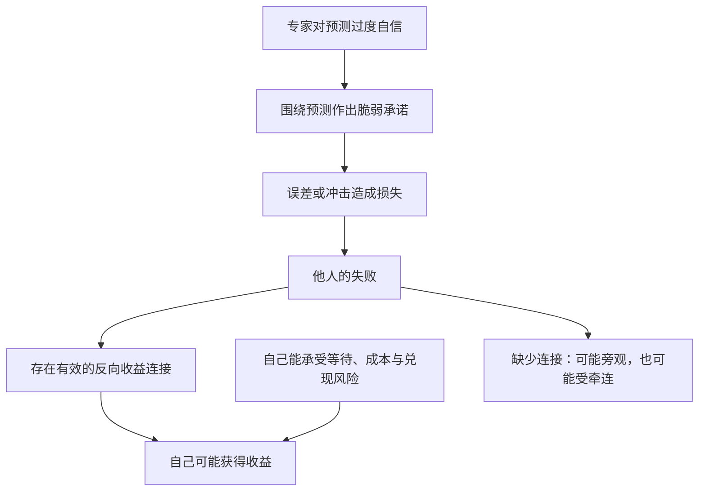
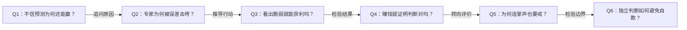

# 《反脆弱》第九章：胖子托尼与脆弱推手——深度拆解

> 依据：用户提供的《反脆弱》第九章 Markdown 原文及章末注[24]。人物经历、危机收益与专业群体的表现均按作者叙述分析，未作独立史实核验。文中的检验问题、组织应用与反例为本文推导，不是原书给出的交易方案。原文末段存在断行识别问题，不影响本章论证主线。

## x → f → f(x)

- **x：如果未来难以准确预测，为什么不信预测的胖子托尼，反而能从预测专家的失败中获利？**
- **f：把判断对象从“未来会发生哪件事”转到“谁的处境经不起预测出错”，再让自己的收益与这种脆弱结构的失败相联系；用实际承担后果检验判断，同时减少对他人认可的依赖。**
- **f(x)：先检查预测错误会击穿谁，再检查自己是否真能从中受益、是否撑得到结果兑现；评价一种判断时，同时看证据、损益结构和承担后果的人，而非只看头衔与口才。**

因为事件预测困难，作者转而识别对错误敏感的结构；只有进一步安排了有效敞口，这种识别才可能变成反脆弱的结果。

## 核心命题

**不知道危机会怎样到来，不妨碍识别某些人无法承受危机；但看出别人脆弱，与让自己因其失败而获益，仍是两件事。**

本章让第八章的抽象转向落到人物身上：托尼以实践嗅觉识别脆弱性，尼罗以概率知识理解同一个问题。二人共有的优势不是某种神奇预测能力，而是不把专家对概率的自信当作系统安全的证明。

## 关键洞见

### 1. 非预测者仍然作判断，只是判断所需的精度不同

章末故意制造悖论：托尼不相信预测，却从危机中赚钱。作者的解法是区分两种判断。

| 判断对象 | 核心问题 | 需要承担的知识负担 |
|---|---|---|
| 具体未来 | 什么事件在何时以多大幅度发生？ | 事件、时间、幅度及概率的准确性 |
| 脆弱结构 | 预测错到某种程度后，谁会出问题？ | 依赖条件、损失机制与承受能力 |
| 自己的敞口 | 对方出问题时，我能否兑现收益？ | 等待成本、支付承诺和自身生存条件 |

作者没有取消所有对未来的判断。认定某结构会失败，本身仍包含前瞻判断；他降低的是对具体事件路径的依赖。因此，“不预测”更准确的读法是：**不让行动完全依赖对未来细节的准确猜测。**

“必将崩溃”也不能直接转换成“现在就值得下注”。即使方向成立，价格、期限与实现途径仍可能使行动失败；本章没有提供这些细节。

### 2. 专家的危险可能来自行动结构，而不只来自知识错误

尼罗反对建立在“自以为理解概率”之上的系统。关键传导是：把估计当成可靠事实，就可能围绕它作出更大胆的承诺；预测一旦失准，损害便超出判断本身。

托尼还认为，这些人整体上比个体更愚蠢。可把它理解为对共同脆弱性的警告：许多个体都信任同一套假设，不等于假设获得了独立验证。若行动互相依赖，错误还可能一起暴露。这里的共同依赖机制是本文对作者断言的解释，本章并未给出完整的制度分析或数据证明。

这也是“脆弱推手”的阅读线索：值得警惕的不仅是判断错的人，还有把未经充分检验的确定感转成他人和系统风险的人。但不能据此把所有专家或管理者归入同一类。

### 3. 别人受损并不自动意味着自己反脆弱

原文把托尼的优势概括为与脆弱者拥有相反命运。这里最容易漏掉的是中间的收益连接：对方失败必须通过某种安排转成托尼可获得的收益。

这张图是对原文省略条件的展开，不是原书的交易流程。避免受损属于强韧；因某类冲击受益才接近这里的反脆弱。即使具备反向收益，也不能保证面对所有冲击都受益。

### 4. 不依赖掌声，是另一种减少脆弱性的方式

尼罗认识的知名科学家仍被引用次数、奖项和同行评价牵动：成就已经很高，情绪却持续暴露在自己不能控制的评价系统中。

打开基金对账单的仪式，起初像是在用金钱证明自己。但作者随即补上关键修正：即使账单显示亏损，亲自承担理念的不利后果也值得尊重。这使标准从“我赚了，所以我对”转向“我不是只说话，却把代价留给别人”。

需要保留两个区分：承担风险能够说明责任归属，不能单独证明判断正确；不依赖认可能够保护自主性，不能成为拒绝纠错的理由。若对账单变成新的情绪开关，只是更换了依赖对象。

### 5. 午餐、阅读和闲暇，是判断自主性的生活背景

大量生活细节并非与主旨无关。托尼和尼罗拥有支配时间的空间，不必时时用忙碌证明价值；午餐则给孤独的异议者提供持续交流的场所。这些条件使他们有机会在群体共识之外维持判断。

尼罗的阅读与托尼的实践直觉并置，也说明本章并非简单反智。真正被质疑的是不能切中后果的知识表演，而不是阅读本身。章末把数百万小时读书与几顿午餐比较，是修辞性的价值排序，不能当成学习效率的实证结论。

图书馆段落还给出一条局部机制：好奇心被满足后，反而暴露更多未知，使继续探索的欲望增强。这里的“反脆弱”描述好奇心受刺激后的增长，不意味着藏书规模或阅读量必然带来正确决策。

## 实践指引

以下是从本章推导的应用方法，不构成具体投资建议。

### 场景一：评估依赖预测的项目

当一个项目必须依靠需求增长才能维持时，不仅看增长预测，还写清三个条件：预测偏差会影响哪些现金承诺，哪个条件首先失效，失败是否会蔓延到其他项目。

例如，围绕单一客户的增长预期扩张产能，应检查客户订单延迟时的固定支出和退出成本。随后再评估分期投入、减少不可逆承诺等调整是否值得。检查的目的，是让项目在预测错时仍有处理空间。

### 场景二：听到“某体系迟早要崩”

把讨论拆成三项：结构证据是什么，什么现象能够推翻判断，行动者怎样承担等待与判断错误的成本。缺少后两项，宏大判断很容易变成无法检验的故事。

还应追问：对方失败后，我凭什么得到好处？如果只能回答“因为我早就看出来了”，就尚未建立收益连接。旁观正确不是行动成功。

### 场景三：评价专家或自己的主张

查看历史判断、失败记录和修正方式，再看谁承担建议造成的损失。头衔不能替代证据，亲自承担损失也不能替代证据；两者分别回答能力与责任的问题。

### 场景四：维持异议而不陷入自我封闭

把认可与反馈分开：可以减少对点赞、职位和排名的依赖，同时保留定期检验假设的制度。找能理解推理、也愿意反驳自己的人交流。尼罗需要托尼的陪伴，不意味着两人互相确认就足以证明他们正确。

## 例子列表

| 原文案例或场景 | 论证作用 | 不能直接推出什么 |
|---|---|---|
| 托尼少读书，却善于识别不切实际的人 | 展示 f：实践判断可指向脆弱性 | 不能推出少读书使人更明智 |
| 尼罗与托尼的午餐、健身和闲暇 | 展示 f(x)：自主生活与交流支持异议 | 不能推出闲暇本身保证判断正确 |
| 翻译协会不凭大学头衔压人 | 展示 f：将讨论与身份权威分开 | 不能推出专业训练无价值 |
| 好奇心越被满足，越想继续探索 | 展示 f：刺激强化探索动机 | 不能推出知识增长永远改善行动 |
| 尼罗的癌症与直升机事故经历 | 支撑 x：人物对技术脆弱性的关注来源 | 不是技术与自愈能力的一般医学证据 |
| 两人在作者叙述中从危机获利 | 展示 f(x)：识别脆弱性后的实际结果 | 不是可复制策略或长期业绩证明 |
| 科学家为引用与奖项愤怒 | 支撑 x：外界认可也能制造脆弱性 | 不能推出学术评价完全无用 |
| 打开基金对账单的仪式及亏损修正 | 展示 f(x)：从索求认可转向承担后果 | 不能推出亏损证明理念正确 |
| 恺撒展示战俘的类比 | 展示 f：可见结果具有象征力量 | 不能据此为羞辱失败者辩护 |
| 物理学家的预测模型与交易失利对照 | 支撑 x：模型声望与行动效果可能分离 | 不足以否定全部模型 |
| 尼罗对财富复杂性与志愿慈善的偏好 | 展示 f(x)：减少不必要的生活依赖 | 不是财富或慈善的普遍评判标准 |

## 结论列表

1. 对具体未来缺乏把握，不等于无法判断某种结构对错误有多敏感。
2. 过度自信只有进入承诺和风险承担，才会把知识错误放大为现实损害。
3. 识别他人的脆弱性，与建立自己可兑现的反向收益，是两个独立任务。
4. 正确判断长期方向，仍可能因等待成本和生存约束而行动失败。
5. 亲自承担理念的代价体现责任，但不能证明理念正确。
6. 对认可的依赖，会让已有成就的人仍持续受他人评价伤害。
7. 独立判断需要交流，也需要防止交流退化为互相确认。
8. 本章真正要求审查的是知识与后果的关系，而非用实践者身份取代专家身份。

## Q-A 问答链

### Q-A 问题结构图

### Q1：不信预测为何还能赢？

- **结论**：可以不精确猜中危机细节，却识别谁承受不了预测出错。
- **形式化**：预测事件路径 → 判断错误作用于谁。
- **论证**：① 精确描述未来需要很多信息。② 检查某结构能否承受偏差，可能只需掌握关键依赖。③ 托尼选择后一种任务，降低对细节准确性的要求。
- **边界**：结构识别仍会出错，“迟早失败”也无法自动给出可行动的时点。

**Q1 → Q2**：Q1 把对象转为对错误敏感的人和系统，但尚未说明错误为何会造成严重损害，所以要追问专家的行动结构。

### Q2：专家为何被误差击垮？

- **结论**：当预测的可信感支撑了超出承受能力的承诺，误差便可能造成毁灭性后果。
- **形式化**：过度确信 → 脆弱承诺 → 误差放大损害。
- **论证**：① 预测会影响行动。② 行动可能增加对单一情景的依赖。③ 情景偏离时，原本被忽视的损失显现。
- **边界**：使用预测不必然脆弱；保留余量、限制承诺和持续纠错都可能改变后果。

**Q2 → Q3**：Q2 解释了他人如何受损，却没有解释损失如何进入自己的收益，因此必须检验获利连接。

### Q3：看出脆弱就能获利吗？

- **结论**：看出脆弱性只提供判断线索，有效敞口和存续能力才使获利成为可能。
- **形式化**：结构判断 + 收益连接 + 等待能力 → 可能获利。
- **论证**：① 他人受损不会自动向观察者转移利益。② 某种安排必须把失败转成自身收益。③ 观察者还必须承受成本，并等到收益兑现。
- **边界**：本章未披露托尼的具体安排，不能据此推定其损失上限或复制方法。

**Q3 → Q4**：Q3 说明了获利的必要环节，但一次兑现仍可能混有偶然性，所以要区分结果与判断质量。

### Q4：赚钱就证明判断对吗？

- **结论**：收益能够约束空谈，却不能单独证明判断正确或方法可重复。
- **形式化**：行动结果是证据 ≠ 行动结果是终审。
- **论证**：① 承担后果使主张超出语言表演。② 单次结果仍受运气和未暴露风险影响。③ 评价还需检查事前理由、失败可能和重复表现。
- **边界**：原文赞许亏损者承担风险，讨论的是责任与尊重，不是证明亏损方法有效。

**Q4 → Q5**：Q4 否定了用单次收益终审判断，也留下评价标准的问题；作者随后把目光转向对外界认可的依赖。

### Q5：为何连掌声也要戒？

- **结论**：若安宁取决于不可控制的认可，成就越高也未必越自由。
- **形式化**：自我价值依赖他人排名 → 评价变化牵动情绪。
- **论证**：① 引用、奖项和赞扬由他人分配。② 自己的成就不能保证这种分配满意。③ 将自尊更多系于可承担的行动，可以减少这类暴露。
- **边界**：减少认可依赖不等于忽略事实反馈；对账单也可能成为新的依赖来源。

**Q5 → Q6**：Q5 减少了外界评价的支配，却可能同时削弱纠错渠道，所以必须说明独立判断怎样接受检验。

### Q6：独立判断如何避免自欺？

- **结论**：把情绪上的独立与证据上的开放同时保留下来。
- **形式化**：少依赖认可 + 保留反证与交流 → 可纠错的自主。
- **论证**：① 共识不能保证正确，独处也不能保证正确。② 同伴交流有助于检查自己未说清的判断。③ 再要求反证条件与失败复盘，避免同伴只起安慰作用。
- **边界**：午餐友情在原文中主要缓解孤独；反证与复盘是本文补充的方法，不能说成两位人物已经执行的制度。

## 局限与盲区

**人物成功不足以证明普遍方法。** 本章借两个人物解释思想，未提供完整持仓、成本、失败记录与可比样本。胜者的故事可能遮蔽判断相同却未能存续的人。

**“嗅觉”还不是可教的方法。** 从步态或交谈识人具有叙事感染力，但缺少独立记录与错误率，很难排除事后选择和刻板印象。读者应把直觉转换成可核对的依赖条件，而不是模仿对人的轻蔑。

**反预测立场存在措辞张力。** 原文既反对预测，又说危机注定发生。区分事件路径与结构判断可以缓解张力，却不能消除后者同样需要证据的事实。

**获利与公共利益需要分别判断。** 尼罗主张警告，托尼倾向于通过获利证明。后者不能自动解决旁观者受损的问题；本章明确将更完整的道德讨论留到第七卷。

**反脆弱不能由身份或态度保证。** 闲暇、博学、实践嗅觉和不求认可都不是充分条件。最终仍须追问：面对哪类变化，通过什么机制受益，以什么代价维持，以及什么情况会使这种安排失效？
