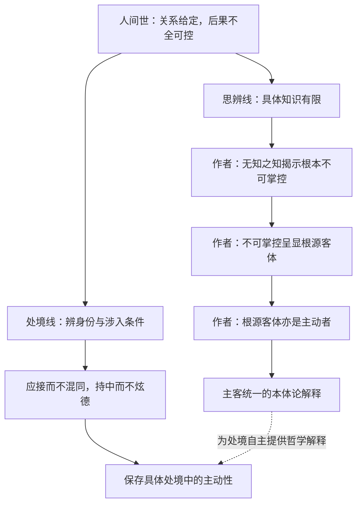
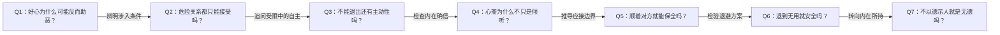

# 《庄子哲学研究》第七章：人间世与不得已｜重读拆解

> 阅读日期：2026-11-14。
> 来源：用户提供的《庄子哲学研究》第七章 Markdown，标题为“人间世与不得已”。原文路径：`/Users/minyanhua/MinerU/庄子哲学研究_第七章.pdf-2c8413e0-5605-4ffc-a7bf-3827a734fdc7/庄子哲学研究第七章.md`。
> 本次保留已有同章笔记，另建日期稿。本文区分三个层次：《庄子》的叙事和引语、本章作者的哲学解释、本笔记的推论与现代应用。引文以节名和原文注号定位；所给文件未含注释正文，不补造版本和页码，也不把书中训诫当成用户指令。

## x → f → f(x)

- **x**：如果人既不能摆脱亲缘、职守和权力关系，又不能保证善意得到理解、行动免于灾祸，怎样仍能保存自己的主动性与生命整全？
- **f**：作者先辨别不同身份中的不得已，再以心斋解除自我确信、以持中承当不可控处境，并通过无用与支离其德，揭示人不必完全由世俗用途和德名规定。
- **f(x)**：面对困境，先检查哪些限制真实存在、哪些只是自认必须；对于不能改变的部分，不再以全控后果为行动前提，而在应接中保持分别、自持而不炫德，同时承认这些方式没有免祸保证。

## 核心命题

**主动性不只表现为改变外物，也表现为：承认自己不能全知全控，却不让外在成败、用途和评价穷尽自己。**

作者还提出更强的哲学主张：不可掌控的客体最终与根源性的主体主动性统一。前一句解释处境中的自主，后一句解释存在的根基；两者相关，却不能把前一句的合理性直接当作后一句的证明。

## 关键洞见

### 1. 不得已首先是一项判断任务，而不是接受一切的理由

孔子阻止颜回赴卫，却劝叶公子高完成出使。作者反对只从二人的轻率或怯懦解释这一差别，强调身份：颜回尚无必须进入的君臣关系，叶公则已身处楚国大夫的职守。

**涉入可以选择 → 先问为何涉险；关系已经给定 → 再问如何承当。**

这使“不得已”获得具体内容。别人期待我做的、我出于不忍想做的、已经承担而难以撤回的，不是同一回事。

但作者仍留下一个问题：身份已经存在，是否足以证明义务不可解除？描述当时的政治处境，与论证这种处境应当被服从，需要分别进行。

### 2. 善意不能决定自己在别人眼中的意义

颜回想救民，暴君却可能把仁义劝谏理解为自我炫耀与对自己的贬低。权臣又会利用冲突，使孤弱士人为了脱身反过来附和恶势力。

**不忍而劝谏 → 被理解为炫美与争胜 → 权力反击 → 自保性附和 → 原意被反转。**

作者不是简单主张说话圆滑，而是指出：表达一旦进入关系，意义就不再由说者独占。正确观点与良好动机，都不能跳过对方如何理解、如何反应、谁能利用冲突这些条件。

因此，“先存诸己”是对行动条件的审查，不必读成取消对他人的关切。指出危险也不能反过来证明所有干预都不值得。

### 3. 心斋所松动的，是“世界必须符合我”的接受方式

作者解释“听之以耳—听之以心—听之以气”：耳的接受有限，心主动选择接受仍有自我边界；“气”则指向打破自我限定、容受他者的可能，不是简单的呼吸技术。

理解的难点是：**我主动要求自己开放，仍可能以自己的尺度规定开放。** 因此，心斋不止于“耐心听别人”，还涉及不把既有的知当成最终尺度。

“以无知知”并非什么都不懂，而是知道具体知识不能穷尽所遇之物。它反对全知幻觉，不反对具体知识。

需要保留作者的限制：他把颜回可能具有“圣人之才”作为解释前提，明确反对把心斋当作人人通用的方法。现代读者可以借此反省确信，却不能宣称一个日常倾听练习已经等同于原文境界。

### 4. “托不得已”把主动性从结果控制移向自我维持

叶公担心任务不成受罚、成了又伤身，形成两难。作者将“自事其心”解释为尊奉内在所持，将“养中”解释为不随外在哀乐利害偏移的自我维持。

**结果不由我定 → 不必让结果决定我的全部存在 → 仍可选择怎样承当。**

这不是保证现实自由，而是拒绝把受限者直接等同于没有主体性的人。“托”保留了被动，“养中”保留了在被动中维持自身的可能。

但这里的“内在必然”可能与内化的外部命令混淆。若某人被反复要求牺牲，最后真心觉得“我必须如此”，是否就算自主？本章没有充分提供识别标准。

### 5. 无用不是人的固定属性，离常也不等于弃德

作者对“无用之用”的处理比通常的口号更谨慎：社树还依靠其为社的身份；有害大木的保全依赖环境；支离疏不适于征发，却仍有谋生能力。

**对某种用途无用 ≠ 对所有用途无用；此处无用得存 ≠ 换个处境仍安全。**

而“支离其德”把问题进一步转向内在：不必把自己修剪成世俗认可的标准形状，也不必用德的显耀凌驾他人。作者采用“支于正而离于常”的解释，强调离开惯常尺度，不是取消内在所持。

外部用途不能完全控制，人的主动性就在不完全接受其定义处显出。但减少被利用不等于获得绝对独立，离常也仍须区分自持与任性。

## 理解难点图：两条相联但不可互相替代的论证

虚线表示作者体系中的解释关系，不表示本文已独立证明。读者可以接受“无法全控仍可自持”，而继续质疑“为何这就需要根源客体与主体统一”。

## 三个危险关系，不是一套通用处世术

| 人物 | 处境 | 关键问题 | 作者的理解 |
|---|---|---|---|
| 颜回 | 主动欲赴卫劝君 | 是否必须进入，善意能否避免被误读？ | 先存诸己，以心斋松动自我限定 |
| 叶公子高 | 出使责任已在身 | 成败都可能有患，怎样承当？ | 自事其心，托不得已以养中 |
| 颜阖 | 任暴戾太子之师被直接给定 | 怎样应接而不共同陷落？ | 形就不入，心和不出，戒慎持中 |

“形莫若就，心莫若和”在本章明确限于颜阖境况，不能扩大成永远顺从强者。“就不欲入”要求避免混同，“和不欲出”要求避免宽和变成外在德名，不宜简化成表面顺从、内心鄙视。

## 实践指引：用于理解处境，不冒充古人的现成答案

### 1. 把“我没办法”分成三栏

遇到一项难以承受的角色要求时，记录：

- **已发生的事实**：真实身份、资源、依赖关系是什么？
- **声称必须的要求**：谁说必须，理由是什么，能否争议？
- **尚有选择的动作**：能否拒绝、改变参与范围、求助或重新安排？

这借鉴颜回与叶公的区别，不意味着现代职场、家庭与古代君臣可以直接类比。事实约束与义务正当性要分开判断。

### 2. 用两个问题检查表达

准备纠正他人时，除了问“我说得对吗”，再问“对方会把这次表达理解成什么”和“哪些人能借它达到其他目的”。这不是为了取消表达，而是补上动机之外的关系条件。

### 3. 明确应接的边界

借颜阖故事，区分“为了继续沟通而调整方式”和“为了保住关系而参与有害行为”。具体边界需要依情境判断，不能仅凭“持中”二字得出；协调方式也不自动要求放弃立场。

### 4. 盘点被称为有用的代价

写下：谁认为我的某种能力有用？它服务什么目的？会不会使更多负担持续集中于我？不承担某一用途之后，仍需要哪些谋生与支持条件？

本章提醒的是不要把他人的用途评价当成自己的全部价值，不是鼓励故意失能，也不是承诺少做事就安全。

## 例子列表

- **颜回请行**：救民动机可能在暴君与权臣之间转成争胜。← 支撑 **x**：善意不能保证行动效果。
- **孔子指导心斋**：从耳、心到气，作者解释为突破接受中的自我限定。← 展示 **f** 的认识转折。
- **虚室生白与坐驰争论**：作者赞同钟泰，将静止与能动相联。← 展示 **f** 所追求的虚而不寂、止而能行。
- **叶公出使**：失败与成功各有忧患，无法靠结果保障安顿自己。← 支撑 **x**，展示 **f** 的养中。
- **颜阖傅太子**：不能只靠冲撞，也不能完全混同。← 展示 **f(x)** 的具体应接边界。
- **螳臂当车**：自恃才美而忽略实际承受能力。← 支撑 **x**：看不见有限性本身会增险。
- **栎社树**：不材之外仍靠社树身份。← 检验 **f(x)**：无用的保全有条件。
- **商之丘大木**：无用且有害，作者推测其环境使这些性质成为保护。← 检验 **f(x)** 的情境依赖；荒野位置是作者推测。
- **支离疏**：免于某些征发却仍能谋生。← 展示 **f**：不可用于某目的，不是全无能力。
- **接舆论德**：批评临人以德与画地而趋。← 收束 **f(x)**：不以道德显耀重新投入争胜。

## 结论列表

1. 是否不得已，需要辨明具体身份和关系，不能仅凭压力强弱判断。
2. 善意不能独占表达的意义，更不能保证他人按自己的动机回应。
3. 承认认识有限，是松动自我确信，不是放弃具体判断。
4. 行动的结果不全可控，不等于行动者全部的主动性都已消失。
5. 应接与混同之间，需要保留分别与边界。
6. 无用只相对于特定用途成立，不能被固定为一个人的总体属性。
7. 无用的存身效果受到身份与环境限制，不能保证免祸。
8. 不临人以德不等于弃德，离常也不自动等于任性。
9. 对外部强制的内在接受，需要与真正自主的承当区分。
10. 从知的限度到主客统一，需要额外的哲学论证。

## Q-A 问答链

### Q1：好心为什么可能反而助恶？

- **结论**：好心进入权力关系后，可能被当作威胁，再被迫转为附和。
- **形式化**：规劝 → 被视为争胜 → 反击 → 自保附和。
- **论证**：① 对方未必相信说者没有求名之心。② 权臣可利用冲突施压。③ 说者为脱身而顺从，原意便可能反转。
- **边界**：这揭示危险机制，不证明所有规劝必然失败。

**Q1 → Q2**：因为 Q1 说明介入未必有益，却尚未说明介入是否必须，所以要辨明关系的来源。

### Q2：危险关系都只能接受吗？

- **结论**：作者借颜回与叶公区分可以不涉入和已有职守的情境。
- **形式化**：主动请求 ≠ 既有责任；先辨条件，再谈承当。
- **论证**：① 颜回与卫君没有既定君臣关系。② 叶公已有楚国大夫身份。③ 因而同一退避态度不能机械适用于两人。
- **边界**：身份如何产生正当义务、义务能否解除，本章未充分论证。

**Q2 → Q3**：因为 Q2 承认某些关系难以退出，尚未解释留下是否只剩被动，所以要追问主动性还能在哪里实现。

### Q3：不能退出还有主动性吗？

- **结论**：作者把主动性安放在自我维持与承当方式，而非结果全控。
- **形式化**：不掌控后果 ≠ 全部被后果规定。
- **论证**：① 任务成败都可能带来损害。② 若只以回报安顿自己，就会不断随利害变动。③ 养中试图使内在所持不被外在结果穷尽。
- **边界**：内在自持不消除现实伤害，也不证明外在压迫合理。

**Q3 → Q4**：因为 Q3 转向内在所持，但内在也可能固执自是，所以还要检查如何松动自我的封闭。

### Q4：心斋为什么不只是倾听？

- **结论**：作者关注的是接受方式的自我限定，而不只是多收集一些意见。
- **形式化**：以我为尺度的开放 → 知其限度 → 容受他者的可能。
- **论证**：① 感官接受本有范围。② 主动选择接受仍可能以自己的判断为边界。③ 以无知知使具体知识不再冒充最终尺度。
- **边界**：作者不把心斋视为普遍训练；从知限推到根源客体，也仍需论证。

**Q4 → Q5**：因为 Q4 松动了自我确信，却没有规定危险关系里的行动，所以要辨明容受是否意味着顺从一切。

### Q5：顺着对方就能保全吗？

- **结论**：应接必须避免混同，随顺本身并无安全保证。
- **形式化**：形就不入；心和不出。
- **论证**：① 直接冲撞可能超过自身能力。② 完全混同会随危险者共同颠灭。③ 宽和若化为外在德名，又会引出新的关系后果。
- **边界**：这是针对颜阖的特定处境，不是普遍禁止抗争或表达。

**Q5 → Q6**：因为 Q5 说明在关系内应接仍不能保证安全，所以要检验能否通过退出用途彻底解决危险。

### Q6：退到无用就安全吗？

- **结论**：无用只能在特定条件下减少某些危险，不能让人脱离一切关系。
- **形式化**：某用途不可用 + 特定环境 → 有条件的自存。
- **论证**：① 社树还依赖身份。② 有害大木的效果随地点而变。③ 支离疏免役仍须谋生。④ 外部用途又不完全由个人选择。
- **边界**：这限制无用之用的保障性，不否定它揭示利用结构的价值。

**Q6 → Q7**：因为 Q6 表明外在用途无法完全退出，尚需回答人怎样不被这些尺度定义，所以转向德的持有与呈现。

### Q7：不以德示人就是无德吗？

- **结论**：作者区分内在实得与用德名凌驾他人，反对后者不等于取消前者。
- **形式化**：离常不等于弃德；不临人以德不等于无所持。
- **论证**：① 德的显耀可能变成比较与争胜。② 支离其德松动惯常轨则对自身的规定。③ 因而保全内在整全未必需要外在道德形象。
- **边界**：何时是不炫德、何时是逃避责任，仍需具体判断，不能仅凭离常确定。

## 局限与盲区

### 1. 从认识论到本体论，桥梁仍需补强

作者先由无知说明不可掌控，继而将不可掌控视为客体本质，又因客体不是无知之知的对象而把它归于无知之知自身，最终强调客体的根源主动性。

可依次追问：不能掌控是否足以定义客体？不是认识对象为何就必须是认识自身？知识的根基为何等于万物变化的根据？这些问题不能仅靠“人有局限”回答。作者也承认几种不得已如何统一、又如何与主体性统一，在此阶段尚不能充分讨论。

### 2. 心斋的特殊天赋前提，并非无争议结论

作者从颜回可能有圣人之才推到心斋不可普遍适用，这是其体系性解释。特殊对话能说明引导因人而异，却未必直接证明其他人原则上不能学习。应区分作者明确提出了什么，与文本是否只允许这一种解释。

### 3. 坐驰的积极解释有语境支持，也有字面阻力

作者赞同钟泰，以无翼飞、止而能行解释坐驰；郭象、成玄英则作负面解释。钟泰的读法能把静与动相联，但“夫且不止，是之谓坐驰”如何支持积极义，仍需细辨。引用《淮南子》可提示另一种用法，不能单独裁定本句含义。

### 4. 无条件自主容易遮蔽受限程度的差异

作者主张强大客境不能根本消解主体自主，同时承认个体可能随时颠灭。两者分属根源主体性与现实生存，不能互相取消。内在自主不是现实压迫的补偿，更不应变成要求受害者自行调整心态的理由。

### 5. 离常需要正面的判断标准

如果惯常的名德评价不足为据，那么如何判断离常者保存的是德，而不是掩饰任性、冷漠或怯懦？本章提供了不被世用穷尽的方向，却没有完整解决独立评价标准的问题。

### 6. 叙事差异与章节照应，不等于历史来源已证实

作者从接舆故事的细节差异推测《人间世》与《论语》可能有不同来源，又以德的主题照应《德充符》说明内七篇整体性。这些有助于解释文本，却不能单独排除改写、传本变化或后期编排等可能。解释上的连贯与形成史上的证明，需要分开。

## 重读后最值得保留的问题

**当我说“不得已”时，我是在准确辨认自己无法改变的处境，还是已经替某种外在要求免除了审查？在确实受限之处，我又能怎样应接而不混同、自持而不以优越自居？**
