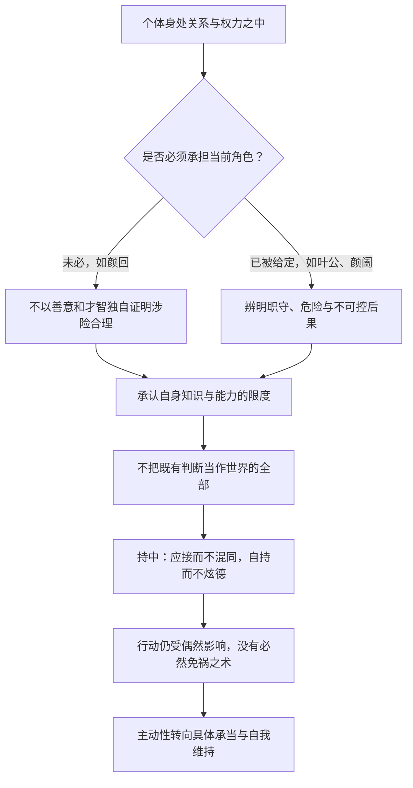

# 《庄子哲学研究》第七章：人间世与不得已——深度拆解

> 来源：用户提供的《庄子哲学研究_第七章.pdf》，共13页，题为“人间世与不得已”。全文分五节：“一宅而寓于不得已”“天下有大戒二”“形莫若就，心莫若和”“无用之用”“支离其德与临人以德”。
> 引用约定：附件未显示可确认的原书印刷页码，以下均用PDF页序。保留原文注释编号[257]—[283]作为定位线索，附件未附注释正文，不补造所引版本与页码。
> 阅读层次：明确区分《庄子》的叙事和引文、本章作者的哲学解释，以及本笔记的分析与现代应用。分析范围限于本章。

## x → f → f(x)

- **x**：一个人既无法脱离亲缘、身份和权力关系，又不能掌控行动的后果，怎样在人间世的不得已中保全自己，而不让生命完全被外在要求支配？
- **f**：先辨明具体处境里什么并非必须、什么已被给定、什么仍不可预知，再通过心斋所揭示的知的限度、托不得已的持中，以及不完全落入世俗用途和德名的方式，保存自身的主动性。
- **f(x)**：面对困境，不再只问“怎样改变别人”或“怎样退到绝对安全处”，而要问：这个角色是否必须承担，我把多少未知当作已知，哪些应对会使自己与危险同化，以及即使结果不可控，仍能怎样持守自身。

三者连读：因为关系不可尽弃、结果不可全控，作者将主动性从控制外物转向辨认限度、持中与自存；保全因此成为具体处境中的审慎行动，而不再是一套保证免祸的技术。

## 核心命题

**人间世的自由，不以摆脱一切关联为前提；它表现为承认给定处境和不可控后果，同时不让外在用途、名声和利害完全规定自己。**

但必须保留本章的两层论证：

- **处境分析**：识别身份、权力和后果的限制，避免自恃道德与才智，也避免把随顺变成混同。
- **哲学重构**：作者进一步主张，不可掌控的“彼”是客体的本质，而根源意义的客体又属于主体性的主动者。

前一层可由具体故事逐步理解；后一层是作者的强解释，需要单独评估，不能仅凭“人有局限”就视为已经证明。

## 关键洞见

### 1. “不得已”首先要求区分处境，不能先宣布一切都只能接受

作者比较孔子对颜回和叶公子高的不同态度（PDF第1—2、7页）。颜回要去劝谏暴君，出发点是对民众遭遇的不忍；但他与卫君没有既定君臣关系，也没有宗室身份带来的责任。叶公子高则是楚国大夫、世袭贵族，出使处于已经承担的职守之内。

作者据此反对钟泰以“颜回把事情看得容易、叶公把事情看得困难”解释态度差异，转而强调身份差异。

| 人物 | 处境如何形成 | 作者提炼的问题 |
|---|---|---|
| 颜回 | 主动请求涉入危险政治关系 | 善意是否足以支持涉险，是否本可不去？ |
| 叶公子高 | 已有角色与职守要求 | 不能简单退出时，怎样不被成败利害夺去自身？ |
| 颜阖 | 任太子之师被直接给定 | 在危险关系里怎样既应接又不混同？ |

这组对照防止把“不得已”当万能解释。第一步是识别边界：并非每一种期待都自动构成责任，也并非所有人都能以退出解决问题。

**本笔记推论：未经辨析就把压力称为命，会提前放弃仍然存在的选择；把所有关系都当可随时退出，也会忽略真实的牵连。**

### 2. 善意与美德不能绕过权力关系，反而可能被它改写

PDF第2页对颜回处境的解释，是全章政治敏感度最强的部分。作者认为，即使颜回没有求名争胜的意图，暴君和周围权臣也未必这样理解。

机制依次是：

**以仁义规劝 → 对方感到被反衬、被羞辱 → 言说被纳入争胜 → 权臣乘势施压 → 士人为自保附和 → 原本的纠正转成对恶的助长。**

这里不只是“说话要委婉”。说者不能独占自己言说的意义：一句自认出于善意的话，在不对等关系中可能被听成威胁、挑战或求名。

“先存诸己”因而不是取消对他人的关切，而是要求先检查自身能否承受进入这场关系之后的变化。作者仍把颜回的动机解释为不忍，也推测庄子著述有类似关切；这是作者的理解，不是由传记材料直接证实的动机事实。

边界：指出干预风险不等于证明任何干预都不值得做；同样，缺少胜算也不能单独完成对责任的全部判断。

### 3. 心斋的“虚”，针对的是自我限定，不是把心变成空白

PDF第3—6页，作者把“听之以耳—听之以心—听之以气”理解为突破接受方式的层层限制：

| 层次 | 作者的解释 | 仍有什么限度 |
|---|---|---|
| 耳 | 感官被动接受 | 接受范围与感官能力有限 |
| 心 | 心主动让自己进入接受状态 | 选择接受的仍是有自身边界的我 |
| 气 | 让不由我支配的根源他者呈显 | 作者据此讨论超越主客对立的可能 |

这里的“气”，作者明确区别于作为客体的天地之一气；不能读成一个简单的呼吸训练步骤。

心斋的认识论转折是“以无知知”：意识到具体知识并非全知，才可能不再用既有判断封死所遇之物。“虚”因此是解除自我占满的状态，不是反对学习，也不是以茫然代替判断。

但作者作了很强的适用性限定：他把颜回可能具有“圣人之才”作为解释背景，明确反对把心斋理解成人人可通用的修养方法。因此，下文现代应用只能借鉴其限制自我确信的思路，不能宣称日常练习就是原文心斋。

### 4. 承受不得已仍可能有主动性，但这是对主动性位置的重定

PDF第7—9页把内在固有的不得已与外在不可奈何的偶然区分开。前者是作为这个人已经置身其中的关联；后者是结果不由己定的变化。

叶公的两难是：失败有人道之患，成功又可能有身心损耗。作者以“自事其心”“乘物以游心，托不得已以养中”说明：当结果不能保证时，仍可不把自己的存在完全交给成败回报裁决。

**不能决定后果 → 并不自动等于不能决定怎样承当 → 持中成为自我维持。**

作者把“事”读作尊奉、服从，认为“自事其心”是正确态度，反对把它另行解释为无语境依据的“心性之学”。这里服从的并非任意欲望，而是作者所理解的内在固有之所是。

这一解释的强处，是拒绝把受限者等同于毫无主动性的人；它的难点，是如何区分真实的内在必然与已经内化的外在强制。本章没有充分提供这种区分的标准。

### 5. 无用与支离，都是松动世俗支配的方式，不能保证安全

PDF第10—13页把三位士人无可靠自全之道的焦虑，推进到无用之用和支离其德。

作者并未停在“无用就不会被伤害”的熟悉结论：

- 栎社树除了不材，还有社树身份；没有这一身份仍可能被砍。
- 商之丘的大木不只无用，还会造成伤害；作者推测它处在荒野，若生在人群中，情形可能相反。
- 支离疏在征兵、劳役上不可用，却仍有维持生计的能力。

因此：**有用与否，是在特定关系中对某种目的而言；它会随情境改变，也不完全由个人决定。**

“支离其德”再把问题从外在形体转向内在所持。作者采纳“支于正而离于常”的解释：不让自己完全落入当时惯常的规范和评价，不以德的显耀凌驾他人。

“临人以德”之所以危险，是德被用来形成高下和外在声名；“支离其德”更接近全德，是因为它减少了对惯常尺度的依附。这里不能把支离等同于作恶，也不能把不彰显德理解为没有判断和底线。

## 理解阻力：把“我不能掌控”变成“我仍能行动”的过程

以下为本笔记对全章结构的整理，不是原文原图。

本章有一条更强的哲学线，不能直接画成上述实践链的必然结论：

**知的根本限度 → 不可掌控的彼 → 客体的根源性 → 主客的最终统一。**

前两步说明未知与限制，后两步属于作者的本体论重构；它们需要额外论证。保留这个断点，才能既理解作者雄心，又不把解释上的跨度隐藏起来。

## 实践指引：如何把本章用于理解处境

以下都是现代阅读应用，不是庄子为现代组织或家庭直接提供的行动处方。

### 1. 先画处境，再谈接受或反抗

面对一项高风险请求，分别写下：

| 层次 | 要问的问题 |
|---|---|
| 已给定的事实 | 我实际承担什么身份，有哪些真实牵连？ |
| 被主张的责任 | 谁说我必须做，理由是什么，是否有争议？ |
| 可选择的范围 | 能否不接、延期、缩小范围、改变参与方式？ |
| 不可控的后果 | 哪些结果并不随我的善意和努力而改变？ |
| 应接的边界 | 怎样参与不会使自己与危险行为混同？ |

事实已发生不等于规范要求已经正当；别人声称“你没有选择”，也不等于真的没有选择。这是借颜回与叶公的差别延伸出的自查，不能反过来宣称古文已完整论证现代权利边界。

### 2. 用“我所不知道的”检查道德确信

例如，准备公开纠正一位拥有强权的人时，除检查观点是否有理，还要问：对方怎样理解这次发言？旁观者能怎样利用它？我有无后续支持？若局势变成争胜，我会不会为脱身反而附和原本反对的事？

这不是把正确与否降格为利害计算，而是承认：正确意图能否实现，受关系和行动机制影响。

### 3. 区分随顺、混同与彰显优越

借“就不欲入，和不欲出”理解危险场景中的边界：

- 随顺可以是减少无意义冲突，并保留必要的距离。
- 混同则是失去分别，把对方的危险行动也变成自己的行动。
- 彰显优越可能使自持变成可被竞争、嫉恨和利用的声名。

原文并非建议任何时候都隐藏立场。作者明确将这段话限于颜阖处境；公开表达、拒绝参与或离开关系，在其他处境中可能更有必要。

### 4. 将“无用”改问为“对谁、为何种目的不可用”

一项能力对生计有用，可能对征发没有用；某种身份在一个地方提供保护，在另一个地方可能增加暴露。由此，应检查谁在定义用途、用途如何改变、保护依赖哪些条件。

不必为了追求抽象无用而损坏能力。支离疏之例恰好提醒：避免某类利用与保留生活能力可以同时成立。

## 例子列表

- **颜回请行（PDF第1—3页）**：出于不忍介入暴政，却可能被拉入权力争胜，善意不能控制接收效果。← 支撑x，展示f的处境辨析。
- **颜回对答逐层推进（第3页）**：从具体应对方案进入心斋，说明问题不只在技巧，还在自我限定。← 展示f。
- **耳、心、气的听（第3—4页）**：作者以接受方式的差异解释主观边界怎样被突破。← 展示f的认识论结构。
- **虚室生白与坐驰争论（第4—6页）**：作者借钟泰的积极解释说明止而能行，避免将虚理解成死寂。← 展示f的哲学目标；属于有争议的解释。
- **叶公子高出使（第7—9页）**：成败皆可能有患，既定角色使不得已变得具体。← 支撑x，展示f(x)的持中。
- **颜阖任太子之师（第9—10页）**：已经被给定的危险角色要求应接而不混同。← 展示f的边界控制。
- **螳螂当车（第9—10页）**：自恃才美而不知不能胜任，是危险的无知。← 展示f为何要求戒慎。
- **栎社树（第11页）**：不材并非唯一保护，社树身份也是存身条件。← 检验f(x)的条件性。
- **商之丘大木（第11页）**：无用且有害的树，是否安全仍与所处环境相关。← 检验f(x)的情境边界；荒野位置为作者推测。
- **支离疏（第11—12页）**：可以避开某些征发，同时仍需劳动维生。← 展示f中用途的相对性。
- **山木、膏火、桂与漆（第11—12页）**：用途可能招致损害，但用途多是被给定而非自主选择。← 支撑x，限定无用策略。
- **支离疏与子舆形变的对读（第12页）**：作者区分形体畸变与残缺，进而解释离常的含义。← 展示f的文本依据。
- **两种接舆故事（第13页）**：不同内容和场景帮助作者凸显人间世中的德与生存问题。← 展示f的收束，并引向德充符。

## 结论列表

1. 不得已需要通过具体身份和关系辨明，不能被当作放弃判断的总理由。
2. 善意能够说明行动动机，不能独自决定行动在权力关系中的效果。
3. 不知自己的有限性，比承认不知道更可能造成危险。
4. 心斋在本章作者的解释中，是突破自我限定，不是普遍通用的放松方法。
5. 无法保证外在结果，不等于自身的全部主动性都已消失。
6. 随顺而不混同，需要在应接外部关系时保留分别与边界。
7. 有用和无用总是相对于具体目的及情境，不能被固定为人的全部价值。
8. 无用之用只能提供有条件的存身可能，不能保证免于伤害。
9. 德行一旦变成凌驾他人的声名，也可能被纳入人间世的争胜结构。
10. 支离其德在作者这里意味着偏离惯常尺度，不意味着取消内在所持。
11. 承认认识限度与证明根源性客体，是两个需要区分的哲学步骤。
12. 内在自持不应被误读为外在压迫因此合理，或现实伤害已经消失。

## Q-A 问答链

### Q-A 问题结构图

```mermaid
flowchart LR
    Q1["Q1：善意为什么也会招灾？"]
    Q2["Q2：危险关系都必须承受吗？"]
    Q3["Q3：承认不得已还算主动吗？"]
    Q4["Q4：心斋怎样避免自以为是？"]
    Q5["Q5：随顺会不会变成同流？"]
    Q6["Q6：做个无用之人就安全吗？"]
    Q7["Q7：不彰显美德就是弃德吗？"]
    Q1 -->|"区分涉入的条件"| Q2
    Q2 -->|"追问受限中的自主"| Q3
    Q3 -->|"检查自主的认识条件"| Q4
    Q4 -->|"推导具体应接"| Q5
    Q5 -->|"检验存身保障"| Q6
    Q6 -->|"转向内在所持"| Q7
```

### Q1：善意为什么也会招灾？

- **结论**：行动者不能独占言说的意义，善意可能被对方纳入权力争胜。
- **形式化**：自认规劝 → 对方感到受辱 → 争胜与反击 → 原意被改变。
- **论证**：①颜回的动机不忍，不等于卫君相信他不求名。②道德规劝可能反衬君主的不德。③权臣再利用冲突，使士人的处境更加孤弱。④自保性附和还可能反向助长原本反对的力量。
- **边界**：这是危险机制的说明，不是任何道德行动都必然失败的证明。

**Q1 → Q2**：Q1揭示介入风险，却没有回答应当涉险还是可以不去，所以需要检查角色是否已经构成约束。

### Q2：危险关系都必须承受吗？

- **结论**：作者以具体身份区分可不涉入与已经承担的职守。
- **形式化**：颜回可不行；叶公已有职守；颜阖处境直接给定。
- **论证**：①颜回与卫君并无既定君臣及宗室关系。②叶公则已处楚国大夫位置。③同一句退避或承担，对两人便有不同意义。④因此不能把特定责任无限扩大成所有人的义务。
- **边界**：本章以古代身份秩序为前提，未充分论证这些职守为何正当、何时可以解除。

**Q2 → Q3**：Q2承认某些关联难以退出，但仍未说明不退出时有什么自由，所以转向主动性的所在。

### Q3：承认不得已还算主动吗？

- **结论**：作者将主动性放在怎样承当与自我维持，而非完全掌控结果。
- **形式化**：外在受限 + 自主承当 → 持中自存。
- **论证**：①叶公无法保证任务成败与身心安危。②若把全部存在交由回报决定，就会不断为利害所动。③尊奉内在所持、托不得已以养中，使人仍有不被结果穷尽的可能。
- **边界**：这种解释没有取消实际伤害，也没有证明内在自持足以补偿不公。

**Q3 → Q4**：Q3把自主转向内在，但内在也可能充满未经检验的确信，所以必须追问怎样不把自我当作全部根据。

### Q4：心斋怎样避免自以为是？

- **结论**：作者以知的根本限度，松动既有判断对所遇之物的封闭。
- **形式化**：知自己的不知 → 具体知识失去绝对性 → 容受的可能。
- **论证**：①耳的接受有限。②心主动选择接受，仍有自己的边界。③作者以听之以气说明自我限定的进一步突破。④以无知知使已有知识不再自居为最终尺度。
- **边界**：作者明确反对将心斋当人人适用的方法；由知的限度到根源客体的结论，也不是无需论证的跳跃。

**Q4 → Q5**：Q4松动了自我确信，却还没有给出危险关系中的行为边界，所以需要讨论应接与混同的差别。

### Q5：随顺会不会变成同流？

- **结论**：颜阖故事正要求应接而不失分别，自持而不以优越显名。
- **形式化**：形就而不入；心和而不出。
- **论证**：①直接冲撞可能超出实际能力。②完全混同又会与危险者共同承受颠灭。③内在宽和若变成外在声名，也会制造多余的关系后果。④持中因而同时限制对抗、自我同化与炫德。
- **边界**：作者将此限于颜阖处境，不能推广为任何时候都不表达立场。

**Q5 → Q6**：Q5给出了戒慎的应接方式，但前三位士人的故事仍无可靠安全保证，所以必须检验退到无用是否真的能够免祸。

### Q6：做个无用之人就安全吗？

- **结论**：无用只有在特定评价、身份和环境下才可能保护人。
- **形式化**：某目的不可用 + 相应环境条件 → 存身可能，并非安全保证。
- **论证**：①社树还依赖社的身份。②有害大木是否被砍与环境相关。③支离疏免于某类征发，却仍须谋生。④而且用途常由外部规定，无法只靠个人意愿退出。
- **边界**：无用之用可揭示利用结构，但不能提供永恒有效的避害策略。

**Q6 → Q7**：Q6说明外在用途无法完全控制，因此问题转向人仍能怎样持有自己的德，而不再靠用途换取安全。

### Q7：不彰显美德就是弃德吗？

- **结论**：作者区分内在实得之德与以德凌人的外在姿态。
- **形式化**：不临人以德 ≠ 无德；离惯常之格 → 保留内在所持。
- **论证**：①外在德名容易把人重新卷入高下竞争。②支离其德意味着不全由惯常轨则定义自己。③它所保存的是不以优越姿态支配他人的内在整全。④因此降低显耀并不等于取消德的意义。
- **边界**：本章没有充分说明，离常之后怎样区分自持与任性、怎样保留对暴政的公共判断。

## 局限与盲区

### 1. 从无知到根源客体，有明显的论证跨度

PDF第6页先说无知之知揭示不可掌控，继而把不可掌控视为客体的本质，又因为它不是知的对象而将其归于无知之知自身，最终主张客体也是根源主动者。

可以分别追问：不能掌控是否等于客体的全部本质？不是对象是否只能是知本身？认识活动的根基为何等于万物的根源？

这些不是用常识否定作者的体系，而是要求将认识论、主体性和本体论之间的桥梁补足。本章第12页也承认，几种不得已如何统一、又如何与主体性统一，尚不能充分讨论。

### 2. 心斋的罕见天赋解释，削弱了其普遍可学性

作者将“圣人之才”作为重要前提，使心斋更像少数人物的境界进路。这一解读能解释孔子与颜回的特殊关系，却并非仅凭该段文字就确定无疑。它也使普通读者难以知道哪些部分可学习、哪些只可理解。

### 3. 坐驰的积极解释有启发，也保留文本阻力

作者赞同钟泰以“无翼飞”“止而能行”说明坐驰，反对郭象、成玄英的负面解释。但“夫且不止，是之谓坐驰”的表述如何与积极义一致，仍需更细致的语法和上下文论证。跨文本例证可以提供可能，不能自动消除本句的歧义。

### 4. 身份说明责任来源，不自动完成责任正当性的论证

作者限制了君臣之义的普遍性，这是重要的细分；但叶公既有身份为何足以形成不可逃避的责任，仍可继续追问。将“已经在其中”直接读成“必须服从”，会把处境事实与规范正当混为一谈。

同样，亲缘在生命中的根源性，不等于父母每一项具体要求都具有绝对效力。承认关系与承认无条件支配，需要分别论证。

### 5. 绝对自主与现实暴力之间，仍有未解决的紧张

作者强调客境无法根本消解自主的可能，也承认偶然随时能使个体颠灭。前者谈根源主体性，后者谈现实生存，层次不同。这一区分保留了受限者的主体地位，但不能令现实压迫因此无足轻重，更不能要求受伤者只靠内在超越解决问题。

### 6. 文本关联不能单独证明来源与整体结构

第13页用接舆故事的差异推测《人间世》未以《论语》为本再创作。差异确实容许不同来源，但也容许改写、传本变动等解释，不能单凭细节不同就排除它们。

同样，从本章德的主题通向《德充符》，有助于理解作者的内篇整体读法，却不是对文本形成史的独立证明。

## 与前几章的衔接

第五章的“齐物与所待”追问主体不能自足的根基，第六章的“全性与死生”把限度带回身心整全与亲缘关系；第七章进一步把这些问题放入暴政、职守和生计之中。

由此，不能全知不再只是思辨结论，不能掌控也不再只意味着接受死生。它们具体表现为：别人不会按我的善意理解我，身份会预先给定部分关联，有用可能成为被伤害的原因，而任何保全办法都受到偶然限制。

本章最终留下的问题是：**既不把自己交给外部用途，也不把内在自持变成自我封闭，一个人怎样在具体关系中保存整全？** 作者以心斋、持中、无用与支离其德给出不同方向的回答，同时没有抹去这些回答仍受处境限制的事实。
