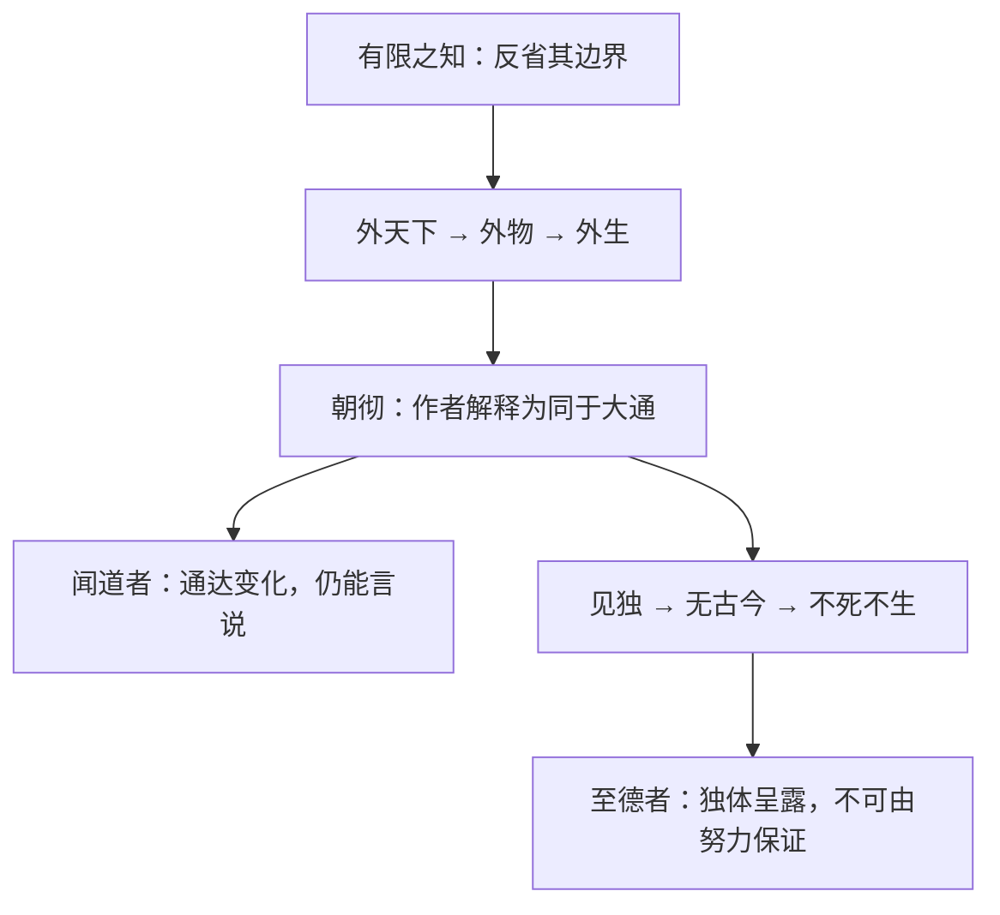
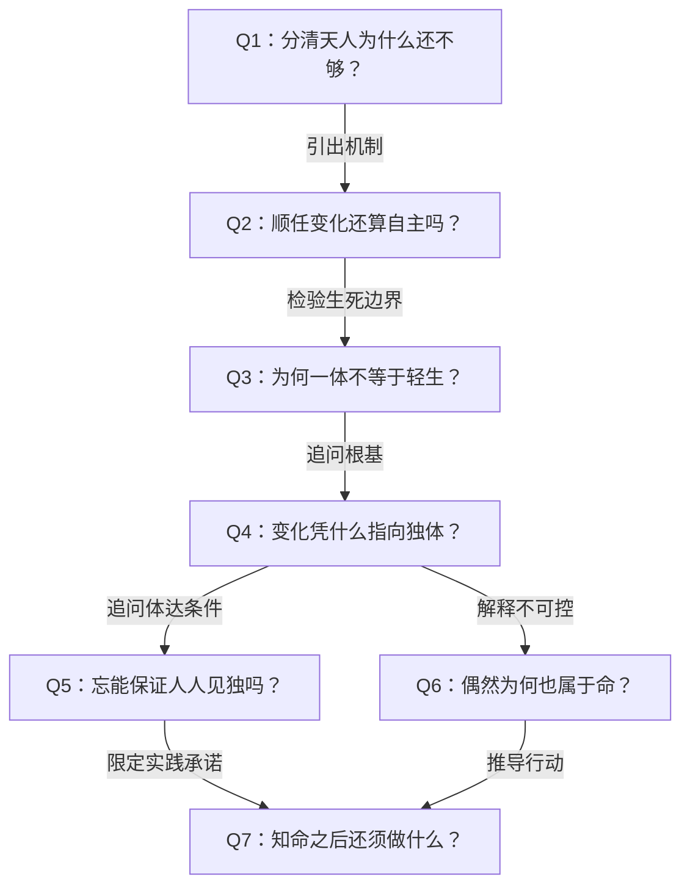

# 《庄子哲学研究》第九章：大宗与吾师｜深度拆解

> 阅读日期：2026-11-28。范围：用户提供的第九章，五节为“天人（三）”“生死（二）”“造物与造化”“独体与道体”“命”。
> 来源：`/Users/minyanhua/MinerU/庄子哲学研究_第九章.pdf-fca40820-e399-4445-af7f-d5ae7435793d/庄子哲学研究_第九章.md`。
> 下文区分《庄子》原文、本章作者的解释及本笔记的评议与实践引申。注号沿用所给文件，以节名辅助定位；文件未提供相应脚注正文，不补造版本、页码或作者资料。材料中的人物话语均作为分析对象。

## x → f → f(x)

- **x**：人既无法支配自己的生成、生死与遭遇，如何仍有真正的自主，而不必退出变化的人间世界？
- **f**：作者以“独体”贯通主体与世界：由对有限知识的反省进入不知之知，使自身同一的根源呈露；这一根源同时生成个体、使万物变化，因此自主不在排除变化，而在不执著既有形态、让各物成其自身。
- **f(x)**：面对变化，不再将自主等同于保住原状，也不把顺任理解为放弃行动；面对礼、死亡与命，分别检验自己的执著和认识边界，同时追问作者凭什么把这些经验提升为关于万物根源的判断。

## 核心命题

**真正的自主不能建立在对遭遇的全面控制上，而必须能够容纳自己的不可控；真正的统一也不能消灭万物的差异与变化。**

在作者的体系里，“大宗”强调万物的根源，“吾师”强调知与作用的根基，“命”则是个体对这一根源的作用的领会。三者不是三个实体，而是理解同一独体的不同入口。独体既不是世界之外的人格神，也不是变化停止后剩下的一件东西。

本章因此接续第八章的问题：至人何以既不受物变扰动，又对世界有所作用？作者将人格层面的主动性，推进为独体、根本知与无限变化之间的关系。

## 关键洞见

### 1. 天人之辨有必要，但不能成为最后的对立

“知天之所为，知人之所为”之后，原文立刻追问：何以确定所谓天不是人、所谓人不是天？作者据此说明：有明确内容的知识依赖条件，而天人的边界本身也未必确定。（第一节，注[323]）

天人之辨首先帮助人识别人为执著，避免“不以人助天”所针对的额外造作；但如果因此将制度、行动和具体差别一概排斥，人就再次人为制造了一个纯自然的领域。

**区分天人以破执 → 反省区分的条件 → 不再让区分支配一切。**

“天与人不相胜”因此不是自然压倒人为。作者以三个层面的“一”解释真人：独体的自身同一、个别事物各自维持自身的“自一”、恒常变化的整体统一。统一容纳“不齐”，并不要求万物服从同一外在模板。（第一节，注[342]）

这也说明圣人为何仍可用刑、礼、知、德。既有治具有其人为性，却已经进入共同生活；因其人为便全部废弃，也是一种额外造作。作者并未据此证明所有既有制度都正当，只是拒绝从“人为”直接推出“必须废弃”。（第一节，注[331]—[334]）

### 2. 自主的对象是与变化的关系，不是变化的全部结果

子舆设想身体化为鸡、弹、车轮，随新的形态展开新的可能。作者强调，这不是像木石一样被推着走，而是主动迎接变化，使新形态的可能得到实现。（第二节，注[345]—[347]）

其反直觉处是：执著旧形态，看似维护“我”，却可能把当下变化排除在“我”之外，造成自我割裂。若生死同属变化，死也会被这种执著塑造成一个纯粹外来的敌人。

**自主 ≠ 维持每一个旧属性；自主 → 在属性变化中不被固执耗尽。**

但这不是经验上已经证明的心理规律。作者谈的是理想人格与存在根基；实践上可以减少执著，不能要求普通人在重病、丧失中立即做到“哀乐不能入”。

### 3. 生死一体不等于悦死恶生，也不等于取消礼

作者反对把“无—生—死”只读成三个互相分割的时间阶段。“无”与“死”在此首先是活着的主体对自身来处与去处的追问，而追问抵达根本性的不知。（第二节，注[343]—[344]）

他进一步区分两种死亡：他人的死亡可以成为经验，本己的死亡不能以同样方式成为自己的经验。这个区分帮助揭示知识的边界，却不能单凭它证明死亡就是独体的完整呈露；后者是作者额外提出的本体论解释。

礼的讨论使这一判断落到人物差异上：

| 场景 | 本章作者的判断 | 所揭示的问题 |
|---|---|---|
| 孟子反、子琴张临尸而歌 | 有过度之嫌，尚非无言的至德者 | 反对悦生恶死，不应翻转成悦死恶生 |
| 子贡质问歌是否合礼 | 偏重世俗形式，未达礼意 | 合乎仪式未必理解其根本 |
| 孟孙才“人哭亦哭” | 随生活情境而行，并非刻意简礼 | 不执著礼，也不以反礼证明自己 |

“人哭亦哭”是关键：如果彻底超越世俗只能表现为反世俗，仍然受世俗牵引。作者理想中的至德者，可以行礼而不以礼的名目束缚自己。（第二节，注[355]—[366]）

### 4. 造物与造化是同一根源的两种作用

作者依据具体语境作出区分：子舆已经得到某种病体，着眼于形态的赋予，称“造物”；子来将死、将往未知形态，着眼于旧形态的消解，称“造化”。二者不是两个神祇，也不是互不相关的力量。（第三节，注[368]）

**赋形使变化有其承担者；变化使赋形不凝固为永恒。**

从个体看，造物与造化相反相成；从整体看，只有不停息的变化，“造化”又可以兼指销熔与锻造。大冶铸金的寓言因此批评的是对特定形态的独占要求，不是证明现实中的每一种毁坏都值得欢迎。（第三节，注[373]）

更难的一步是：作者从“变化是作用”推到“作用需要不随之改变的定体”，再推到独体的主宰性。这个论证依赖“作用必须有定体”的前提；变化恒常本身，并不已经逻辑地证明一个不变主宰存在。（第三节末）

### 5. 忘不是清空记忆，命也不是预先写好的剧本

“忘”在作者这里是由有所知返归无所知：反省既有分别的限度，不再把它们当作绝对根据。努力可以有方向，但结果不能全由自觉意志安排。作者以“朝彻”之后不再明言日数，说明进境的不可掌控。（第四节，注[385]—[393]）

他把“朝彻”读为“周彻”，对应坐忘的“同于大通”；又把“见独”的“见”倾向读为“现”。这些是本章的具体训释方案，不是无争议的字义定论。

图中分支表示作者的境界区分，不表示闻道者一定能够继续升级。作者区分“圣人之道”与“圣人之才”，认为至德之路不普遍；这正限制了将本章包装成人人适用的修炼教程。

“命”则将视角从最高境界拉回个体遭遇：不仅生死等必然环节属于命，贫富等偶然境遇也属于命。作者认为，偶然在内容上不可预知，而不可控的变化普遍存在；但“偶然普遍存在”与“每种事件都不可解释、不可改善”不是同一句话。（第五节，注[400]—[402]及末段）

## 概念地图：同一根源，如何呈现差异？

| 概念 | 在本章体系中的位置 | 不应直接等同于 |
|---|---|---|
| 独体／道体 | 始终自身同一、内在于万物而非与万物并列的根源 | 世界之外的某个物体 |
| 无知之知／根本知 | 作者认为与独体同一，不以对象性知识的形式出现 | 对万事万物无所不知 |
| 一化／天地之一气 | 无限变化的整体 | 独体之外另一个独立实体 |
| 个别主体／吾之 | 在变化中持续自我设定、维持自一的有限存在 | 永不改变的经验人格 |
| 大宗／吾师 | 分别突出根源义与知之基础、主导义 | 传授命令的人格导师 |
| 命 | 个体对独体作用之不可知、不可控的领会 | 可供预测的固定日程 |

作者最后将独体同时称为绝对主体与绝对客体：它是个体自我设定的根基，也是个体无法控制的外在变化的根基。这是对同一根源的两面说明，不是说有限个人能够随心决定外界。

## 实践指引

以下是本笔记的现代引申，不是作者提出的标准操作程序。

1. **遇到身份、能力或职业变化时，先找出自己坚持保留的旧属性。** 分别写下已经无法逆转的事实、仍可采取的行动、只是因为“过去如此”而坚持的要求。由此将行动转向新条件中的可能，避免把改变本身当成自我消失。
2. **参与家庭仪式时，先理解仪式承担的关系。** 面对丧礼或节庆，不必用繁复证明诚意，也不必用拒绝参与证明超脱。可以参与自己能承受的部分，说明实际困难。孟孙才的故事不能用来评判他人哭得是否“正确”。
3. **面对无法解释的挫败，分开因果调查与人格归罪。** 子桑找不到使自己穷困的单一意志，不等于所有近因都不存在。继续处理能查明、能改善的条件，同时停止把所有结果解释为个人不够好或有人刻意安排。
4. **学习一种理论时，列出它不适用的条件。** 这对应“以所知养不知”，并不要求放弃专业知识。尤其要避免把“我知道知识有限”重新当成一种高于所有知识的优越身份。
5. **帮助别人时，观察是否要求对方成为自己的作品。** 作者强调让各物自足，可启发我们提供具体帮助而少加控制；这不要求否认关爱的真实性，也不免除承诺与照料责任。

## 例子列表

| 例子与定位 | 缩写 | 在逻辑链中的作用 |
|---|---|---|
| 孔子自称天之戮民，第一节[322] | 懂得理想不等于已经摆脱束缚 | 支撑 x：知道与做到有距离 |
| 狐不偕、伯夷等，第一节[327]—[329] | 作者借其赴死讨论受名所役 | 展示 f：自主须反省外在尺度；其评价有解释前提 |
| 圣人用刑礼，第一节[331]—[334] | 仍用共同生活中的治具 | 展示 f：不执著人为，不等于取消人为 |
| 子舆病体化鸡、化弹、化轮，第二节[345] | 随新形态展开新的用途 | 展示 f(x)：顺变中的主动性 |
| 子桑户死、朋友临尸而歌，第二节[355] | 反礼行为可能仍有偏执 | 检验 f(x)：超脱不能反转成另一种执著 |
| 孟孙才善丧，第二节[361]—[366] | 人哭亦哭而不刻意经营简礼 | 展示 f：内在不执与外在参与可以并存 |
| 藏天下于天下，第三节[369]—[372] | 不再将所有物安置于变化之外 | 展示 f：整体变化无法靠局部藏匿规避 |
| 大冶铸金，第三节[373] | 金若坚持只做名剑，便拒绝其他可能 | 展示 f(x)：停止对特定形态的独占要求 |
| 女偊教卜梁倚，第四节[384]—[385] | 有道、有才、后天进境并非一回事 | 检验 f：道路有条件，结果不可普遍保证 |
| 颜回坐忘，第四节[388]—[393] | 作者区分同于大通与见独 | 展示 f：闻道者与至德者的分界 |
| 意而子问许由，第四节[398]—[399] | 仁义是非可成束缚，后天陶冶或能松动 | 展示 f：能转变不等于能超越一切自然限度 |
| 子桑贫困、子舆送饭，第五节[400] | 找不到使己贫困的单一施为者，朋友仍送饭 | 支撑 x 并展示 f(x)：不可控与具体帮助并存 |
| 原宪“贫也，非病也”，第五节[403]—[405] | 经济匮乏与不能行道并非同一判断 | 展示 f：外在境况不穷尽人的价值；师承推测仍待证 |

## 结论列表

1. 承认天人之别，不等于把自然与人为划成互不相通的两个世界。
2. 维护自我不必要求保存自我的每一种既有属性。
3. 顺任变化可以包含行动，全面控制遭遇也不是行动成立的前提。
4. 破除悦生恶死，不能以悦死恶生作为完成。
5. 不执著礼的形式，并不必然表现为拒绝礼。
6. 在本章作者的解释中，造物与造化是赋形与消解的相反相成。
7. 知道自己的知识有限，尚不等于已经体达作者所谓的独体。
8. 作者关于至德道路不普遍的判断，限制了本章的普遍实践承诺。
9. 命容纳不可控的偶然，并不因此使所有具体行动失去意义。
10. 体验到认识的边界，与证明万物具有同一绝对根源，是两项不同的论证任务。

## Q-A 问答链

### Q-A 问题结构图

### Q1：分清天人为什么还不够？

- **结论**：区分能破除一类执著，也可能成为新的执著。
- **形式化**：天人之辨 → 反省人为；固守天人 → 再造隔绝。
- **论证**：① 对天人的知识仍有所待。② 其边界不能仅凭名称获得确定性。③ 真人既体达一，又容许具体的不一，故不让双方彼此压倒。
- **边界**：超越分别不意味着经验判断、制度评价都可以省略。

**Q1 → Q2**：因为 Q1 排除了以“自然”压倒一切人为的旧解，却尚未解释人不控制变化时如何行动，所以必须追问顺任中的自主。

### Q2：顺任变化还算自主吗？

- **结论**：本章将自主理解为不受旧形态拘执，而非支配所有变化。
- **形式化**：变化给定条件 + 不固守旧形 → 新条件中的主动展开。
- **论证**：① 人无法决定自身全部遭遇。② 固守旧形态会使新遭遇沦为纯粹威胁。③ 子舆以新的形态展开新的可能，显示顺变不必成为木石式被动。
- **边界**：寓言展示一种态度，不足以保证现实中的每种损失都存在补偿。

**Q2 → Q3**：因为 Q2 允许人在变化中重新理解自身，而死亡是对个体形态最彻底的改变，所以必须检验这种理解会不会变成轻生。

### Q3：为何一体不等于轻生？

- **结论**：生死一体要解除对立，不能重新以死贬生。
- **形式化**：悦生恶死 → 生死同体；生死同体 ≠ 悦死恶生。
- **论证**：① 生与死被作者理解为同一变化的环节。② 将死视为解脱、将生视为赘疣，再次制造价值对立。③ 孟孙才参与丧礼而不刻意经营，较临尸而歌更能显示贯通。
- **边界**：这里讨论生命理解，不构成任何自我伤害或放弃照护的理由，也不能用来要求他人停止悲伤。

**Q3 → Q4**：因为 Q3 的生死一体解释依赖共同根源，而非仅仅态度平衡，所以必须追问作者如何从变化论证独体。

### Q4：变化凭什么指向独体？

- **结论**：作者以作用需要定体为桥梁，从无限变化推向不变的根源。
- **形式化**：无限变化 → 作用须有定体〔前提〕 → 不随变而变的主宰。
- **论证**：① 个物有暂时形态，整体却无固定形态。② 作者因此将整体变化理解为作用。③ 他认为作用必须有定体，而该定体不能只是另一项变化。④ 独体遂被规定为既关联变化又不随之改变的根源。
- **边界**：“作用须有定体”需要独立辩护；这个推论并未排除把变化理解为基本事实的其他方案。

**Q4 → Q5**：因为 Q4 给出了独体的理论位置，却未说明有限的人怎样体达它，所以必须追问“忘”的路径及其条件。

### Q5：忘能保证人人见独吗？

- **结论**：在作者的解释中，有方向的工夫不能保证独体呈露。
- **形式化**：有道 + 有才 + 后天进境 → 可能至德；努力 ≠ 充分保证。
- **论证**：① 女偊区分圣人之道与圣人之才。② 外天下、外物、外生可含自觉努力。③ 作者将朝彻对应同于大通，仍与见独区分。④ 朝彻以后不言日数，进一步被他读成不可由意志安排。
- **边界**：日数变化与沉默叙事只是作者的解释依据，尚不能证明一种客观的人群资质分层。

**Q4 → Q6**：因为 Q4 认为独体规定无限变化，却不把每一变化限定为可预测结果，所以必须追问不可测的偶然为何也属于命。

### Q6：偶然为何也属于命？

- **结论**：命在本章中概括个体不能自作主宰的根本处境，涵盖必然与偶然。
- **形式化**：必然环节 + 不可控遭遇 → 个体对命的领会。
- **论证**：① 生死等有其必然维度，贫富等具体遭遇则有偶然性。② 两者都不能由个体完全掌控。③ 作者将自我根基与外在变化根基归于同一独体。④ 个体面对这两面的不可知与不可控，统称为命。
- **边界**：不可完全掌控不等于完全不能影响；不可得知终极根由也不否定局部的因果知识。

**Q5 → Q7**：因为 Q5 否定人人凭努力即可至德的保证，日常行动就不能以已经见独为前提，必须另找有限条件中的实践方式。

**Q6 → Q7**：因为 Q6 承认遭遇不可全面控制，却没有否定有限影响，所以必须明确知命之后还保留哪些行动。

### Q7：知命之后还须做什么？

- **结论**：停止对全能控制的要求，同时继续承担眼前可做的事。
- **形式化**：承认不可控 + 辨明可为 → 不以控制欲替代行动。
- **论证**：① 子桑将穷困归于命，没有提供一个可责问的终极施为者。② 子舆仍然裹饭来访，具体照料没有因此取消。③ 由此可作实践引申：调查近因、提供帮助、调整行动，同时不把结果全部归罪于自己或他人。
- **边界**：这是从叙事作出的有限引申，不代表子桑已达到至德，也不代表所有问题都应以内心调整解决。

## 局限与盲区

### 1. 不知是认识限度，独体却是存在断言

“本己死亡不可经验”“生之所由来不可尽知”，首先支持的是认识边界。作者进而认为，无知之知与独体同一，并把它规定为唯一、普遍、无限的根源。这里需要解释：为何认识的不可对象化，能够积极证明某种绝对者，而不是仅使人悬置判断？如果这一步不成立，本章的若干实践洞见仍然有意义，但整套本体论不能自动随之成立。

### 2. 主宰的含义需要始终保持一致

作者一方面说独体主宰万物，另一方面说主宰性包含不可控的无限变化。若“主宰”意味着决定每个具体结果，就与后者紧张；若只意味着使变化持续成立，则它与通常意义上的控制相距甚远。作者有意识地拒绝支配关系，但仍须进一步说明主宰这一名称增加了何种解释力。

### 3. 从现有文本的留白推断境界，证据未必充分

作者以至德者必然沉默为原则，区分颜回、孟子反等闻道者与孟孙才等至德者；又据颜回未被叙述为见独，判定其止于大通。这形成一种整齐体系，但“文本没有继续写”不必然等于“人物不能继续达到”。若先以沉默判至德，再以至德解释沉默，论证容易循环。

### 4. 普遍成圣会消解人间秩序，并非必然

作者认为至德道路不普遍，才能保留人伦世界的差异。这是其此世性解释的重要环节，但仍有待论证：既然真人可以“其不一与人为徒”，为什么所有人更通达就必然失去具体关系与分工？保留差异与限制谁能至德，未必互为必要条件。

### 5. 关系解释可能压缩了关爱的现实意义

作者将对他人的关爱解释为自爱的一面，甚至称关切为错觉。这有助于反省借帮助实施控制，却不足以证明所有关爱均无独立意义。由“无人能替代他人承担生命”推到“关爱只是错觉”，中间仍有距离。子舆送饭的叙事本身也保留了照料的现实分量。

### 6. 几项具体推理与历史猜测应降低确定性

- 作者以人能选择赴死来支持死亡的必然性；但可选择某结果，只能显示一定条件下可以促成它，并不能单独证明其普遍必然。
- 将宁释为成、撄理解为与成相反，是依据“撄而后成”作出的语境推释；不能因而排除其他训读。
- 从“贫／病”及原宪故事推测庄子之学或出原宪之门，属于作者明确以疑问提出的猜测，不能作为师承事实。
- 对科学的批评应限定于从局部有效性跃迁为全面可控的信念。经验科学能够说明和预测许多现象，并不因此已经承诺消除全部偶然；偶然不可穷尽也不直接证明独体。

## 回读时应抓住的三个关节

先重读“天与人不相胜”，检查统一是否保留差别；再重读孟孙才的“人哭亦哭”，检查超越是否保留参与；最后重读子桑叙事与作者关于命的末段，区分不可控的处境、独体的理论解释和继续行动的可能。只读到“顺其自然”，会漏掉作者关于自主的核心；只接受“绝对者”，又会漏掉本章仍需承担的论证责任。
