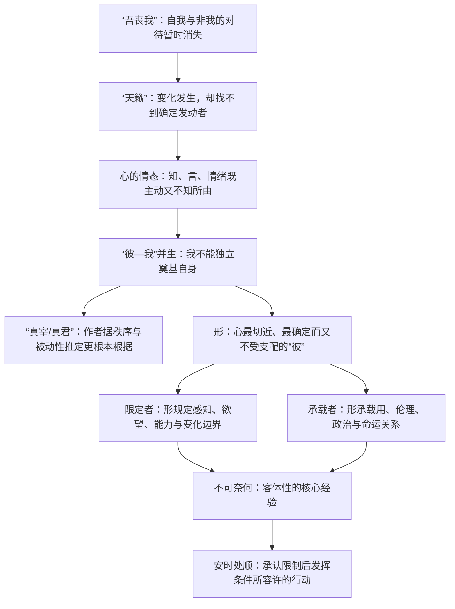

# 《庄子哲学研究》第二章“心与形”深度拆解

> 原文范围：第二章“心与形”，含“从‘吾丧我’到‘天籁’”“心、形、知、言等概念的提出”“限定者”“承载者”四节。
>
> 阅读提示：以下拆解重构的是本章作者对《庄子》的解释，不等于《庄子》文本唯一可能的读法。

## x → f → f(x)

- **x**：如果人的“我”既能发动知、言、判断和行动，却又不能决定自己的形成、身体运转、情绪来去与生死变化，那么主体究竟以何种方式存在于世界之中？
- **f**：不把自我理解成支配身体与世界的独立主宰，而从“吾丧我”的被动经验出发，经由“天籁”的无主生成结构，辨认心的有限主动性，并把“形”理解成主体最切近的他者、限定者和生存关系的承载者。
- **f(x)**：主体性不再等于控制一切，而是在承认“不可奈何”的前提下，辨认自身所受的形体、关系与命运限制，继而顺着现实条件发挥仍然可能的行动——即“安时而处顺”而不沦为消极放弃。

---

## 核心命题

人并不是一个先已完成、能够自由支配身心与世界的封闭主体。所谓“我”，是在与“彼”的相互限定中生成的；心具有主动性，却不能自我奠基，形看似属于我，却以不受我支配的方式限定并承载我的全部生存关系。

本章真正要建立的不是简单的“心身二元论”，而是一种**有限主体论**：人的主动性真实存在，但它始终内嵌在更根本的被动性之中。庄子的超越也因此不是摆脱一切条件，而是在无法取消的条件中改变自己的回应方式。

## 全章论证骨架

这条链条的关键不是“发现了一个神秘主宰”，而是：**每当我们以为找到主动者时，文本又暴露出它更深一层的被动性。**众窍发声取决于风，心的判断取决于未明的“此”，身体的秩序不由意识建立，人的生存又受形体、社会与命运限制。哲学追问因此不断后撤：究竟是谁在“使”这一切如此？

---

## 关键洞见

### 1. “吾丧我”不是自我主动消灭，而是主客对待的暂时失效

作者抓住颜成子游问话中的两个“可使”：子游怀疑南郭子綦形如槁木、心如死灰，是不是有意修炼的结果。子綦随即谈“天籁”，正是为了否定这种“自我主动制造无我状态”的理解。

这里的“我”不是单指心理意识，而是身心整体；“我”的对面是“非我”。所以：

`我成立 → 非我同时成立；我丧 → 我/非我的对待一起消隐`

但“丧我”并非昏迷或纯粹惰性，因为子綦仍能在事后清楚言说这一经验。它保留了一种不由目的意识发动的活跃性：不是“我在行动”，却也不是“什么都没有”。这正逼出“天籁”的问题。

### 2. 天籁不是一个吹奏万物的实体，而是“自己”与“被使”的悖论结构

地籁的譬喻把变化分成两层：众窍的形状决定各自发出何种声音，风则决定声音是否发生及其强弱。个体差异出自“自取”，但差异的显现与消失又不由个体控制。

天籁把这一结构推到万物层面：万物各自如此，所以不能指出一个像吹箫者或风那样的外在发动者；然而万物又不是绝对自因，因为它们“自己”恰恰像是某种“使之”的结果。

`个体性 = 自己而然 + 非自主生成`

因此“怒者其谁邪”在本章作者看来是真问题，不是“背后无人”这一答案。郭象用“造物无物”直接回答，作者认为这过早封闭了追问。

### 3. 心的主动性从封闭的自我边界中出现，也因此转化为争胜与耗损

“大知闲闲，小知间间；大言炎炎，小言詹詹”以下，不是在列举心理现象，而是在展示有限主体如何成形：知与言持续侦察外界，恐惧使边界收紧；一旦不确定的自我边界被执为真实，判断就像弩机一样发射，围绕是非、胜负攻击和防守。

逻辑链是：

`不安与提防 → 自我封闭 → 是非判断 → 胜负争夺 → 心日益衰杀`

心确实具有主动性，但这种主动性不是自由自足的。情绪“日夜相代”，人甚至不知道它们从何萌生。越执着于由心建立的边界，心越被自己的判断机制役使。

### 4. “彼—我”不是两个现成实体，而是同时生成、互相限定的关系

“非彼无我，非我无所取”意味着：“我”不能脱离“彼”独立成立，“彼”也只有被“我”取为对象才进入这组关系。作者把它理解为整体性的互为条件，而不判定何者在先。

`彼 ⇄ 我：互相包含、互相限定、同时显现`

这并未解决问题，因为整组关系仍无法说明自己为何发生。作者由“若有真宰”“其有真君存焉”推定一个“有情而无形”的根据：它的作用可以由彼我并生和身体秩序间接确认，却不能成为感官对象。

### 5. 形首先不是“我的工具”，而是我无法绕过的最近客体

身体的器官自行运转，不因意识偏好而改变；身体会衰老、患病、畸变，最终消亡。心不能统治形，形也不能完全决定心。作者据此主张：庄子思想中的心与形相对独立、能够互相影响，却不构成彼此的充分条件。

因此，形是主体走向世界时遇到的第一个确定的“彼”：它最亲近，甚至通常被称为“我的身体”；可它又不断以疼痛、衰老、欲望、能力差异和死亡证明自己并不服从“我”。

### 6. 客体的真实性不在永恒不变，而在它对主体呈现为“不可奈何”

本章最有穿透力的一步，是拒绝以“不变”作为真实存在的必要条件。身体和感官经验虽然不断变化，但这种变化恰恰不是任由主体随意改写的。作者因而将“不可奈何”提炼为客体性的核心：

`客体性 ≠ 永恒不变；客体性 = 对主体意志构成不可任意取消的限制`

这让庄子的“不得已”不再只是人生感叹，而成为一种认识论入口：我们首先确定的不是对象背后的恒常实体，而是对象对我们的抵抗、限制和迫使。

### 7. 形同时是限定者与承载者，超越形不等于离开形

形限定物种的居处、食味、审美和欲望，也限定人的能力边界；与此同时，形承载人与物的使用关系、人与人的伦理关系、政治义务以及生死命运。形不是静态躯壳，而是一个生存世界得以展开的支点。

至德者的“忘形”也不等于没有身体。即便真正超越形的拘限，形仍是超越经验的载体。子舆“左臂化鸡则司晨、右臂化弹则求鸮炙”的意义，便不是被动忍受，而是在不能选择变化时，顺着新形态展开其可能作用。

`超越形 = 不被形的好恶绑架 ≠ 取消形的现实条件`

---

## 三组必须分清的概念

| 概念对 | 本章的区分 | 容易误读之处 |
|---|---|---|
| 主动 / 被动 | 人有判断与行动能力，但这能力的发生、边界和终止不由自己奠定 | 把“被动”误作毫无活力，或把“主动”夸大为绝对自由 |
| 心 / 形 | 二者相对独立、互相作用；心不是身体官能，也不是身体君主 | 直接套用现代“大脑产生意识”的理论，造成历史错位 |
| 命运般的 / 命运性的 | 前者虽难逃仍可能选择遵从与否；后者连是否发生都无从选择 | 把所有社会约束都自然化为不能反抗的天命 |

---

## 实践指引

### 面对身体疾病或衰老

先区分两个层面：病变本身有哪些不可由意志取消的限制；在这些限制中，治疗、生活调整、求助和重新安排目标还有哪些可能。庄子的方向不是拒绝治疗，而是不把“身体不能照我的意愿存在”再次转化为自我敌视。

### 面对观点冲突

当判断迅速进入“谁赢谁输”时，回看它背后的边界焦虑：我是在求真，还是在保卫一个已被执实的自我？先辨认情绪和立场“所由以生”，再决定是否发言，可中断“心斗—争胜—耗损”的链条。

### 面对能力与处境差异

不要只用抽象的统一标准衡量不同个体。居处、欲望、感受和能力都依形而展开；有效行动必须从具体条件出发。承认差异不是取消判断，而是避免把自身条件伪装成普遍尺度。

### 面对无法选择的变化

借子舆的例子，把问题从“为什么偏偏变成这样”改成“这一新条件还允许什么作用”。这不是美化苦难，而是在事实无法撤销时，尽快把有限主动性从对事实的徒劳否认中释放出来。

### 面对伦理和制度压力

先判断限制究竟是自然事实、不可逆事件，还是人造制度。对前两者可讨论“安时处顺”；对可改变的制度，承认其现实强度不等于认可其正当性，更不等于放弃改变。这里正是本章思想应用时最需警惕的边界。

---

## 例子列表

- **南郭子綦“形如槁木，心如死灰”**：经验并非有意制造，却保有可言说的活跃性。← 支撑 **x / f**
- **风过众窍而万声不同**：窍决定声类，风决定发声与强弱，显示个体“自取”与根本被动并存。← 展示 **f**
- **弩机发射般的是非判断**：自我边界一经封闭，知言便自动滑向争胜，并反过来役使心。← 展示 **f**
- **百骸、九窍、六藏自行运转**：身体属于我却不由意识统治，成为最切近的客体。← 支撑 **f**
- **子舆病后形体畸变**：形的变化不可控制，但可以顺其新机能重新行动。← 证明 **f(x)**
- **人、泥鳅、猿猴居处不同，人与动物食味、美丑不同**：感知与偏好以具体形体为条件。← 展示 **f**
- **不材之木与文木**：形承载潜在的使用关系；“材”反而招致斧斤，“不材”使别样生存成为可能。← 展示 **f / f(x)**
- **叶公子高受命出使**：政治伦理的“不得已”承载于具体人的生存，但尚存在如何回应的选择。← 支撑 **x / f(x)**

## 结论列表

- ① 自我越被理解为绝对主宰，越难解释情绪、身体与命运为何不服从自我。
- ② “吾丧我”取消的不是生命活动，而是我与非我的僵硬对待。
- ③ 个体之所以“自己”，并不等于个体是自己的终极原因。
- ④ 封闭的自我边界会把知与言从理解工具变成争胜装置。
- ⑤ 身体最悖论之处，在于它既最属于我，又最不听命于我。
- ⑥ 客体的真实首先表现为它不能被主体意志任意取消。
- ⑦ 超越限制不是离开条件，而是不让条件垄断自己的回应方式。
- ⑧ 接受不可改变的事实，与接受人为秩序的正当性，是两件完全不同的事。

---

## Q-A 问答链

### Q-A 问题结构图

```mermaid
flowchart LR
    Q1["Q1：为何由丧我转向天籁？"]
    Q2["Q2：万物究竟由谁发动？"]
    Q3["Q3：心为何既主动又被动？"]
    Q4["Q4：彼我为何必须并生？"]
    Q5["Q5：形为何是最初的彼？"]
    Q6["Q6：不可奈何为何是真实？"]
    Q7["Q7：顺应会不会沦为消极？"]

    Q1 -->|"引出无主生成"| Q2
    Q2 -->|"追问主体机制"| Q3
    Q3 -->|"追问自我来源"| Q4
    Q4 -->|"使抽象关系具体化"| Q5
    Q5 -->|"提炼客体标准"| Q6
    Q6 -->|"推导行动"| Q7
```

### Q1：为何由丧我转向天籁？

- **结论**：“天籁”用来解释“丧我”为何能够发生却不是自我有意制造。
- **形式化**：`有变化 + 无明确发动者 → 天籁问题`
- **论证**：① 子游以“可使”追问子綦是否主动让身心枯寂；② 子綦以“吾丧我”指出主客对待曾暂时消失；③ 这种经验不是死寂，因为仍保有活动与事后言说；④ 因而必须解释一种无明确主体而发生的变化。
- **边界**：本章只能据文本关联重构这一意图，不能证明庄子本人曾把“天籁”当作严格的心理经验理论。

**Q1 → Q2**：因为 Q1 确认了“丧我”是一种无明确自觉发动者的变化，但尚未解释无主变化如何可能，所以必须继续追问万物究竟由谁发动。

### Q2：万物究竟由谁发动？

- **结论**：万物各自呈现差异，却没有一个可被指认的外在发动者。
- **形式化**：`万物自取 ≠ 万物自因；被使 ≠ 存在可见使者`
- **论证**：① 地籁中，窍形决定声音差异；② 风决定声音是否显现，却不决定每个声音的具体形态；③ 到天籁层面，连“风”式的主体也无法指出；④ 因而个体同时具有“自己而然”和“非自主生成”两面。
- **边界**：从“找不到发动者”不能直接推出“绝无发动者”，也不能反过来直接推出一个人格化造物主。

**Q2 → Q3**：因为 Q2 暴露了“自己”与“被使”同时成立的结构，而人的心正是最直接表现这种矛盾的场所，所以必须追问心为何既主动又被动。

### Q3：心为何既主动又被动？

- **结论**：心能判断和行动，却不能决定自己的情绪来源、边界形成和运作惯性。
- **形式化**：`有限主动 = 能发动判断 + 不能自我奠基`
- **论证**：① 知、言持续与外界交接，表现主动性；② 恐惧和防备使自我边界封闭；③ 边界一旦被执实，判断便像弩机自动发射；④ 情绪与念虑不断更替，而主体不知其所萌；⑤ 心于是既用判断争胜，又被争胜机制消耗。
- **边界**：这一分析适合解释被焦虑驱动的判断，不意味着所有区分、论辩和是非判断都必然有害。

**Q3 → Q4**：因为 Q3 说明心有主动性却不能说明自己的来源，而心的边界只有面对对象才出现，所以必须继续追问“彼”与“我”为何并生。

### Q4：彼我为何必须并生？

- **结论**：“我”只能在与“彼”的区别中成立，“彼”也只能作为“我”所取的对象出现。
- **形式化**：`无彼则无我；无我则彼无从被取`
- **论证**：① 主体边界需要一个非我来界定；② 对象性也需要主体的取认；③ 彼我因此不是两个先成实体的外在拼接；④ 两者整体呈现出的被动性，又让作者追问更根本的“真宰”。
- **边界**：互为条件只说明概念和经验上的共生，不能自动证明一个超越性的实体根据。

**Q4 → Q5**：因为 Q4 的“彼”仍然抽象，而身形是主体最先遭遇、最无法否认的非我因素，所以必须把彼我关系具体化为心与形的关系。

### Q5：形为何是最初的彼？

- **结论**：身体离心最近，却以不受心支配的秩序、变化和死亡证明其客体性。
- **形式化**：`最属于我 + 最不由我 = 最切近的彼`
- **论证**：① 器官自行维持秩序；② 意识既不能任意改善身体，也不能阻止其衰变；③ 心会受形影响，却不完全随形而改变；④ 形因而既不是心的工具，也不是心的全部原因；⑤ 主体借形才进入更广阔的世界关系。
- **边界**：这是本章重构的先秦哲学模型，不能直接替代当代神经科学对身心机制的经验研究。

**Q5 → Q6**：因为 Q5 证明了形的确定性并不来自永恒不变，而来自它对意志的抵抗，所以必须重新追问何种意义上的“不可奈何”构成真实。

### Q6：不可奈何为何是真实？

- **结论**：对象之所以真实，首先因为它能限制主体，而不是因为它永远不变。
- **形式化**：`真实感 = 对象的抵抗力 ≠ 对象的不变性`
- **论证**：① 感官和身体都处在变化中；② 变化不等于任意或虚假；③ 主体不能凭意志取消这些变化；④ 这种“不可奈何”提供了客体独立于意志的最低限度证据；⑤ 形体、社会关系与命运由此呈现不同强度的客体性。
- **边界**：“不可控制”只能证明某物不由当前主体随意决定，不能单独证明作者所设想的“真宰”必然存在。

**Q6 → Q7**：因为 Q6 把限制看成真实的基本经验，但承认限制容易被误解为取消行动，所以最后必须检验“安时处顺”是否会沦为消极顺从。

### Q7：顺应会不会沦为消极？

- **结论**：真正的顺应是在不可改的条件中重组行动，不是把一切现状都宣布为合理。
- **形式化**：`安时处顺 = 承认事实 + 用尽可能；≠ 放弃判断与改变`
- **论证**：① 子舆不能选择身体变化；② 他却能顺着变化后的形态设想新用途；③ 因而“安”取消的是对不可逆事实的内耗，不是行动本身；④ 对社会规范仍须区分现实约束、道德正当性与可改变程度；⑤ 只有真正不可改变的部分才适用彻底的“处顺”。
- **边界**：若用“命”把可改革的制度、压迫或可治疗的疾病自然化，这一思想就会变成维护现状的意识形态。

---

## 局限与盲区

### 1. 从秩序推到“真君”，论证并不充分

身体器官能够有序运转，只能说明其秩序不由日常意识直接控制，不能据此必然推出一个自在、独立的“真君”。本章作者也许准确捕捉了文本的追问方向，却把“若有真宰”“其有真君存焉”中的探问语气解释得过于确定。

### 2. 预设心形异质，削弱了其他解释可能

作者强调心不是身体官能，并提醒不要把现代脑科学倒置到庄子时代，这个历史警觉是必要的；但“古人不可能持现代物质主义”并不能正面证明心形必定相对独立。文本中的修辞、体验描述与形上学承诺仍需区分。

### 3. “主体—客体”语言可能过度现代化

用主体、客体、绝对者、互为条件等概念确实能把论证系统化，却也可能把《庄子》开放、寓言式的追问压进近代哲学的问题框架。本章反对科学主义的历史错位，却未完全避免概念体系上的另一种历史错位。

### 4. 从《齐物论》跨篇取证，增强体系性也增加了过度整合风险

作者以《逍遥游》《大宗师》《德充符》《人间世》等篇互证“形”的意义，使“限定者—承载者”的解释相当完整；但不同寓言的语境、人物层次和写作目的可能并不完全一致。把它们排列成单一哲学系统，需要比本章提供的更多文本论证。

### 5. “安之若命”具有政治伦理风险

本章已经区分“命运般的”与“命运性的”，却仍可能让读者把社会制度造成的限制当成自然必然。若不进一步提供“何者可改变”的判断标准，“不可奈何”很容易从对事实的清醒转为对权力的顺从。

---

## 一句话收束

这一章最重要的贡献，是把庄子的“忘我”“顺命”从玄妙的精神境界拉回一条严密的哲学主线：**人的自由从来不是没有限制，而是在看清自我也被生成、身体也不听命、世界也不可尽控之后，仍能不被争胜和好恶耗尽，并在具体条件中找到恰当的行动。**
