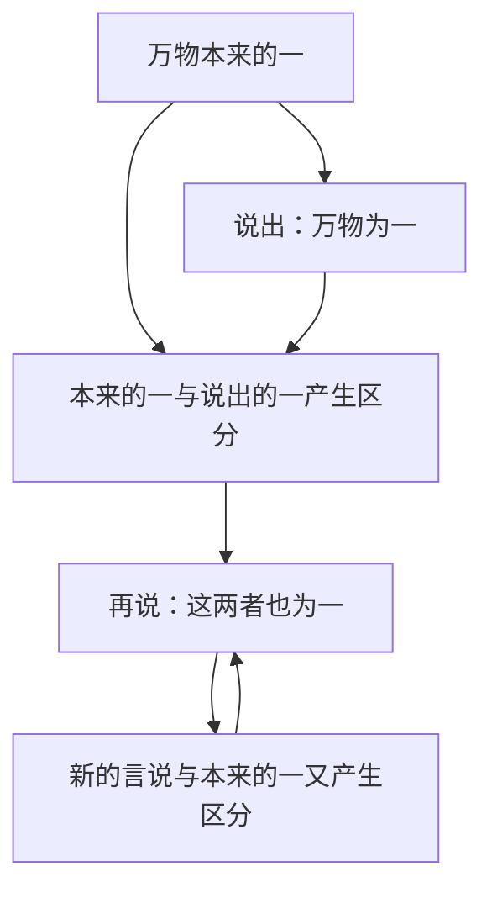
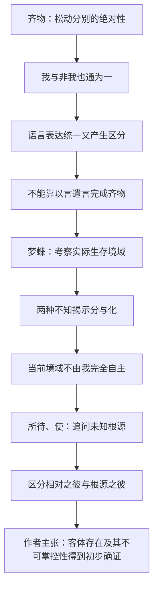
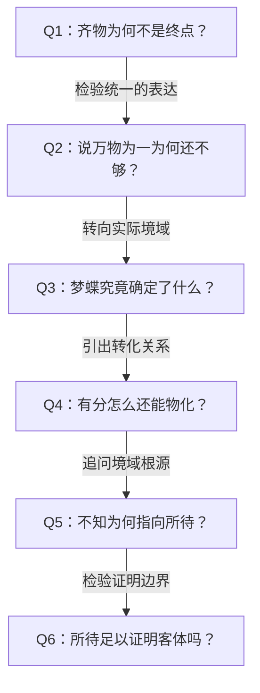

# 《庄子哲学研究》第五章《齐物与所待》深度拆解

> 来源：用户提供的《庄子哲学研究_第五章.pdf》，共17页。本文页码指该PDF页序，方便回查，不等同于原书页码。提取文本有一条PDF对象索引警告，但17页均提取出连续正文；未自行补造原书注释。
>
> 本文区分三个层次：庄子文本、本章作者的解释、笔记的分析与批评。尤其是“物化证明外境存在”“不知确证根源性的彼”等，均是本章作者的哲学重建，不是未经争议的庄子通解。用户已审阅并授权归档。

## x → f → f(x)

- **x**：既然知见、言说乃至“我现在醒着”都缺少最终担保，庄子如何避免滑向一切皆假的怀疑论，并说明我与外境的真实关系？
- **f**：先用齐物松动分别的绝对性，再揭示言说无法完成统一；通过梦蝶中的知与不知、境域之分与转化，以及所待关系，追问主体自身无法掌握的来由，进而确立根源性的“彼”。
- **f(x)**：齐物不再意味着“所有东西都一样”，梦蝶也不只是“人生如梦”。二者共同把问题引向：我所凭借的认识与生活境域从何而来，它如何先于并限制我的自主？

三者连读：**认识缺少最终担保，作者便从主体无法掌握自身来由这一事实追索所待；由此，把对确定性的怀疑转成对依存关系与客体性的追问。**

## 核心命题

**齐物是打开封执的环节，不是庄子哲学的终点；所待所揭示的被动性，才把问题从“万物如何为一”推进到“主体凭何存在”。**

作者试图论证：即便我无法确认自己醒着，仍能确认当前境域不是由我完全自主设立的。这个“不由我”的维度，成为他确立客体及根源性他者的入口。注意，“不由我”到“客体已被证明”之间是否充分成立，仍需单独检验。

## 关键洞见

### 1. 齐物不是抹平差异，而是松动差异的自足性

作者将惠施理解为贯穿本章的隐含对话对象：惠施由齐物支持“泛爱万物”的社会政治主张；庄子的齐物则服务于真知道路的敞开，而不止于一种统一学说。（PDF第1—4页）

“劳神明为一”与“知通为一”的区别，既涉及目的，也涉及思路。前者通过名辩不断处理概念关系，试图把差异论证成统一；后者则追问，一物的规定性是否本来就依赖非此物。

作者据此将“指”解作名言层面的能指，将“马”放在物的层面，解释“以非指喻指之非指”“以非马喻马之非马”：事物不能只由孤立的自身规定，它与非自身的关系也参与其规定。

这里须分清两步：

- **较弱、较易理解的判断**：指与非指、马与非马相互规定，分别不是完全自足的。
- **作者更强的判断**：由相互规定推进到“指即非指、马即非马”，进而解释“天地，一指也；万物，一马也”。

后一步不是普通形式逻辑中的直接推导。依赖对方才能获得规定性，并不自动意味着与对方数值同一。阅读时应保留这处论证跨度，不能把“通为一”翻译成所有对象在事实上一模一样。

### 2. “万物与我为一”仍未结束问题：说出统一，又产生了分别

作者首先将主体引入齐物：天地万物对“我”而言是“非我”，我与非我也相互规定。接着，他追问表达这一认识的语言自身是否已被纳入考察。（PDF第4—6页）

“万物本来的一”与“言说出来的一”不同；若再说二者为一，就又多出一层表达。依本章解释：

这不是“一加一等于二”的计算，而是统一的表达无法自动消除表达与对象之间的距离。“以言遣言”因而不能单靠再添一个命题来完成。

作者由此强调忘言，但并未让所有言说失去意义：至德者沉默，闻道者、知道者的言说才更有必要。**语言未必能替代默会，却能揭示通向默会的困难与方向。** 庄子著述的意义也在这一张力中得到说明。

### 3. 梦蝶首先追问境域的边界，不直接以梦觉比附生死

作者明确反对把梦蝶直接读为“生如梦、死如觉”，并区分昼夜与梦觉：昼夜指外境变化，梦觉指主体所处境域不同。（PDF第6—11页）

这项区分改变了故事的重心：我们要问的不是庄子是否看淡死亡，而是梦中与醒后如何各自形成一种自我与世界。

| 层次 | 主体的处境 | 知与不知 |
|---|---|---|
| 梦为蝴蝶 | 栩栩然胡蝶，自喻适志 | 不知庄周；作者视其为完全的不知 |
| 醒为庄周 | 蘧蘧然周，记得蝴蝶之梦 | 知曾梦蝶，无法证明此刻不是蝶梦周 |
| 哲学追问 | 反思两种境域的关系 | 不确定哪一个具有最终醒觉资格，却面对两种境域的分别与联系 |

第二个“不知”并非失忆，而是在保有记忆时无法最终确证。这个细微区别，正是作者推进物化解释的支点。

### 4. “有分”与“能化”必须同时保留

作者认为，“周与胡蝶，则必有分矣”不是为庄周与蝴蝶各自固定一种天然性分，而是确认不同生存境域之间的边界。边界真实，却不必恒久不变。（PDF第9—11页）

为什么不能只有“分”？如果醒后完全不记得梦境，只能说两境彼此隔绝，无法据此说明它们如何关联。醒后既记得梦蝶，又不能最终排除蝶梦周的可能，才使“自”从“他”的境域转化而来的问题凸显。

所以本章的物化，不是泛泛说“一切都会变”，而是：**当前被称为“我”的境域，并非自足地从自身产生，它有来自其他境域的转化关系。**

但应注意，作者进一步说这“证明”每一自境皆由他境而来。这是由梦蝶模型向全部生存境域的推广，原文引句本身不能免除这一步的论证责任。

### 5. 所待比“缺少某种资源”更根本：连我是谁，也不是完全由我决定

“吾有待而然者邪？吾所待又有待而然者邪？”将依存追问不断推进：罔两待景，景待形，形又有所待。作者还将“使其自己”“不知其所为使”“真宰”“真君”接入同一条思路。（PDF第12—14页）

这里的悖论是：一个存在者呈现为“它自己”，不等于它自主产生了自己的全部存在条件。**自己之为自己，仍可能是被给予、被推动的。**

梦与觉在这点上同构：即使我知道自己可能在梦中，也不知道当前整个境域的最终来由。作者因此不将“大觉”当作终于站到一切境域之外，而将其解释为对整体之梦的领会；知道自己的限制，并不自动取消限制。

这也解释了为何“使”不应立即人格化：作者承认不知道使者究竟是什么，真宰有情无形。推论重心在根源性依存，而非已经认识了一个幕后操纵者。

## 最难的概念：两种“彼”，以及“此”与“我”

| 概念 | 作者的具体用法 | 不能混同为什么 |
|---|---|---|
| 此／是 | 最直接的在此主体境域，伴随知与不知 | 不等于已有完整自主意识的人格自我 |
| 我／吾 | 经由“吾之”而形成的自我认定 | 不等于此境域全部的、最终的根源 |
| 与我相对的彼 | 我／非我、此／彼关系中出现的对象或他者 | 不等于已经脱离我的认识框架而被完整把握的自在客体 |
| 根源性的彼 | 从我不知道自身境域由来、不能掌控其条件中追索的根源 | 不等于任何一个已知经验对象，也未被证明是人格神 |

作者用这一区分解释两句表面方向相反的文本：

- **“彼出于是”**：在自知的此境中，与之相对的彼随之形成，强调此／是的优先性。
- **“非彼无我”**：追问自身未知的来由时，彼呈现为我的根源，强调根源性他者的优先性。

二者分属不同层次，不能只择其一，把庄子说成单纯“意识创造世界”或“某个现成外物制造意识”。（PDF第14—17页）

还有一处重要张力：作者一面说物化证明与自我有别的外境，一面说根源性的彼并不在此／是之外。这不是空间位置问题，而是试图同时保留客体的非自主性与此彼通一的关系。不过，“外境存在”的外，与“不在主体之外”的外，究竟各指什么，仍需更清楚地界定。

## 全章论证地图

箭头表示作者的论证推进，不表示每一步都已获得无可争议的证明。

## 孟子为何突然出场

末节用孟子作结构上的比较，而非把孟庄的具体思想合并。（PDF第15—16页）

- 作者解释孟子：尽心与知性相同一 → 人性呈现为不得不有的主动性 → 主动性既有不得不的一面，就仍是相对的 → 进而推知绝对主动性的天。
- 作者解释庄子：从最直接的此境出发 → 自知却不知道来由 → 根源性被动显现 → 进而确证作为所待的彼。

共同点是从主体直接性出发，追索不由主体自主设立的根据；不同点在于，孟子的道路凸显主动性，庄子的道路凸显不知与被动性。

这段比较说明作者的整体哲学取向：他试图把先秦思想读成严格的主体与客体根源问题。但从相对主动性推出绝对主动性，也不是无需额外前提的逻辑必然。

## 实践指引：限于现代类比

这些应用由本章问题推出，不是庄子原文中的现代操作方案。

1. **面对坚信不疑的自我叙述**：把“我就是这样的人”拆成能力、习惯、环境和记忆。问哪些是自己选择的，哪些是长期关系与条件形成的。对应“吾之”：自我认定并非全部存在根据。
2. **复盘一次重大认知转变**：记录以前什么对你显得当然，现在什么显得当然。既承认两种境域有分，也寻找使转变发生的事件与关系，而不把过去概括成纯粹愚蠢。对应分与化的同时保留。
3. **面对沟通中的统一口号**：团队都说“以用户为中心”，不等于对具体用户和取舍已经一致。把统一表达落回不同经验与行动条件；多添一句统一口号，可能只是把分歧推迟。对应言与一。
4. **面对控制感焦虑**：区分可调节的具体条件与尚不可掌握的整体来由。承认有所待，不等于停止调查、治疗、学习或协作；它只限制“我应该完全掌控一切”的要求。不能用抽象不知替代可获得的具体知识。

## 例子列表

- **惠施的历物诸题与泛爱万物**：作者借此区分齐物的社会政治用途与庄子的真知道路。← 支撑 x 的思想背景。
- **指与非指、马与非马**：由非自身一面考察规定性，松动孤立自足的物。← 展示 f；由相互规定到同一仍须论证。
- **莛与楹、厉与西施**：局部价值分别没有当然的普遍高下。← 展示 f。
- **秋毫与大山、殇子与彭祖**：大小寿夭被纳入齐物，继而引入我与非我。← 展示 f。
- **始、未始有始及有无的递推**：反对某概念的言说仍可能受该概念支配。← 展示 f 中语言的限度。
- **一与言为二、二与一为三**：表达统一不断产生新层次的区分。← 支撑 x。
- **庄周梦蝶**：记忆、不知、分与转化共同呈现境域问题。← 展示 f 的核心。
- **孟孙才与梦鸟、梦鱼**：补充自我认定、境域转化及待的关联。← 展示 f。
- **梦中占梦、大觉知大梦**：识破一次梦境未必已经超出所有境域。← 展示 f 的边界。
- **天籁的使其自己**：存在者成为自己，仍有其无法自主说明的使。← 展示 f。
- **罔两问景**：依存对象也有所依存，所待问题不能在表面一层停止。← 展示 f。
- **孟子尽心知性知天**：对照从主体直接性推索根源的另一条路径。← 检验 f 的结构。
- **知天知人却仍有所待**：高阶知识也依凭尚未确定的条件。← 展示 f(x) 中对知的自限。

## 结论列表

1. 齐物在本章中是打开封执的环节，而不是思想的最终完成。
2. 相互规定意味着分别不能完全自足，却不自动意味着不同事物彼此同一。
3. 说出统一，与已经消除表达和对象之间的距离，不是同一件事。
4. 梦蝶中的第一个不知是梦中不知庄周，第二个不知是醒后无法最终确证自己的醒觉。
5. 境域有真实边界，不等于边界永久不变；境域可以转化，也不等于原本没有差异。
6. 自知不等于自主，知道自己的不知也不等于摆脱有所待。
7. 相对之彼与根源之彼必须区分，否则会混淆认识对象与主体自身的存在根据。
8. 作者把不知转为确证客体的入口，但不知道根源是什么与已经证明根源的性质之间仍有距离。

## Q-A 问答链

### Q1：齐物为何不是终点？

- **结论**：齐物的作用是打开分别的封闭，从而让主体与真知的根源问题出现。
- **形式化**：松动分别 → 发现通 → 追问我与非我的根据。
- **论证步骤**：① 固定差别限制了认识。② 齐物揭示差别不能自足。③ 将认知主体纳入其中，问题转成我与非我的关系。④ 仅宣布为一还未说明这种关系如何真实成立。
- **边界**：这是作者对庄子思想目标的解释，不等于齐物没有独立价值，也不等于其他思想家的齐物都毫无意义。

**Q1 → Q2**：既然宣布我与万物为一还没有完成追问，就必须考察这一宣布本身会不会留下新的分别。

### Q2：说万物为一为何还不够？

- **结论**：言说的一与其所说的本一之间仍有区分，再以言说统一二者会继续产生区分。
- **形式化**：本一 + 言说之一 → 新区分 → 再统一 → 再区分。
- **论证步骤**：① 对象与表达不能直接混同。② 表达统一仍是一种表达。③ 将表达与对象一并统一，又需要新的表达。④ 作者因此认为以言遣言无法完成真正齐物。
- **边界**：表达与对象不同，不证明表达必然失真；语言仍可具有有限而有效的揭示作用。

**Q2 → Q3**：既然言辞不能靠增添统一命题消除全部距离，就须转向主体实际经历的境域，梦蝶因而成为检验场景。

### Q3：梦蝶究竟确定了什么？

- **结论**：按作者的解释，醒觉资格不确定，却仍能确认周与蝶存在境域之分。
- **形式化**：不知谁梦谁 ≠ 无差别；记得梦境 ≠ 证明现在醒着。
- **论证步骤**：① 梦蝶时不知庄周。② 醒为周后记得蝴蝶之梦。③ 记忆不能最终排除当前也在梦中的可能。④ 但周与蝶呈现为不同的存在境域，作者据此强调必有分。
- **边界**：由不知直接确证境域边界有多强，仍可争论；对境域不同的描述不等于确认某一境域具有最终真实地位。

**Q3 → Q4**：确认有分之后，仍未解释两个境域为何不是完全无关，因而必须追问记忆与转化的作用。

### Q4：有分怎么还能物化？

- **结论**：作者以醒后的记忆保留两境联系，以无法最终确证保留转化方向的开放性。
- **形式化**：分 = 境域不同；化 = 境域之间存在来由与转化关系。
- **论证步骤**：① 完全无差别便无从谈转化。② 完全隔绝又只能谈各自存在。③ 醒者记得梦境，使两境关联可被追问。④ 作者由此把物化解释为自境来自他境。
- **边界**：从一个梦蝶叙事推广到一切自境都必由他境而来，需要额外论证；不能把记忆本身当作真实转化的充分证据。

**Q4 → Q5**：既然当前之自并非被解释成自足的，就必须追问其转化与出现依凭什么，以及主体能否掌握这些条件。

### Q5：不知为何指向所待？

- **结论**：在作者看来，主体不能掌握自身境域的来由，显示它不是完全自主的，而有所依凭。
- **形式化**：自知其在此 + 不知其所由来 → 根源性被动 → 追问所待之彼。
- **论证步骤**：① 此境伴随知与不知。② 无论梦觉，都不能从自身说明全部来由。③ 使与待将这种不能自主的维度凸显出来。④ 作者据此区分经验中与我相对的彼，以及使我可能的根源之彼。
- **边界**：不能把不知道原因直接等同于没有自主性；认知限制、因果依存和存在根源是相关但不同的问题。

**Q5 → Q6**：既然作者把不知转成依存的证据，就必须检查依存是否足以证明客体存在，以及到底证明了什么性质。

### Q6：所待足以证明客体吗？

- **结论**：所待有力地提出主体非自足的问题，但由此确证根源性客体仍依赖作者的额外前提。
- **形式化**：非自主性线索 → 可追问依存；依存 ≠ 已确定根源的全部性质。
- **论证步骤**：① 不由我控制的经验确实挑战主体全能。② 但其来由可有多种解释，不能仅由不知排除。③ 根源不可知、不可掌控、与此通一且具主体性，并非完全同义的命题。④ 因此宜把本章视为一条根源论的论证方案，而非已终结怀疑论的无条件证明。
- **边界**：指出证明不足，不等于证明外境不存在，也不等于否定庄子对被动性和所待的洞察。

## 局限与盲区

### 1. 从认知限制到存在根源，有跨层次推论

“不知道我从何而来”是认知状态，“我依凭某种非我而存在”是存在论判断。前者不能仅凭自身推出后者，更不能直接确定后者唯一、根源、不可知却又有主体性。作者需要交代连接这些命题的前提。

### 2. 相互规定不等于同一

马由非马获得概念规定，可以支持概念的关系性；它并不直接推出一切非马都是马。除非“即”与“一”取特殊哲学意义，否则容易发生概念依赖与事物同一的混淆。即便取特殊意义，也应明确其内容。

### 3. 记忆不足以单独担保境域转化

醒后记得梦，只能直接保证当前出现了对梦的记忆或叙述，尚不能单独排除记忆重构乃至记忆属于当前梦境的可能。作者用记忆连接两境，同时又保留彻底的醒觉怀疑，二者怎样相容，需要细化。

### 4. 梦觉与生死的关系不宜被过度排斥

作者有理由反对将梦蝶简化成生死寓言，但缺少直接对应，不等于梦觉与生死完全没有解释上的关联。同样，把“大觉”解释为没有最终醒觉境域，也是一种强解释，不能只靠“予谓女梦，亦梦也”便排除其他读法。

### 5. 对“彼”的层次划分有解释力，也可能过度系统化

相对的彼与根源性的彼，可以协调文本中不同的关系方向。但这一区分并非庄子逐项明列的术语系统。还须检查：它究竟解释了文本原有结构，还是将现代主体客体问题重排进文本。

### 6. 真知的出口仍有待后文

作者批评言说无法完成齐物，却保留闻道者言说的必要；又称根源性的彼不可知，却说其存在与本质已被初步确证。因此必须继续区分：不可知究竟指不能对象化、不能穷尽，还是完全无从认识？若完全无从认识，对它的肯定性论断便需要说明来源。

## 与第四章的衔接

第四章《以明与因是》着重说明：局部判断怎样冒充普遍尺度，以及如何揭示其非根源性。第五章进一步问：即使松动了意见的绝对性，知本身又依凭什么？

**第四章：判断不能自称终极根据。第五章：主体也不能未经追问就自称自己的最终根据。**

读到本章结尾，值得带入下一章的问题是：如果根源性的彼总以不可掌控的方式显现，这种抽象的客体性将在真实生活中呈现为什么，又是否仍容许主体的主动性与真理性生存？
