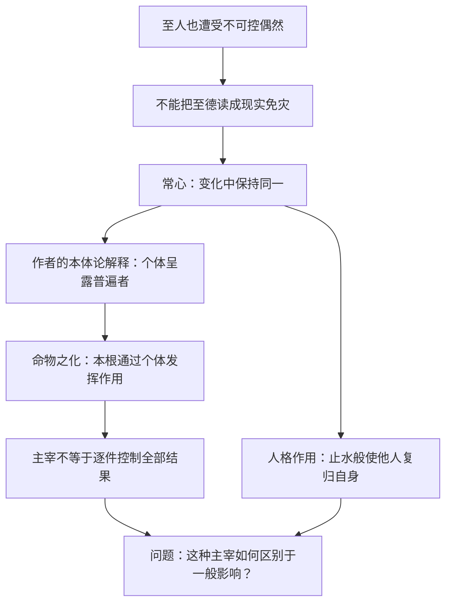
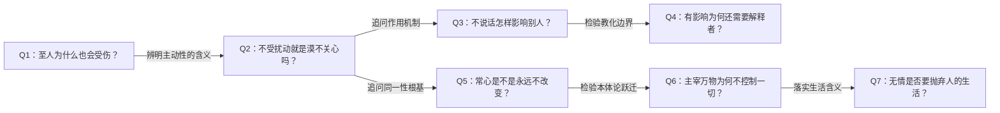

# 《庄子哲学研究》第八章：至德与至人｜深度拆解

> 阅读日期：2026-11-14。来源：用户提供的第八章 Markdown，原文路径：`/Users/minyanhua/MinerU/庄子哲学研究第八章.pdf-9de077fa-2c24-4f2c-850b-c6371556aefe/庄子哲学研究第八章.md`。
> 本文限于所给章节，区分《庄子》叙事、本章作者的解释与本笔记推论。引语以节名及原文注号定位；文件未附注释正文，不补造版本页码，也不把人物言语当成用户指令。

## x → f → f(x)

- **x**：至人同样承受不可掌控的祸患，为什么仍能被称为不受变化支配、又能积极作用于世界的存在？
- **f**：作者借不言之教、常心与德不形，将至人的作用解释为：个体生命呈露贯穿变化的普遍主体，因而能自持而不隔绝，影响他人而不靠显耀与强制。
- **f(x)**：理解至人时，不再把无伤读成身体免疫、无情读成麻木、无言读成没有作用；但必须另问：人格影响如何支持关于万物本根的结论，以及不控制偶然的主宰究竟意味着什么。

## 核心命题

**至德不是把偶然消灭，也不是把自己变成与世界无关的旁观者，而是在变化中不失自身，同时使他人有可能复归其自身。**

作者进一步认为，这种人格作用与万物本根的作用同构：至人的主动性，并非有限个人操控宇宙，而是普遍者通过个体生命呈露。理解这层解释，才能读懂本章；但理解不等于已经证明。

## 关键洞见

### 1. 不言之教不是不需要言说，而是言说不能代替人格作用

王骀“立不教，坐不议”，追随者却“虚而往，实而归”。作者据此强调至人的无言化育；但同受伯昏无人影响的申徒嘉与子产，表现却不相同。申徒嘉能渐渐不再以失足定义自己，子产仍以身份与形体轻人。

**无言影响存在 → 接受并非自动发生 → 闻道者、知道者仍需解释与传达。**

因此，本章没有简单取消语言，反而说明语言作为中介的必要：没有理解者，至人之德难以成为可讨论的认识。

作者把孔子描绘为能自省、能提高理解的人，和难以被触动的子产形成对比。两者差别不只是“听过多少”，更在于既有尺度能否被动摇。不过，子产的短暂改容是否足以证明始终没有改变，仍可讨论。

### 2. 形体受损与德的整全，属于不同判断层次

王骀、申徒嘉、叔山无趾同为兀者，作者却区分其遭遇与闻道过程。尤其从王骀“视丧其足，犹遗土也”，作者推断他受刑前已经至德，借此强调至人并不免于灾祸。

**形体可能受损 ≠ 内在整全必然丧失；内在整全 ≠ 形体不会受损。**

这延续第七章，又迫使作者解释《逍遥游》《齐物论》的“不溺”“不热”“不惊”等语言。若一律读成现实免灾，就与至人仍遭祸患冲突；作者转而强调这些语言标举不为物变所动的主动性。

需要注意：引文直接说明的是王骀如何看待失足，未直接交代他达到至德的时间。受刑前已经至德，是作者的推断，不能当成明载的传记事实。

### 3. 常心不是固执己见，而是作者用来解释变化中同一性的概念

“以其知得其心，以其心得其常心”是本章中枢。具体的知具有不同情态与限度，作者认为它们仍须以持续的主体同一为基础，才能被理解为同一主体的经历。

这里有三个不同层次：

| 层次 | 问题 | 不能直接等同于什么 |
|---|---|---|
| 具体知识与情态 | 此刻怎样认识、感受事物？ | 不能代表全部主体 |
| 自我设定 | 怎样把某些经历认作“我的”？ | 不等于凭空创造自己 |
| 常心 | 差异经历如何具有主体的同一性？ | 不等于意见永不改变 |

作者借梦蝶的不同物境说明同一性问题，并以常心联结不为所动与施加影响。其哲学目标不只是情绪稳定，而是说明一个贯通万变的主体根基。

但“经验有连续性”是否必须由恒常不变的主体解释，本章没有穷尽其他可能；梦蝶也不是只能支持这一种读法。

### 4. 止水比喻把“不动”与“使他人复归自身”连接起来

“人莫鉴于流水，而鉴于止水。唯止，能止众止”提供了理解至人作用的关键形象：水没有主动替照见者规定面貌，却因其平静而使映照成为可能。

按作者解释，这意味着：**自身不被扰乱 → 他人得以反归自身 → 影响发生，而不以强迫同一为目标。**

所以至人的作用不是把大家变成自己，也不是全无关联。哀骀它“才全而德不形”进一步说明：不把德显耀为优越形象，恰能形成亲近与依赖。

这一比喻适合解释人格影响，却不能直接证明至人具有支配万物变化的能力。映照、吸引、教化与宇宙根源作用，是强度不同的命题。

### 5. 与物为春，是开放的自持，不是永久愉快

作者解释“通而不失于兑”：通指向相对者的贯通，兑保留个体自足之悦；“使日夜无郤”则意在超越变化之间的隔断。

**通而不失兑 = 不封闭于局部，也不在贯通中抹去个体。**

“与物为春”由此不只是心情好，而是使死生、穷达等变化不再只以彼此排斥的境域出现，持续保有新生与关联的可能。这里的“和”有活力与容纳，不是消除差异后的寂灭。

同样，“无人之情”由庄惠对话澄清为不以好恶内伤其身，不宜理解成没有感情。作者还把“不益生”解释为“不以生为益”，而非通常的“不增益其生”；这是其特殊释读，不能略去争议。

## 理解难点：影响、主宰与控制要分开

作者不是没有看见困难：他明确追问至人能否主宰万物、不可控偶然如何仍在“物之化”之内。他给出的方向是，完全决定被支配者反而使双方直接同一，消解主宰概念；偶然因而成为主宰成立的必要环节。

这一方向的价值，是拒绝把主动性理解为彻底决定一切。它的难点是：影响与不受影响为何必须相联？完全决定为何必然取消双方区别？保留偶然又为什么足以成就主宰？本章仍需补充论证。

## 实践指引：借用问题，不把至人变成速成课程

作者认为至人不是人人可达，且没有普适修养方法。以下只是本笔记的现代阅读练习，不声称照做便能涵养至德。

### 1. 分开记录遭遇、评价与自我定义

面对挫折时，分别写下：发生了什么；别人如何评价；自己是否因此把整个存在定义为失败。借形与德的区别，看见遭遇不等于人的全部，不要求否认损失与伤痛。

### 2. 检查影响是否替别人规定答案

当你希望帮助他人时，问：对方是否更能形成自己的判断，还是更依赖我的赞许？“止众止”的启发是使别人有机会复归自身；这不等于永不提供明确意见，也不保证沉默一定更好。

### 3. 区分感受与被感受穷尽

“我有愤怒或悲伤”和“我只能依此行动”不是同一判断。以无情一节反省好恶如何占据判断，而不是压抑感受、要求自己毫无波动。文本并未提供心理治疗方法。

### 4. 检查追求的目标是否有根据

读天人一节时，列出自己正在增加的要求：为什么要达到这个目标？它满足什么需要？是否只为证明自己胜过他人？这借鉴作者对额外造作的批评，不意味着计划、学习或改善生活本身都属多余。

## 例子列表

- **王骀与孔子中分鲁**：无言而有人追随。← 展示 **f** 的人格作用；追随规模是叙事，不是影响效果的独立统计。
- **申徒嘉与子产同门**：同一老师并不带来相同变化。← 支撑 **x**：教化受到接受者限制。
- **申徒嘉在老师处忘其兀**：身体差异不再占据全部自我理解。← 展示 **f(x)** 的可能变化。
- **孔子面对无趾的自责**：愿意学习却仍可能误解全德。← 展示 **f**：闻道者理解可以深化，不能与至人等同。
- **羿的射程**：置身危险之中，受伤与免伤不能完全按德行解释。← 支撑 **x** 的偶然性。
- **王骀视失足如遗土**：作者据此思考至德与祸患并存。← 展示 **f**，但成熟时间为作者推断。
- **止水与流水**：平静使映照可能。← 展示 **f** 的不动而有作用。
- **松柏与舜**：以受命、独正及影响他人说明非后天制作的特质。← 展示 **f**，同时引出天赋与学习的张力。
- **庄惠论无情**：追问迫使概念区别于没有感情。← 澄清 **f(x)** 的边界。
- **乳猪离开死母**：作者以响应关系解释形与使形者的区别。← 展示 **f** 的主体性解释，不作为独立动物学证据。
- **哀骀它才全而德不形**：德不显耀而能使人亲近。← 展示 **f** 的完整人格形象。
- **庖丁仍有戒惧之处**：最高熟练也不意味着穷尽未知。← 支撑 **x**，为作者的无知之知提供例证。

## 结论列表

1. 至德不保证身体免于损害，受损也不能独自裁定德的整全。
2. 不言之教的存在，不消除解释与言说的必要。
3. 接触同一位老师，不保证发生相同的理解转变。
4. 不受变化支配，与完全控制变化，是不同命题。
5. 常心在本章指向主体同一性，不是意见永不改变。
6. 人格影响可以使他人复归自身，不必以同化为目标。
7. 不以好恶内伤其身，不等于没有情绪和感情。
8. 德不形区别于没有德，也不同于把隐藏优越感当作优越。
9. 与物贯通不必抹除个体，自持也不必等于封闭。
10. 从无知确证客体，再推出普遍主体与本根，需要分别论证。

## Q-A 问答链

### Q1：至人为什么也会受伤？

- **结论**：作者认为至人不能消除偶然，德的整全并不等于形体免灾。
- **形式化**：至德 ≠ 现实免伤；受伤 ≠ 至德消失。
- **论证**：① 王骀是兀者而被理解为至人。② 作者据此保留偶然对个体的影响。③ 不为所动需从主体性层次理解，而非身体不可损坏。
- **边界**：王骀受刑前已经至德是作者推断，不是引文明载的时间线。

**Q1 → Q2**：因为 Q1 排除身体免疫的读法，尚未解释不为所动是否只是麻木，所以要追问其对世界的态度。

### Q2：不受扰动就是漠不关心吗？

- **结论**：作者以至人仍能积极影响他人，反对把自持解释成无所关联。
- **形式化**：自身不失 + 对外有作用 ≠ 隔绝冷漠。
- **论证**：① 至人没有退出所有关系。② 追随者在相处中发生变化。③ 所以不受支配不等于完全无作用。
- **边界**：有作用不能单独证明其作用良善，更不能直接证明宇宙主宰性。

**Q2 → Q3**：因为 Q2 确认关系仍有作用，却尚未解释无言怎样作用，所以要看止水与德不形的形象。

### Q3：不说话怎样影响别人？

- **结论**：至人以自身整全提供映照与安顿条件，而不靠显耀来要求服从。
- **形式化**：自止 → 他人得以自止；德不形 → 形成亲近。
- **论证**：① 流水难以成鉴，止水使照见可能。② 作者以此说明人格的非强制作用。③ 哀骀它的形象进一步将吸引力与外在德名区分。
- **边界**：这是比喻与叙事解释，不能推出沉默总比教导有效。

**Q3 → Q4**：因为 Q3 解释了作用的可能，却不能保证所有人都被改变，所以必须检查接受条件与中介作用。

### Q4：有影响为何还需要解释者？

- **结论**：无言影响有限，闻道者与知道者使它成为可理解、可传达的认识。
- **形式化**：至人呈现 + 理解者解释 → 可言说的认识可能。
- **论证**：① 子产同在老师门下仍以旧尺度轻人。② 不言之教无法自动突破自是。③ 孔子的理解与转述于是成为传播环节。
- **边界**：解释者也可能误解，言说不能保证穷尽至德。

**Q2 → Q5**：因为 Q2 同时要求自持与开放，尚未解释什么能在变化中保持自身，所以要追问常心的含义。

### Q5：常心是不是永远不改变？

- **结论**：常心指作者所设想的主体同一根基，不是具体观念与情绪一成不变。
- **形式化**：知与境有变 → 作者追问贯穿变化的主体同一。
- **论证**：① 知的主体情态多样。② 作者认为持续自我设定需要同一性基础。③ 常心用来解释这种基础及其主动作用。
- **边界**：由经验连续推到恒常主体不是唯一可选解释，仍需哲学论证。

**Q5 → Q6**：因为 Q5 说明同一性的作用，却还没证明它能支配万物，所以要检查作者从常心到命物之化的推进。

### Q6：主宰万物为何不控制一切？

- **结论**：作者把主宰理解为普遍本根的作用，试图容纳偶然而不接受完全决定。
- **形式化**：个体呈露普遍者 → 有作用而非逐项全控。
- **论证**：① 有限个体不能掌握全部遭遇。② 作者将作用根源转到超个体的普遍者。③ 又主张完全支配会消解主宰与被主宰者的区别，故保留偶然。
- **边界**：完全决定为何消解区别、保留偶然如何支持主宰，本章未充分证明。

**Q6 → Q7**：因为 Q6 排除全控世界的读法，尚未解释个体如何继续生活，所以要回到天人、无情与与物为春。

### Q7：无情是否要抛弃人的生活？

- **结论**：无情指不让好恶内伤自身，与物为春则保留关联、个体性与活力。
- **形式化**：有感受而不被穷尽；能贯通而不失自持。
- **论证**：① 庄惠对话限定无情的含义。② 有人之形使人仍在人群中。③ 通与兑并置，说明超越隔断不必消除个体。④ 春的形象强调持续新生而非死寂。
- **边界**：这些境界描述没有自动转化为普通人可操作的训练程序。

## 局限与盲区

### 一、主宰不等于全控，但也不能只剩重新命名

作者认真承认不可控偶然，却仍坚持主宰概念。他需要更清楚地区分：一般因果影响、人格教化、主体主动性及宇宙根源作用。证明其中一种存在，不等于其他几种随之成立。若主宰只意味着“有影响且保有自身”，其特殊哲学内容仍需说明。

### 二、从不知到绝对客体，存在明显跨度

作者区分知道自己不知道什么、以及不知道自己不知道什么，继而把最高的不知理解为绝对客体的呈露，并赋予其唯一、无限、普遍的性质。

但不知道并不能仅凭自身确定未知者具有这些属性；没有认识对象，也不自动等于某个绝对存在已经呈露。作者使用的是体系内的思辨路径，不能当作无需前提的证明。

### 三、天赋与学习之间的紧张没有被取消

作者承认孔子的理解可以进步，却坚持至德不是后天努力能够达到的。这区分了成为至人与理解至人，但仍留下规范问题：若某人的被动样态也是天所给定，凭什么要求他改变？作者在天人一节明确提出“天刑”与自然的难题，并把更深的讨论留待后文。不能替他提前宣布已经解决。

### 四、从自然事实到人伦必要性，还需要规范论证

结尾将不得已的道德命令归于主体的个体性自觉，并认为它为人伦政治秩序的必要性确立基础。但“我已经被给定地存在于关系中”和“既定秩序因此具有正当性”并不等同。自觉接受可以说明行动方式，未必足以证明命令应当被接受。

### 五、特殊训释应保留可争论性

作者赞同无假为无所待，反对改作无瑕；把益生读为以生为益；把成和之修读为无所长之长；又对通、兑和万物尽然给出特定解释。这些相互支持其整体读法，但不能仅凭体系连贯证明每项训释唯一正确。注释与版本材料未随附件提供，本文不作独立训诂定论。

### 六、至人的缺席与沉默，也限制了验证方式

作者以至人不正面出场、无言及不可普遍达到，说明揣测性理解为何必要。但倘若解释不符时总能诉诸至德不可言传，理论就难以接受反证。较稳妥的阅读方式，是分别检查文本依据、推理桥梁与体系前提，而不以神秘性代替论证。

## 与第七章的衔接

第七章问：不得已中怎样保有主动性？第八章更进一步问：保有主动性的人怎样不成为孤立者，反而能够作用于他人？

回答从持中与自存，推进到常心、止众止和与物为春。同时，作者也把现实处境的分析推进到主客统一与万物本根。两章合读，既要看见这种哲学雄心，也要保留从具体故事到本体论之间尚待补足的步骤。

## 重读时抓住的一句话

**不被世界穷尽，不等于与世界无关；能影响他人，也不等于能控制一切。至德的形象，正是在这两重区别之间展开。**
