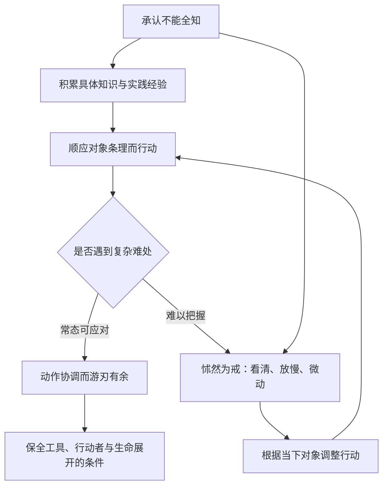
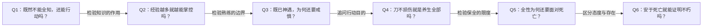

# 《庄子哲学研究》第六章《全性与死生》深度拆解

> 来源：用户提供的《庄子哲学研究_第六章.md》，正文分为“缘督以为经”“天理固然”“天人（一）”“生死（一）”四节。
> 原文路径：`/Users/minyanhua/MinerU/庄子哲学研究_第六章.pdf-ed2fb552-a66c-4cc9-99a3-ffb32780b088/庄子哲学研究_第六章.md`
> 本文区分庄子文本、本章作者的解释、笔记的分析与批评。原文保留了[228]—[256]注释序号，但未提供对应注释正文；不补造出处与页码。分析范围限于所给章节，2026-11-03整理。

## x → f → f(x)

- **x**：既然人无法全知，也不能自主决定生命的来去，怎样既不妄图控制一切，又不放弃行动与关系，活出性命的整全？
- **f**：作者将根本的不知转为审慎的实践：以“缘督”持守分寸，以庖丁展示经验与戒惧相互支持，以“养亲”保留生命的关系维度，并以“安时处顺”松动对生死的占有。
- **f(x)**：理解庄子的养生，便不能只计算身体保存多久，而应追问：行动是否强加于对象，经验是否遮蔽未知，自己是否为了控制与续存而损伤了生命的整全。

三者连读：**人不能全知、不能自定来去，作者便以审慎、顺应与关系中的全性回应这一处境；由此，养生成为一种在有限中行动的生存方式。**

## 核心命题

**养生的核心是性命如何完整地展开；延长身体存续，只是其中一个维度。承认不能全盘掌控，反而能使行动更准确，使人与关系不被某个单一目的耗尽。**

本章承接前文对知识根据、主体所待的追问，将问题带回生活。“不知道自己的根本来由”不能只是一句抽象判断，它还应改变做事、对待亲人以及面对死亡的方式。

但全章并非只有这一条线。作者最后还提出更强的存有论解释：心灵中有真正自主的“使形者”，可能不随形体消散。这一判断需要单独论证，不能由审慎生活直接推出。

## 关键洞见

### 1. “知无涯”不是劝人停止学习，而是限制知识的统治权

作者将这里的“知”主要解释为可积累的经验知识：生命有限，世界及其变化无穷，人不可能借积累达到全知。

关键转折不是“既然学不完，就不学”，而是：**局部知识若自居为完整根据，就会把自己不知道的条件一并当成已经掌握。**

逻辑链：有限经验 → 无法覆盖全部条件 → 判断始终含有未掌握部分 → 行动必须保留分寸与戒惧。

“缘督以为经”经郭象“顺中以为常”的解释，被作者理解为持守中道。这里的“中”不能简单等同于两种意见各退一半，更接近在具体处境中不越分、不以有限把握冒充完全把握。

作者还把它与《中庸》的戒慎相联系。这能显示一种共同的审慎结构，但不足以证明两者的完整哲学立场相同。

### 2. “全性”包含养亲，生命不是封闭的个人财产

作者反对将“养亲”改读为“养新”，理由不只是维护字面。他借“子之爱亲，命也，不可解于心”等语句说明：对父母的牵挂，本来就在人的生命结构之内。

如果养生只求个体身体不受损，就容易把关系看成外在拖累。作者将“养亲”保留下来，便使“全生”转向“全性”：**完整的生命，包含对他者的关联，并非先有一个孤立的我，再决定是否增加关系。**

这是对第五章“所待”的生活化延伸：我无法彻底说明自己的根源，但父母是在实际生命中最切己的来处。作者称父母为“绝对他者”，是他的哲学表述，不宜不加说明地当作庄子原有概念。

也要划清边界：承认亲缘牵挂是重要的生命关系，并不自动推出父母的一切命令均应无条件服从；“关系构成生命”与“特定关系要求永远正当”是两个判断。

### 3. 庖丁之“道”以技术为基础，却不把对象当作任意支配的材料

作者划分三个阶段：

| 阶段 | 庖丁如何遇见牛 | 关键变化 |
|---|---|---|
| 所见无非牛 | 面对一个整体对象，肌理尚未熟悉 | 开始学习 |
| 未尝见全牛 | 能分辨筋节、骨间的结构 | 经验和分析能力形成 |
| 官知止而神欲行 | 动作与对象条理相应，不再逐项依靠感官分析 | 整体的默会与实践协调 |

作者明确说明，第三阶段不能绕过前两个阶段。因此，“神遇”并不是未经训练的灵感，更不是认为直觉天然比知识可靠。

其思想重心是：**熟悉结构，使动作不必强行碰撞；真正的能力通过对象自身的条理实现。**“依乎天理”“因其固然”在这里首先指牛的肌理、间隙与本来结构，不应直接套入后世其他哲学体系。

最值得保留的细节却是“每至于族”：庖丁达到高境界后，仍会在难处警戒、凝视、放慢。作者由此指出，最高的主动性并不排斥不知，恰恰表现为能对不知保持醒觉。

### 4. 熟练的标志，包括知道何时不能照熟练的方式做

本章最有力的实践结构，是经验与戒惧的共同工作：

这张图是笔记对作者解释的重构。它要揭示的不是“永远小心”，而是：经验帮助人应对常态；对未知的敏感，使人能在例外处改变节奏。两者缺一，行动都容易失衡。

这一点也使作者对“技术”的批评需要精确化。他批评的是由技术成就膨胀出来的完全控制幻想；不是一切分析与技术。技术本身完全可以包含误差意识和风险约束。

### 5. “安时处顺”试图解除对生命的占有，末尾却又追问不朽

作者将生理解为偶然的时遇，将死理解为必然的顺次：生命既非自己选择取得，也就不必把死亡只理解为个人所有物被夺走。

**来而非自取 → 不把生完全当成占有；去而有顺次 → 不把死完全当成被剥夺。**

秦失吊老聃，是这一态度的叙事展示。作者借死母与小猪的例子说明：人所爱的不只是形体，而是使形体成为这个人的东西。

但随后作者从“使形者”进一步推论：心灵中真正自主的部分能够不受形体状态左右，因此也可能不随形体消散；“薪火喻”便被解释为形与使形者的关系。

这里必须分开两层：**不以死亡为纯粹失去，是生存态度；有某种心灵成分在肉身死后继续存在，是关于存在的主张。**前者不自动证明后者。理解这一分界，才能既理解作者，也检验作者。

## 实践指引：把思想变成辨认处境的问题

这些是从本章提炼的阅读与生活反思，不是作者提供的固定操作法。

1. **遇到熟悉任务中的异常时，检查自己是否仍在套用常态。**例如已经熟悉的一类工作忽然出现无法解释的细节，可以先说明哪里不确定，再决定如何观察、求助或调整；对应“每至于族”，并非要求事事犹豫。
2. **当“我是在为你好”变成控制他人的理由时，区分自己的目标与对方的条理。**庖丁的启发在于行动要回应对象的实际情况；人并不是牛或工具，这种类比只适合提醒尊重差异，不能把关系当成更高明的操纵术。
3. **安排生活时，检查身体、关系与心灵是否被一个指标挤压。**只以寿命、成绩或效率衡量一切，可能看不见为了该指标付出的整体代价；“全性”提供的正是这种检查视野。
4. **面对死亡议题，分开三个问题。**死亡是否无法完全避免；我与逝者的关系如何继续被承载；死后是否仍有心灵存在。它们相关，却不共享同一个证明。庄子的叙事可供思考，但不能用“安时处顺”要求正在哀伤的人立即平静。

## 例子列表

| 本章材料 | 作用 | 逻辑位置 |
|---|---|---|
| 有涯之生追随无涯之知 | 将知识追求的限度转为行动的限度意识 | 支撑 x、引出 f |
| “养亲”与“养新”的解释分歧 | 说明养生是否包含人伦关系，会改变整个解释方向 | 展示 f |
| 庖丁从见牛到神遇 | 展示经验积累如何成为整体协调的基础 | 展示 f |
| 庖丁遇到筋骨交错难处便戒惧放慢 | 展示最高熟练仍不取消例外与不知 | 展示 f、指向 f(x) |
| 十九年刀刃若新 | 展示顺应条理的保全效果，不应取代全性目标 | 检验 f(x) |
| 梁惠王自信尽心而治理未达预期 | 支撑作者对完全掌控错觉的批评 | 支撑 x；其与庖丁故事的连接属作者推测 |
| 侏儒以梦灶讽卫灵公 | 说明卑微者如何借隐喻向君主进谏 | 展示作者的叙事解释，不直接证明 f |
| 右师独足 | 用先天与人为的成因之问引入初步天人之辨 | 为 f 补充概念前提 |
| 泽雉宁愿觅食艰难也不求笼养 | 对照人工供养与自然生命展开之间的张力 | 展示 f |
| 秦失吊老聃，三号而出 | 展示作者所理解的安时处顺 | 展示 f(x) |
| 小猪离开死去的母体 | 区分所爱的形体与使形体成为活物的东西 | 引出作者的心灵论解释 |
| 薪尽而火传 | 承载作者关于形体与使形者的比喻性解释 | 延伸 f；不直接构成不朽的证明 |

## 结论列表

1. 承认知识有限，应当约束行动的自信，而不是取消具体学习。
2. 经验越成熟，越应能够识别经验不能覆盖的难处。
3. 顺应条理并非无所作为，而是减少意图与对象之间的强行碰撞。
4. 养生若只计算身体保存，就会遗漏生命的关系维度与整体展开。
5. 保全的结果不能独自说明行动的全部目的。
6. 对生命来去的接纳，与关于死后存在的信念，是可以分别讨论的问题。
7. 心灵不被某种身体状态支配，不足以独自证明心灵能脱离身体存在。

## Q-A 问答链

### Q-A 问题结构图

### Q1：既然不能全知，还能行动吗？

- **结论**：不必先全知才能行动，但必须承认行动根据的有限。
- **形式化**：局部可知 + 根本不知 → 有分寸的行动。
- **论证**：① 人的知识不能覆盖全部条件。② 局部经验仍能支持具体行动。③ 因而合理的回应是审慎使用经验，而不是等待全知或彻底停手。
- **边界**：本章提供态度方向，没有给出每种处境的“中道”判定程序。

**Q1 → Q2**：因为 Q1 保留了经验的作用，却没有说明经验扩大后是否能消除有限性，所以必须检查熟练与完全掌控的区别。

### Q2：经验越多就越能掌控吗？

- **结论**：经验能改善回应，却不能使对象与世界的全部条件都由我支配。
- **形式化**：经验增长 → 能力提高；能力提高 ≠ 条件穷尽。
- **论证**：① 庖丁先积累对牛的结构性认识。② 神遇依赖这些训练。③ 对结构的熟悉仍不能排除具体难处，因此不能推出完全控制。
- **边界**：作者对“技术性态度”的批评只在技术被夸大为全能时最有力，不能以此否定技术本身。

**Q2 → Q3**：因为 Q2 说明经验没有消除例外，但尚未回答最高境界如何处理例外，所以要看庖丁在难处的实际反应。

### Q3：既已神遇，为何还要戒惧？

- **结论**：神遇的成熟表现，包含在难处收住惯性、提高醒觉的能力。
- **形式化**：熟练遇到例外 → 戒惧与放慢 → 重新回应当下。
- **论证**：① 具体对象不会被一般经验完全穷尽。② 继续沿用顺畅节奏，可能变成强行碰撞。③ 警戒与微动，使行动重新贴近对象的实际结构。
- **边界**：不是所有迟缓都出于智慧，也不是一切迅速都缺少审慎；关键在是否回应了处境差异。

**Q3 → Q4**：因为 Q3 说明这种行动能够减少损伤，但尚未说明减少损伤是最高目的还是附带效果，所以要追问养生究竟保全什么。

### Q4：刀不损伤就是养生全部吗？

- **结论**：依作者解释，刀与身形的保存只是全性的一部分，不能代替生命整体。
- **形式化**：形体保全 ⊂ 性命整全；全性包含关系。
- **论证**：① 庖丁自述所好在道，而不只是省刀。② 养生开篇同时说保身、全生、养亲、尽年。③ 因而把养生压缩为身体延续，会丢失行动方式与关系维度。
- **边界**：文惠君是否确实只关注刀，本章没有直接心理证据；这属于作者对寓言的解读。

**Q4 → Q5**：因为 Q4 将养生的目的扩大为性命整全，但形体仍不能永远保存，所以必须说明全性怎样面对必然的死亡。

### Q5：全性为何还要面对死亡？

- **结论**：若把全性等同于无限延续，就仍把生命当作必须永久占有的东西。
- **形式化**：生非自主取得 + 死属于变化 → 松动得失式理解。
- **论证**：① 生命的来临不是我事先选择的。② 生命的离去也不能被我完全控制。③ 作者以安时处顺回应这种被给予性，使自我主宰转向如何面对变化。
- **边界**：这是对生死态度的哲学重构，不是强迫他人停止哀悼的规范；接受有限也不意味着放弃合理照护。

**Q5 → Q6**：因为 Q5 改变了对死亡的态度，却尚未说明死亡之后什么继续存在，所以作者的薪火解释必须另行检验。

### Q6：安于死亡就能证明不朽吗？

- **结论**：生存态度不能直接证明心灵不朽，薪火比喻也不能独自填补这一距离。
- **形式化**：不受某种变化扰动 ≠ 能脱离形体存在。
- **论证**：① 一个人能够不被某些变化扰动，是对其生活状态的描述。② 死后仍然存在，是关于存在条件的另一判断。③ 后者需要说明形体解体后何以仍能存在，不能只以此前的自主性为根据。
- **边界**：指出论证不足不等于已经证明心灵必随身体消亡；它只意味着本章没有完成排他性的证明。

## 局限与盲区

### 1. 文本解释的概率，不能被改写成历史事实

“文惠君”就是梁惠王、庖丁之言具有劝止好战的讽谏意图、此种叙事影响韩非子，是作者提出的解释链。相关背景能支持其可能性，但本章提供的证据不足以排除其他解释。尤其不能从“年代接近、人物有关联”直接推出具体写作意图或影响关系。

### 2. 右师天生独足的结论，仍有推断性质

作者注意到其他丧足人物明说“兀者”或刑罚原因，而右师一节没有，因此倾向天生残疾。这是从文本差异作出的有根据假说，但缺少刑罚说明不等于已经排除刑罚成因。本章在此展示的是天人问题的入场方式，并未完成完整天人论。

“泽雉”则进一步呈现偏向自然展开、警惕人为圈养的倾向，也不能简化为所有人为安排都违背生命。

### 3. “全知不可能”与“中道最合理”之间仍需桥梁

有限知识可以支持审慎，却不能独自确定何为恰当分寸。同样的不确定性，有时要求等待，有时要求及时行动。中道若没有对具体对象、后果与关系的辨认，仍可能只是一个正确但空泛的名称。

### 4. “最高支配”与“顺应固然”存在需要解释的张力

作者一方面批评控制一切的幻想，一方面称庖丁实现对工具与对象最高程度的驾驭和支配。较连贯的理解是：后者指回应对象的娴熟，而不是任意改变对象的全能。否则，对技术控制的批评会重新回到控制的赞美。

“对象充分实现自身”也不能简单照字面接受：解牛对牛作为活物意味着什么，与牛的结构被充分顺应，并不是同一问题。寓言的养生启示不应自动变成对所有对象都适用的伦理结论。

### 5. “无哀痛”是一种高境界解释，不能独占正常情感

秦失“三号”与作者所说“并无哀痛”之间仍有解释空间。即使接受本章读法，也要区分不被哀痛彻底拘束与完全没有哀痛。“有哭泣”不必然等于逃避天道，“接受死亡”也不必然排除悲伤。

### 6. 薪火喻无法独自承担心灵不朽论

作者的推理大致是：心有不随形变的自主部分 → 此部分是真正使形者 → 形体消散时它也不消亡。问题在于，“不被某些身体变化左右”与“不以身体为存在条件”并不等价；第三步需要额外论据。

同时，“物理主义尚未被最终证明”不能直接证明另一种心灵论为真。允许认真讨论一种可能性，与确认其成立，标准不同。

本章末尾用了“似乎”“应该”限定只有达到“帝之悬解”的人才能薪尽火传，也明说这里只初步展开。因此不能把它改写为庄子已经清晰断言人人都有不灭灵魂；也不能把作者对个体心灵的解释，简化成普通的文化传承比喻。

## 本章在思想链中的位置

第五章追问“我不能自定其来由”；第六章追问“既如此，我怎样活”。它最有解释力的回应，是把根本不知落实为有经验而不自满、有主动性而不妄控、有自我而不切断关系。

死亡使这一回应面临最终考验：**如果生命的整全不等于无限保存，那么如何面对无法保存的时刻，本来就是养生问题的一部分。**至于不朽，作者在此开启了另一个尚待证明的问题。
