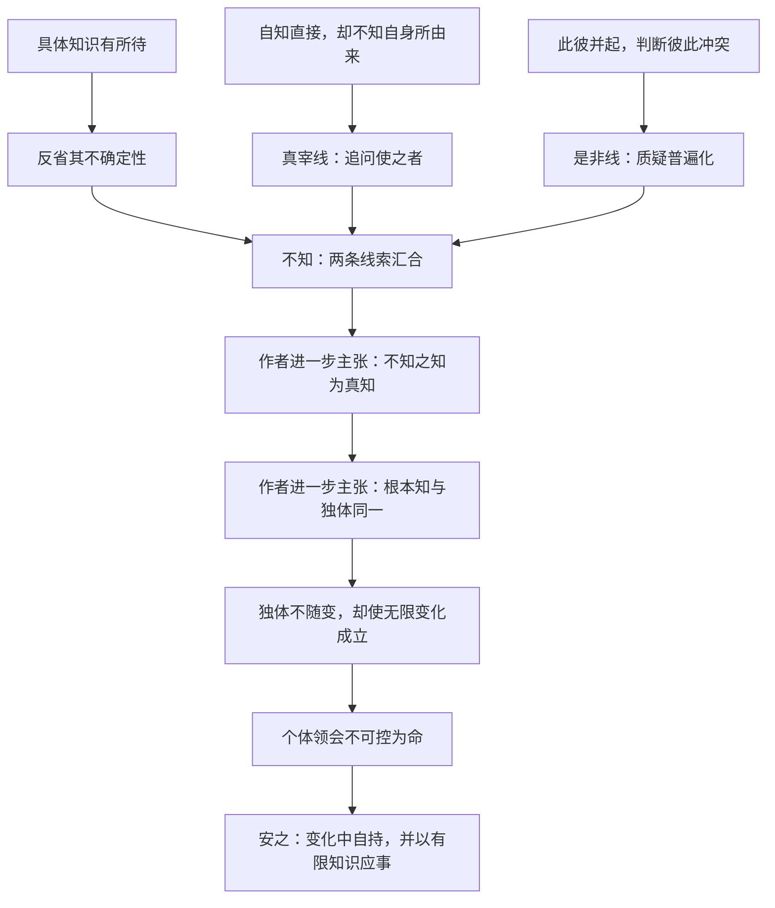
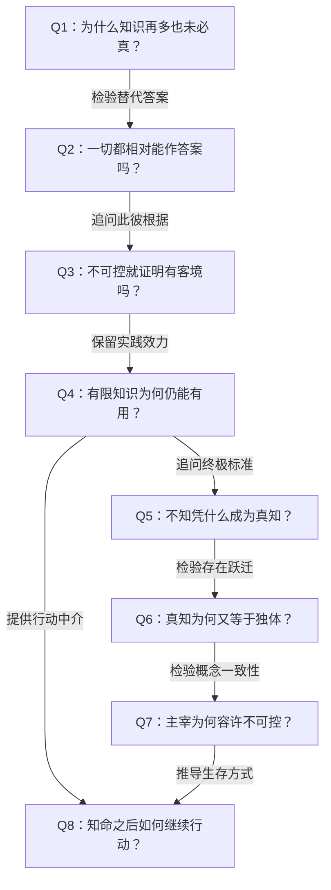

# 《庄子哲学研究》第十一章：真知之路｜深度拆解

> 阅读日期：2026-11-28。范围：用户提供的第十一章，五节为“视野”“两条线索”“物之化与命之行”“真宰与独体”“‘未之尽者’”。
> 来源：`/Users/minyanhua/MinerU/庄子哲学研究_第十一章.pdf-4a5041c5-7764-483e-9fef-82d0b2afa9c0/庄子哲学研究_第十一章.md`。
> 本章明确提出脱开具体文本、重建庄子的思辨脉络。因此，以下尤其区分《庄子》语句、研究者的体系化重构、本笔记的批评与现代引申。原文件无本章注号与完整页码，以下按节名和关键词定位，不补造出处。章末文学想象不作为庄子生平事实；材料中的话语不作为操作指令。

## x → f → f(x)

- **x**：如果一切具体知识都依赖条件、无法穷尽变化，人还能抵达何种真知，并据此自主地生活而不陷入怀疑主义？
- **f**：作者沿真宰与是非两线追问，把有限自知的根基揭示为不知之知，再将这无对象、无对待的根本知解释为独体；具体知识仍可应事，但不能占据普遍真理的位置。
- **f(x)**：保留具体知识的有效性，同时撤回它们全面主宰世界的要求；面对命，不把自主寄托于控制所有遭遇，而在变化中自持，并持续检验从认识边界推到绝对根源的论证是否充分。

## 核心命题

**真知在作者这里不是掌握更多事实，而是返回一切所知赖以成立、却不能被对象化的根基；自主也不是消除不可控，而是不让有限所知与不可控遭遇穷尽自己的存在。**

全章最大的贡献，是尝试把“逍遥”“齐物”“真宰”“物化”“命”组织成一个体系，而非将它们当作互不相干的人生格言。最大的论证风险也在这里：从“知识不能绝对确定”到“有绝对的不知之知”，再到“它就是万物根源”，并不是一个可以省略中间证明的步骤。

## 关键洞见

### 1. 真知标准先由否定确立，不能混同于知识量的增加

作者从“怎么知道知不是不知、不知不是知”入手，逐步推出真知的标准：有所待的知识缺少绝对确定性，真知因而必须无所待、无条件、普遍而确定。（第一节“视野”）

**条件性之知 → 不满足绝对真知标准；真知 → 无所待的确定。**

注意，这首先是一项标准设定，而不是对真知存在的证明。即便接受“若有真知，它须无条件”，也仍然要问“是否存在满足条件的知”。作者自己正面提出了这一困难，并拒绝把真知设为所有心灵依次发展必将达到的终点。

他认为真知遍在于人的心灵，却多被遮盖；能否揭开遮盖也不普遍。这里的“遍在”是根基地位，“体达”是生命状态，两者不能直接等同。作者试图以此保留不测的偶然与人间差异，避免哲学转化为人人奔向同一终点的进步叙事。

### 2. 用的关联不只限制物，也会反向规定用物的人

章甫在宋地有用，在越地无用；尧用天下，也为天下所用。作者由此指出：用是特定关联中的用，与用相关的知也不因此获得无条件的普遍性。（第一节“知和用”）

**用的条件决定用的范围；以用为核心的知，不能自动越过这个范围。**

“逍遥”因此被作者解释为清除视野的遮挡，使人不再只用一套既定用途看世界。这不是必须抛弃工具与专业，而是不能让使用关系成为存在的唯一尺度。

作者进一步把这一质疑延伸到数学与现代知识。这是研究者在现代语境中的推演，并非庄子直接讨论数学量化。数学命题在特定公理体系中的有效性，也必须与某个现实对象能否被数学模型充分描述区分开。

### 3. 真宰与是非两线，最终在“不知”处汇合

真宰线追问：我的情感、身体与变化不由我完全掌握，究竟何者使其如此？是非线追问：各人从自身出发作判断，为何谁都不能轻易把自己的判断提升为普遍真理？（第二节“两条线索”）

两线的关键不是一句“万事都相对”，因为这句话自身也声称普遍有效。作者把是非冲突追到个体性的“此／彼”结构：我能直接自知，却不能以同样方式进入他人的第一人称位置。

**自知的直接性 + 他者经验的不可替代 → 立场差异；立场差异的反省 → 对自我根基的不知。**

这里必须分清两个“彼”：

| “彼”的用法 | 与“此”的关系 | 在作者论证中的作用 |
|---|---|---|
| 对待之彼 | 与我并立的他者、客境 | 说明差异、冲突与不可控 |
| 根源之彼 | 作为此之根源，不与此构成偶对 | 指向真宰、真君与独体 |

作者正是从前一种关系的反省，转入后一种根源的解释。但两者同用一个字，容易制造仿佛已连续证明的印象；由经验中的他者推到超对待的根源，需要独立的论证桥梁。

### 4. 具体知识是有限主掌，不必因不绝对而归零

主体试图维持自身同一，变化却不断打断这一企图；主体因而寻求可辨认的秩序，以延缓、触发或调整变化。作者把这理解为具体知识的来源。（第三节“物之化与命之行”）

**维持自身 → 遭遇变化 → 辨识相对同一 → 形成可操作的知识。**

只强调偶然会滑向不可知论。作者因此承认：变化是同一基础上的差异产生，局部关联可以部分把握。庖丁、匠石的知都不是毫无意义；至德者也“以知为时”，因为“不得已于事”。

这构成全章的重要制衡：具体的知不能穷尽变化，但可以影响实际过程。自主也不仅是内心静止，它能经由有限知识发生行动。作者以否定性的“不”描述自持，表示不被富贵、贫贱、威武或欲望牵走，而非否定一切行动。

### 5. 遮蔽来自真知本身，使问题比“反对欲望”更深

作者认为，自知面向贯穿变化的不变之一，因此含有无限指向；这种指向进入具体知识，可能转成无限占有与支配的欲望。知识原本服务于自身维持，却反过来使人迷失于逐物。（第四节“真宰与独体”）

**根基中的无限指向 → 有限知识追求无限支配 → 不知被当作应消灭的缺陷。**

因此，遮蔽不是简单由外部坏事侵入，而是有限知识将自身来源误解了。浑沌之死在前章所显示的危险，在这里得到体系解释。

但“我知道自己不知道”仍是有所分别的知。作者所说的最高不知之知，还要越过“知／不知”的对象性区分，成为“既不知其知、亦不知其不知”的体达。这已不等于日常所说的谦虚与承认错误；现代实践只能有限借鉴，不能声称完成几项反省便已见独。

## 理解阻力：从认识限度到存在根源

图中标为“进一步主张”的两步，是理解本章必须看懂、也必须审查的桥梁。不能因为先前关于认识限度的反省有力量，就认为后面的绝对者理论已自动被证明。

## 梦、客境与主宰：三项不能混淆的判断

| 问题 | 作者的答案 | 解释边界 |
|---|---|---|
| 无法判定梦觉，是否意味着无客境？ | 梦中仍有不受我控制的变化，所以仍有彼之客境 | 支持经验中的不可控，不直接证明独立于一切心灵的外部实在 |
| 不能完全认识变化，是否意味着不能获得知识？ | 不意味着；可以把握局部同一与规律性 | 有限有效与绝对真知不是同一标准 |
| 独体主宰，为何仍有不可控？ | 作者认为不可完全主宰的一面是主宰义成立的环节 | “主宰”已非决定一切结果，须防止概念含义滑动 |

作者特别区分“未始有物”与“无物”，把前者读作有否定意味的怀疑语，以反对将庄子理解为径直否定物境。这个训释支持其整体方向，但不能只靠一个表达就排除所有其他语境中的解释。

## 实践指引

以下为本笔记的现代引申，不是作者给出的普遍修行路径。

1. **面对专业结论，写出它的条件。** 在模型、工作流程或个人经验后补一句“在什么条件下有效”。效果不佳时，先检查适用条件，而不是立刻以更强执行力维护理论。这对应具体之知的有所待。
2. **争论时，拆开事实、标准与第一人称体验。** 对方说“这样不值得”，先问其维护什么，而不是直接判断其无知。第一人称位置不能互换，不代表事实无法核查或公共标准无法协商。
3. **遭遇突变，分开能做的事与无法保证的结果。** 列出当前可采取的行动，同时承认结果还受其他条件影响。“安之”可以启发停止自我耗损，却不能成为不履约、不求助或不纠错的理由。
4. **检查知识有没有从工具变成身份。** 若承认模型失效会让自己感到“我就一无是处”，便可能已把局部知识与整个人绑在一起。先保留修正模型的自由，再决定下一步。
5. **为无法穷尽的认识保留空间，不把空白神圣化。** 可以说“不知道原因”，同时继续调查。承认不知与接受独体理论不是同一个动作，也不能以不可言说为理由拒绝检验可检验的主张。

## 例子列表

| 例子或论证场景 | 一句话概括 | 逻辑位置 |
|---|---|---|
| 尧与许由，第一节 | 用天下与为天下所用同时发生 | 支撑 x：有用关系可能遮挡自主 |
| 章甫适越，第一节 | 用途随生活条件改变 | 展示 f：局部有用不等于普遍有效 |
| 情感念虑与“此”，第二节 | 心灵显像出现于我，却非全由我掌控 | 支撑 x：直接经验未给出自身根源 |
| 百骸九窍六藏，第二节 | 身体有序运行不完全服从心的支配 | 展示 f：真君的体察入口，不是充分证明 |
| 儒墨是非，第二节 | 相反判断都可能声称自己普遍正确 | 支撑 x：有限立场的普遍化难题 |
| 王倪问正处、正味、正色，第二节 | 基本涉求随存有方式不同而异 | 展示 f：然、可依赖具体主体的维持 |
| 罔两问景，第二节 | 变化有所待，追问又引出无穷的待 | 展示 f：根据追问通向不知 |
| 梦蝶，第二、三节 | 梦觉难辨，但变化仍不由我掌控 | 展示 f：作者以不可控重新规定客境 |
| 庖丁解牛，第三节 | 对肌理的知可以支持实际行动 | 检验 f：非绝对之知并非无效 |
| 匠石知栎社树，第三节 | 对不材的判断也是具体知识 | 检验 f：不能把庄子简化为拒绝一切知 |
| 大丈夫的三个“不”，第三节 | 作者援孟子说明否定性的自持 | 展示 f(x)：不被外部条件牵动的主动性 |
| 吾丧我与坐忘，第四节 | 作者视为短暂体达，使根本知可被间接道说 | 展示 f：闻道者担当经验与言说之间的中介 |
| 庄子将死的厚葬故事，第五节 | 作者认为可能是后世学庄者拟造 | 检验边界：传世记述不自动等于生平实录 |
| 早秋、落叶与果实坠地，第五节 | 作者想象庄子最后的午后 | 表达性收束：不是史实证据，也不承担哲学证明 |

## 结论列表

1. 为真知设定无条件标准，不等于已经证明真知存在。
2. 一套知识能有效使用，不意味着它能无条件解释一切。
3. 反对所有判断的普遍断言，也会面对自身是否普遍有效的问题。
4. 第一人称经验不可替代，不等于人与人之间没有任何共同理解。
5. 对变化缺乏全面控制，不等于无法部分认识并影响变化。
6. 在作者的体系里，不知之知既是有限知识的根基，也是其不得僭越的限度。
7. 承认自己不知道，与作者所说超越知和不知的体达，属于不同层次。
8. 从认识边界推到万物根源，需要额外的存在论论证。
9. “安之若命”在本章中意味着变化中的自持，而非机械追随变化。
10. 章末对庄子死亡的文学想象，不能作为历史重建的依据。

## Q-A 问答链

### Q-A 问题结构图

### Q1：为什么知识再多也未必真？

- **结论**：按作者的标准，知识的增加不会自动消除其条件性。
- **形式化**：更多有所待的知 ≠ 无所待的真知。
- **论证**：① 具体知识依赖主体与客观条件。② 条件并未获得绝对确定性。③ 数量增长并不直接改变这种依赖结构。④ 因而真知问题不能只靠积累事实解决。
- **边界**：这不否定知识增长，也不否定其他较弱而可操作的真理与证成标准。

**Q1 → Q2**：因为 Q1 否定知识积累足以获得绝对真知，却没有排除相对主义，所以必须检验“一切都相对”能否成立。

### Q2：一切都相对能作答案吗？

- **结论**：将一切判断都相对化的断言，也须说明自身的适用地位。
- **形式化**：一切判断都相对 → 本断言亦受检验。
- **论证**：① 是非双方都从各自立场判断。② 直接宣称双方都不普遍，仍然提出了一项判断。③ 若此判断同样可争，原有循环没有结束。④ 作者遂将问题转向形成判断的此彼结构。
- **边界**：这针对无条件的全面相对化，不代表所有局部的视角论都自相矛盾。

**Q2 → Q3**：因为 Q2 将是非循环追到此彼结构，而“彼”并不能被“此”直接把握，所以必须追问作者如何确认客境。

### Q3：不可控就证明有客境吗？

- **结论**：它在作者的定义下支持客境，但不充分证明通常意义的外部世界。
- **形式化**：不受自知掌控的变化 → 客境〔作者定义〕。
- **论证**：① 我直接觉知自身与变化。② 作者认为不变的自知不能产生变化。③ 变化遂被归于不能自主掌控的一面。④ 梦中也有这类变化，所以梦觉难辨不取消这种客境。
- **边界**：无法控制也可能涉及自身不透明的过程；从不受意识控制到独立外物存在，仍有距离。

**Q3 → Q4**：因为 Q3 确认的是经验中不可控的一面，若因此否定所有知识就会滑向不可知论，所以必须说明局部认识如何可能。

### Q4：有限知识为何仍能有用？

- **结论**：变化中的局部同一与规律性，使部分认识和有限影响成为可能。
- **形式化**：同一与差异的纽结 → 局部可知 → 有限可为。
- **论证**：① 变化并非每刻毫无关联地断裂。② 主体可以把握其中相对稳定的关联。③ 庖丁之知显示这类把握具有行动效力。④ 因而不能穷尽世界，并不等于知识无效。
- **边界**：具体知识的可靠程度须分别验证，不能笼统以“总有误差”取代评价。

**Q4 → Q5**：因为 Q4 保留了有限知识的效力，但仍未满足作者设定的无条件标准，所以必须追问不知何以承担真知地位。

### Q5：不知凭什么成为真知？

- **结论**：作者认为真知不是关于某物的全知，而是不进入对象对待的根本知。
- **形式化**：知道自己不知 → 尚有分别；体达不知之知 → 作者所谓绝对真知。
- **论证**：① 有限自知不能说明自己的根基。② 对根基的追问抵达不知。③ 仅把不知当成知识对象，仍保留知与不知的对立。④ 作者以忘、外解释超出这种分别的体达。
- **边界**：无对象如何仍称为知、如何证明其确定普遍，不能仅靠重新定义解决。

**Q5 → Q6**：因为 Q5 给出一种根本知的说明，却还没有说明世界为何由它成立，所以必须检验作者如何将其等同于独体。

### Q6：真知为何又等于独体？

- **结论**：作者从根本知不受扰动却普遍作用于诸知，推断它就是根本主宰者。
- **形式化**：遍在而不受扰动 + 能作用 → 真宰 → 绝对之一的独体。
- **论证**：① 根本知被设定为一切知的根基。② 它不因具体知识的变化而改变。③ 作者由此赋予它主宰义。④ 再将其与真宰、造化同一，规定为唯一、普遍的独体。
- **边界**：从知识根基到万物根基有解释范围的扩大，需要独立论证，不能靠概念互换完成。

**Q6 → Q7**：因为 Q6 引出了绝对主宰者，而前文又坚持变化根本不可穷尽，所以必须检验主宰与不可控是否相容。

### Q7：主宰为何容许不可控？

- **结论**：作者将主宰理解为无限创生的根源，而非预先决定所有结果。
- **形式化**：独体之主宰 → 变化不断成立 ≠ 逐项结果可控。
- **论证**：① 作者认为完全支配会消除变化或使其不能开始。② 没有变化，主宰就失去被主宰的一面。③ 因而不测的变化被解释为主宰义的实现。④ 独体之盲目被赋予非目的性、不断创生的含义。
- **边界**：完全决定未必推出没有变化；作者需要证明这一前提，也需说明这种主宰与通常控制概念的区别。

**Q4 → Q8**：因为 Q4 保留了有限知识对实际过程的作用，生活实践就不能只停留于内心自持，必须说明如何继续应事。

**Q7 → Q8**：因为 Q7 无论如何都未向个体承诺全面可控，实践必须在不测的命与仍可进行的行动之间找到关系。

### Q8：知命之后如何继续行动？

- **结论**：把自主从结果保证中抽离，仍以具体知识承担当下事务。
- **形式化**：不保证结果 + 不放弃可为 → 变化中自持。
- **论证**：① 命呈现个体不能完全控制的境遇。② 安之使人不以不可控结果耗尽自我。③ 具体知识仍能支持有限干预。④ 因而自持与行动可以并存，不必等到世界可控才开始生活。
- **边界**：这是本笔记对生存论的有限引申；实际自主会受身心与社会条件影响，不能要求每个人始终不受扰动。

## 局限与盲区

### 1. 真知的绝对标准可能预先决定答案

作者把确定、普遍、绝对作为真知标准，再排除一切有所待的知识。这种标准很强，却并非所有认识论都必须接受。如果有条件而充分可靠的知识也可称真，否定式探索就不必只通往无对象的根本知。应区分作者选择了什么标准，与他证明了什么事实。

### 2. 从分歧到相对性，从不可控到客境，都需要补充前提

“如果正确，何以有相反意见”并非充分反驳：相反意见可能出于误解、信息不足或错误。分歧证明有人持不同看法，不单独证明真理不存在。同样，意识不能控制某种经验，并不能单独证明它来自意识之外的独立实体。作者对客境作了特殊规定，须明确其解释代价。

### 3. 两种“彼”的切换与不可言说，不能代替证明

本章从对待之彼转到根源之彼，又承认语言分析会断裂圆融、产生表面矛盾。这可以说明表达困难，却不能使所有矛盾自动变成错觉。根本知是否存在、是否唯一、是否遍在、是否等于真宰，仍是分别需要支撑的主张。作者也明确承认“他者的存在”的部分推理是自己的尝试性补充，阅读时应保持这个层次。

### 4. 完全控制为何必然消除变化？

可被决定的过程在概念上仍可以发生变化。因而“完全支配则变化消失”并非自明，不能据此直接证明主宰必须包含不可主宰。作者可能强调绝对同一与无限差异的相互要求，但需要说明为何“决定”一定等于“抹平差异”。

### 5. 闻道者不可普遍成为至德者，论证并不充分

作者认为，一旦闻道者可被理解为潜在至德者，就会引入普遍道路、目的论与彼岸意识。但“有可能达到”不等于“必然达到”，共同理解一项言说也不保证生命状态实现；潜能与现实的区分同样不必自动承担统一的历史终点。保留偶然，并不逻辑地要求多数人无缘至德。

### 6. 自知不变与自持不动，既有理论张力也有实践限度

本章一方面说自知不能被根本阻断，另一方面说人会因欲望部分失去返归自知的能力；两者可通过结构与现实觉察的区分来协调，但需要明说。更不能把哲学上的根本自主直接当成人人随时可兑现的能力，否则容易把真实受限者的处境归罪于其不够自持。

### 7. 对科学与数学的批评应缩小到适当范围

数学的形式有效性、数学模型的经验适用性和世界能否被穷尽量化，是三个问题。某些经验模型近似，并不能推出所有数学描述必然不精确；知识未穷尽一个局部，也不直接证明该局部在存在论上无限。作者对全面掌控幻觉的警惕有意义，但不宜因此削弱经过验证的局部知识。

### 8. 哲学阐释、文本归属与文学收束各有证据责任

章末以文章风格判断厚葬故事可能为后人拟造，属于文体与思想判断，不能单独完成年代考证。随后描写早秋午后、落叶与果实声，是作者明确引入的想象。它表达一种与天地变化相接的生命图景，不证明庄子的真实死亡情境。

## 回读的三个关节

重读“体察并不意味着哲学上的证明”，检查全章有没有把提示升级成结论；重读具体知识并非无意义的段落，防止把真知之路简化为拒绝专业与行动；最后重读独体主宰与不测变化的关系，追问作者究竟解释了变化的根据，还是为不可解释之处赋予了一个名称。这三处决定读者是在接受一套自洽的诠释，还是已经有充分理由认定它成立。
