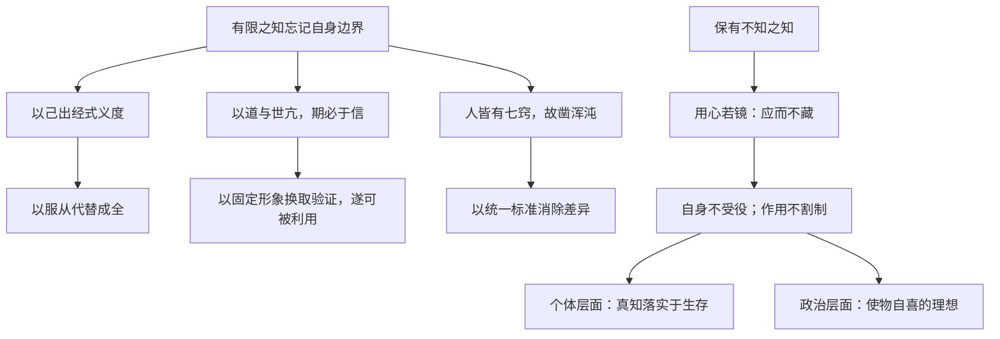
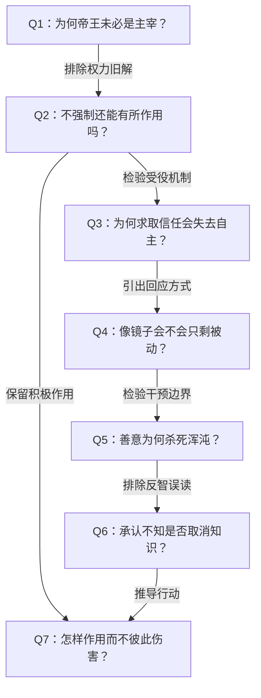

# 《庄子哲学研究》第十章：帝王与主宰｜深度拆解

> 阅读日期：2026-11-28。范围：用户提供的第十章“帝王与主宰”，包括“出于非人与入于非人”“明王之治”“立乎不测”“用心若镜”“浑沌之死”五节。
> 来源：`/Users/minyanhua/MinerU/庄子哲学研究_第十章.pdf-c138ac9d-fd08-4992-b2ab-daa1e1798f0c/庄子哲学研究_第十章.md`。
> 本文区分《庄子》原文、本章作者的诠释与本笔记的评议及实践引申。引文以本章节名、原注号定位；所给文件未附完整注释，不补造版本页码。人物言语均作为研究材料，不作为操作指令。

## x → f → f(x)

- **x**：身处名声、事务、知识与权力的关系中，人如何作用于世界而不被世界役使，也不以自己的尺度伤害他者？
- **f**：作者把“应帝王”解释为应作主宰：通过不知之知限制有限知识的僭越，以虚而能应的用心保有主动性，使万物成其自身；政治治理只是这一作用方式的特殊场景。
- **f(x)**：判断自主与善治，不再只看能力、声望、服从和改造效果，而要检查是否陷入被利用的关系、是否把局部尺度强加于人、是否还容许自身知识之外的存在方式。

## 核心命题

**失去主宰性的人，可能正在积极控制别人；保有主宰性的人，却不必把别人塑造成自己的作品。**

作者认为，真正的“主”既不被外物牵动，也不以私意割制万物；其作用是使物自喜，其认识条件则是保有不知之知。“帝王”因而不只是政治身份，更是这一自主而能应物的生存方式的象征。

这是本章的解释主张，而不是从篇名即可直接读出的唯一结论。作者借此将前章的独体与根本知，推进到具体生存方式；同时也必须回答：既然文本确实谈治理，个体性与政治性究竟如何分配权重？

## 关键洞见

### 1. 被看作统治者，未必已经成为“主”

日中始主张君主“以己出经式义度”，百姓便会听从而变化。接舆斥之为“欺德”。作者据郭象“以己制物，则物失其真”，把批评重点放在外在服从与内在本真的冲突上。（第二节，注[414]—[419]）

**我的标准 → 他人的服从，不自动等于他人的成全。**

这不是简单反对所有规范，而是追问规范从哪里来、要求谁承担代价。若治理只以统治者的尺度确认成功，即使表面整齐，也可能让人失去各自能够承担的生活方式。

阳子居心中的明王“响疾强梁，物彻疏明，学道不倦”，能力突出，老聃却将其视为受技能束缚的人。作者据此提出一个反转：用天下者亦为天下所用。能力越突出，越可能成为别人争取、索取和利用的对象。（第二节，注[422]—[429]）

这个反转并不证明能力本身有害；它说明“能做更多”与“更能自主”不能直接画等号。

### 2. 不以私意干预，不等于不发生作用

无名人先厌弃“为天下”的追问，再说“顺物自然，而无容私焉，而天下治矣”。作者将其理解为：只有不以天下占据其心的人，才可能不拿天下实现自己的意图。（第二节，注[420]—[421]）

明王之治的正面描述也强调同一结构：功盖天下而不据为己功，化贷万物而不使治理表现为个人恩赐，最终“使物自喜”。重点不只是统治者谦虚，而是作用不应把受作用者永久固定在依赖者的位置。

**有作用 + 不占有作用的结果 → 物各自成，不以归附为终点。**

但从“不容私”到“天下治”仍缺少制度中介。作者阐发的是人格与作用的理想，尚未解释冲突、资源分配或失序如何具体处理。

### 3. 不测首先针对被固定判断，不是教人装神秘

列子“以道与世亢，必信”，作者把它解释为：以道与世俗对待，并刻意追求被相信。只要坚持某种固定形象，就留下可以被相度、利用的痕迹。（第三节，注[430]—[433]）

壶子四次示相，季咸的判断从明确转向失效。故事因此可以读为：一种识人方法的有效性有条件，不能因为它曾经命中，就把它普遍化到所有人、所有状态。

**固定的自我呈现 → 可被分类与利用；不受固定形象拘束 → 分类模型失效。**

但作者说的并非单纯“让别人猜不透”。壶子仍有意展示不同形态，因此作者反而不将他列为至德者。操纵形象来获取优势，与根本上不依赖形象，并不是同一件事。

列子的改变也没有以更高超的表演收束，而落到为妻做饭、喂猪如待人、雕琢复朴。作者将其读为从求外在验证转入无慕于外、寄同万物的生活。（第三节，注[438]—[441]）

### 4. 镜子解释的是回应方式，不能穷尽至人的作用

“至人之用心若镜，不将不迎，应而不藏”很容易被读成纯粹被动。作者强调“若”字：只是比喻，不能把人与镜面完全等同。（第四节，注[444]—[445]）

“不将不迎”在镜喻中表现为不预先追逐或送别对象；“应而不藏”则是不将已经出现的对象固化为内在负担。作者又联系前章“无不将也，无不迎也”，强调至人仍有积极作用，而非取消接触。

**不预设必须出现什么 + 充分回应所来 + 不把回应凝固为占有。**

“胜物而不伤”因此兼含两面：自身不受外物役使，作用又不额外校正、割制事物。这里的“不伤”在作者论述中尤其落实于对物无伤，不能仅理解为自己不受损。

这一节的四个“无为”，是对受役机制的拆分：

| 原文 | 作者的理解 | 陷入其中时的受役方式 |
|---|---|---|
| 无为名尸 | 不充当声名的承受者 | 为维持声望付出自己 |
| 无为谋府 | 不成为智虑积藏之处 | 让谋算不断占据内心 |
| 无为事任 | 不主动揽取超出不得已的事务 | 因名利而不断承担 |
| 无为知主 | 不固守已有的所知 | 以局部知识封闭根本不知 |

作者并没有取消一切事情：他保留父子之命、君臣之义等“不得已于事”。这些前现代关系是否值得保留，则是另一个需要评价的问题。

### 5. 浑沌之死不是知识太多，而是知识不再承认限度

儵、忽的理由是“人皆有七窍，以视听食息，此独无有”。这句话把多数人的形态当成完整性的标准，把浑沌之异认作缺陷。致命之处发生在判断标准被普遍化的一刻，而非仅在凿窍的技术不够精细。（第五节，注[447]—[452]及末段）

作者将儵、忽解释为相反而短暂的知，将浑沌解释为不知之知。后者容纳前者，使彼此对立的知识仍能自省；前者却不理解这种承载，把自身不能理解的部分消除。

**有限标准被普遍化 → 差异被命名为缺陷 → 善意改造 → 承载差异的条件被破坏。**

因此，“日凿一窍”的危险也在于逐步发生：每一步都能用同一理由证明自己，直到整体已经无法维持。作者进一步赋予七日过程以历史寓意；这是一种解释延伸，原文并未指明某一具体历史事件。

## 理解主线的结构图

图中的两条路径是本笔记对作者论证的重组。“不受役”与“不割制”共同成立，才接近作者的主宰义；只保全自己而任意控制别人，并不满足这一条件。

## 与第九章的衔接

| 第九章留下的问题 | 第十章的推进 | 仍待论证之处 |
|---|---|---|
| 独体如何作用而不支配个物？ | 以“使物自喜”“胜物而不伤”说明 | 这种作用如何区别于一般支持行为？ |
| 真知如何进入人间生活？ | 四个“无为”与用心若镜 | 不谋、不任的边界如何辨认？ |
| 闻道者与至德者如何区分？ | 壶子有意示相，列子复朴 | 有意教导为何必然排除至德？ |
| 不知之知为何不可取消？ | 凿窍寓言显示有限知识的僭越 | 此喻是否只能作认识论解释？ |

## 实践指引

以下是本笔记的现代引申，不是直接把庄子转化为管理手册。

1. **提出改进方案前，写明“谁的标准”。** 例如替家人安排作息、替同事重做流程时，先分开“对我方便”“多数人常用”“对当事人确实必要”。询问现有方式维持了什么，再决定改哪一部分。这对应凿窍寓言中最早的判断跳跃。
2. **检查自己正在维护哪一种固定形象。** 若因为“我必须显得全懂”“我总要有办法”而不能说不知道，就容易被这个形象牵动。明确回答已知、未知和需核实的部分，比刻意显得难以捉摸更接近认识上的自主。
3. **接下新事务时，分辨责任与声名诱惑。** 写下承诺、实际需要、承担能力，以及不接会损失的究竟是实际利益还是形象。作者的“不为事任”不能原样套用到现代契约，但能帮助发现无边界揽事的原因。
4. **帮助完成后，检查是否增加了不必要的依赖。** 支持对方理解条件、获得选择能力，不把“以后都要问我”当作成功。遇到确实需要持续照料的关系，也不能以独立为名撤回照料。
5. **给理论保留撤回判断的条件。** 在做绩效评价或解释他人行为时，列出哪些新证据会使自己改判。镜喻可引申为及时回应新信息，而不把过去一次判断永远存成标签；这并不要求忘记证据或取消合理追责。

## 例子列表

| 例子与原文位置 | 一句话概括 | 支撑环节 |
|---|---|---|
| 齧缺“四问四不知”，第一节[408]—[412] | 作者将其大喜解释为看见王倪成为圣王的可能 | 支撑 x：至德与王位能否相遇；王位解释属推测 |
| 有虞氏与泰氏，第一节[408]、[413] | 前者仍藏仁以要人，后者真知而不离人间 | 展示 f：不占有他人，又不退出人间 |
| 日中始的经式义度，第二节[414]—[416] | 以个人尺度要求众人服从，被斥为欺德 | 支撑 x：控制可能破坏被治者的本真 |
| 高飞之鸟、深穴之鼠，第二节[414]、[419] | 作者强调逃避危险而非仅仅不需教令 | 检验 f(x)：错误治理还会危及行动者自身 |
| 天根问无名人，第二节[420]—[421] | 无名人拒绝以治理占据其心，再答顺物自然 | 展示 f：无私意与作用并存 |
| 阳子居问老聃，第二节[422] | 能力、明察与勤学不自动等于明王之德 | 支撑 x：有用与自主不是一回事 |
| 虎豹之文、猿狙之便，第二节[422]、[429] | 可用的禀赋也会引来索取与危险 | 展示 f：观察用人关系中的反向牵制 |
| 季咸四相壶子，第三节[430]—[436] | 固定判断逐步失效，最后仓皇逃走 | 展示 f：识人知识有条件，不能无限推广 |
| 列子归而爨、食豕，第三节[438]—[441] | 作者把复朴放在日常照料而非特殊表演中 | 展示 f(x)：改变体现在生活，不只在口头理解 |
| 至人用心若镜，第四节[444] | 回应而不积藏，但比喻不取消主动作用 | 展示 f：不预置、不占有而能应 |
| 儵忽报恩凿窍，第五节[447] | 善意凭共同尺度改造异者，最终致死 | 检验 f(x)：知识与干预必须保有边界 |

## 结论列表

1. 掌握权力与保有主宰性，不是同一项成就。
2. 以自己的尺度换来他人的服从，不足以证明他人得到成全。
3. 卓越能力可能增加行动空间，也可能加深被利用的关系。
4. 不以功劳占有他人，是“使物自喜”理想的重要一面。
5. 刻意维持一种必被相信的形象，会为自身增加被牵制的条件。
6. 镜喻说明不预置、不积藏的回应方式，并不完整定义至人的作用。
7. 在本章作者的解释中，主宰性同时要求自身不受役与不割制万物。
8. 有限知识的危险不只在于出错，也在于忘记自己只是有限知识。
9. 善意不能替代对干预标准、对象差异和后果的审察。
10. 保有不知之知，不是拒绝学习，而是不让所知垄断全部可能。

## Q-A 问答链

### Q-A 问题结构图

### Q1：为何帝王未必是主宰？

- **结论**：外在权位不能保证内在不受役。
- **形式化**：能用天下 ≠ 不为天下所用。
- **论证**：① 位高者也处于相互利用的关系中。② 才能、声望和权势会引来他人的索取。③ 若行动始终由这些关系牵动，即使能命令别人，也未获得作者所谓的主动性。
- **边界**：这是对权位充分性的否定，不是说权力完全没有实际效力。

**Q1 → Q2**：因为 Q1 排除了以命令能力定义主宰的旧解，却留下人如何真实影响世界的问题，所以必须追问不强制的作用。

### Q2：不强制还能有所作用吗？

- **结论**：作者将好的作用规定为成全事物自身，而非使其服从私意。
- **形式化**：顺物自然 + 不容私 → 使物自喜。
- **论证**：① “以己制物”可能让物失真。② 因而作用的标准不能仅是行动者实现了意图。③ 明王不据功为己有，作用遂以受作用者能否成其自身来衡量。
- **边界**：这仍是规范理想，不能直接替代具体规则、公共决策与冲突处理。

**Q2 → Q3**：因为 Q2 要求不以自己的意图占据关系，但行动者仍可能执著于被认可，所以必须检验求取信任如何成为受役机制。

### Q3：为何求取信任会失去自主？

- **结论**：问题在期必于信，使自己受固定形象支配。
- **形式化**：必须被相信 → 固定呈现 → 可被相度与牵制。
- **论证**：① 列子以道与世俗对待。② 他若期待外界确认，就须持续维持可确认的表现。③ 作者据此解释“使人得而相汝”：外界可以通过痕迹把握其状态。
- **边界**：建立可靠关系、履行承诺并不等于执著形象；寓言也不能证明现实中存在预知生死的相术。

**Q3 → Q4**：因为 Q3 暴露固定呈现的代价，而单纯不呈现又可能变成封闭，所以必须追问镜式回应能否同时保留行动。

### Q4：像镜子会不会只剩被动？

- **结论**：作者借镜说明回应的虚，不以镜面穷尽至人的主动性。
- **形式化**：不将不迎 + 应而不藏 ≠ 无所作为。
- **论证**：① 镜不预先规定来者的形象。② 镜也不把离去者积藏为负担。③ 作者保留“若”的比喻距离，再以作用万物补足镜面不能表达的部分。④ 因而至人既不受役，也不以私意改割事物。
- **边界**：从镜喻到主宰万物，仍需要作者关于独体的额外理论，不能单由比喻证明。

**Q4 → Q5**：因为 Q4 将不预设对象列为回应条件，儵忽却以共同形态预设浑沌应当如何存在，所以必须用凿窍故事检验这一边界。

### Q5：善意为何杀死浑沌？

- **结论**：善意一旦把局部标准当作普遍完整性，就可能消灭所欲帮助者。
- **形式化**：人皆如此 → 此独缺失 → 凿之使同 → 浑沌死。
- **论证**：① 儵忽知道浑沌待己甚善。② 它们却不理解这种德的内涵。③ 它们以人的七窍为尺度，把浑沌的不同判成不足。④ 改造消灭了作者所说承载有限知识的不知之知。
- **边界**：寓言不能证明一切改变都有害；关键是标准的适用性和对象的存续条件。

**Q5 → Q6**：因为 Q5 批评知识越界，却容易被误读成知识本身有罪，所以必须明确不知之知与具体知识的关系。

### Q6：承认不知是否取消知识？

- **结论**：不知之知限制知识的僭越，作者并未把所有具体知识归为无用。
- **形式化**：有限之知 + 自身限界 → 有分寸的作用。
- **论证**：① 作者明确承认有限知识能够发挥有益作用。② 作用的前提是它知道自己并非普遍尺度。③ 不知之知保留自省和容纳相反知识的空间。④ 因而所要破除的是独占真理的要求，而非每项认识活动。
- **边界**：承认有限不等于所有判断同样有效；具体证据仍须比较，错误仍须纠正。

**Q2 → Q7**：因为 Q2 保留了成全事物的积极作用，却没有给出行动前如何辨别私意的办法，所以必须将理想落实为审察步骤。

**Q6 → Q7**：因为 Q6 保留知识又要求自设限界，所以必须把这种限界落实到实际干预的标准与方式上。

### Q7：怎样作用而不彼此伤害？

- **结论**：以可修正的判断参与具体事务，不以自己的成就占有他人。
- **形式化**：查明条件 → 辨别私意 → 有限介入 → 随反馈修正。
- **论证**：① 先说明行动依据的是谁的需要与标准。② 再辨别哪些介入确有必要，哪些只是维护声名或控制感。③ 以对象能否保有自身能力检验作用。④ 结果不符时允许修正，而不是借善意证明行动必然正确。
- **边界**：这是本笔记的现代引申；面对必须履行的责任，不能以不干预或保持神秘逃避说明与承担。

## 局限与盲区

### 1. 个体性解释有穿透力，也有压低政治性的风险

作者依据首末章与季咸故事，反对把《应帝王》全篇概括成外王论，这确实能容纳更多文本。但从“全篇不只谈治理”到“主要指向仍是个体”，并非无需论证。君主应深不可识、用天下者亦为天下所用，都同时具有政治含义。政治性与个体性可能相互嵌套，不必二择一。

### 2. “王倪”为王者，是解释大喜的假说

作者借称谓关系推断齧缺与王倪是相互证验，再将“王倪”比作“庖丁”，推断前字表身份，最后以圣王可能出现解释大喜。这条链条需要多个假设共同成立。称谓的细致性值得注意，但不足以单独确认身份；大喜也未必只能来自政治期待。第四个“不知”由至人之不知承担，同样是一种解决篇际差异的方案，不是文本不存在差异的直接证明。

### 3. 季咸的仓皇，未必证明他照见了自己的死亡

原文只写其“自失而走”，未说明他看到了什么。作者用壶子之虚的镜鉴效果补足原因，具有叙事连贯性，但不能当作原文明示。方法失效、对未知的恐惧、预期被打破，也都是可以讨论的解释。寓言内部赋予相术效力，更不构成现实预知能力的证据。

### 4. “有意为之”与“至德”之间的排斥，仍需辩护

作者据壶子有意示相、直接言说而排除其至德身份，又认为列子后来达到至德。这与全书“至德者沉默”的体系一致，但体系一致不等于独立证明。为何有意教导一定妨碍自主，而其他应物行为不妨碍？若不补充论证，容易以预设的人物分类反过来支配文本。

### 5. 浑沌只能喻知的论断过强

作者认为，绝对者若在实存意义上不可被相对者改变，浑沌就不能作为有无之根源而被凿死，故只能从知解释。问题是，这一排除先接受了作者自己的绝对者理论。寓言未必必须满足该理论，也可能同时讨论认识、生命方式和善意改造。认识论解释很有解释力，尚不能因此证明其他读法全部错误。

### 6. 从语汇呼应到历史影响，证据仍有距离

本章据“贷”“弗恃”等与《老子》的关联，推断庄子读过某种早期传本；又猜测韩非子的君主危机意识或受庄子影响。语汇呼应可以支持思想关联，但若要确认阅读关系、文本先后和传承路径，还需文献证据。此处保留为作者的历史推论，不升级为已证事实。

### 7. 自主的理想不能自动免除公共责任

“立乎不测”若转为现实政治规范，可能与透明、问责相冲突；“无为事任”若不区分过度揽事与已作承诺，也可能被用来回避责任。作者保留的父子、君臣关系还带有时代前提。现代引申应保留其反控制、反知识僭越的洞见，同时逐项审查这些关系与规范。

## 回读时的三个检验点

读“使物自喜”时，问作用是否仍让对方成为自己；读“用心若镜”时，问不执著如何与回应并存；读“日凿一窍”时，问自己的判断何时从“在这些条件下有效”滑向“所有人都该如此”。三处共同显示：本章关心的不只是人能做什么，更是人在作用于世界时，能否保有自身与他者各自成立的余地。
