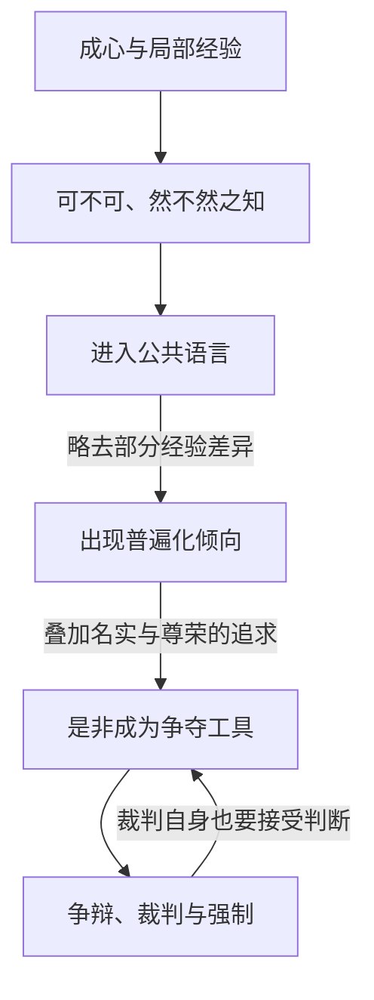
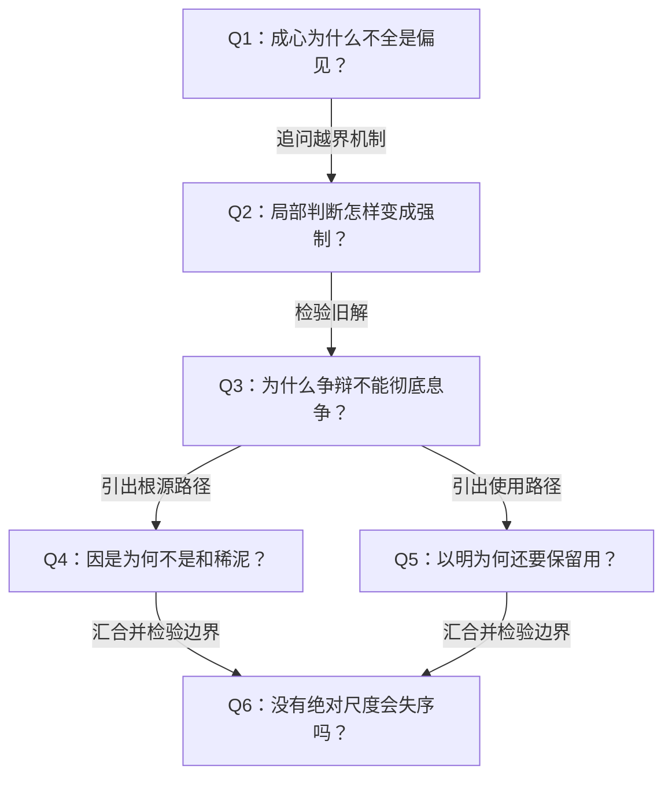

# 《庄子哲学研究》第四章《以明与因是》深度拆解

> 依据：用户此次提供的《庄子哲学研究_第四章.md》，正文标题为“第四章 以明与因是”，包含成心、可不可之知、言与辩、因是、以明五节。与此前文件名同为第四章、正文实为第三章的“小大之辨与逍遥”材料不同，本文另建笔记，不覆盖旧稿。
>
> 阅读约定：“作者认为”指本章研究者的解释；庄子原句以引号标明；现代应用及批评为本笔记的推论。本章多项训诂、断句和哲学解释具有争议，下文不将其当作唯一通解。用户已审阅并授权归档。

## x → f → f(x)

- **x**：人必然从有限经验出发作判断，为什么这些判断会变成无穷的是非争执，甚至成为征伐他人的道义？若争辩不能终结争辩，又怎样走向真知？
- **f**：先区分有限判断与普遍化的支配，再以“因是”追溯对立所依凭的肯定性根源，以“以明”看清行、言和用途的从属性，让分别回到个体存续与万物通一的基础之上。
- **f(x)**：不靠另立一个绝对正确的立场压倒所有立场，也不取消判断、语言和行动；而是限制它们越界成为终极尺度，使局部判断保有适当分寸，并向更根本的生存关联开放。

三者连起来：**有限判断会越界，作者因此追问它的根源和工具地位；看清二者之后，才能保留判断而减弱执著，继续走向真知。**

## 核心命题

**本章要解除的不是一切差别，而是局部差别对普遍真理的僭称。** “因是”与“以明”分别从对立的根源和日常用的结构入手，说明是非为何不是最后的根据。

更深一层，作者并不满足于“大家各有道理”的相对主义：各方判断之所以可能，仍依凭一个共同的、整全的生存基础。这个基础如何成立，是本章最有力度也最需要审查的论证。

## 关键洞见

### 1. 成心是判断的形成条件，不能直接翻译成坏的偏见

作者抓住“知代，而心自取者有之，愚者与有焉”的对举，认为已经闻道者与愚者都有成心。若成心天然等于应该清除的执著，这个对举就不容易解释。

据此，本章区分三个层次：

| 层次 | 在本章中的作用 | 关键风险 |
|---|---|---|
| 成心 | 已经形成、使具体判断得以发生的心之状态；并非直接负面 | 将它当作最终依据 |
| 小成 | 局部成就遮蔽整全之道 | 以局部成就自足并排斥其他可能 |
| 作者所说的“大成／无成” | 超越局部成就的自我固化，不再以一端的成就统摄整体 | 不能将其误解为从未形成任何能力与判断 |

这里有一个细节：作者先说不能断言成心必然导致是非之争，后又说有成心便有可不可、然不然之知。两句不必互相冲突：**拥有有限判断，与把判断变成争夺性的普遍标准，不是同一件事。**

边界也要保留：成心不是直接负面，不等于成心就是终极理想。作者认为，真人没有一般意义上的成心；真正的无成仍须经过对成心、小成的超越。

### 2. 从“适合我”到“人人必须如此”，危险发生在这次跨越

王倪谈人、鱼、猿猴的居处，以及不同物类的食物与审美，首先说明：某种可接受、合适或可判为然的东西，总有其具体场域。

作者区分：

- “可不可”侧重能否适应、接受。
- “然不然”上升到对错，但仍可限于某一场域。
- 局部判断声张普遍适用，才构成是非冲突的重要来源。

因此，从“人不适合湿寝”不能推出“鱼也不该湿处”；从“我珍视这一生活方式”也不能直接推出“所有人都应被改造成这样”。作者把这种越界的严重形式放在文明、道义与征伐之间考察：**一方将自己的尺度说成普遍正义，就可能把改变、统治他人解释成替他人好。**

这不是说所有普遍原则都已被证明虚假，而是指出：自称普遍，不能代替对普遍性的论证。

### 3. 语言使交流成为可能，也使个体经验容易冒充公共标准

作者的机制分析是：语言必须有公共性；公共表达又须在一定程度上略去个体经验差异。同一句“这段音乐很美”，可能来自真切感受，也可能来自附庸风雅；词句相同，并不保证经验相同。

于是：

关键在于分清“倾向”与“必然结果”：作者没有因为语言存在局限，就否定语言。语言仍可沟通，甚至是闻道者向普通人揭示真理的必要媒介。

辩论的困难也在这里：胜出只能直接证明赢了这一场辩论，未必证明获得真理；引入裁判，又会产生裁判凭什么有权判定的问题。**这揭示的是终极担保的难题，不能直接推成一切具体争论都不可能澄清。**

### 4. “因是”不是迁就所有意见，而是拒绝用新的独断终结旧独断

“因是”的解释有两层，应分开阅读。

**第一层是息争。** 单纯否定对方，通常同时立出了自己的“是”，仍在是非循环之中。承认各方之“是”有其局部条件，不自立一个统摄一切的“是”，才可能让彼此的普遍性声张相互消解，使判断回到有限场域。

这不等于认定互相冲突的命题同时为真，更不等于赞同所有行为。要接纳的是各方判断作为有限判断的来由，而非它们要求别人服从的全部权利。

**第二层是作者更强的哲学主张。** 作者认为，“彼”与“是”虽相互规定，却不是无主次的对称关系；“是”、生、可的肯定性方面更根本。由此，他把“因”解作依凭、根据，把“因是”引向依凭整全、绝对待的“是／一”。

这里必须区分：具体一方的“是”，与作者所说作为对立根源的“是”，不是同一个层级。后者若被拿来替某一方意见背书，就重新落回了本章批判的问题。

### 5. “以明”是看清用途不能穷尽存在，而非停用语言和行动

作者用“为是不用而寓诸庸”连接“因是”与“以明”，并进一步提出：“不用”的对象应落在“道行之而成”的行与“物谓之而然”的言上。

这不能孤立理解成不说、不做。作者随后强调：行与言必不可无，用也并非幻妄，所以还要“寓诸庸”。结合起来，更准确的理解是：**不用行、言及其划分作最终根据，仍让它们发挥适当的沟通与行动作用。**

器物提供了一条更具体的理解路径：

原文以材质、形制、目的分析器物，认为形制对功用的从属性尤其明显。树做不了舟、棺、柱，不等于树本身没有继续存在的意义。用途是关系中的一层，不能耗尽对象。

## “因是”与“以明”如何相连

| 比较项 | 因是 | 以明 |
|---|---|---|
| 入手处 | 彼是、生死、可不可等对立 | 行、言、器物之用 |
| 关键追问 | 对立依凭什么发生？ | 用途和划分为何不是最终根据？ |
| 作者的回答 | 肯定性根源，整全的“是／一” | 个体自身存续，以及存有之间通为一 |
| 直接作用 | 不以自立之是继续否定，让争执回到分寸 | 看清功能、划分的相对性与从属性 |
| 共同指向 | 超越对立的固执，打开真知之路 | 超越对立的固执，打开真知之路 |

二者不是一套先后必做的技巧。依作者的解释，它们是同一思想的两个入口：**从根源看，对立不是最终实在；从使用看，功能和划分不是全部存在。**

## 关键文本争点：不要把作者的解释当成无争议的原意

1. **成心的性质。** 作者反对直接贬义化，但也不接受将其简单提升成至人之心或天理。重点是保留层次，而非把坏词改成好词。
2. **“隐”的解释。** 作者选择遮蔽义，借问答结构及彰、亏、成的对照支持其说；不同于章太炎等的依凭义。
3. **朝三暮四的断句。** 作者在“名实未亏，而喜怒为用”处收结寓言，把“亦因是也”接回前面的思想主线。因此，他不把狙公哄猴解释成圣人因是的正面范例。
4. **“两行”的解释。** 作者认为是“是非之和”与“自然之平”的两行，而非简单让是、非并行。其重点是调节争执，不是消除一切是非。
5. **“因”的解释。** 作者以同段六个“因”的用字一致性为依据，主张依凭、根据义，而非一般的顺任义。
6. **“不用”的宾语。** 作者从上下文回溯行、言，反对将成毁直接补作宾语。这是解释性重建，不是句面直接写出的对象。

## 实践指引：由本章推出的现代类比

以下应用用于帮助理解，不是庄子原文中的现代制度方案。

### 场景一：团队争论“哪种工作方式最好”

先把“最好”拆回条件：适用于什么任务、谁承担成本、依靠哪些资源。不要让“我用得顺”自动升级为“所有人必须照办”。若需要统一标准，应说明协调的实际需要及适用期限，而非把统一包装成绝对真理。

对应本章：让普遍化的是非退回具体的可不可，再让语言服务于沟通。

### 场景二：争论反复升级，双方都在争裁判资格

先区分事实争议、偏好差异和利益冲突。事实可核查，偏好需说明场域，利益需协商。若把这三者混成“谁更高明”，引入一个支持己方的第三者只会复制争执。

对应本章：辩论胜负不自动构成真理担保。这个限制不取消证据与程序的实际效用。

### 场景三：用绩效判断一个人的全部价值

保留绩效对具体岗位的衡量作用，同时列出它测不到什么：照料关系、恢复需要、长期探索、人的自身生活。不能因为指标可操作，就把指标变成存在价值的总判决。

对应本章：以明所揭示的，是用途的从属性。承认用途真实，不等于承认用途穷尽对象。

### 场景四：以“为你好”为由安排他人的生活

检查三件事：对方是否认可你的目标，你是否把自身经验普遍化，以及是否允许对方拒绝。目标听起来善，并不自动赋予施加它的权利。

对应本章：局部判断披上普遍道义之后，可能成为强制的根据。遇到现实伤害仍须作具体判断，不能拿“齐是非”阻止必要的制止。

## 例子列表

- **知代者与愚者皆有成心**：判断有其形成条件，成心不能直接等同于坏的偏见。← 展示 f 的起点。
- **今日适越而昔至**：作者将其读为对无根争辩的反讽，不接受以“初心”肯定它。← 支撑 x。
- **昭氏鼓琴**：具体声音的彰显也意味着其他声音没有呈现，局部成就有其遮蔽。← 展示 f。
- **人、鱼、猿猴的居处**：某类生命的合宜处境不是所有生命的共同标准。← 展示 f。
- **正味与毛嫱、丽姬之美**：口味、审美的局部有效性不能直接变成普遍尺度。← 展示 f。
- **昭文、师旷、惠子欲明其所好于人**：以自己的所好要求别人接受，推动局部之知越界。← 支撑 x。
- **尧欲伐宗、脍、胥敖及章太炎的文明批判**：道义的普遍性声张可能与征伐相连。← 支撑 x 的政治危险。
- **颜回欲赴卫及孔子论名实**：说服、争名与实际权力关系交织，知识可能成为争夺器具。← 支撑 x。
- **辩者与各种裁判**：胜负或裁判立场本身不足以终结真理依据的追问。← 展示 f 所面对的难题。
- **朝三暮四**：按作者断句，此例批评劳神明为一，不正面赞扬狙公的巧诈。← 展示 f 的解释边界。
- **一与言为二、二与一为三**：说出统一，言说本身又引入分别。← 展示 f 所要避开的递归。
- **王骀与孔子**：默会之境仍需闻道者的言说，才能让更多人理解。← 展示 f(x) 中保留语言的必要。
- **栎社树不能为舟、棺、器、门户、柱**：特定功用失效，不会穷尽自然存有本身。← 展示以明及 f(x)。

## 结论列表

1. 在本章的解释中，成心不是直接负面的，但也不是最终境界。
2. 有限判断与争夺性的普遍是非必须区分。
3. 语言的公共性可能推动判断普遍化，却不能保证经验真正相同。
4. 争辩的胜出与判断的为真不是同一件事。
5. 用新的绝对立场压倒旧立场，可能延续而非终结是非循环。
6. 因是不能被化约为迎合所有意见或操纵他人的技巧。
7. 以明要求看清用途的从属性，而不取消用途的实际效力。
8. 作者以万物通一作为物论得齐的基础，而不是从言辞平等直接推出万物通一。

## Q-A 问答链

### Q1：成心为什么不全是偏见？

- **结论**：成心首先标示具体判断已经有所形成，不直接等于遮蔽一切的执见。
- **形式化**：成心 → 有限判断；有限判断 ≠ 必然争执。
- **论证步骤**：① 原文让知代者与愚者皆有成心。② 因此成心不能只解释成愚者的缺陷。③ 作者又区分成心与遮蔽道的小成。④ 批判的焦点遂落在如何从形成走向固化和遮蔽。
- **边界**：成心非直接负面，不等于无需超越；作者仍认为真人没有一般意义上的成心。

**Q1 → Q2**：既然有限判断本身不必导致争执，就必须继续追问它在什么变化中变成要求他人服从的标准。

### Q2：局部判断怎样变成强制？

- **结论**：局部之知进入公共语言，再与名实追求及道义声张结合，就可能获得支配力量。
- **形式化**：局部合宜 → 公共表达 → 普遍性声张 + 名实追求 → 强制风险。
- **论证步骤**：① 各物有自己的可不可与然不然。② 公共语言略去部分经验差异。③ 说话者可能要求别人接受自己的所好。④ 当要求以道义名义施加于整体，就可能为征伐提供根据。
- **边界**：这是风险机制，不是说所有公共语言和普遍规范都必然导致暴力。

**Q2 → Q3**：既然越界借助的是非理由可能造成强制，就会想到靠论辩澄清；因此需要检验论辩能否提供最终担保。

### Q3：为什么争辩不能彻底息争？

- **结论**：争辩与裁判不能仅凭自己的胜负和立场，证明自身拥有最终真理根据。
- **形式化**：赢辩论 ≠ 真；引入裁判 → 仍需说明裁判根据。
- **论证步骤**：① 一方获胜不排除修辞、权势等因素。② 第三者也带着自己的判断。③ 对裁判的争议又需要新的判定。④ 以判定终结全部判定，因而可能无限后退。
- **边界**：缺少终极担保，不等于所有证据无效、事实不可核查或公共程序毫无意义。

**Q3 → Q4**：既然增加一次否定或裁判仍可能复制对立，就需追问能否改变对待各方之“是”的方式，而非再立一个最高的“是”。

### Q4：因是为何不是和稀泥？

- **结论**：因是旨在解除各方判断对普遍性的垄断，并追溯使对立成为可能的根据。
- **形式化**：承认各方的有限来由 ≠ 承认所有命题同时为真。
- **论证步骤**：① 因非往往同时自立其是。② 因其皆是则可暂不另立排他的终极立场。③ 各方普遍性声张相互破除，判断得以退回局部。④ 作者再从肯定性方面的优先性，推进到整全之是与一。
- **边界**：第四步是更强的哲学推论，不能由宽容态度直接推出；也不能以整全之名重新独占裁判权。

**Q3 → Q5**：终极裁判失效之后仍须生活和交流，因此还要解释如何使用语言、行动而不把它们抬成最终根据。

### Q5：以明为何还要保留用？

- **结论**：看清用途不能穷尽存在，恰恰使用途可以回到恰当的地位。
- **形式化**：用是从属的 ≠ 用是虚假的；不用作根本 → 仍寓诸实际之用。
- **论证步骤**：① 器物功用不能穷尽材质及相关存有的自身存续。② 行与言的划分同样不是最终根源。③ 但行与言仍是生活、沟通和揭示真理的必要媒介。④ 因而不能停在不用，必须同时理解寓诸庸。
- **边界**：这里对“不用”宾语的解释依赖作者重建，且不能直接扩成否定所有制度、技术和分类。

**Q4 → Q6**：因是削弱了排他性尺度，但仍留下如何制止伤害、协调共同生活的难题。

**Q5 → Q6**：以明保留实际作用，却尚未说明哪些共同规则应被选择和执行，因此同样必须面对秩序问题。

### Q6：没有绝对尺度会失序吗？

- **结论**：作者承认消解价值与秩序并不保证更好的世界，本章提供的是根源批判，尚非完整治世方案。
- **形式化**：揭露虚假普遍性 ≠ 自动建立公共秩序。
- **论证步骤**：① 局部道义被绝对化可能成为暴力。② 但全部取消约束也可能带来更深危险。③ 作者承认庄子并非用世之人，其书非治世之书。④ 理想治理仍寄望至德之人成为王者，暴露了从哲学洞察到稳定秩序之间的缺口。
- **边界**：这不取消批判的价值；它限制的是把该批判当作可直接执行的完整政治设计。

## 局限与盲区

### 1. 从“是”的优先性到整全根源，论证仍有跃迁

第一人称经验中“这里／是”较直接，不自动证明肯定性在存在上更根本；同样，从生死概念相互规定，也不自动推出整全的一。作者的推理依次跨过经验、语义和存在根据三个层次，需要分别论证，不能只凭“彼出于是”完成全部工作。

### 2. 统一用字与补出宾语，不能排除其他解释

同段“因”字应有一致字义是一条解释理由，而非不能例外的语言规律。“不用”的宾语没有明写，前后文也可能支持不同补法。作者的方案应以解释力评估，不能当作句面已确定的事实。

### 3. 语言的公共性并不只是抹平差异

本章强调公共语言略去个体经验差别，却较少讨论语言如何借限定、举例和修正，主动让差异显现。公共性不必只有普遍化和支配这一种方向。即使经验不能完整传递，交流仍可能提高判断的准确性。

### 4. “自身存续”如何支撑通一，尚需更充分展开

从用途之外仍有自身存续，可以推出对象不被功用耗尽；但由此进一步推出各存有通为一，还需要额外论证。此外，不同存有的存续可能冲突，例如捕食与资源竞争，不能只靠肯定各自存续就自动获得均平。

### 5. 政治上的自我警惕强，制度上的回答弱

本章对道义如何服务征伐有清楚警惕，也坦承取消秩序的风险。但若良治取决于至德者偶然成为王者，就仍缺少稳定约束权力、修正错误和处理冲突的制度机制。现代应用宜吸收其对尺度越界的警惕，不宜照搬为撤销规则的主张。

## 与前章的衔接

前章回答：如何从世用束缚中打开更大的眼界？本章追问：眼界打开后，为什么习常的是非不再显得自明，我们又怎样不落入新的独断？

连续起来便是：**逍遥使眼界敞开 → 看见局部知见缺乏普遍担保 → 因是与以明追溯根源、重置用的地位 → 通向真知的道路得以打开。**

这里的“打开道路”仍不等于已经得到真知；同样，“物论之齐”在作者那里以“万物与我为一”为基础，不能仅靠宣布意见平等来实现。
