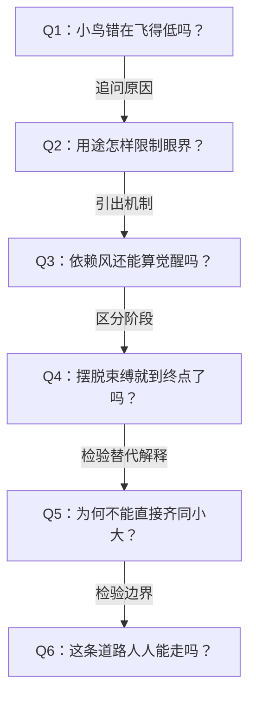

# 《庄子哲学研究》所附第四章深度拆解：小大之辨与逍遥

> 材料说明：用户提供的文件名为“庄子哲学研究_第四章.md”，正文题为“第三章 小大之辨与逍遥”。本文按所附原文分析，以“第四章”保留用户提供的材料编号。原文存在 OCR 缺漏；不补造缺失引文。以下区分本章作者的解释、庄子原文与分析者的推论，不把作者的争议性解释直接当作学界定论。

## x → f → f(x)

- **x**：既然庄子追求超越分别，为什么《逍遥游》仍反复强调“小知不及大知”？逍遥究竟是终点，还是通向真知的条件？
- **f**：不能在出发点就抹平小大之别；应先摆脱世用对生命和认识的限定，由此打开大知的眼界，再走向真知与至人之游。
- **f(x)**：理解庄子时，要区分“受局部尺度拘限”“摆脱既定用途”“获得更大眼界”和“充分实现主动性”，不能把它们都压成一句“各自快乐就好”。

## 核心命题

**逍遥首先是解除束缚的否定性环节；它打开大知的可能，却不能直接等同于已经完成的至人之境。**

小大之辨最终可以被超越，但超越必须经过认识与生存方式的转变。未经转变就说大小一样，会取消庄子安排这组对比的思想作用。

## 关键洞见

### 1. 小大不只是尺寸，而是认识和生存方式的差别

蜩、学鸠、斥鷃的问题，不是飞得低，而是把自己熟悉的飞行经验当成飞行的全部可能。斥鷃说“此亦飞之至也”，意味着它把局部经验提升成了普遍尺度。

逻辑是：经验范围有限 → 把有限经验当成终极标准 → 无法理解越出这个范围的行动 → 用嘲笑封闭自己的判断。

作者因此把“知效一官”等人物与斥鷃相对应，把惠施对庄子“大而无用”的讥讽与小鸟之笑相互映照。物理形象是入口，真正的问题是心灵如何被自己的生活关系限定。

### 2. “有用”会成为束缚，因为用途同时规定了评价尺度

狸狌善于捕鼠，却可能死于机关与网罟；大树不合木匠尺度，却得以免于砍伐。本章不是简单赞美无能，而是追问：生命为什么必须由某一种外在用途来证明价值？

用途固定 → 行动围绕用途组织 → 生命受评价和征用支配。摆脱这种限定，才能显露此前被“能做什么”遮住的存在可能。

“无用”在这里首先指向免于被规定成器，不等于任何意义上的无价值。原文把它推到“无所用于天下为大”，也留下了如何解释公共行动的问题。

### 3. 大鹏有所依赖，仍可能比小鸟更接近觉醒

依赖风，并不意味着鹏的飞行没有思想意义。作者明确区分：海运是南徙的条件，不是南徙的原因；图南是鹏主动、自觉的选择。

有条件的行动仍可具有主动性。真正要考察的是：主体有没有意识到自身限界，是否利用条件越出既有处境。不能因为鹏尚未无待，就断言它与自满的小鸟没有区别。

### 4. 解除束缚与充分主动，中间还有距离

本章将“逍遥”的消解、摆脱义，与“乘”“御”“游”所呈现的主动性区分开来。前者解除受制状态，后者涉及至人的充足主动性。

这是一张依作者论述重建的理解图，不是原文已经给出完整步骤的修行程序。作者明确承认，中间还有漫长过程。

### 5. 《逍遥游》作为开篇，是敞开问题而非交付全部答案

作者把内七篇理解为相互映照的整体：《逍遥游》中的知、年、待，与《齐物论》互相指涉；大树与狸狌又指向《人间世》的用世危险。

开篇先打开问题 → 各篇从不同侧面推进 → 概念在相互映照中获得层次。因此不能只靠篇名“逍遥游”，就认定逍遥必然是全部庄子哲学的最终目标。但这种整体结构也是作者的解释前提，不能用作无需论证的文本事实。

## 作者如何与前人争论

| 解读者 | 本章所概括的解释方向 | 本章的主要异议 |
|---|---|---|
| 郭象 | 各当其分、自得，故“小大虽殊，逍遥一也” | 过早齐同小大，漏掉认识转变的必要环节 |
| 支遁 | 鹏与鷃都未达到至足，以至人之心说明逍遥 | 虽分外在失适与内在矜伐，仍把鹏鷃放在同一层次 |
| 成玄英 | 逍遥为达道之士的境界 | 把开篇的概念直接理解为完成状态 |
| 王夫之 | 无待之后，小大一致而无不逍遥 | 缺少对正文具体语境与阶段差别的约束 |

注意：作者并未简单说郭象主张“所有生物只要满足就已无待”。他明确反对这种简化，承认郭象那里同样只有至人才能无待。

## 实践指引：作为现代类比使用

以下是从论证推出的应用，不是庄子原文直接给出的生活建议。

- **面对陌生选择**：当你觉得别人的道路“根本没意义”，先列出自己正在使用的评价尺度。例如，是否只用收入或职位衡量一项长期研究？问题不只是结论对错，也在于尺度是否容得下对象。
- **面对角色耗竭**：区分“我能提供某种用途”与“我只有这种用途才有价值”。尝试保留不需要对外交付成果的时间，观察没有即时评价时，注意力会转向什么。
- **面对现实依赖**：不要把必须依靠资源、合作、时间窗口，直接解释成不自由。先判断这些条件是否支持自己认可的方向，还是反过来决定了全部方向。
- **面对暂时轻松**：离开一项消耗性的工作，只能说明某种束缚减弱；还要继续问自己是否形成新的理解与行动能力。解除旧约束和建立主动性是两个问题。

## 例子列表

- 蜩、学鸠质疑大鹏：局部经验无法把握更大活动范围。← 支撑 x。
- 斥鷃以“飞之至”自喜：有限经验转化为排他标准。← 展示 f 所要克服的机制。
- 宋荣子不因世誉世非动摇，仍有“笑”：超出世俗评价不等于已至最高境界。← 展示 f 的层次区分。
- 列子御风仍有所待：轻灵的行动形式不自动等于无待。← 展示 f 的边界。
- 惠施的大瓠：作者认为此例重点在能否善用大物。← 展示 f，不能与大树完全混同。
- 狸狌与斄牛：专长可能伴随危险，不能用捕鼠衡量一切。← 展示 f。
- 不材大树：免于木匠征用，出现寝卧其下的另一种关系。← 展示 f(x)。
- 尧让天下与尧“丧其天下”：人物相同，所处精神层次可以不同。← 展示 f。
- 鲲鹏之化、乘风图南：觉醒与借助条件的主动超越。← 展示 f。
- 九万里上的观看：摆脱遮蔽之后，认识的视域发生变化。← 展示 f(x)。
- 女偊说“子非其人”：作者借此强调觉醒能力并非普遍。← 标明 f 的适用限制。

## 结论列表

1. 小知的封闭来自把自己的尺度当作一切事物的尺度。
2. 本章对小大的区分首先是一种认识与生存层次的区分。
3. 依赖行动条件与完全受条件支配，不能直接等同。
4. 摆脱固定用途，可以成为扩大认识视域的条件。
5. 逍遥的否定性环节不等于至人主动性的充分实现。
6. 超越小大之辨需要经过转变，不能靠宣布差别不存在来完成。
7. 大知打开通向真知的道路，却不能因此被直接称为真知。

## Q-A 问答链

### Q1：小鸟错在飞得低吗？

- **结论**：小鸟的关键问题是把自己的有限经验当成终极标准。
- **形式化**：经验有限 ≠ 必然封闭；有限经验 = 唯一尺度 → 封闭。
- **论证**：① 飞行范围体现经验差异。② “此亦飞之至也”把差异变成尺度垄断。③ 对鹏的嘲笑因而暴露了认识限界。
- **边界**：不能将所有有限者都判成自满者，也不能把体型大直接当作智慧高。

**Q1 → Q2**：既然问题在尺度封闭，便须追问生活中什么关系持续塑造并固定这种尺度。

### Q2：用途怎样限制眼界？

- **结论**：用途把对象压进既定功能，也可能把生命压进外部评价。
- **形式化**：固定用途 → 固定尺度 → 看不见尺度外的可能。
- **论证**：① 木匠按成材要求看树。② 不符合要求的大树被判无用。③ 庄子改变人与树的关系，让先前被排除的可能出现。
- **边界**：这不能证明所有用途都有害；大瓠故事仍讨论善用。

**Q2 → Q3**：摆脱固定用途似乎要求摆脱外物，但大鹏又依靠风，因而必须说明依赖与主动能否共存。

### Q3：依赖风还能算觉醒吗？

- **结论**：有所依赖并不抹去主动超越既有处境的意义。
- **形式化**：风 = 起飞条件；图南 = 作者所理解的主动方向。
- **论证**：① 海运使飞行成为可能。② 作者将它与南徙的主动选择区分。③ 借助条件远举，使新的眼界成为可能。
- **边界**：这属于作者对寓言的哲学解释；鹏有主动性仍不等于鹏已经无待。

**Q3 → Q4**：既然主动觉醒与仍有所待可以并存，就必须区分已经开启转变与已经完成转变。

### Q4：摆脱束缚就到终点了吗？

- **结论**：否定既有束缚只打开道路，尚未充分实现至人的主动性。
- **形式化**：解除束缚 → 大知可能 → 真知道路敞开；第一步 ≠ 全过程。
- **论证**：① 大树语境中的逍遥指向摆脱世用。② “乘”“御”“游”则显示更充足的主动性。③ 作者明确要求保留二者之间的阶段与环节。
- **边界**：本章尚未完整交代所有中间环节，不能自行补成确定的修行教程。

**Q4 → Q5**：既然道路包含必要阶段，就要检验“大小本来一样”是否把这些阶段提前取消了。

### Q5：为何不能直接齐同小大？

- **结论**：直接齐同会把尚未打开眼界与已经超越局限混为一谈。
- **形式化**：起点取消差别 ≠ 经历转变后超越差别。
- **论证**：① 文本反复安排小大对照。② “小知不及大知”赋予对照认识上的方向。③ 若开头就判定二者无差别，转变的必要性便被抽空。
- **边界**：作者并不否定最终超越分别；他反对的是未经层次推进的提前齐同。

**Q5 → Q6**：保留转变的必要性之后，还须追问这种转变是否对所有人同样开放。

### Q6：这条道路人人能走吗？

- **结论**：按作者的解释，觉醒有资质限制，不能保证人人抵达同一境界。
- **形式化**：思想可引领普通人 ≠ 至人之境人人可达。
- **论证**：① 作者区分鲲与小鸟的转化可能。② 又借女偊之言强调圣人之才罕见。③ 但不真切的认识仍能进入语言，对普通人形成引领。
- **边界**：不能由此把现实中的人固定分成高低等级；寓言与特定人物言论是否足以证明不可改变的资质差别，仍可争论。

## 局限与盲区

1. **词义证据与思想结论之间有跨度。** 作者从“消摇”推到消解、摆脱，再推出否定性阶段。这个解释能组织全章，但字形、训诂和出现次数本身，不足以单独证明完整的哲学阶次。
2. **寓言细节未必只能服务于这一解释。** 从鲲鹏并存推出“不是所有鲲都能化鹏”，从鹏保持沉默推出它不涉及自视，这些都有可讨论空间。原文没有明说的地方，应保留解释与文本事实的距离。
3. **内七篇整体构造是一项前提。** 篇章之间存在概念照应，不自动证明全部次序均由同一套精密设计决定。
4. **资质论容易走向封闭。** 用小鸟说明眼界狭窄，与断言小鸟不可能觉醒，并非同一个命题。后者需要更强论证。
5. **公共行动的空间尚不充分。** “无所用于天下为大”如何与《应帝王》衔接，需要后续章节说明，不能将其直接改写成退出一切社会责任。

本章最值得保留的阅读习惯是：每见一个“自由”“齐物”或“无待”的结论，都追问它位于思想展开的哪一层，经过了什么转变，又还有什么没有完成。
