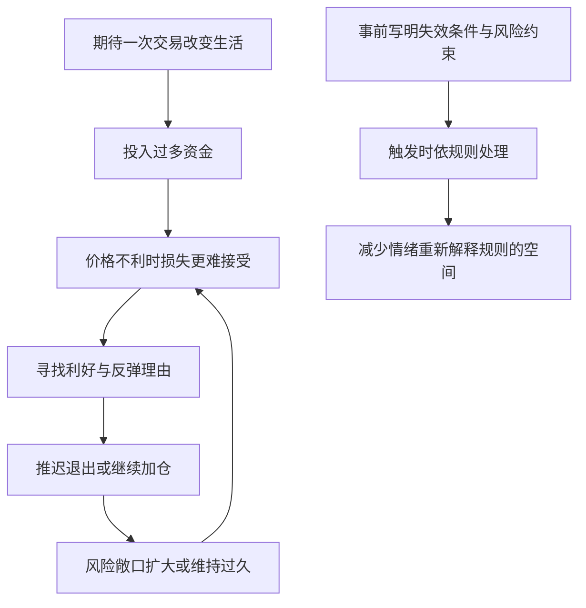

# 《炒股的智慧》第一章：炒股的挑战｜深度拆解

> 材料：《炒股的智慧》第一章“炒股的挑战”。用户提供的原始文件名为《股市的智慧_第一章.md》，书名已按用户确认更正；下方保留实际来源路径以便追溯。本文仅分析所给章节，不延伸为全书结论。
> 原文路径：`/Users/minyanhua/MinerU/炒股的智慧_chapter1.pdf-40cd7209-4d2d-423e-84f9-ad00879dcde1/股市的智慧_第一章.md`
> 阅读日期：2026-11-03。以下“作者主张”与“拆解推论”分别标明；实践部分是阅读与复盘练习，不是具体证券买卖建议。原文中的行动性措辞均作为分析材料处理。

## x → f → f(x)

- **x**：为什么聪明、勤奋、知道基本原则的人，仍可能在股票交易中反复把小错误变成足以出局的大损失？
- **f**：市场不替参与者确定下注规模和退出时刻，而人面对盈利与亏损会采用不对称的判断；只有把这些选择提前变成自己承担后果的规则，才能减少情绪对风险边界的侵蚀。
- **f(x)**：评估交易能力时，不能只问“这次猜对没有”，还要追问“判断失效后怎样行动、风险为何扩大、规则是否真的执行”；学习的对象因此同时包括市场和自己的决策过程。

## 核心命题

**市场的不确定性未必直接造成致命损失；失去边界的持仓，加上不愿承认判断失败的心理，才会让普通错误持续升级。**

作者用这一章改变读者对“炒股本领”的理解：会分析消息、知道原则，与能在真金白银的压力下执行，是不同能力。不过，本章主要解释某些失败机制，还没有证明克服这些机制就足以长期盈利。

## 关键洞见

### 1. 市场把“什么时候结束”交给了你

作者将股市称为特殊的赌局，重点在于决策结构：赌场的一局通常会自动结算，而持仓不会因为你已经焦虑、后悔或超过心理预期就自动消失。

因果链是：**持仓持续存在 → 风险暴露持续存在 → 退出需要主动决策 → 拖延也会改变结果。**

这颠覆了“不做决定就能暂时回避后果”的直觉。已持仓时，维持原状本身就是一种选择。但这不等于频繁操作更好：事前有依据地持有，与事后因为不愿认错而拖延，外观看起来一样，决策性质不同。

“恒久赌局”也是比喻，不能当作市场没有交易时间、退市或合约期限等现实边界的字面描述。

### 2. 人不是始终怕风险，而是会为不同愿望改变风险态度

作者先说人性讨厌风险，随后提供的两个选择题却揭示了更精确的机制：面对收益，人想锁定确定的小利；面对损失，人又愿意冒险，争取免于确认损失。

于是，同一个人可以一边“怕利润消失”，一边“不怕亏损扩大”。两种行为的共同目标，是回避眼前的不舒服。

**收益时求确定 + 亏损时赌翻盘 → 可能截短盈利、放大亏损。**

作者举例：得到700美元，或以75%的机会得到1000美元；支付700美元，或以75%的机会支付1000美元。两个冒险选项的期望收益、期望支出均为750美元。这是群体或重复情境中的平均意义，不是任何个人一次必得或必付750美元。

原文中的实验归属、人数和选择比例没有在所给材料中附出处，应视为作者转述。更关键的是，选择确定收益并不能单独证明非理性；资金约束、对风险的偏好也影响选择。对本章有用的是前后风险态度的不对称，而非把一切风险厌恶都判为错误。

### 3. 急于翻身，会同时破坏仓位与证据判断

作者回忆自己开始期待某只股票改变生活方式，随后买得更多、退出更迟，并偏向搜集支持自己的消息。

这里有两条相互强化的路径：

- **翻身期待 → 加大下注 → 亏损更难承受 → 更不愿退出。**
- **翻身期待 → 排斥反面信息 → 延迟承认判断失效 → 风险进一步累积。**

问题不只是欲望太大，而是交易同时承担了证明自我、改变阶层和兑现未来生活的任务。卖出因此不再只是调整资产，而像是亲手否定一个未来。

本章由此说明：资金规模也会反过来影响判断。所谓“心态不好”，有时并不是抽象的意志薄弱，而是承担了自己无法冷静处理的损失规模。

### 4. 跟风的隐蔽收益，是暂时免除决策责任

作者没有只把跟风归为缺知识。他指出，新手借别人的结论入场，也借别人的身份为失败预备解释。

**没有自己的判断标准 → 借用他人的决定 → 不必解释入场依据 → 事后也难从结果中学习。**

真正的代价是反馈链断裂：赚了不知为什么，亏了也不知该修改什么，下一次仍只能寻找新的“领袖”。

这不等于独立决策必须拒绝外部研究。拆解推论是：可以借用信息，但要能够说明它为何适合自己的目标、持有期限与风险约束；责任不会随观点来源一起转移。

### 5. 经验的价值，在于改变受压时的行为

作者用反复受骗类比学习交易：骗局换形式，贪便宜的心理如果保留，逐条记住旧套路也未必有效。

**知道原则 → 在压力下执行 → 留下可复盘记录 → 修正下一次行为。**

这才是本章所需的经验含义。单纯“做了很多年”并不能证明能力增加；重复同样的错误只是暴露次数增加。

作者把技能称为“心态”“感觉”，抓住了知识与执行之间的落差，但没有给出可靠的训练与检验方法。不能据此将直觉当成无需验证的优势。

## 理解难点：为什么越亏越难退出？

下图是根据本章多个故事综合出的机制图，并非原文已有模型：

这个回路的危险在于：**退出的心理门槛，可能随亏损一起升高。**最初只是“不想亏一点”，后来变成“亏太多，已经不能走”。风险变大，约束反而变松。

## 实践指引：把章节转为复盘问题

以下表格是拆解后的学习工具，不是作者在本章提供的完整交易系统。

| 场景 | 要追问什么 | 记录什么 |
|---|---|---|
| 被一个诱人的故事吸引 | 我依据的是可检查的信息，还是想象中的生活变化？ | 支持依据、反面证据、仍未知的事项 |
| 为一次模拟决策制定计划 | 什么情况说明原先判断不再成立？ | 判断失效条件、风险约束、退出安排 |
| 浮亏后想修改计划 | 我获得了新信息，还是仅仅不愿确认亏损？ | 原计划、修改理由、是否增加风险 |
| 想听从某位“高手” | 如果对方明天不再发言，我知道如何处理吗？ | 自己能否解释入场、持有与退出依据 |
| 一次交易结束 | 结果来自可重复过程，还是偶然波动？ | 依据质量、执行偏差、结果，分别评估 |

可以用历史记录或模拟练习检查三个能力：能否保留反对自己的证据；能否在不利变化中维持约束；能否区分“按计划亏损”与“违反计划却赚钱”。后者盈利，并不能验证违规过程可靠。

本章没有给出适用于所有人的止损比例、仓位比例或退出时点，不应从“止损重要”直接推出固定数值。事先设定的损失预算也不等于实际损失保证，执行条件仍可能带来偏差。

## 例子列表

| 原文例子 | 一句话提炼 | 逻辑位置 |
|---|---|---|
| 高学历朋友尝试职业炒股后退出 | 智力与外部职业成就不能直接迁移为交易执行能力 | 支撑 x |
| 修车与相同消息引发不同涨跌的对比 | 相似表象不足以保证相同结果，旧经验需要结合条件使用 | 展示 f |
| 贪便宜者反复受骗 | 只记招式、不改变决策倾向，可能反复落入不同形式的陷阱 | 展示 f |
| 母猪包装成凤凰大集团 | 相同现有资产可以承载截然不同的未来叙事 | 支撑 x、展示 f |
| 沙丁鱼罐头被反复转卖 | 转售预期可能暂时压过对使用价值的检查 | 展示 f；属于寓言式故事 |
| 收益与损失的两组选择题 | 同一个人群可能在盈利与亏损框架下呈现不同风险偏好 | 展示 f；实验来源未核验 |
| 作者期待股票改变生活方式 | 急于翻身会同时推高投入并削弱反面信息处理 | 展示 f |
| 摔跤后想清仓的朋友 | 缺少可解释的规则时，人可能借无关事件恢复控制感 | 支撑 x |
| 赌场翻倍与下跌中摊低成本 | 为翻本而持续追加风险，可能把有限亏损推向无法承受的规模 | 展示 f |
| 猎手等待火鸡返回，最后一无所获 | 对已失机会的执着，使人不断推迟处理仍可控制的结果 | 展示 f，并反向提示 f(x) |

这些例子以个人经历、类比和转述为主，能帮助理解机制，不能单独证明普遍发生比例。

## 结论列表

1. 股票交易容易进入，不能由此推出容易依靠它持续谋生。
2. 不愿确认小亏，可能让交易者承担原先并未同意的大风险。
3. 对一次交易寄托的生活期待越多，越可能难以公平处理不利证据。
4. 外部观点可以借用，决策后果仍由持仓者承担。
5. 当前成交价是实际交易的约束，不是内在价值的最终裁决。
6. 交易经验是否增长，要看错误处理方式是否改变。
7. 风险纪律能减少某些失败路径，却不能自动创造盈利优势。

## Q-A 问答链

### Q-A 问题结构图

### Q1：聪明人为什么也会失败？

- **结论**：理解规则的能力，不等于承受亏损时执行规则的能力。
- **形式化**：知识理解 ≠ 受压执行。
- **论证**：① 聪明人容易理解交易原则。② 实际损失会引发恐惧、后悔和自我辩护。③ 这些反应可能阻断已经理解的原则。
- **边界**：作者朋友圈的经历不是代表性样本，不能推出高学历者更容易失败。

**Q1 → Q2**：因为 Q1 将问题定位到受压执行，但尚未解释交易环境为何持续制造这种压力，所以要检查市场的决策结构。

### Q2：市场怎样放大人的弱点？

- **结论**：市场让风险暴露持续存在，却要求参与者自己决定何时终止。
- **形式化**：持续持仓 + 自主退出 → 拖延也承担后果。
- **论证**：① 买入后价格继续变化。② 心理上不愿面对，不会自动终止持仓。③ 退出若被拖延，损失就可能越过最初预期。
- **边界**：现金持有、不同产品和预设约束的结构并不相同；不能把所有投资等同于没有边界的赌博。

**Q2 → Q3**：因为 Q2 说明退出需要主动选择，但尚未解释这种选择为何常在盈利和亏损时方向相反，所以要检查心理偏好的变化。

### Q3：为什么赚一点就跑，亏了却等？

- **结论**：锁定盈利与拖延亏损，都可能服务于回避眼前不适。
- **形式化**：怕利润消失 → 早兑现；怕承认亏损 → 赌反弹。
- **论证**：① 浮盈时，回撤意味着失去已经想象拥有的收益。② 浮亏时，退出意味着确认失败。③ 两边分别采取看似舒服的动作，可能组合成小赚大亏。
- **边界**：具体策略可以合理地快速兑现或继续持有；是否失当要看事前依据及整体结果，不能只凭动作判断。

**Q3 → Q4**：因为 Q3 揭示了偏好的不对称，但知道这种机制并不会自动消除它，所以必须解释原则为何在执行时失效。

### Q4：懂了道理为什么仍做不到？

- **结论**：当仓位承载翻身与自尊的期待时，承认交易失败的心理代价会被放大。
- **形式化**：交易结果绑定生活期待 → 认错更痛 → 修改证据与规则。
- **论证**：① 急于改变生活，容易增加投入。② 更大损失强化逃避现实的冲动。③ 人转而搜集支持持有的理由，使原有纪律失去约束力。
- **边界**：执行困难也可能来自规则含糊、信息延迟和交易限制，不能一律归咎于贪婪。

**Q4 → Q5**：因为 Q4 说明人在压力下会重新解释规则，尚未解决如何减少临场改口，所以需要把原则转成可复盘的约束。

### Q5：怎样让规则真的约束自己？

- **结论**：规则要写清触发条件与后续动作，并把修改理由留在记录中。
- **形式化**：原则 → 条件与动作 → 执行记录 → 复盘修正。
- **论证**：① 具体条件减少模糊解释空间。② 提前规定动作减少临场重新谈判。③ 对照记录才能区分规则失效与自己没有执行。
- **边界**：这是由本章推导的学习方法；清晰规则仍可能设计错误，实际执行也可能受市场条件影响。

**Q5 → Q6**：因为 Q5 提供了减少执行偏差的方法，但尚未证明被执行的方法本身能盈利，所以必须检查纪律是不是成功的充分条件。

### Q6：守住纪律就一定赚钱吗？

- **结论**：纪律能约束错误放大，却不能把没有优势的方法变成盈利方法。
- **形式化**：执行一致 ≠ 正期望；方法优势 + 风险约束 + 可行执行，仍需验证。
- **论证**：① 一个方法可以被严格执行。② 它的平均收益仍可能不足以覆盖损失与成本。③ 因而减少心理失误，只解决了持续盈利的一部分条件。
- **边界**：本章没有提供足以检验优势的数据或完整系统，因此不能仅凭本章判断某种方法或某个人能否长期盈利。

## 局限与盲区

### “人性使然”有解释力，也可能解释过多

作者明确选择从心理角度讨论失败。这个切面能解释拖延、跟风和冲动，却无法包办成本、流动性、信息差和方法本身无效等问题。如果亏损都被解释为“没战胜自己”，方法就会免于检验。

### “股价永远是对的”需要限定含义

合理含义是：实际成交价格是当下无法靠个人争辩抹去的事实。它不证明价格合理，也不证明未来不会逆转。原文把投资大众的看法称为影响股价的“唯一力量”，表述过强；交易资金与数量、供求约束也不能被简单化为人数多数的意见。

### 作者自己的例子不足以支持必胜承诺

“铁了心就迟早成功”是经验性鼓励，不是已经证明的因果结论。坚持可能增加学习，也可能延长负收益行为；朋友选择回到其他职业，同样可能是理性的机会成本判断，不能只解释成成功意志不足。

### 上涨、下跌两种方向，不代表各有一半概率

原文将50%作为假设来说明盈亏不对称，应保留它的假设性质。结果有两类，不意味着等概率；胜率也不能替代收益大小、损失大小和成本的共同评估。

### 翻倍下注不能靠“总有一次赢”证明安全

原文说资金足够时翻倍法在数学上可行，但有限资金无法保证等到那次胜利。每多承受一次连续失败，下一次所需下注与累计投入都会迅速增长。“最终可能赢一次”与“能够存活到那一次”是两个命题。

### 摊低成本的动作，不能独立证明报复心理

作者批评的是缺少原定依据、为翻本不断追加风险。预先规划、有整体预算和再评估条件的分批投入，在逻辑上需要另行判断。不能把所有下跌中买入都判为同一种心理。

## 重读时抓住的一句话

**这章最值得带走的，是检查自己如何处理错误：当事实不利时，你是在依据新证据调整计划，还是在降低约束，好让自己暂时不用承认失败？**
