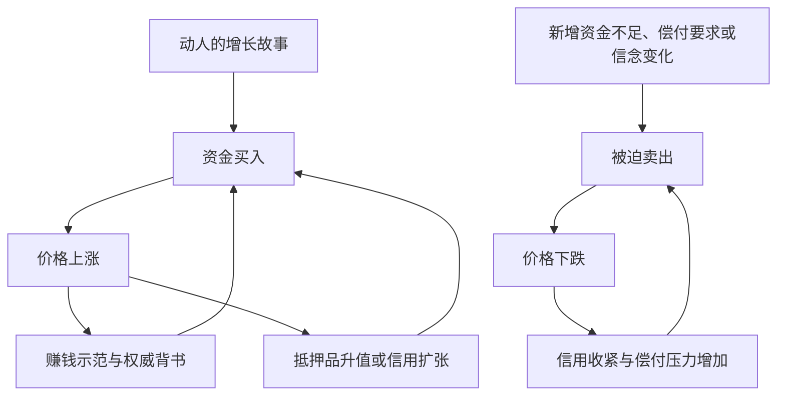

# 《炒股的智慧》第七章：抓住大机会｜深度拆解

> 材料：用户提供的第七章“抓住大机会”全文。
> 原文路径：`/Users/minyanhua/MinerU/炒股的智慧_第七章.pdf-3e4ecaf6-80b3-46b2-97d1-46bcb19ffdb5/炒股的智慧_第七章.md`
> 阅读日期：2026-11-10。本文只分析所给章节；历史数字、人物引语及轶事均为原文转述，未作独立史实核验。下文区分作者主张与拆解推论，练习用于阅读与复盘，不构成具体证券操作方案。

## x → f → f(x)

- **x**：当资产上涨已被集体想象推动时，交易者怎样理解并把握这类大行情，又避免成为崩溃时的最后持有人？
- **f**：作者把“疯”解释为故事、资金与赚钱示范相互强化的过程，主张识别其形成、跟随价格运动，并在公众普遍识破故事之前退出。
- **f(x)**：研究对象从“故事究竟多美好”转向“谁因何继续投入、上涨如何强化信念、支撑条件何时改变”；但参与是否值得，仍须另行证明识别与退出办法可执行，不能由泡沫故事直接推出。

## 核心命题

**价格可以在故事尚未被证实、甚至故事存在严重问题时持续上涨，因为上涨本身会吸引资金，并成为人们相信故事的证据。**

作者希望读者由此学会借势赚钱。这个解释有价值，但“看懂泡沫如何形成”和“有能力安全交易泡沫”之间，隔着本章尚未解决的择时、损失与成交问题。

## 关键洞见

### 1. “疯”的关键，是价格开始替故事作证

初期人们因为故事而买入；价格上涨后，人们又因为别人赚到了钱而相信故事。证据方向发生倒转：从判断事物的前景，变成用市场的上涨确认前景。

**故事吸引资金 → 价格上涨 → 赚钱故事传播 → 信任与参与增加 → 更多资金推高价格。**

这解释了为什么事实尚不充分的叙事仍能持续：参与者暂时靠转手盈利，未必要等最终承诺兑现。上涨能证明一段时间内有人愿意支付更高价格，却不能单独证明公司的承诺真实。

### 2. 最有传播力的故事，既容易理解，又难以证伪

作者的第三项特性尤其关键：普通人要能迅速理解“为什么可能发财”，又难以立即检验“这个承诺是否成立”。

南海公司的远方贸易、虚构的一灵散的科学术语，都提供了这样的结构：收益容易想象，验证依赖遥远市场、专业知识或未来批准。

**收益图景清楚 + 验证门槛高 → 想象可以先于证据扩张。**

这是对传播条件的解释，不是判定真假的充分条件。真正的创新也可能复杂且尚未验证；仍需检查独立证据，而不能因看不懂便判为骗局。

### 3. 信用把未来的希望变成今天的购买力

佛罗里达案例中，少量定金控制土地交易；科威特案例中，远期支票使缺乏现款的人也能参与。二者共同展示：资金不仅来自既有储蓄，还可能由信用安排放大。

上升时，资产升值让信用显得更安全；反转时，偿付要求又迫使持有人卖出。因而信用既加速上涨，也可能加速下跌。

图中的信用环节在原文几个案例里表现不同，不代表每一次泡沫都有相同融资制度。

### 4. 制度保障的信念，能削弱个人的风险警惕

科威特故事的关键不只是贪婪，还有参与者把过去的政府支持理解成未来的损失保障。因此，人们更愿意开出自己当下无法兑现的支票。

**过去曾被支持 → 被理解为以后也会获救 → 扩大风险承担 → 潜在救助负担继续增加。**

这个循环的弱点是：信念可以无限外推，支持能力却有条件。按原文叙述，石油收入下降、新财政部长表态、支票被提前要求兑现共同打断了循环。不能把结果简化为某一条消息单独引发一切。

### 5. 判断终局和判断时间，是两种能力

作者指出，最早看出泡沫的人可能长期被上涨“打脸”。这里必须拆开两件事：他们对最终可持续性的判断，和他们对转折时间的判断。

**不可持续 ≠ 即将终结；尚未终结 ≠ 可以持续。**

但这个区分也约束作者自己：看空者不能仅凭估值失衡知道何时跌，参与者同样不能仅凭“疯的六大特性”知道何时应离场。过早退出、过晚退出以及反复误判，都是方法的真实成本。

## 用六大特性完成原文作业

以下只按章内材料归纳；未明确出现的内容不补成史实。

| 特性 | 南海泡沫 | 佛罗里达土地疯 | 科威特股疯 |
|---|---|---|---|
| 可信的财富想象 | 南美贸易与贵金属前景 | 度假、迁居与土地需求 | 石油财富及政府支持的安全感 |
| 资金充足或被创造 | 国债换股安排及股票抵押贷款 | 定金与银行信贷放大参与 | 无现款支持的远期支票 |
| 简单又难以验证 | 海外贸易听来可懂，实际权限难核实 | 土地有限易懂，供需与估值难判断 | 政府支持易懂，支持能力与信用链难判断 |
| 有人快速赚钱 | 暴涨吸引社会关注 | 土地转卖暴利故事 | 连续高涨幅吸引投机者 |
| 权威或成功者背书 | 政府参与带来可信感，未必等于明确荐股 | 利物莫也参与，银行跟随扩张贷款 | 既有政府托市被理解为保障 |
| 持续超出怀疑者预期 | 原文明写怀疑者受嘲笑 | 持续上涨强化参与；未具体记录怀疑者 | 参与者用“本地特色”排斥质疑；未量化超预期时长 |

这六项更像识别脆弱结构的观察框架，而不是已经验证过的行情预测指标。三个事后选中的案例符合框架，不能证明符合框架的新案例都将暴涨，或都能被交易获利。

## 实践指引：把故事拆成可检查的问题

以下是从本章推导的学习练习，原文没有给出完整交易系统。

### 阅读热门叙事时，分开记录三种证据

| 记录项 | 要回答的问题 | 常见混淆 |
|---|---|---|
| 业务事实 | 产品、收入或需求有什么可独立验证的证据？ | 把宣传或名人体验当验证 |
| 价格与参与 | 哪些已经发生的成交和价格变化支持“市场正在追逐它”？ | 把价格上涨当成业务真实 |
| 融资条件 | 买方资金来自哪里，什么时候必须还钱？ | 把可借到的钱当成可承受的损失 |

三列分别成立，不能互相替代。尤其要问：如果价格停止上涨，偿债与持有还能不能继续？

### 复盘历史行情时，遮住未来再写判断

选择一个案例，只读到某个时点，先写下当时能获得的信息、判断失效条件以及哪些因素可能妨碍退出，再查看后续发展。检查自己是否只有看过结局，才能认出所谓明显信号。

不能拿作者设定的“20元入、300元出”当验证结果。只有把同期可能失败、提前退出及无法成交的情形一并纳入，才开始接近对方法的检验。

### 把“国家会支持”改写成有条件的命题

记录原文案例中的支持主体、支持方式、资源来源及改变支持的条件。区分“过去采取过支持措施”和“承诺未来任何价格都不受损失”。后一个判断需要额外证据，不能由前一个自动推出。

### 识别泡沫之后，保留不参与的选项

认识到价格可能继续上涨，只说明存在一种可能路径，尚不足以说明自己拥有获利优势。参与的预期收益、可承受损失及实际退出能力，本章均未给出可靠估计。对读者而言，识别脆弱性也可以用于减少误判与避免风险。

## 例子列表

- **南海泡沫**：海外财富想象与政府安排赋予股票吸引力，上涨又吸引更广泛投机。← 展示 **f** 的故事—价格循环。
- **外围公司的荒诞募资**：害怕错失下一个南海公司的心态，削弱了对业务的基本核查。← 支撑 **x**：追逐机会会侵蚀判断。
- **佛罗里达土地疯**：真实度假需求启动上涨，转卖与信用后来强化投机，新增供应和融资压力促成逆转。← 展示 **f** 的真实起点与信用放大。
- **作者接到卖地电话**：持有者只比较名义买卖价，忽视长时间占用资金的代价。← 支撑 **f(x)**：复盘应考虑时间与资金成本；单个案例不能代表整个地区。
- **科威特远期支票**：对政府支持的信念使投机者制造购买力，兑现要求暴露偿付缺口。← 展示 **f** 的信用与保障预期循环。
- **海湾医学中心**：原文描述低需求房地产换用医疗概念上市后受到追捧。← 展示 **f** 中叙事包装与资金追逐的关系。
- **中国邮票及早期股市**：稀缺想象、赚钱故事和支持预期吸引参与。← 支撑 **x** 的跨市场重复性；相关数字与稀有度说法均未核验。
- **一灵散与同类产品**：名人背书、专业术语、财务增长和模仿者轮番推高热度，负面证据动摇信念。← 展示 **f**；这是作者虚构的合成情境，不是2050年的真实事件。
- **20元买入、300元卖出**：作者设定的理想交易结果，说明其目标是跟随大趋势。← 表达期望的 **f(x)**，不能充当该目标可实现的证据。

## 结论列表

1. 价格上涨会吸引资金，也会被参与者误当成故事真实的证明。
2. 容易理解收益、难以核验承诺的叙事，为集体想象提供了扩张空间。
3. 真实需求可以启动一段行情，却不足以证明后来任何价格都合理。
4. 信用既能放大购买力，也能在反转时把持有问题变成被迫出售问题。
5. 曾经获得支持，不等于未来损失已被无条件承保。
6. 判断泡沫不可持续，与判断泡沫何时结束，是两个不同任务。
7. 识别行情的形成机制，不等于已经获得交易该行情的优势。
8. 理想买卖点只能说明愿望，事前规则与完整结果才可能检验方法。

## Q-A 问答链

### Q1：故事有漏洞，为什么还涨？

- **结论**：参与者可以先靠转手赚钱，暂时不必等待故事兑现。
- **形式化**：故事 → 买入 → 上涨 → 赚钱示范 → 更多买入。
- **论证**：① 故事吸引第一批资金。② 上涨产生可见赢家。③ 后来的参与者将赚钱结果当成继续买入的理由。
- **边界**：这解释上涨如何自我强化，并不意味着任何虚假故事都能启动行情。

**Q1 → Q2**：因为 Q1 确认赚钱示范能维持参与，却没有解释哪些叙事能吸引最初买家，所以要追问故事的传播条件。

### Q2：什么故事最容易吹大？

- **结论**：收益容易想象、核心承诺难以迅速核验的故事，更有扩张空间。
- **形式化**：简单的财富图景 + 复杂的验证过程 → 想象先行。
- **论证**：① 易懂的收益降低传播门槛。② 难核验的承诺延后反驳。③ 权威背书进一步降低参与者的怀疑。
- **边界**：这是作者提出的特征，不能单独区分真实创新与骗局。

**Q2 → Q3**：因为 Q2 解释了为什么人会相信，但相信尚未变成实际购买，所以还须追问支付能力如何形成。

### Q3：光有故事，钱从哪里来？

- **结论**：闲置资金和信用安排，把信念变成能够推高价格的购买力。
- **形式化**：储蓄流入 + 信用扩张 → 当前购买力增加。
- **论证**：① 故事吸引已有资金集中。② 定金、贷款或远期支票允许更多人入场。③ 上涨改善抵押价值或偿付预期，进一步支持融资。
- **边界**：这些融资形式不可混同，具体风险取决于各自偿付与担保条件。

**Q3 → Q4**：因为 Q3 说明上涨依赖持续购买和信用延续，尚未说明这些条件中断后会发生什么，所以要分析反向循环。

### Q4：为什么上涨会突然反转？

- **结论**：当买方接力中断而付款义务仍存在时，卖出会把融资压力传给价格。
- **形式化**：资金不足或信念变化 → 卖出 → 跌价 → 信用收紧 → 更多卖出。
- **论证**：① 资产无法仅靠原有价格承诺完成付款。② 部分持有人被迫变现。③ 下跌损害其他人的偿付能力与信心，放大卖压。
- **边界**：并非所有反转都由信用触发；原文也包含供给增加、故事被质疑等路径。

**Q4 → Q5**：因为 Q4 解释了反转机制，却没有提供它何时触发的时钟，所以要区分识别脆弱性与预测转折。

### Q5：看出泡沫就该立刻看空？

- **结论**：识别不可持续性，不能确定价格马上下跌。
- **形式化**：终局判断 ≠ 时间判断。
- **论证**：① 在支撑条件仍延续时，上涨可以继续。② 新资金和信用可能暂时抵消质疑。③ 因而早期怀疑正确，也可能无法转化成当下可盈利的判断。
- **边界**：这同样不能被反过来当成继续买入的理由；不参与也是可选结果。

**Q5 → Q6**：因为 Q5 排除了“发现泡沫便能判断转折”，却尚未证明跟随上涨能规避同样的时间难题，所以必须检验作者的参与主张。

### Q6：那跟着上涨就能赚钱吗？

- **结论**：跟随上涨只有在识别、损失控制与退出共同可行时，才可能成为可检验的方法。
- **形式化**：理解循环 ≠ 交易优势；参与理由 + 失效条件 + 可行退出 → 待检验的方法。
- **论证**：① 作者设定了理想买入和退出点。② 但没有说明事前如何稳定识别它们。③ 没有失败样本和成交约束，就无法证明总体收益覆盖总体风险。
- **边界**：这是本章证据不足的判断，不是证明所有趋势方法无效。

## 局限与盲区

### 一、最难的一步，被留在了口号里

“在公众认识假象之前退出”听起来明确，实则包含难题：怎样知道公众何时认识？自己的信号会提前多久？信号错了怎么办？本章把价格与成交量的具体理解指回前文，但所给材料没有完整规则，因此不能替作者补出确定的突破、放量或止损参数。

### 二、理想价格路径存在事后视角

虚构故事已经给出从低位上涨到400元再崩溃的完整过程。读者知道结局后，容易把20元与300元想成可辨认的机会。但在真实时间里，20元可能是途中高点，300元也可能来不及卖出。故事展示“如果做到会怎样”，没有证明“如何反复做到”。

### 三、“无从追究真假”容易削弱必要的核查

作者重视价格运动，不希望交易者因纠结叙事而错过行情。可故事真假仍影响停牌、欺诈暴露与损失路径。把价格当作可观测事实是合理的，把事实核查视为无关则走得过远。

### 四、大财富叙事掩盖了结果分布

本章选取著名泡沫，并突出抓住一次便可能改变生活。它没有统计多少类似故事根本没有起势、多少参与者离场失败、不同进入时点的结果如何。因此，这些案例适合生成研究假设，尚不足以估计参与的成功率。

### 五、“疯”与骗局需要区分

南海案例突出叙事和权限落差；佛罗里达存在真实度假需求；科威特突出融资制度与支持预期；一灵散则是明确虚构的欺诈故事。它们共享强化循环，却不具有完全相同的事实基础。价格过度上涨不自动等于公司欺诈，真实产业也不保证资产价格合理。

### 六、史实与数值不能直接拿来做模型参数

原文包含行情日期、股价、认购倍数、人物经历、邮票稀有度和引语归属，但未提供可追溯出处，部分表述还可能受时代与转录影响。若进一步做历史研究或系统验证，需要回到独立资料核实，而不是把章内叙事直接当数据库。

## 重读时抓住的一句话

**上涨为什么能自我强化，与我凭什么能在强化停止前退出，必须分别回答。前者是本章的洞见，后者是本章留下的功课。**
