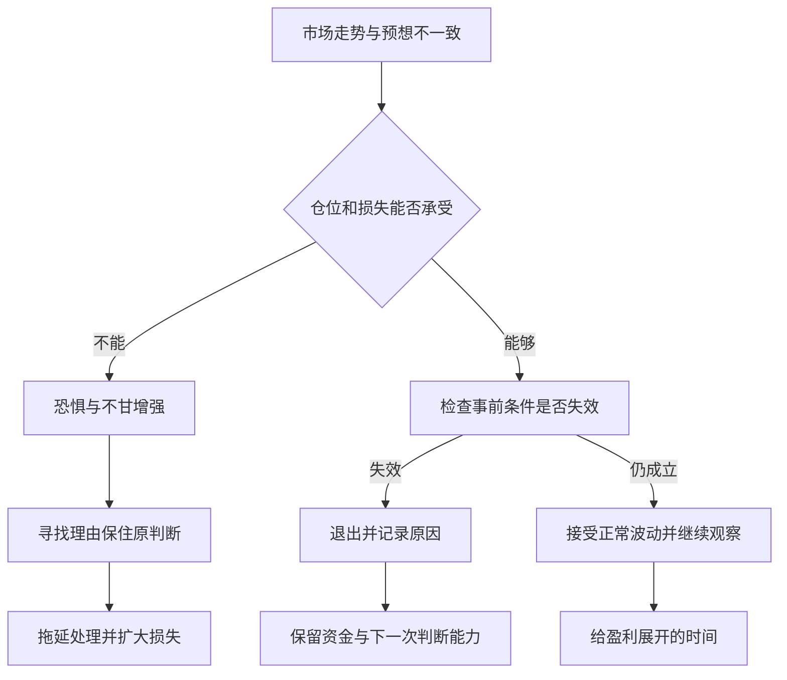
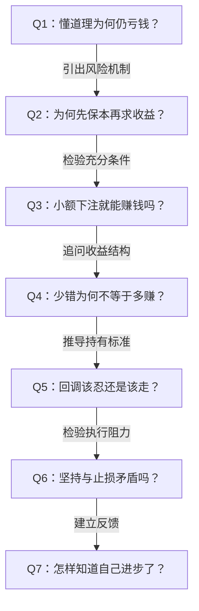

# 《炒股的智慧》第三章：成功的要素——深度拆解

> 材料：用户提供的《炒股的智慧_第三章.pdf》，共21页；正文印刷页码55—73，对应PDF第3—21页。以下页码均指印刷页码。
> 方法：依据原文逐页阅读，区分作者经验、论证解释与本笔记补充。数字案例仅用于核验书中逻辑，不构成具体交易建议。范围限于第三章。

## x → f → f(x)

- **x**：为什么一个人懂得不少股票知识，也偶尔赚过钱，却仍无法把偶然获利变成可持续的交易能力？
- **f**：把交易作为一项允许判断出错的生意：先限制错误的代价，再等待符合条件的机会，让正确判断充分产生收益，并以独立判断和执行纪律维持这一过程。
- **f(x)**：评价交易时，应检查机会条件、风险规模、退出依据与执行记录；既不要用一次赚钱证明能力，也不要为了证明自己而继续持有已经失去依据的交易。

## 核心命题

**交易能力的关键，是在不确定条件下管理错误与收益的不对称：错时承受得起，对时拿得住。**

本章开头要求“败而不倒”和“追求卓越”，随后将它们展开为保本、不断盈利、赚大钱，再用资金管理与投资者共性解释怎样实施。最后落到“知易行难”：知识只有进入反复执行的行动，才可能产生效果。

这里的“保本”是控制损失、保留参与能力，不是保证本金不发生亏损；“不断盈利”也不应理解为每笔、每天或每年都盈利。

## 关键洞见

### 1. 保本同时保护资金和判断能力

作者给出两个办法：及时止损，不要一次下注太多（56—57页）。前者限制错误持续的时间，后者限制错误影响的规模。

更深的一层是心理机制：仓位太大 → 一次正常波动也令人难以承受 → 把小反弹当成解套希望 → 判断开始服务于自我安慰 → 更难止损。仓位不仅改变账户波动，也改变人解释信息的方式。

作者用“能否睡好”检验风险承受力。这是心理报警器，不能代替客观风险测量：有人会因不了解风险而睡得很好，也有人会对合理波动过度敏感。

**本笔记推论：风险规模应小到允许你诚实观察，而不是大到逼你寻找借口。**

### 2. 等待是在筛选机会，不能靠提高交易频率制造优势

作者批评无论牛熊都几乎满仓、每一轮都不愿错过的行为（58页）。其逻辑是：有些时段看不出可利用的条件 → 贸然参与缺乏依据 → 应等待符合自己入场条件的时机。

但本章主要告诉读者“要筛选”，尚未给出完整、可重复验证的筛选规则。因此，“等待自己看得懂的机会”不能自动等同于“这个机会有统计优势”。熟悉感也可能只是偏见。

### 3. 赚大钱依赖盈利分布，不只依赖猜对次数

作者比较两位年收益同为100%的交易者：一位频繁小赚且笔笔赚钱，另一位多次小亏、少数大赚（58—59页）。作者借此说明，专业能力可以表现为承担有限错误、让少数正确判断贡献主要收益。

这个对比打破了“胜率越高，能力越强”的直觉。然而，仅凭这两段记录也无法判定谁更专业，还缺少样本长度、杠杆、风险暴露和完整亏损记录。

本章的正确落点是：**不要为提高账面上的正确率，过早卖出仍符合持有条件的盈利交易。**它没有证明所有策略都应追求少数极端盈利。

### 4. “拿得住”与“及时走”共用一个判断标准

63—66页用价量变化说明作者所谓的正常运动：上涨时活跃，回调时成交量减少，随后恢复上涨；若突然出现与此前节奏不同的剧烈波动，则应警惕。

这里有一个重要统一：继续持有和退出，都应依据交易条件是否仍然成立。持有并不因为“不甘心卖”，退出也不因为“终于赚到一点”。

作者也承认异常信号不保证随后下跌，并要求结合公司发展考虑。因此，异常更适合理解为重新评估原有判断的触发条件，而不是已经证实未来走势的结论。

### 5. 坚持的对象是学习过程，止损的对象是具体错误

67—73页列出欲望、韧性、兴趣、独立思考、耐心、自制力、适合自己的模式、前瞻判断、不幻想和应用知识的毅力。它们共同处理一个问题：如何让人持续执行前面的交易逻辑。

最容易误读的是“锲而不舍”。作者一方面讲自己经历巨亏仍坚持学习，另一方面要求发现危险就离场。

两者能同时成立，因为对象不同：

| 对象 | 应有的坚持 | 应有的调整 |
|---|---|---|
| 学习过程 | 持续观察、记录、检验 | 修改不能成立的解释 |
| 单笔交易 | 按事前依据判断 | 依据失效时退出 |
| 交易方法 | 给出合理检验机会 | 证据持续不支持时修订或停用 |
| 自我形象 | 对记录诚实 | 放弃“我必须是对的” |

后两行是本笔记对作者逻辑的延伸。坚持不构成盈利保证，也不能把持续投入本身当作方法有效的证据。

## 机制图：同样的波动，为什么会导致不同结果？

此图是对本章机制的整理，不是原书图表。它说明小仓位为何可能改善执行，并不证明小仓位可以把无效策略变成有效策略。

## 两个必须核算的数字问题

### 十只股票组合：原文收益率计算有误

59页设定本金10000元，十只股票各投1000元：五只跌10%，四只涨10%，一只涨200%。

- 五只亏损股票期末合计：5 × 900 = 4500元。
- 四只普通盈利股票期末合计：4 × 1100 = 4400元。
- 一只上涨200%的股票期末价值：1000 × 3 = 3000元。
- 合计：11900元，盈利1900元，收益率19%。

原文写成12900元、接近30%，按其给出的条件不能成立。这个错误不推翻“少数大赢家可能决定组合收益”的机制：如果把那只涨200%的股票换成涨10%，组合期末仅为10000元。两种情形相差1900元，恰好来自那只大赢家多贡献的收益。这里均忽略费用。

### 胜率提高与小额下注：仍不足以推出必胜

61—62页抛硬币例子先改变输赢金额，再改变下注规模。必须把三件事拆开：

| 变量 | 回答的问题 | 本章容易混用之处 |
|---|---|---|
| 胜率 | 赢的次数占多少 | 与盈亏金额比不是一回事 |
| 盈亏幅度 | 赢一次赚多少、输一次亏多少 | 原文的1∶0.95描述金额关系 |
| 下注规模 | 一次结果影响多少本金 | 改变资金路径，不改变硬币正反概率 |

**本笔记的数学补充：单次平均净收益 = 胜率 × 平均盈利 − 败率 × 平均亏损 − 平均成本。**

假设赢时赚1，输时亏2，胜率60%，不计成本，平均结果为0.6 × 1 − 0.4 × 2 = −0.2。胜率超过50%仍然亏损。

另一个区别是：正的平均收益也不保证有限次数内获利。书中赢500、输475的硬币例子，正反概率始终各半，两次连续输的概率为25%；两次损失合计950元，1000元本金只余50元，无法继续按原金额下注。小额下注的作用是降低少数不利结果造成严重损害的程度。

因此，本章“久炒必赢”的措辞过强。较严谨的理解是：在优势确实存在且能够持续、成本没有吞噬优势、风险规模可承受的前提下，重复实施才有长期获利的可能。

## 实践指引：把本章转成可检验的学习记录

以下是阅读后的练习设计，不是作者原有表格，也不是具体证券的买卖方案。

### 练习一：在结果出现前固定判断依据

每个研究案例先填写：

| 字段 | 要写清的问题 |
|---|---|
| 机会条件 | 哪些可观察事实支持当前判断？ |
| 失效条件 | 出现什么事实，说明原判断需要放弃？ |
| 正常波动 | 事前允许怎样的变化？ |
| 异常变化 | 哪些变化要求重新评估？ |
| 风险规模 | 不利结果会损害多少资金与后续参与能力？ |
| 持有依据 | 除了“已经买了”，还有什么理由继续持有？ |

关键是时间顺序：先记录，再观察结果。事后给所有上涨命名为“正常”、所有下跌命名为“异常”，无法检验判断能力。

### 练习二：把盈亏结果与执行质量分开

| 结果 | 按事前规则执行 | 偏离事前规则 |
|---|---|---|
| 盈利 | 记录结果，继续积累样本 | 检查是否把运气当能力 |
| 亏损 | 检查是否为规则允许的损失 | 定位具体偏离及原因 |

规则执行良好仍然可能亏损；这既可能是正常波动，也可能说明规则没有优势。执行记录与方法检验需要分别做，不能互相替代。

### 练习三：检验“正常运动”是否可复现

将书中“上涨放量、回调缩量、随后恢复上涨”的描述转成明确观察口径，再检查未用于形成规则的历史样本。记录胜率、平均盈亏、费用、回撤，以及不同环境下的表现。

本章没有提供这些检验结果；此练习的目的正是把有启发的经验变成可被反驳的假设。

### 练习四：识别三个自我合理化信号

- 原因从“条件仍成立”变成“等回本就走”。
- 原因从“观察证据”变成“别人说不用担心”。
- 原因从“按规则继续研究”变成“我吃了这么多苦，不能放弃”。

出现这些解释时，检查自己是否正在用情绪代替原来的判断标准。

## 例子列表

以下均来自本章；它们是作者的叙述或思想实验，不等于独立验证的经验事实。

| 例子与位置 | 在论证链中的作用 |
|---|---|
| 足球先少失球，再谋得分（56页） | 展示f：先限制失败，再争取收益 |
| 计划买1000股，先200股，再视表现分层增加（57页） | 展示f：把一次判断拆成试探与后续确认 |
| 因持仓担忧失眠（57页） | 展示f(x)：用心理反应发现承担风险过大 |
| 赌客每轮都不肯错过（58页） | 支撑x：渴望参与会破坏机会筛选 |
| 两位年收益相同、盈亏分布不同的交易者（58—59页） | 展示f：正确次数与盈利结构应分开评价 |
| 十只股票组合由一只大赢家贡献收益（59页） | 展示f：少数盈利可能支撑整体；原文算术有误 |
| 地产老板拒绝小亏离场，最终破产（60—61页） | 支撑x：过去的成功与社会地位可能增加认错阻力 |
| 抛硬币的输赢金额及下注规模变化（61—62页） | 展示f：优势与资金规模共同影响参与过程 |
| 赌客带2000美元却因大额下注很快输光（62页） | 支撑x：过大下注使资金迅速受损；不是严格概率证明 |
| 20→27→24，再恢复上涨到35的价量示例（63—64页） | 展示f：辨认正常回调，避免过早退出 |
| 50→55、冲到62后收58、再到64后回61（64—66页） | 展示f：与此前节奏不同的剧烈运动触发警惕 |
| 铁轨遇到火车先避开，之后可重新返回（66页） | 展示f(x)：退出是保留选择，不是宣判永久失败 |
| 买2000元电视做大量比较，买20000元股票却少研究（67—68页） | 支撑x：口头上想赚钱与实际研究投入脱节 |
| 作者一天亏5万美元、约占当时资产一半（68页） | 支撑x：学习过程存在真实经济与心理代价，不能据此鼓励复制 |
| 围棋职业训练的单调、狮子等待猎物、按季节播种（70—71页） | 展示f：耐心需要日常工作与判断能力支撑 |
| 假设今天手里只有现金，是否仍会买这只股票（72页） | 展示f(x)：检查持有理由是否被历史成本绑架 |
| 减肥知道方法却难持续执行的类比（72—73页） | 展示f：知识与行动之间存在执行缺口；书中统计未附来源 |

## 结论列表

1. 保留本金的意义，是保留未来行动与纠错的能力。
2. 过大的仓位会同时损伤资金和判断的独立性。
3. 一笔交易赚钱，不能单独证明方法有效。
4. 高胜率不能单独证明正收益，盈亏幅度与成本也决定结果。
5. 少数大赢家可能主导组合收益，但不能因此把每次亏损都解释为等待大赢家的代价。
6. 持有和退出应共享可检查的判断标准。
7. 坚持学习不等于坚持已经失效的交易。
8. 独立思考不等于机械地与大众反向操作。
9. 耐心只有配合机会识别，才可能成为有用的能力。
10. 纪律帮助执行方法，方法是否有优势仍需另外验证。

## Q-A 问答链

### Q-A 问题结构图

### Q1：懂道理为何仍亏钱？

- **结论**：懂得原则不代表能在金钱压力下持续执行原则。
- **形式化**：知道规则 ≠ 压力下执行规则。
- **论证**：① 盈亏激发希望与恐惧。② 这些情绪改变对信息的解释。③ 原本知道的止损、等待和持有原则因此被临时改写。
- **边界**：亏损也可能源于方法无效，不能把一切失败归咎于意志薄弱。

**Q1 → Q2**：因为情绪会使执行走样，而风险规模影响情绪强度，所以需要追问为什么作者把保本放在收益之前。

### Q2：为何先保本再求收益？

- **结论**：没有可继续使用的资金，再好的机会也无法转化为行动。
- **形式化**：限制损失 → 保留参与能力 → 才有后续获利机会。
- **论证**：① 交易不可避免会出错。② 一次过大的损失会破坏后续参与条件。③ 止损与限制下注规模，都是避免错误升级为出局。
- **边界**：这不是保证不亏；过紧的退出条件也可能造成反复损失。

**Q2 → Q3**：因为保本只解决能否继续参与，还没有解释参与是否值得，所以必须检验小额下注能否自行产生盈利。

### Q3：小额下注就能赚钱吗？

- **结论**：小额下注控制资金受损的速度，不能自行创造正的收益预期。
- **形式化**：风险控制 + 无优势 ≠ 长期盈利。
- **论证**：① 缩小下注不改变机会本身。② 如果平均亏损和成本超过平均盈利，重复只会继续暴露于不利条件。③ 因而还需要检验入场与退出方法是否存在优势。
- **边界**：这里的优势是估计结果，可能随环境改变，不能当作永久属性。

**Q3 → Q4**：因为是否有优势不能只看下注大小，而作者又强调获胜概率，所以还必须区分猜对次数与最终收益。

### Q4：少错为何不等于多赚？

- **结论**：最终收益取决于每类结果的次数与金额，正确率只覆盖其中一部分。
- **形式化**：收益结构 = 赢的频率与幅度 − 输的频率与幅度 − 成本。
- **论证**：① 经常小赚可能被少数大亏抵消。② 多次小亏也可能被少数大赚覆盖。③ 所以应同时审视亏损控制与盈利展开空间。
- **边界**：少数大赚的记录也可能来自运气或过度风险，不能仅凭形状判定专业性。

**Q4 → Q5**：因为保留盈利空间需要承受浮盈回撤，但承受回撤也可能变成死扛，所以必须建立继续持有与退出的共同标准。

### Q5：回调该忍还是该走？

- **结论**：先判断回调是否使事前交易依据失效，再决定是否继续持有。
- **形式化**：依据仍在 → 按规则观察；依据失效 → 按规则处理。
- **论证**：① 正常趋势也会回调。② 与原有结构不同的运动可能削弱判断。③ 原因应来自事实变化，而不是浮盈缩水带来的不舒服。
- **边界**：作者的价量描述是经验模型，不能保证准确识别趋势转折，也没有提供统一阈值。

**Q5 → Q6**：因为标准明确后仍可能因不甘心而拒绝执行，所以需要分清坚持到底应该坚持什么。

### Q6：坚持与止损矛盾吗？

- **结论**：坚持研究和纠错，与退出一笔失效交易可以同时进行。
- **形式化**：坚持学习过程 + 放弃具体错误。
- **论证**：① 能力需要长期积累。② 单笔判断可能随时出错。③ 为保住长期学习能力，反而需要及时停止具体错误。
- **边界**：长期坚持也不能证明适合这一行业，应审视实际证据、投入代价与其他选择。

**Q6 → Q7**：因为愿意坚持并不证明能力改善，所以必须建立能区分努力、运气和进步的反馈方式。

### Q7：怎样知道自己进步了？

- **结论**：进步要同时体现在可复核的判断记录、执行表现和足够样本下的风险收益结果中。
- **形式化**：进步证据 = 事前判断 + 执行记录 + 方法检验。
- **论证**：① 事后回忆容易美化判断。② 事前记录让偏差可见。③ 多次观察与独立样本检验，才能逐步区分能力和偶然结果。
- **边界**：这一检验框架是本笔记补充；历史结果仍不能保证未来表现。

## 局限与盲区

1. **概率措辞过强。** “久炒必赢”将有利条件下的长期倾向说成确定结果，也忽略了优势估计误差、成本、环境变化和不利资金路径。
2. **部分数字有误或概念混用。** 组合案例应为19%；硬币案例中的1∶0.95是盈亏金额比，不是正反面概率之比。
3. **正常运动的定义不够可检验。** 原文承认难以精确描述，但仍据此推断高胜算，缺少统计证据与失败样本。
4. **大户行为解释不能由图形单独证实。** 65页关于吸筹、推荐和派发的叙述是一种因果解释，观察到放量或急涨急跌，并不能据此确认特定参与者的意图。
5. **成功者共性存在筛选偏差。** 作者的韧性故事说明坚持的体验，不能证明坚持会让每个人成功；失败后仍坚持的人没有在本章得到同等呈现。
6. **部分统计和格言缺少可核对出处。** 例如80%股民的入市动机、减肥成功比例，本章未给调查来源，宜作为作者论述材料，而非已确认数据。
7. **职业交易视角有适用范围。** 58页强调绝对赚钱而轻视“比市场少亏”的比较，适合解释作者以交易为生的目标，不能直接取消其他投资目标中的基准评价。
8. **缺少从原则到完整系统的桥梁。** 本章有效地提出风险、机会、持有与纪律的关系，却未独立提供完整策略。需要另行明确规则和检验，不能从文字认同直接跳到实际投入。

本章最有价值的阅读成果，是把“我想赚钱”改写成一组可回答的问题：我凭什么参与？我可能错在哪里？错误的代价能否承受？条件还成立吗？我的记录支持我继续使用这个方法吗？
