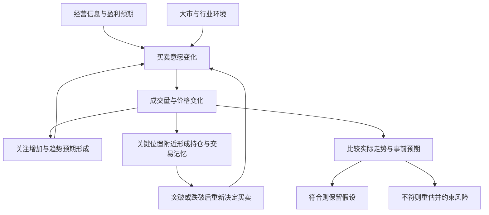
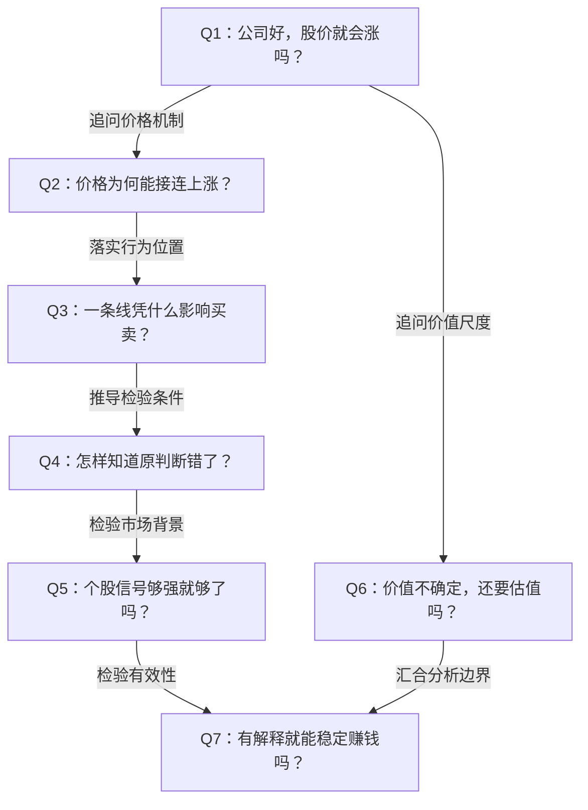

# 《炒股的智慧》第二章：股票分析的基本知识｜深度拆解

> 来源：用户提供的 `/Users/minyanhua/Desktop/炒股的智慧_chapter2.pdf`，共27页，正文书页27—51。PDF前两页为章标题和摘句，PDF第3页对应书页27，以下引用均按书页定位。
> 阅读日期：2026-11-04。扫描正文经本地OCR读取，图2-5至图2-8另核对页面图像。本文只解读本章；区分作者主张、拆解推论和批判性检验。原文的买卖指令作为研究材料，不是针对具体证券的操作建议。

## x → f → f(x)

- **x**：公司价值无法精确估计、市场价格又不断波动时，交易者凭什么判断一段行情值得参与，又凭什么承认自己的判断失效？
- **f**：用公司经营解释未来盈利的可能来源，用大市与行业识别共同环境，再用价格、成交量和关键位置检验资金是否持续支持这个判断；走势不再符合预期时，重新评估并约束损失。
- **f(x)**：分析不应止于“公司不错”或“图形像要涨”，而应形成可检查的条件链：经营依据是什么、市场是否配合、什么行为算确认、什么行为推翻判断；结果与预期不符时，不再无限补充故事。

## 核心命题

**公司可能值得拥有，与市场正在支持它上涨，是两个不同的问题；交易判断要把两者连接起来，还要给判断留下被推翻的入口。**

本章表面在介绍分析工具，实际在建立作者偏向中短期交易的认识框架：经营情况提供背景，大市改变个股判断的处境，价量变化提供观察资金行动的窗口，关键位置则让“我可能错了”变得可以识别。

这是一套分析框架，还不是一套已经证明有效的交易系统。本章没有提供形态胜率、成本后的收益分布或完整仓位规则。

## 关键洞见

### 1. 基础分析和技术分析，连接于“预期如何变成行动”

**作者主张**：两种分析不能完全分开。价量和时间的互动，反映投资者对公司经营的看法，他们以资金投票。（书页27、45）

逻辑链是：**经营信息 → 对未来盈利的预期 → 买卖意愿 → 成交与价格变化。**

基础分析主要追问预期有没有经营基础；技术分析主要观察这些预期是否已推动市场行为。即使对公司经营的判断正确，市场反应的时间和幅度也未必符合交易者期待。

进一步还要问：好消息是否已经反映在价格中？“业绩增长”与“股价将上涨”之间，隔着原先预期、估值和后续资金行动，不能直接画等号。

**边界**：价格也受流动性、被动配置、被迫平仓等因素影响。因此价格变化不是对企业真实价值的无误裁决，也不能从价格倒推出唯一的经营原因。

### 2. 低市盈率是一个比值，盈利质量才是需要解释的过程

作者提醒读者，不要把低“成本收益比率”（这里对应市盈率）直接当成便宜；高估值公司的增长可能改变未来盈利。（书页30—31）

他的检查顺序有三层：

1. **看基数**：每股盈利从0.01元到0.02元，虽然增长100%，但绝对盈利仍然很小。
2. **看来源**：销售是否增长，盈利是否依靠会计处理或一次性因素。
3. **看转化效率**：销售翻倍，而盈利只增加20%，需要解释利润率为什么下降。

本章真正有用的提醒是：**增长率 → 基数与持续性 → 收入如何转为利润。** 一个亮眼数字必须还原成业务过程。

新产品之所以重要，也不在于“新”本身，而在于它可能开拓需求、带来收入并形成盈利。回购则通过减少股数改变每股指标，必须与总盈利增长区分。

**批判性检验**：作者说缺乏销售增长的盈利增长“通常是玩会计游戏”，过于绝对。成本改善、产品组合变化也可能提高盈利。高增长同样不能豁免估值检验；作者列出的成功公司，是说明可能性的案例，不是高市盈率投资的整体统计证据。

### 3. 趋势是反馈过程，支撑阻力是行为可能集中的位置

作者将上涨描述为：价格走高吸引新买者，新买入继续推高价格；一部分持有人获利卖出，形成回调，若后续买力持续，便出现更高的高点和低点。（书页33—35）

**价格上涨 → 吸引注意与买入 → 进一步上涨**，构成他解释趋势延续的核心回路。

支撑阻力则把这种行为放到具体位置：市场曾在某价格区间形成交易记忆，人们据此等待买入、解套或卖出。旧支撑跌破后，原持有人回到成本附近可能急于退出；已经止损的人可能不愿重新买入，于是同一区域可能变为阻力。（书页35—38）

这里最值得学的不是背线条名称，而是追问：**这个位置附近，哪些人有改变行动的理由？**

**边界**：这是可能的行为解释，不能据此认定每个支撑位都会有效，或每次突破都会发生角色转换。同一种图形可能由不同机制形成。作者“买者多过卖者”的说法也应理解为买入意愿更积极，而非成交人数或成交股数不相等；每笔成交都有对应买卖双方。

### 4. 技术图形的主要用途，是让预期可以接受检验

本章最重要的词不是某个指标，而是“正常运动”。（书页41—42、45）

作者给出一组条件性期待：

| 原先假设 | 作者期待观察到的行为 | 需要重新审查的变化 |
|---|---|---|
| 上升趋势持续 | 高点、低点逐步抬高 | 高低点结构破坏 |
| 向上突破有效 | 越过阻力后继续上涨，回调守住原区域 | 很快跌回原区域下方 |
| 向下突破有效 | 跌破支撑后继续下行 | 很快收复原支撑 |
| 长期走势偏强 | 价格大体运行于长期均线上方 | 跌破并出现其他转弱证据 |

“正常”在这里表示**符合当前走势假设**，不是股票应该服从的自然规律。

由此可以提炼出更有价值的用法：图形并不保证未来，它把判断变成“如果这是真的，接下来应该看见什么”。实际走势偏离这个预期，就出现重估入口。

**边界**：本章没有明确“很快”是几天、“跌破”看盘中还是收盘、“守住”允许多少波动。若不事先定义，事后总能修改解释。因此这里提供的是研究问题，尚未提供可直接复现的信号。

### 5. 大市是个股的共同背景，价值则是随假设变化的锚

作者用羊群比喻大市，强调多数个股会受到整体环境影响。他又提醒，指数可能被少数权重股影响，必须兼看上涨下跌家数、行业和龙头表现。（书页45—48）

这使判断顺序变成：**整体市场 → 行业 → 个股**。它不是宣称所有股票同步，而是提醒读者，个股信号需要放在共同环境中理解。

本章末尾转而讨论合理价位：估值取决于未来盈利和折现假设，假设不同，合理价值就不同。遛狗比喻中的“人”代表价值，“狗”代表价格，但现实中“人”也在移动，绳长也不可事先知道。（书页48—51）

这两部分共同限制了分析者的自信：个股判断可能被大市压倒，所谓合理价值也不是可以无条件等待回归的固定点。

**边界**：市场图形的四阶段，与企业经营周期有时相互呼应，但不能据此建立必然的一一映射。“大市不好时不买”是作者偏多、中短期交易方法的纪律，不应扩展为所有投资策略的普遍定律。

## 理解难点：信息、价格与行为如何互相推动？

以下是根据本章综合出的机制图，不是原文已有图表。最难理解的地方在于：价格既是行动的结果，又会改变下一轮行动。

作者的四阶段可以另记为：**蓄劲期：大致平衡 → 爬坡期：买方更积极 → 疲劳期：上涨推进变难 → 下坡期：卖方更积极。** 这是理解变化的地图，不能在事后画完曲线后，假装当时已确定处于哪个阶段。

## 实践指引：把看图变成可复核的学习练习

以下是拆解后的复盘方法，不是作者提供的完整交易系统。

### 练习一：为一个历史案例写三层依据

选择一家公司的一段历史，限定当时能获得的信息，分别写出：

- **公司层**：收入增长来自销量、价格还是并购？盈利增长有多少来自主营经营，有多少来自股数变化或一次性项目？
- **环境层**：同期指数、相关行业与市场涨跌家数是否一致？个股强势是否只是随整体上涨？
- **行为层**：哪几个高低点支持趋势判断？成交量在哪里发生变化？哪些关键位置值得观察？

目的在于避免事后把所有上涨都解释为自己选对了公司。

### 练习二：每个判断写一条反证条件

把“看好突破”改写为一张研究卡：

| 项目 | 应当写明的内容 |
|---|---|
| 时间尺度 | 研究日线还是周线，观察多长时间 |
| 关键位置 | 如何依据当时已有数据确定区间 |
| 确认条件 | 观察盘中、收盘还是连续多期；量能与什么基准比较 |
| 失效条件 | 什么变化要求放弃原解释 |
| 处理约束 | 若以模拟交易练习，如何事先限定风险与执行方式 |
| 复盘结果 | 信号有效、失效，还是标准本身含糊 |

这些数值需要自行研究，不能从本章推导出一个普遍有效的参数。不要看到结果后，再改变确认与失效标准。

### 练习三：遮住未来，检验“正常运动”

从历史图表某一天开始，遮住后续数据。先记录假设及反证，再逐日展开。把“真突破”“假突破”“没有信号”全部留下，避免只搜集成功形态。

若进一步研究策略，至少需要同时考察交易成本、平均盈利与平均亏损、样本外表现和连续亏损，而不能只数猜对次数。这是验证要求，不是本章已经完成的证明。

### 练习四：给估值做情景，而不是只报一个答案

分别写出增长较慢、基准、增长较快的情景，解释每种情景如何形成可分配现金、需要什么再投资、承担什么风险。观察估值如何随假设变化，再检查市场价格需要多强的假设才能成立。

这一练习保留了作者对估值不确定性的提醒，也避免从“估值不精确”滑向“价值无法研究”。

## 例子列表

以下均是本章使用的案例或类比，历史涨幅与调查说法按作者转述记录，未独立核验。

- **微软早期高市盈率案例**：高比值与后续高速增长可能同时存在，提示静态低估值不等于唯一机会。← 展示 **f：增长背景**。（书页30）
- **每股盈利0.01→0.02与0.5→1元**：相同增长率掩盖不同盈利基数。← 展示 **f：拆开数字**。（书页31）
- **收入增长100%，盈利增长20%**：总量增长需要利润率变化的解释。← 展示 **f：经营质量检验**。（书页31）
- **新态口服避孕药、王安文字处理机、麦当劳快餐概念**：新产品或新商业方式可能打开增长空间，成功样本本身不能证明普遍成功率。← 展示 **f：盈利来源**。（书页31）
- **公司回购**：总利润不变时，股数下降可以提高每股盈利。← 展示 **f：区分分母变化与业务增长**。（书页32）
- **10—15元衣服交易区间**：用熟悉的价格预期解释区间与突破。← 展示 **f：交易意愿集中**。（书页35—37）
- **旧支撑附近的解套者与止损者**：经历改变同一价位的买卖意愿。← 展示 **f：位置的行为含义**。（书页37）
- **双肩、头肩及其倒置形态**：反复试探关键位置后，市场可能重新定价。← 展示 **f：结构与临界点**。（书页38）
- **抛硬币画走势图**：随机曲线也能被赋予故事；作者以缺少成交量批评该分析，但这尚不能证明加入量能就能预测。← 支撑 **x：辨认真信号的困难**。（书页45）
- **羊群与权重股影响指数的例子**：共同环境重要，但单一指数也可能遮蔽市场内部差异。← 展示 **f：环境过滤**。（书页46—47）
- **遛狗比喻**：价格可能偏离价值，偏离的距离与持续时间不确定。← 支撑 **x：价格与价值的张力**。（书页49）
- **农业、工业、信息社会的价值标尺变化**：传统资产口径可能漏掉新产业的价值来源。← 展示 **f：检查估值假设**，不是证明新产业可以不受现金创造能力约束。（书页49—51）

## 结论列表

1. 经营改善解释上涨的可能来源，无法单独确定价格何时反应。
2. 相同盈利增长率，可能掩盖完全不同的基数、质量与可持续性。
3. 每股盈利提高，既可能来自业务增长，也可能来自股数减少。
4. 趋势解释中，价格既反映参与者行动，也会反过来影响参与者行动。
5. 支撑和阻力的行为含义，来自交易经历与预期，不能保证在未来持续有效。
6. 技术图形最有价值的用法之一，是帮助明确什么变化会推翻当前判断。
7. 个股走势需要结合大市和行业，指数方向也需要与内部涨跌结构互证。
8. 有合理心理故事的形态，仍需接受统计和交易成本的检验。
9. 估值依赖假设，不代表估值毫无意义，更不代表任何高价格都合理。
10. 本章提供分析问题的框架，没有证明按这些图形操作即可长期盈利。

## Q-A 问答链

### Q-A 问题结构图

### Q1：公司好，股价就会涨吗？

- **结论**：经营质量不能直接替代对市场预期和交易行为的判断。
- **形式化**：经营改善 → 可能改变预期 → 可能改变行动 ≠ 保证立即上涨。
- **论证**：① 企业经营影响未来盈利。② 市场交易的是对未来的判断，好结果也可能早已计入价格。③ 因此必须同时观察价格如何回应经营信息。
- **边界**：这不意味着长期经营成果无关紧要，而是经营与特定时点的价格变化不存在简单同步关系。

**Q1 → Q2**：因为Q1排除了“经营好就立即涨”的直接推断，但没有解释行情为何持续，所以必须追问价格与参与者行动如何互相推动。

### Q2：价格为何能接连上涨？

- **结论**：作者用价格吸引新增买入的反馈机制解释趋势延续。
- **形式化**：上涨 → 吸引买入 → 推动上涨；获利卖出 → 回调。
- **论证**：① 一部分资金改变买入意愿。② 上涨引起更多人关注，也让持有人提高预期。③ 新买入若能承接获利卖出，价格可能继续抬高。
- **边界**：反馈会衰竭，也会受新信息打断；动机解释不能量化某段趋势延续的概率。

**Q2 → Q3**：因为Q2说明了行为反馈，但未解释买卖为何常在特定区域集中，所以要追问过去的成交经历如何改变当下行动。

### Q3：一条线凭什么影响买卖？

- **结论**：可能影响买卖的是位置附近的交易记忆与预期，线只是表示方法。
- **形式化**：过去的交易经历 → 当前的等待与解套意愿 → 可能集中的订单。
- **论证**：① 参与者记得过去买卖发生的位置。② 盈亏经历改变他们再次到达该位置时的反应。③ 行动集中时，图上可能形成支撑或阻力，突破后也可能转换作用。
- **边界**：无法仅凭线条确认参与者结构；新信息、持仓更替或流动性变化均可能使旧区域失去作用。

**Q3 → Q4**：因为Q3把位置解释为有条件的行为区域，而非不会失效的边界，所以需要明确何种后续行为会推翻原解释。

### Q4：怎样知道原判断错了？

- **结论**：先写出走势假设应有的表现，再用实际偏离来触发重估。
- **形式化**：事前假设 → 预期表现 → 实际不符 → 重估与风险约束。
- **论证**：① 趋势、突破都有其预期表现。② 若缺少事前标准，任何结果都可被重新解释。③ 因此应在观察结果前定义确认与失效条件。
- **边界**：短暂偏离未必意味着根本反转；容忍范围、观察期限和执行方式必须另行研究，不能让“正常”成为随意判断。

**Q4 → Q5**：因为Q4建立了个股层面的检验，但尚未排除共同环境使个股信号失真的可能，所以必须把大市与行业纳入判断。

### Q5：个股信号够强就够了吗？

- **结论**：作者要求个股判断与大市、行业和市场内部结构共同评估。
- **形式化**：个股信号 + 大市背景 + 行业状态 → 更完整的判断。
- **论证**：① 许多个股受共同资金和环境影响。② 强个股也可能遭遇普遍性卖压。③ 指数自身又可能被权重股影响，因此还要检查行业及涨跌家数。
- **边界**：这种过滤可能错过逆势强股，也可能在震荡中反复误判；收益与代价需要数据验证。

**Q1 → Q6**：因为Q1区分了公司质量和价格表现，但仍留下“究竟怎样判断价格是否合理”的问题，所以要检验价值尺度本身。

### Q6：价值不确定，还要估值吗？

- **结论**：估值仍有用，但应呈现条件和情景，不能把单一结果当成事实。
- **形式化**：盈利与现金假设 + 时间与风险假设 → 条件性价值范围。
- **论证**：① 作者指出未来盈利和折现假设无法精确预知。② 不同假设会导出不同价值。③ 分情景检验能暴露当前价格依赖什么条件，比放弃估值更有信息。
- **边界**：价值区间不能规定市场何时认同它；新产业需要改变对价值来源的建模，但不能因此忽略现金创造能力。

**Q5 → Q7**：因为Q5补充了环境条件，却没有提供这些条件改善交易结果的统计证据，所以需要检验整套框架的有效性。

**Q6 → Q7**：因为Q6明确了估值的条件性，却没有解决价格偏离能持续多久，所以不能仅凭估值与图形解释就认定可以稳定获利。

### Q7：有解释就能稳定赚钱吗？

- **结论**：能够讲通行情，不等于形成可重复、成本后有优势的决策方法。
- **形式化**：解释合理 ≠ 预测有效 ≠ 执行后盈利。
- **论证**：① 人能够为随机曲线赋予故事。② 规则必须先被明确，再用包含失败案例的数据检验。③ 盈利还取决于盈亏幅度、成本、风险暴露和执行，而非只取决于猜对比例。
- **边界**：缺少本章层面的证明，不等于所有技术分析无效；它说明读者仍需完成验证，而不能把作者经验当成自己的证据。

## 局限与盲区

### 1. 心理解释没有完成对有效性的证明

作者认为人性稳定，所以自己使用的图形可持续有效，又认为公开指标可能因广泛使用而失效。这里缺少区分标准：同样公开的图形，为什么不受拥挤、套利和市场制度变化影响？心理解释是研究起点，不是免检理由。

“获胜概率超过50%”也不足以说明盈利；平均盈利小、平均亏损大或成本高，都可能使结果为负。反过来，低于50%的胜率也不必然亏损。

### 2. 成交量不能自动排除随机图形的误认

作者对抛硬币走势图故事的回应是“没有问交易量”。但给一条随机价格曲线增加量能数据，并不会自动证明某种解读有预测能力。真正缺少的是事前规则、可比较样本和验证结果。

### 3. 图形和四阶段存在事后解释空间

高低点的选择、突破确认、正常回调的范围都没有充分定义。蓄劲与疲劳也可能在当时长得很像。若用后来涨跌决定之前是什么阶段，再用阶段解释涨跌，就形成循环论证。

200天、50天均线是作者使用的尺度，本章没有提供最优性证据，且明确承认短线例外。

### 4. 基本面表述多处是教学简化

“盈利增加，股价自然上涨”忽略预期差与估值变化；“流通股数大就更难上涨”没有充分区分市值、流动性和订单强度；固定资产账面值大于市值，也不能忽略负债、处置能力和资产可用性。作者自己用旧机器提醒了账面价值的缺陷。

回购也不能只凭信心投票来评价：回购价格、资金来源、实际股数变化及其对其他投入的影响，都需要另查。每股指标改善不自动等于价值增加。

### 5. “现金值法”的算例不宜当成标准估值公式

原文以通胀10%把一年后的1元折为0.9元，又以从当期开始的等比级数说明价值。（书页48—49）这里至少混合了三个问题：

- 严格按价格每年上涨10%计算，一年后的1元相当于今天约 `1 ÷ 1.1 = 0.9091` 元；0.9是近似，而非精确结果。
- 通胀率不等于股票估值所需的完整折现率；风险和机会成本不能被省略。
- 会计盈利不自动等于股东可取得的现金，期初还是期末收到也会改变现值。

值得保留的是“估值依赖假设”，不宜沿用的是把这段算例作为完整定价方法。信息产业的价值来源可能更偏向无形资产，并不意味着未来现金创造能力失去意义。

### 6. 经验材料与时代背景需要分开

历史牛股、品牌金额、华尔街调查和作者个人经历没有在所给章节提供完整出处，不能充当已验证的普遍统计事实。电脑能力的讨论也属于作者写作时的判断，不能直接用来推断当代系统化交易的能力边界。

## 与第一章的连接

第一章指出：知道原则的人，仍可能因不愿认错而扩大损失。第二章开始回答一个前提问题：**在情绪干扰之前，怎样把“我可能错了”写成能够观察的条件？**

由此，两章可以连成：**第一章处理承认错误的心理阻力，第二章提供识别判断失效的分析语言。** 识别失效与执行退出仍是两种能力，而本章尚未完成从分析语言到完整交易系统的转换。
