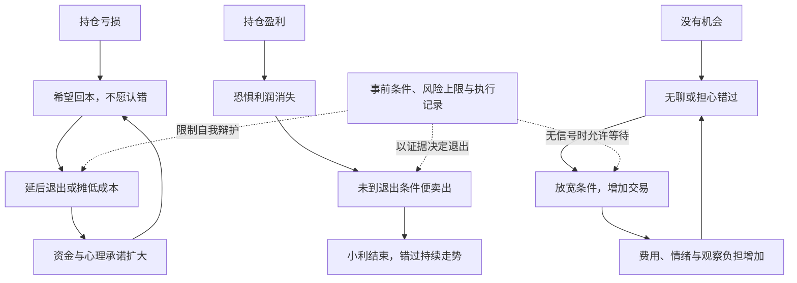

# 《炒股的智慧》第五章：华尔街的家训——深度拆解

> 原始材料：用户提供并已更名的《炒股的智慧_第五章.pdf》，共20页。PDF第3—20页对应印刷页95—112；以下页码均指印刷页码。已核读全部正文页。
> 范围：第五章，包括作者整理的家训，以及作者转述的巴菲特、索罗斯、巴鲁克、利物莫和施瓦格的观点。后者属于本书的二手转述，不视为已核验的原始引文。数字例子仅用于解释和检验论证。

## x → f → f(x)

- **x**：为什么一个人明明知道止损、等待和独立判断的重要性，交易时却反复把小错拖成大亏、把大机会做成小利，还在没有机会时不断下单？
- **f**：用事前计划约束亏损、盈利和无机会三种状态下的反应：先限定风险与观察范围，再依据市场证据执行入场、持有和退出，并通过复盘修改方法，而非在持仓压力下临时修改理由。
- **f(x)**：评价一笔交易，不再只问赚没赚钱，而要问它是否符合事前条件、风险是否受控、有没有被成本价和情绪改变规则，以及这套方法在完整记录中是否真的有效。

## 核心命题

**交易纪律的作用，是防止希望替亏损找借口、恐惧替盈利按下结束键、无聊替入场制造理由。**

本章把前几章的方法转化成行为约束。作者的重点不在增加更多预测技巧，而在解释：为什么同一个人在冷静时认可的原则，一旦持仓就不再执行。

但纪律只是让方法被稳定实施；方法本身有没有优势，需要独立检验。严格执行一套无效方法，也可能持续亏损。

## 关键洞见

### 1. 最危险的不是一次看错，而是看错后不断扩大承诺

96页反复强调止损；98—99页反对为了摊低成本而向下加仓；103—104页批评为了捍卫自己的判断而否认市场变化。

三者构成同一条失控链：

**判断受挫 → 不愿确认损失 → 为持有寻找理由 → 增加投入或延后退出 → 更难承认错误。**

这里损失的不只是钱。每次增加投入，都会提高下一次认错的心理代价，导致更强的自我辩护。止损是在打断这条链，而不是承诺下一次一定看对。

作者以“市场从来不会错”迫使交易者服从现实约束。更准确的理解是：你的解释不能取消当前价格及其对账户的影响。它不能推出所有市场价格都等于公司价值，也不能证明每次下跌都要求任何策略立即卖出。

### 2. 成本价记录过去，不能独立决定下一步

97—98页要求忘掉入场价；101页又说“跌得很低”不能单独构成买入理由，“已经很高”也不能单独构成卖出理由。

共同针对的是参照点错位：交易者用过去的价格衡量委屈与满足，却把它误当成未来机会的依据。

| 容易问的问题 | 它实际围绕什么 | 更有用的研究问题 |
|---|---|---|
| 等回本再卖行不行？ | 我过去付了多少钱 | 当前持有依据是否仍成立？ |
| 从15元跌到5元还不便宜？ | 距离历史高价有多远 | 下跌原因与现有价值或趋势是什么？ |
| 已经赚很多，是不是该卖？ | 我现在有多满足或害怕 | 哪项退出条件已经发生？ |

“忘掉入场价”不等于删除成本记录。成本仍用于计算收益、费用和风险；作者要排除的是用回本愿望替代持有判断。

### 3. 分散风险和集中注意力，约束的是两种资源

96页既要求将资本分成5—10份，又建议先集中注意3—5只股票，逐步扩大观察范围。表面上看，一个要求分散，一个要求集中，实质上分别约束资金损失和认知负荷。

**资金不能全部压在一次判断上；判断范围不能超过实际观察能力。**

原文在持仓与关注范围的表述上有交叠，不能据这些数字拼出唯一最优组合。作者个人能关注20只，也不意味着所有人都应关注20只。

本笔记推论：需要分别记录投入了多少资本、各头寸承担什么共同风险，以及自己能持续核查多少对象。买了很多名字不自动等于风险已经分散；买得少也不自动等于研究足够深入。

### 4. 耐心与果断是同一规则在不同状态下的表现

98页反对为“每天完成工作”而交易；108—109页转述利物莫等待并持有大势的观点；111页同时强调机会来时要采取行动。

三者可以用状态区分：

| 状态 | 需要的行为 | 最常见的干扰 |
|---|---|---|
| 尚无入场条件 | 等待 | 无聊、怕错过、想证明勤奋 |
| 入场后条件仍成立 | 继续按规则持有 | 害怕利润被收回 |
| 入场或退出条件已触发 | 执行 | 犹豫、期待更好的价格 |

所以耐心不是永不卖出，果断也不是随时行动。两者都依赖事前条件，否则“有耐心”可以成为死扛借口，“果断”也可以成为冲动的美名。

### 5. 自信要保护执行过程，不能保护已经失效的解释

102页要求制定计划并执行，也承认方法应随经验修正。103页指出研究得越多，越可能对股票产生感情；110—112页又谈到独立、自信、直觉以及对结果负责。

其核心张力是：交易者既要有足够信心执行，又要允许新信息推翻自己。

较稳妥的分工是：

- 交易前，明确理由、触发条件、失效条件和风险。
- 执行时，依据预定条件行动，不为一时不甘临时开例外。
- 复盘时，检查规则是否有效、是否执行、哪些条件需要修改。

这不是禁止在交易中响应新事实。新事实可以触发预先定义的重新评估；问题在于把“我不愿承认亏损”包装成新的事实。

## 理解阻力：亏损、盈利与等待怎样变成恶性循环

以下为本笔记根据全章整理的行为回路，并非原文原图。

作者强调的“反人性”，可以具体理解为改变这三个回路中的行为，而不是要求自己消灭恐惧、希望和无聊。

## 实践指引：把家训改写成可以复盘的问题

以下用于阅读应用和模拟研究，不是本章已经验证的完整交易系统。

### 1. 用一张记录区分规则、证据和感受

| 项目 | 应记录的内容 |
|---|---|
| 方法类型 | 长期价值、趋势交易或其他；时间尺度是什么 |
| 入场依据 | 哪些当时可观察的信息满足条件 |
| 退出依据 | 什么事实构成失效，盈利后怎样更新退出参考 |
| 风险 | 数量、计划退出距离、费用与无法按价退出的可能 |
| 加仓依据 | 新证据是什么，加仓后全部持仓风险是多少 |
| 情绪 | 是否急于回本、怕错过、想追回刚才的亏损 |
| 结果与执行 | 赚亏各多少，哪些动作符合或违反规则 |

把情绪单独记录，是为了看出它是否改变动作，不能把“很有信心”直接填进证据栏。

### 2. 区分方法修订与临场找借口

例如，原计划达到某条件退出，条件发生后却想“再等等”，应检查：新理由是否有可观察事实？是否适用于其他同类交易？是否只是因为当前账面不好看？

若一个解释只在不愿卖出时才出现，而且无法写成可重复条件，它更可能是在保护情绪。

### 3. 把“不要向下摊平”理解为风险约束

原文98—99页不是讨论所有分批建仓，而是重点警告：错误后为了更快解套，投入越来越多。作者也承认升势中的正常回调与新证据可能构成例外。

研究时应区分：

- 入场前已明确的分批条件与总风险上限。
- 下跌后临时追加资金，以降低平均成本并逃避认错。

两者动机和约束不同，但前者也不能仅靠“事先计划”就证明有效。每次追加仍应检查整体风险，不能拿事前计划掩护无限加码。

### 4. 用原文日记核对“不执行”的代价

100页记载：xirc，2000股，17.25元买入，曾升至23.50元，原拟21.50元卖出却迟疑，后来跌到16.25元。

按所列价格计算，不计费用：

| 情境 | 计算 | 结果 |
|---|---|---|
| 若在计划价21.50元成交 | 2000 × (21.50 − 17.25) | 盈利8500元 |
| 后来价格16.25元 | 2000 × (16.25 − 17.25) | 亏损2000元 |
| 两种结果之差 | 8500 − (−2000) | 10500元 |

原文称原可保证“8000美元”利润，与所列价格精算的8500相差500；本章没有说明是约数、费用还是记述差异。本笔记保留差异，不擅自补出原因。此外，计划卖价本身不能“保证”实际成交。

这个例子的作用是展示迟疑可能造成的后果，不是证明所有退出规则都应越早执行越好。要评价21.50这个阈值，还需要更多同类交易。

### 5. 检验策略优势时，同时看胜率和盈亏幅度

以下是本笔记为检验原文而补充的算术示例，不是书中数据：

**平均净结果 = 胜率 × 平均盈利 − 败率 × 平均亏损 − 平均成本。**

- 假设100次交易中40次各赚3单位，60次各亏1单位：合计120−60=60单位，扣成本前为正，胜率只有40%。
- 假设100次交易中70次各赚1单位，30次各亏3单位：合计70−90=−20单位，胜率70%仍亏损。

这直接说明110页把“胜算”解释成每次胜率必须超过50%的说法过强。正确的问题应包括赚亏幅度及成本，而非仅靠主观把握或胜率门槛。有限样本中的平均结果也不是未来承诺。

## 例子列表

- **连续十次幸运不能保护第十一次（96页）**：作者用连胜后的失败提醒不能豪赌。← 支撑x，展示f的生存约束。
- **保留少量持仓维持关注（97页）**：作者用100股小头寸提醒自己持续观察。← 展示f(x)的个人实施方式；这仍是风险敞口，不是免费注意力工具。
- **全职初期每天必须交易（98页）**：作者误把交易次数当成工作成果，为此付出损失。← 支撑x，说明等待的必要性。
- **上海石化45→35→25→10美元（98页）**：逐次下跌诱发补仓，使风险持续扩大。← 展示失控机制；价格为本书记述，未作历史行情核验。
- **王安电脑破产的反例（99页）**：过去多次摊平成功，不能排除后来遇到无法恢复的标的。← 检验f的边界，提醒极端失败风险。
- **10元买入、涨至12元后上移退出点（99页）**：保护利润，同时避免把退出点贴得过紧。← 展示f的取舍。
- **三人排队探路的比喻（100页）**：跟随朋友可能只复制入场，无法同步获得退出判断。← 支撑x，展示独立决策的必要性。
- **xirc日记（100页）**：事前有卖点，实际迟疑仍可能把盈利变成亏损。← 支撑x，暴露执行瓶颈。
- **ihni从5美元买入跌至0.25美元（101页）**：作者因跌得多而买，拒绝止损，5000美元变成250美元。← 支撑x，反驳历史跌幅等于便宜。
- **修旧本田的感情（103页）**：投入时间和劳动产生依恋，类比深入研究股票后不愿接受反证。← 展示f要处理的认知阻力。
- **本章转述巴菲特1969年暂离市场（105页）**：没有符合自身方法的机会，就接受错过其他机会。← 展示f(x)的能力边界。
- **索罗斯从小规模开始、顺利再增加（105—106页）**：用逐步投入而非一次押满应对不确定性。← 展示f。
- **德国银行持股价值的故事（106页）**：作者转述索罗斯用一个可理解的价值差异提出投资理由。← 展示f的聚焦研究；不能忽略负债等完整估值条件。
- **利物莫过早获利后等不到回调（109页）**：按小波动反复操作可能失去大势中的收益。← 展示f(x)为什么包括持有。
- **施瓦格15项要点（110—112页）**：方法、自律、风险、个性、耐心与责任共同构成执行条件。← 汇总f，不构成成功的充分证明。

## 结论列表

1. 一次错误可以是有限损失，拒绝认错却可能使风险不断扩大。
2. 已付出的成本不能独立决定一项持仓是否仍值得保留。
3. 历史跌幅不是价值证明，历史涨幅也不是退出证据。
4. 分散资金与集中注意力可以同时成立，因为它们管理不同资源。
5. 没有机会时，等待应当被允许成为完整的工作结果。
6. 有效条件触发后的执行，与无条件的冲动行动不同。
7. 研究投入可能增加理解，也可能增加对标的的情感依附。
8. 自信应允许新证据推翻旧判断，纪律应允许复盘修正旧规则。
9. 交易方法需要同时具备可检验的优势、可承受的风险和可持续的执行方式。
10. 胜率超过50%既不是盈利的充分条件，也不是所有盈利方法的必要条件。
11. 接受有限亏损是风险管理的一部分，持续亏损仍须追问方法是否失效。
12. 对行动负责意味着检查可控制环节，不意味着能够控制一切结果。

## Q-A 问答链

### Q-A 问题结构图

### Q1：为什么懂止损仍会大亏？

- **结论**：知道规则不等于愿意承担执行规则时的心理代价。
- **形式化**：亏损 → 不愿确认 → 推迟退出 → 更大亏损 → 更难确认。
- **论证**：①止损使账面损失成为已接受的结果。②交易者可能把这理解成能力被否定。③于是借小反弹和新解释延后退出，最终让错误代价扩大。
- **边界**：不是所有亏损都来自心理失误，也可能来自规则失效或无法按计划成交。

**Q1 → Q2**：Q1指出认错困难会扩大损失，但还没有办法在压力来临时阻断它，因此要建立事前约束。

### Q2：怎样阻止自己越错越押？

- **结论**：把失效条件、投入边界与追加条件放在交易前确定。
- **形式化**：先限定风险 → 证据变化 → 按条件行动，而非按回本愿望追加。
- **论证**：①临场压力容易让判断偏向自我辩护。②事前记录提供一个不随当下愿望移动的参照。③限制总投入和追加条件，可以避免只为摊低成本而持续增加承诺。
- **边界**：计划本身可能错误，且计划损失不是实际损失保证；事后仍需检验。

**Q2 → Q3**：Q2限制了单次投入，但资金要如何分配、能观察多少标的仍未解决，所以需要区分资本和注意力。

### Q3：分散与集中矛盾吗？

- **结论**：分散约束资金集中风险，集中约束认知负荷，二者可以兼容。
- **形式化**：资本不过度集中 + 标的不超过观察能力。
- **论证**：①一次判断不能支配全部生存资本。②每增加一个主动观察对象，也增加信息处理负担。③因此要同时考虑风险分布和实际跟踪能力，而不是只数股票数量。
- **边界**：不同方法对研究对象数量要求不同；作者的个人关注上限不是通用最优值。

**Q3 → Q4**：Q3限定了投入与关注范围，但在这个范围内仍可能因为无聊乱动，或因犹豫不动，因此必须规定行动时机。

### Q4：等待和果断如何兼容？

- **结论**：条件未到时等待，条件已到时执行，适用的是不同状态。
- **形式化**：无条件 → 等；条件持续 → 持；条件触发 → 做。
- **论证**：①没有条件时行动是在降低入场标准。②条件已触发仍迟疑，则是临时提高执行门槛。③统一参照事前规则，两类偏差才有可能被识别。
- **边界**：条件若含糊或无效，仅靠坚决执行无法补救。

**Q4 → Q5**：Q4要求服从规则，但规则可能不再有效，因此必须区分纪律与固执。

### Q5：坚持计划会不会变固执？

- **结论**：纪律坚持的是明确的决策程序，固执保护的是不许被推翻的结论。
- **形式化**：坚持检验程序 ≠ 坚持原预测必对。
- **论证**：①规则应包含失效和重新评估条件。②新证据出现时按条件修正，本身就是执行计划。③只有因为不愿认错而排斥反证，才是在把计划变成自我保护。
- **边界**：复盘修订也可能过度迎合少数结果，需要完整记录和一致标准。

**Q5 → Q6**：Q5允许检验和修订方法，但本章的方法来自多位风格不同的人，因此还必须判断这些规则能否组合。

### Q6：大师的话能直接照做吗？

- **结论**：应先识别共同原则，再按策略区分具体规则。
- **形式化**：共同约束可借鉴；具体触发须匹配方法与时间尺度。
- **论证**：①本章转述的长期价值投资与趋势交易有不同持有依据。②同样的短期下跌，对不同依据可能有不同意义。③盲目拼接会让人买入时讲价值、亏损时讲长期、盈利时又按短线退出。
- **边界**：区分策略不能成为任何结果都能解释的借口；每种方法都应能明确失效条件。

**Q6 → Q7**：Q6排除了机械抄格言，但即使找到一致方法，也未证明它能赚钱，所以还要检验优势与风险。

### Q7：纪律好就一定赚钱吗？

- **结论**：纪律保证动作一致，不能替代方法的收益优势。
- **形式化**：有效优势 + 风险约束 + 可执行性，缺一项都可能失败。
- **论证**：①纪律能减少临时破坏规则。②若规则本身平均收益不足以覆盖亏损与成本，一致执行仍会损耗资本。③因此应同时检验收益分布、风险和执行记录，不能只用意志力解释成败。
- **边界**：有限记录不能消除未来不确定性；历史优势可能变化。

## 局限与盲区

### 1. “胜率超过50%”把优势过度简化

97、110页将有把握与超过50%的胜率相连，并在110页作出过强判断。前文算术反例已表明，胜率要结合平均盈亏与成本解释。主观不确定也不能直接推导客观概率恰好为50%。

96页提出风险报酬至少1:3，也没有交代预期盈利怎样估计、实际能否兑现。画出三倍目标，不等于已经取得三倍平均盈利。

### 2. “市场不犯错”是行为告诫，不是估值定理

本章一方面要求服从市场，另一方面转述巴菲特寻找低于价值的价格、索罗斯批评市场理论。如果把市场永远正确理解成价格永远等于价值，内部就会冲突。

将其限定为“不要否认当前价格的实际约束”，才能保留其行为意义，而不抹掉价值判断与市场价格的差异。

### 3. 本章转述不能取代大师原著与原始记录

“准备永远持有”“只在升势买入”“从小量开始”等句子，属于作者选择和转述的部分观点。不能据此概括某位投资者的全部方法，也不应把声望当作规则正确的独立证据。

106页用个人超额收益记录反驳市场理论，缺少对风险、样本和运气等解释的排除。该论证本身不足以完成理论证伪。

### 4. 人性稳定，不意味着具体参数永远有效

95页宣称这些原则百年前、百年后均适用。恐惧、希望和从众可以持续出现，但本章没有因此证明固定止损比例、观察数量或具体技术条件永远有效。应区分较一般的行为问题和依赖环境的操作参数。

### 5. “毫不费力”与“直觉”不能代替有效性检验

110页说适合自己的方法应当执行顺畅；112页说专业直觉来自实践。可以把它们理解为减少反复内耗和形成模式识别，但不能推成“让我舒服的方法就是好方法”。盲目自信也可能很轻松，有效风控反而可能令人不适。

### 6. 责任需要指向改进，不能变成结果自责

112页要求为结果负责。其有用含义是检查信息选择、仓位、规则和执行中可控制的部分。它不能推出每次损失都可避免，也不能把随机不利结果一律归为品格缺陷。

## 与前几章的衔接

第三章建立“错时亏小、对时赚大”的目标；第四章把它放到买点、失效点和动态退出上；第五章解释人为什么会破坏这些安排，以及怎样用计划、注意力边界和复盘维持执行。

本章读完应留下的检查句是：**我现在的动作，来自原有证据和条件，还是来自不愿认亏、害怕利润消失、急于找事做？** 这个问题不能替你发现收益优势，但能帮助识别自己什么时候已经离开原本的方法。
