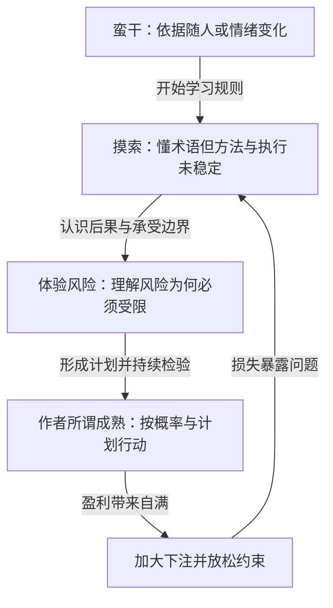

# 《炒股的智慧》第八章：和炒手们谈谈天｜深度拆解

> 来源：用户提供的第八章全文。原文路径：`/Users/minyanhua/MinerU/炒股的智慧_第八章.pdf-9cec0994-ca54-4a3f-aaf4-b86f65358206/炒股的智慧第八章.md`
> 阅读日期：2026-11-10。本文限于所给章节，作者的收益、历史统计、人物经历和市场比例均为原文转述，未独立核验。原文行动性语言作为分析对象处理。实践部分为阅读与研究练习，不是具体证券操作建议。

## x → f → f(x)

- **x**：为什么一个人已经知道止损、分散和顺势，仍无法形成可重复的交易能力；怎样判断自己是否真正学会了？
- **f**：作者把学习解释为从冲动操作、机械试规则、切身理解风险，到形成计划并以概率思考的过程；时机提供判断依据，资金管理控制失败代价，情绪控制使计划不在压力下变形。
- **f(x)**：评价进步时，不只看近期赚了多少，还要检查依据能否事前说明、损失是否受约束、规则是否被执行，以及获利能否经受重复检验；同时避免把自信、年资和一次大亏当作能力证明。

## 核心命题

**知道规则，只获得了交易语言；能在不确定的结果和真实压力下，让判断、风险规模与行动保持一致，才开始形成可重复的能力。**

这是本章最有价值的主线。作者进一步将成熟称为“久赌必赢”，但本章没有提供足够数据证明其方法具有稳定优势，更不能据此推出个人必然成功。理解学习机制，与接受盈利保证，应当分别判断。

## 关键洞见

### 1. 规则的效果取决于它与整个决策是否配套

作者最初把止损设为跌1美元，后来改为10%和20%，仍不断亏损。他又举例：30美元买入，亏时27美元退出；涨到35美元后将退出点上移到31.50美元，最终只赚1.50美元。

关键不是证明某个固定比例一定错误，而是说明：**单独使用一条正确原则，不能证明整个方法有效。** 买入位置、价格波动、退出办法和交易成本，都可能改变这条规则的实际结果。

按作者给出的简化结果，如果每次亏3美元、赚1.50美元，不计成本，需要胜率超过约三分之二才有正的平均收益。这里只是算术说明，不代表其全部交易实际具有相同盈亏。

### 2. 摸索期同时存在“方法不行”和“没有照做”

作者不仅找不到合适的买卖规则，还会在股价下跌时下移止损点；已有浮盈时，却更容易遵守退出规则。

这两种失败需要分开：

| 问题 | 原文表现 | 需要检查什么 |
|---|---|---|
| 方法缺陷 | 持续小亏，偶尔盈利也不够覆盖损失 | 完整方法是否具有优势 |
| 执行偏离 | 怕止损后反弹，临场下移退出点 | 为什么允许扩大原定损失 |

**没有优势的方法，严格执行也可能亏；有优势的方法，执行变形也可能亏。** 如果两者不分，交易者会不停换指标，或把一切亏损归咎于心态，两种做法都妨碍学习。

### 3. 风险的核心，是损失会不会越过承受能力

作者两个星期亏掉53000美元，而按其原定规则，损失应约为4000美元。他将原因归结为下注过大和不及时止损。

实际损失约为原计划的13.25倍，揭示的是风险预算失去约束力。这里不能推算账户回撤比例，因为本章未提供同期总资本，也没有完整持仓与成交记录。

机制是：**急于弥补过去损失 → 增加下注 → 无法接受认错 → 希望取代分析 → 亏损越过原定边界。**

这也是本章对“我已经懂了”的最有力反证：理解和自信增长后，风险反而可能扩大。

### 4. 概率思维必须同时考虑赢面与盈亏大小

作者一方面强调赢面超过50%，另一方面也承认70%的正确率仍可能无利可图。后一句比“超过50%就胜定”更接近完整问题。

**平均净收益 = 胜率 × 平均盈利 − 败率 × 平均亏损 − 平均成本。**

例如，假设胜率70%，每次赢1份、输3份，则平均为0.7−0.9，即亏0.2份；假设胜率40%，每次赢3份、输1份，则平均为1.2−0.6，即赚0.6份。两例均未计成本，只用于展示胜率不能单独决定结果。

因此，所谓“成熟”不应只是更相信自己能猜中，而是能检查判断、损失和收益如何共同组成结果。

### 5. “无招”应理解为熟练运用，不能变成免于解释

作者把熟练掌握临界点比作从有招走向无招：规则不再需要逐条默念，情境判断已成为习惯。

有用的理解是：**明确规则 → 反复实践与反馈 → 识别适用条件 → 更熟练地执行。**

但另一种路径也同样可能发生：反复参与 → 偶然盈利 → 信心增强 → 把冲动称为直觉。区分两者，需要可追溯的事前判断与持续结果，不能只凭当事人感觉。“难以言传”说明传授困难，不能代替验证。

## 四阶段模型：看行为变化，不给自己授予身份

这不是必须经历的线性课程。原文也承认阶段交错；反馈路径是拆解推论，依据作者多次“大赚后大亏”的经历绘制。

| 阶段 | 核心缺口 | 有意义的进步证据 | 不能当作进步证据的东西 |
|---|---|---|---|
| 蛮干 | 缺少独立、稳定的决策依据 | 买卖前能写清理由与失效条件 | 刚入市就赚了钱 |
| 摸索 | 方法效果与执行问题混在一起 | 能分开检查规则结果与偏离结果 | 看过很多书、用过很多指标 |
| 体验风险 | 对后果缺乏真实约束 | 损失出现时仍维护风险边界 | 亏得够多、足够痛苦 |
| 作者所谓成熟 | 仍需证明优势及其持续条件 | 记录支持方法、执行与风险控制 | 自称有直觉，或短期高收益 |

本章最值得借用的是阶段中的问题描述。没有证据表明每个人都要走同一路径，更没有证据表明进入第四阶段就永久不会退步。

## 实践指引

以下是由本章推导的学习与研究办法，不是作者给出的标准化交易系统。

### 建立一份“依据—风险—执行”记录

复盘一个历史案例或已有决策，分别写下：

1. **依据**：决定发生前能知道什么？什么观察会否定这个理由？
2. **风险**：原先允许承担什么损失？结果为何可能超过计划？
3. **执行**：实际动作与原定动作有什么不同？改变是因为新信息，还是因为不愿确认亏损？
4. **检验**：类似案例总体怎样？有无成本、失败样本或事后挑选问题？

这样可以避免“赚了就是水平，亏了就是心态”的循环解释。

### 把反复修改规则，变成可比较的假设

作者从1美元改到10%、20%，但没有展示同期对照与完整样本。学习者可以在历史研究中固定其他条件，比较不同退出规则，并记录改变规则的时间与理由。不能在看过结果后选择最漂亮的参数，再把它当成事前可知的方法。

目标是辨认问题来源，不是从本章找到一个万能止损数字。

### 把模拟与真实压力视为不同学习任务

作者认为纸上交易浪费时间，因为不能产生真实恐惧与贪婪。其前半个观察有道理，结论却过度：模拟可以检验规则是否清楚、计算是否正确及流程能否执行，只是不能完整检验资金压力下的行为。

**流程学习与情绪学习各有对象，不能因一项训练不完整，就判定其毫无价值。** 这也不构成要求读者立即实盘的理由。

### 给继续投入设前瞻性标准

面对“已投入多年，放弃就白费”的想法，分别记录过去投入和未来代价，再判断接下来是否有可验证的改进。过去成本不能证明继续参与更好。

如果已有数年经验却持续无法建立有效方法，合理的问题是“下一阶段凭什么不同”，而不是“大亏是否说明即将成功”。

## 例子列表

- **亲戚反对卖出亏损股票**：把是否回到买价当作退出依据。← 支撑 **x**：直觉中的合理与风险控制可能冲突。
- **蛮干期幸运盈利**：作者先赚钱，反而对悟性充满信心。← 支撑 **x**：结果不能单独证明能力。
- **1美元、10%、20%的止损尝试**：更换参数未解决整体亏损。← 展示 **f**：规则需要与完整方法配套。
- **30美元买入的盈亏例子**：亏3美元、赚1.50美元仍可能总亏。← 展示 **f**：胜率要结合盈亏大小。
- **下移亏损仓位止损点**：明知不对仍因害怕反弹而改变计划。← 展示 **f**：执行偏差有独立作用。
- **转向期货却更快亏损**：换市场未解决原有问题。← 支撑 **x**：更换对象不能自动修复决策。
- **两个星期亏53000美元**：实际损失远超作者计划约4000美元。← 展示 **f**：仓位与退出必须共同约束后果。
- **随后两年年回报超过100%**：作者用个人经历支持方法成熟。← 表达期望的 **f(x)**；未经独立验证，不能证明长期或低风险。
- **同一荐股消息在不同位置出现**：作者要求结合走势位置解释消息。← 展示 **f**：情境影响信息含义；其推测的联手操纵并未被证明。
- **王安电脑由强转衰**：作者借此反对把单股下跌一律视为摊低成本机会。← 支撑 **f(x)**：检查资产前景，不能只盯买入成本。
- **电工老师讲“夹着尾巴做人”**：作者以多年后仍记得的训诫收尾。← 凝练 **f(x)**：保持克制，不让自满破坏边界。

## 结论列表

1. 初期盈利可能强化错误方法，而不是证明悟性。
2. 止损限制一次错误的后果，却不能单独创造交易优势。
3. 规则有缺陷与没有遵守规则，是两类需要分别检验的问题。
4. 仓位过大可能使原本理解的退出规则失去实际约束力。
5. 胜率只有结合平均盈亏和成本，才有收益意义。
6. 大亏能促成反思，也可能只是损失，不能证明成功临近。
7. 多年参与不自动等于多年有效学习。
8. 熟练直觉仍需要记录与反馈，不能仅靠自信确认。
9. 模拟无法复制全部资金压力，但可以承担明确的流程训练任务。
10. 克制的作用，是让已经学到的规则在自满和压力下仍有效力。

## Q-A 问答链

### Q1：为什么会背规则还会亏？

- **结论**：会复述原则，不等于方法有效或能执行。
- **形式化**：懂规则 ≠ 方法有优势 ≠ 压力下照做。
- **论证**：① 原则没有自动确定买卖条件。② 条件组合可能总体无利可图。③ 即使条件合理，执行也可能偏离。
- **边界**：亏损本身不能证明方法错误，有效方法也可能经历不利结果。

**Q1 → Q2**：因为 Q1 留下了“方法本身可能无效”的问题，所以要检查连止损这样的正确原则为何仍会产生亏损。

### Q2：止损也会越止越亏吗？

- **结论**：如果获利不足以覆盖反复损失和成本，连续止损仍会侵蚀资本。
- **形式化**：损失受限 ≠ 总收益为正。
- **论证**：① 每次小亏仍是真实支出。② 偶尔的小赚未必覆盖累计亏损。③ 因而止损须与入场和获利规则一并评估。
- **边界**：这不证明取消止损更好，也不证明固定比例必然无效。

**Q1 → Q3**：因为 Q1 同时指出执行可能偏离，尚未解释人为何会违背已经认可的规则，所以要追问实际失控的过程。

### Q3：方法合理为何仍会失控？

- **结论**：当下注与翻本期待放大时，人可能为避免眼前认错而放宽风险约束。
- **形式化**：急于赚钱 → 下注过大 → 不愿退出 → 原定损失扩大。
- **论证**：① 更大的下注提高了损失的心理代价。② 人更愿等待反弹。③ 下移退出条件让原先预算失效。
- **边界**：实际损失超过计划也可能来自价格跳变与成交限制，不能一律归咎于情绪。

**Q3 → Q4**：因为 Q3 说明痛苦损失可能暴露执行问题，但尚未证明必须付出这种代价才能学会，所以要检验“大亏毕业论”。

### Q4：大亏是毕业的必修课吗？

- **结论**：大亏可能提供反馈，但不是学习的必要条件，更不是成功临近的证据。
- **形式化**：受损 → 可能反思；受损 ≠ 能力形成。
- **论证**：① 损失使后果变得具体。② 是否改变后续行为仍需观察。③ 没有改进机制，大亏只会继续消耗资金与时间。
- **边界**：这里否定的是普遍化的必修与保证说法，并非否定作者从亲历中学到东西。

**Q2 → Q5**：因为 Q2 证明小亏与盈利必须合并计算，尚未说明怎样判断整体有利，所以需要检查作者对赢面的解释。

### Q5：赢面过半就能久赌必赢？

- **结论**：赢面过半既不是获利的必要条件，也不是充分条件。
- **形式化**：胜率 × 平均盈利 − 败率 × 平均亏损 − 成本 → 平均净收益。
- **论证**：① 高频小赢可能被少数大亏抵消。② 低胜率也可能由足够大的盈利覆盖损失。③ 即使平均有利，有限资金、结果相关和优势变化仍可能导致失败。
- **边界**：公式是核对结果的框架；样本中算出正值，不保证未来分布不变。

**Q4 → Q6**：因为 Q4 排除了用亏损的痛苦程度判断毕业，尚需建立能够观察的学习标准，所以要转向行为与记录。

**Q5 → Q6**：因为 Q5 排除了只用胜率判断能力，也表明平均收益存在估计与持续性问题，所以进步标准还必须包含完整结果和适用边界。

### Q6：怎样判断自己真的进步？

- **结论**：进步应体现在判断可解释、风险可约束、执行可核对，以及方法得到更严格检验。
- **形式化**：事前依据 + 风险边界 + 执行记录 + 重复检验 → 可审查的能力证据。
- **论证**：① 事前记录减少事后编理由。② 核对行为区分方法与执行问题。③ 汇总完整样本检验能力是否超出偶然结果。
- **边界**：这是研究框架，没有一个从本章即可推出的统一样本量或毕业期限。

## 局限与盲区

### “久赌必赢”把有利条件说成了个人保证

作者强调概率、少量下注和大赚小亏，这些概念有助于离开单次胜负思维。但“长期胜定”需要优势真实、环境与分布足够稳定、成本可控、资本能够承受不利序列等条件。两年个人高收益不能独立证明这些条件，也不能证明风险极小。

尤其要区分“单次胜率”和“长期净盈利概率”：让利润奔跑可能改变盈亏大小，不意味着单次获胜概率自动增加。

### 大亏后“千万不要放弃”，带有幸存者与沉没成本风险

作者以成功炒家曾经破产为鼓励，却没有展示同样破产、坚持后仍失败的人。成功者经历过大亏，不能推出经历大亏的人接近成功。自己已经投入多年，也不是继续参与的充分理由。作者对家庭责任的忧虑，反而说明成本需要纳入判断。

### 年化回报数字不能直接转成预期

章内的历史年均10%或11%、专业炒手的高收益目标，缺少明确期间、收益口径、分红处理和风险数据。历史均值不是每年结果，更不是未来保证。名义收益也不同于扣除通胀后的购买力增长。因此本文保留为作者当时的叙述，不据此计算读者的未来收益。

### “基金”不是一种同质资产

作者区分单股与分散投资，意在提醒单个公司可能永久衰败。但“基金通常分散、随大市、适合摊平”的说法范围过宽：需要知道具体持仓、集中度、融资结构及目标。不能仅凭名称，就推出下跌只是暂时或长期必然上涨。

### 价格危险信号不是造假损失的保险

作者推测知情者会提前卖出，因此价格与成交量可以使普通人避开造假伤害。这个推论要求知情交易足够早、信号可辨且仍能成交，本章未证明。价格异常也可能有其他原因，平静价格同样不能证明没有造假。

### 跨市场原理相似，不等于操作条件相同

自满、恐惧与风险约束具有跨市场解释力，但股票、期货及不同市场的融资、结算和交易限制不同。作者关于操纵、短期交易者比例的断言没有在本章提供数据，不能由此概括所有市场，更不能用“失败者找借口”替代对制度障碍的检查。

### “夹着尾巴”比“没有情绪”更适合作为结尾

作者把成熟描述为对盈亏不再有情绪。这是理想化画像；检验重点应是情绪有没有改变风险边界和行动，而不必要求人毫无感受。结尾的克制与前文“大赚后自以为懂了”的经历呼应：承认自己可能错，比宣布自己已经不会再错，更有助于持续学习。

## 与第七章的衔接

第七章讨论大行情如何形成，第八章讨论交易者能否持续参与并等待机会。两章合起来留下同一个检验要求：既要证明识别机会的依据，也要证明面对失败时的行动能够受约束。故事解释行情，自传解释成长；两者都不能替代对方法的独立检验。

## 重读时抓住的一句话

**真正的进步，是越来越能解释并约束自己的行动；“我终于懂了”的感觉，仍然需要接受检验。**
