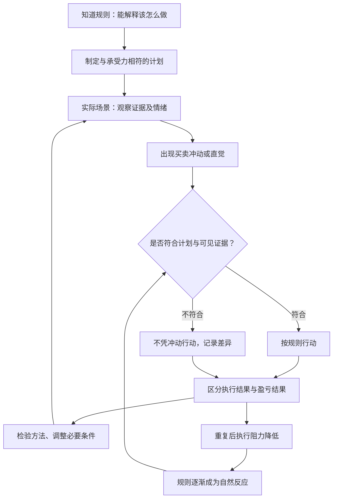

# 《炒股的智慧》第六章：从有招迈向无招——怎样在心理上建设自己

> 材料：用户提供的《炒股的智慧_第六章.pdf》，共12页；PDF第3—12页对应印刷页115—124。已逐页核读正文，以下页码均指印刷页码。
> 方法：范围限于第六章，区分作者主张、书中举例与本笔记推论。实践部分用于阅读应用、模拟训练和复盘，不构成具体证券的买卖建议。

## x → f → f(x)

- **x**：为什么已经知道交易规则、也能写出计划的人，在真实盈亏面前仍然无法稳定执行，怎样把“知道该做什么”变成“当时做得出来”？
- **f**：先识别恐惧、贪婪和希望怎样改变信息选择与行动，再用适合自身承受能力的计划，反复进行观察、规则核对、执行和反省，使原本需要强迫自己的动作逐渐内化为习惯。
- **f(x)**：学习重心从继续搜集招式，转向检查具体决策：当时有什么证据、身体与情绪如何反应、有没有改动规则、改动基于什么，以及下一次如何在同类场景中执行得更一致。

## 核心命题

**“无招”是规则经过练习后成为自然反应；成熟的直觉仍应能回到证据和规则接受核对。**

本章的转变，是从“拥有一套规则”推进到“在压力下仍能实施这套规则”。作者认为困难主要来自自我保护：止损使人面对认错，持有盈利使人承受回吐，等待使人暂时放弃赚钱想象。规则要求的动作因此可能与当下最舒服的动作相反。

这一章的价值是解释执行障碍；它没有证明只要心理成熟，交易方法就一定有效。

## 关键洞见

### 1. 情绪的危险，在于它会替你重写问题

116—119页按恐惧、贪婪、希望展开。最值得理解的不是三种名称，而是它们怎样改变判断过程：

| 情绪 | 原文中的触发 | 问题怎样被改写 | 常见动作 |
|---|---|---|---|
| 恐惧 | 曾经巨亏、群众恐慌、怕错过热门股 | 从“条件是否满足”变成“怎样马上避免难受” | 过早卖出、盲从、追高 |
| 贪婪 | 小仓赚钱、幻想后续大涨 | 从“新增风险值得承担吗”变成“当时多买就好了” | 无计划放大仓位、忽视退出 |
| 希望 | 入场后亏损、不愿承认判断失效 | 从“现在证据是什么”变成“怎样等到我回本” | 挑选利好、忽略反证、拖延离场 |

作者特别指出恐惧既能使人不敢买，也能使人追买。怕损失和怕落后方向相反，却都可能让人跳过原来的判断程序。

本笔记推论：训练目标应是识别“我正在用什么问题作决定”，而不是要求自己永远没有情绪。情绪出现可以被记录；它是否擅自接管了规则，才是需要检查的行为。

### 2. 部分成功可能通过加仓，把人推入另一种风险状态

118页的例子：300股、10元买入，涨到15元后后悔当初买少了，于是追加3000股。跌1元，原先的1500元浮盈就变成1800元亏损。

这个变化的核心不只是股价从涨转跌，而是持仓数量从300股变为3300股。原先可以平静承受的波动，突然被放大成心理压力。

**小仓获利 → 想象本可赚更多 → 情绪性扩仓 → 同样波动造成更大损失 → 希望回本 → 更难退出。**

这里“希望”接替“贪婪”成为持仓理由。整个过程并没有增加多少市场信息，却大幅改变了风险。

作者也明确说加仓本身并非错误；如果原计划已经规定试探数量、追加条件和退出安排，性质就不同。但事先写过计划，仍不能保证计划合理或实际执行后没有焦虑。

### 3. 计划必须能被人执行，但“舒服”不足以证明计划安全

115—116页强调风险承受力和持有时间决定方案；121页又要求观察计划效果，必要时修改。作者举例：原来只买两只，资金过于集中以致失眠，可以调整为四五只。

逻辑是：

**方法与承受力失配 → 压力持续上升 → 判断和执行受影响 → 需要调整方案。**

这让心理管理与风险管理连接起来：不应要求自己靠意志力去硬扛一个无法持续执行的风险结构。

但作者116页把满仓一只股票也视为可选方案，主要以能否睡好判断适合与否，这个标准不充分。不了解风险的人也可能很舒服；多买几个同类标的也可能仍承担同一种风险。

因此，本笔记把“舒服”理解为执行适配的检查项，而非风险已经合格的证明。需要同时检查可能损失、共同风险、退出条件与实际承受能力。

### 4. 直觉在本章中是候选信号，不是最终裁决

119—122页讲从有招走向无招。最容易被漏读的是122页的步骤：当内心出现买卖的声音，要将它与规则比较，并检查趋势、大市、公司情况和价量变化，分辨是自以为是还是客观判断。

所以作者给出的实际训练路径是：

**出现感觉 → 找到可观察依据 → 与规则比较 → 行动 → 分析错误 → 再练习。**

这比“跟着感觉走”多了关键的核对环节。无招可以理解为熟练度提升、执行阻力降低，不能据此取消风险上限、记录和检查。

边界也在这里：反复经验既可能形成技能，也可能固化偏见。作者没有提供衡量直觉精度的完整方法，因此“越来越准确”仍需要记录验证。

### 5. 自信、诚实与改变能力，需要一起运转

120—121页列出相信自己、诚实评价、独立判断、自我督促、改变能力和热爱行业六点。它们并非同向用力的口号，而是相互约束的能力：

| 能力 | 解决的障碍 | 缺少约束时的偏差 |
|---|---|---|
| 自信 | 害怕犯错而不能行动 | 过度确信自己的预测 |
| 诚实 | 为结果编造解释 | 只把失败归因于个人无能 |
| 独立判断 | 跟随权威和热门情绪 | 为独立而拒绝他人证据 |
| 自我督促 | 短期努力没有回报就放弃 | 对无效方法无限追加投入 |
| 改变能力 | 方法与市场或自身不再适配 | 每次亏损后都换规则 |
| 热爱过程 | 只想迅速赚钱、无法持续观察 | 沉迷交易，忽略资本与时间成本 |

本笔记推论：应相信自己能学习和执行，同时允许具体判断被推翻。坚持的是检验和学习的过程；需要被证据更新的是具体方法。

## 理解阻力：从规则到直觉，究竟发生了什么？

以下是依据119—122页整理的训练结构，“完整记录与检验”为本笔记补充。

最后一条返回核对环节很重要：熟练不意味着免检。作者所描述的“无需强迫自己”，与“无需任何约束”，是两种不同状态。

## 实践指引：将“心理建设”落实为观察与复盘

以下是本笔记整理的训练方式，适合用于历史回放、模拟决策和受约束的记录练习；不是原文已经验证的训练方案。

### 1. 在决定前留下两种互不替代的记录

**证据记录：** 什么条件已经出现？什么条件尚未出现？什么事实会使当前判断失效？

**情绪记录：** 我是在怕亏损、怕错过、后悔买少，还是急于回本？这种感受是否推动我改数量、改触发条件或推迟退出？

比如“我怕错过”可以真实记录，但不能因此成为放宽入场条件的证据。情绪要被看见，也要和市场事实区分。

### 2. 每次复盘，先分类，再谈修正

| 结果类别 | 需要追问 | 不宜直接得出的结论 |
|---|---|---|
| 按规则赚钱 | 是否只是一次有利结果？ | 我的方法已经被证明 |
| 按规则亏钱 | 是允许的失败，还是方法条件变化？ | 我一定心态有问题 |
| 违反规则赚钱 | 哪个约束被破坏，风险是否被运气掩盖？ | 这说明可以继续破例 |
| 违反规则亏钱 | 是在哪个时刻、因何感受改变动作？ | 只要下次更有毅力就够了 |

这可以避免把所有亏损都叫“犯错”，也避免把所有赚钱都叫“学会了”。

### 3. 一次聚焦一种可观察偏差

例如，针对118页的扩仓问题，可以只练习一个动作：每当想追加时，先写明新增证据、追加数量、追加后总持仓和计划退出时的金额风险。

再检查这个动作是否在所有同类场景都完成，是否降低了无计划扩仓。不要以“这次追加后赚钱了”作为训练成功的唯一标准。

本章强调重复，补上可观察行为和检查标准，重复才有明确对象。

### 4. 核算原文加仓例子

不计费用，并假设追加3000股均在15元成交：

| 阶段 | 持仓与成本 | 账面结果 |
|---|---|---|
| 300股以10元买入 | 成本3000元 | 初始为0 |
| 股价升至15元 | 300股市值4500元 | 浮盈1500元 |
| 在15元追加3000股 | 总成本48000元，总股数3300 | 浮盈仍为1500元 |
| 股价由15元回到14元 | 市值46200元 | 总亏损1800元 |

**从15到14，每股只跌1元，但3300股使账面变化达到3300元。** 原文算术成立。

如果未追加，14元时原300股仍有1200元浮盈。真正改变结果的是新增3000股的价格敞口，并非单纯“运气突然不好”。

### 5. 将“我还会买吗”用作排查依恋的提问

119页建议亏损时自问：如果今天没有这只股票，手上有现金，还愿不愿买？

它的用处是暂时拿走成本价，暴露持有理由是否只剩回本愿望。但它不能机械等同于卖出指令：不开新仓与必须卖出，可能有不同条件，还涉及交易成本、仓位限制和原策略安排。

应把这道题和原持有依据、失效条件一起使用。回答“愿意买”也不是免除风险约束的理由。

## 例子列表

- **五只股票持有20年（115页）**：作者设想每只投入20%，一只翻十倍、两只破产、两只不动，以说明方案须匹配持有周期。← 展示f的计划一致性；不是收益预测。
- **不同数量与止损比例的选择（116页）**：用两三只与五至十只、25%与10%等组合解释承受力差异。← 展示f；比例为作者示例，不能直接当通用风险标准。
- **儿童怕火与服从权威（116页）**：作者以日常学习解释恐惧和权威依赖的来源。← 支撑x的心理背景；是类比，不是因果实验。
- **群众恐慌的传播（116—117页）**：他人的情绪可能替代自身观察。← 展示f需要识别的外部干扰。
- **巨亏记忆导致过早退出（117页）**：为避免重复过去痛苦，将很小甚至想象的风险也当作退出信号。← 支撑x，展示恐惧机制。
- **热门股与怕落后（117页）**：恐惧不只抑制行动，也可能催生追买。← 展示f中对情绪方向的辨别。
- **300股盈利后追加3000股（118页）**：小成功引出后悔和贪婪，再由损失引出回本希望。← 支撑x，展示情绪接力与风险放大。
- **亏损后每天只找有利信息（118—119页）**：期望结果改变了信息筛选。← 展示f必须处理的判断偏差。
- **现金重置提问（119页）**：暂时移除已有持仓身份，重问当前是否仍有理由参与。← 展示f(x)的复核方式。
- **两只过度集中改成四五只（121页）**：根据持续失眠检讨计划与承受力的匹配。← 展示f(x)的适应性；名字增多不自动证明风险下降。
- **止损由痛苦变成自然动作（122页）**：通过观察、经历与反省改变对守规则的感受。← 展示f内化为习惯的过程。
- **游泳不能只靠看书（122页）**：知识需要在实际情境中应用。← 支撑f(x)；不意味着必须靠大额实盘损失学习。
- **巴鲁克两次资金与第六年盈利的故事（124页）**：作者以转述故事说明成长周期漫长。← 支撑f(x)需要时间；不是亏光资金或押上家庭财产的建议。
- **利物莫五年与作者近六年（124页）**：以个人及前人经历提醒不要期待速成。← 支撑f(x)的长期练习；不是达到年限就掌握技能的证明。

## 结论列表

1. 知道规则与在压力下执行规则，是两种不同能力。
2. 恐惧既可能导致退出过早，也可能通过害怕错过而导致追买。
3. 贪婪会改变风险规模，希望则可能为扩大的风险延长停留时间。
4. 小仓位上的成功，不能自动证明更大仓位同样可承受。
5. 适合自己的计划应能持续执行，但心理舒适不能替代风险检验。
6. 熟练直觉应能接受可见证据与规则的核对。
7. 重复可以培养技能，也可以固化偏见，差别在于有没有有效反馈。
8. 按规则亏损不自动等于执行错误，违反规则获利也不自动等于方法正确。
9. 自信应指向学习和纠错能力，而不是某次预测必然正确。
10. 方法可以修改，但修改需要依据，不能只为缓解当前持仓的不甘。
11. 学习需要时间，却不存在由年限保证的盈利资格。
12. 心理训练可以减少执行偏差，不能凭空创造策略优势。

## Q-A 问答链

### Q-A 问题结构图

### Q1：为什么知道却做不到？

- **结论**：交易规则可能要求承受眼前的不适，而自我保护倾向于马上消除它。
- **形式化**：知道应做什么 + 当下不愿承受 → 执行偏离。
- **论证**：①止损要接受亏损与认错。②持有要容忍部分回吐。③等待要接受暂时没有收益。④这些代价可能使人即使懂规则，也临时寻找例外。
- **边界**：执行问题不能解释所有失败；规则不清、方法无效或成交受阻也会造成损失。

**Q1 → Q2**：Q1确认即时不适可能压过规则，但尚未解释它怎样影响信息与动作，所以需要拆开情绪机制。

### Q2：情绪怎样改变判断？

- **结论**：情绪把事实判断改写成避痛、逐利或回本的问题。
- **形式化**：恐惧 → 急于避痛；贪婪 → 放大所得；希望 → 排斥反证。
- **论证**：①恐惧让过去损失或他人反应占据注意。②贪婪使潜在收益压过损失检查。③希望让人只寻找支持持有的信息。④问题被改写后，同样事实就会得到不同解释。
- **边界**：情绪本身也可能提醒真实风险，不能因为它是情绪就一概否定。

**Q2 → Q3**：Q2说明了各类情绪，但还没有解释它们如何前后接续，因此要检查小成功怎样变成大风险。

### Q3：赚过钱为何反而更危险？

- **结论**：小额成功可能诱发无计划扩仓，使后续波动超过承受能力。
- **形式化**：获利 → 后悔买少 → 扩仓 → 同样波动、不同损失。
- **论证**：①初次盈利强化了对未来上涨的想象。②交易者将“当初该多买”变成现在追加的理由。③新增头寸扩大损失敏感度。④回落后又容易以希望替代退出，形成连续偏差。
- **边界**：有明确追加条件和总体风险约束的加仓，不能仅凭价格更高就判为错误。

**Q3 → Q4**：Q3指出临场动作会放大情绪，但提醒自己别贪并不足够，所以需要把约束变成可反复执行的过程。

### Q4：怎样把纪律练成自然反应？

- **结论**：在明确条件下重复执行、记录偏差并反馈修正，才能逐渐降低执行阻力。
- **形式化**：规则 → 情境练习 → 核对动作 → 复盘 → 再练习。
- **论证**：①先明确该做和不该做的动作。②在具体场景里观察自己有没有做到。③区分方法、执行和偶然结果。④对同类场景持续检查，才能知道行为是否真的改善。
- **边界**：本章强调重复与反省，但未给出实验验证的训练频率或毕业标准；重复错误也会变成熟练。

**Q4 → Q5**：Q4预期动作变得自然，却留下自然反应是否可以免除检查的问题，因此必须界定“无招”。

### Q5：无招就是凭感觉吗？

- **结论**：本章的无招是规则内化，直觉出现后仍需回到证据核对。
- **形式化**：直觉提出候选 → 证据与规则复核 → 决定动作。
- **论证**：①作者认为长期观察会形成买卖感觉。②他同时要求核查趋势、大市与价量。③因此成熟感受并非自带真实性，而是一个可以接受检查的判断入口。
- **边界**：主观熟悉与准确识别不等价，直觉质量需由事前记录检验。

**Q5 → Q6**：Q5保留了规则检查，但市场与承受能力可能变化，所以接着要回答何时修改规则而不沦为找借口。

### Q6：计划什么时候可以改？

- **结论**：出现可观察的失配或规则问题时可以改，单纯不愿认亏不足以构成依据。
- **形式化**：事实或执行条件变化 → 检查失配 → 有依据修订。
- **论证**：①作者要求观察计划效果与承受力。②持续失眠等情况提示风险安排可能不可持续。③修订应明确改变什么、为什么，以及新的边界。④否则改变可能只是保护当前持仓。
- **边界**：一次亏损不必然意味着方法失效；增加股票数量也不必然解决共同风险。

**Q6 → Q7**：Q6说明怎样维持计划的适应性，但仍未证明训练成熟足以创造收益，所以需要最后划定心理建设的边界。

### Q7：练到没情绪就能盈利吗？

- **结论**：心理成熟可以减少执行偏差，不能替代有效方法和风险管理。
- **形式化**：执行一致 ≠ 方法有效 ≠ 结果有保证。
- **论证**：①没有情绪干扰，仍可能执行无优势的规则。②再好的规则也有不利结果与环境变化。③所以训练应同时检查行为质量、方法证据和损失约束，而非只追求平静或自信。
- **边界**：本章没有证明完全消除情绪可行，也没有给出心理素质与未来收益之间的确定映射。

## 局限与盲区

### 1. “99%以上错误来自三种心理”没有数据支持

119页给出恐惧、贪婪、希望导致99%以上错误的说法，未交代样本、定义和测量过程。可以把三类心理当作有用的自查框架，不能把百分比当研究结论，也不能据此排除模型、信息、成本和操作问题。

### 2. 主观舒适、分散数量和风险安全不能等同

116页的25%止损示例与前章强调20%上限存在口径张力，本章没有解释其协调方式。它们反映作者在此强调适配性的写法，不能直接合成为统一风险标准。更不能因为满仓一只不焦虑就认定没有问题。

### 3. 计划一致性不是计划质量的证明

115页设想五股等权持有20年，一只变成原值10倍、两只归零、两只不变。如果按这一口径且忽略分红与成本，期末是初始资本的2.4倍，年化约4.5%。这是由假设算出的结果，不是现实收益预估；若“翻十倍”使用其他口径，数字也会变化。

更重要的是，作者没有证明五只股票将出现这种结果。一个计划写得明确、持有得足够久，并不保证它值得执行。

### 4. 逆大众行动不能只靠大众情绪

117页认为普通人恐慌时熊市通常接近结束，缺少可操作定义与样本。其行为启发是不要被情绪传染，而非“大众恐慌即可抄底”。同样，独立判断不是为了不同意多数人而行动。

### 5. 直觉、责任与努力的表述偏强

122页认为造假、操纵等问题都能在价量中找到痕迹，并要求为结果承担全部责任；123—124页又以长期努力鼓励成功。这些表述应保留边界：痕迹未必事前可辨认，结果不完全可控，投入时间也不保证形成优势。

“对过程负责”更适合用于改进可控制环节，不能把所有损失解释为个人不够努力或心态不够完美。

### 6. 成长故事不是训练成本标准

124页转述巴鲁克亏完一笔钱、再投入家庭最后资产，最终第六年取得进展。它说明作者希望读者理解学习漫长，不能证明高额损失是必要学费，也不能证明再投入就会成功。没有成功者的经历同样需要纳入判断。

## 与第四、第五章的衔接

第四章把交易写成入场、失效和动态退出条件；第五章归纳应遵守的行为原则；第六章则解释为什么这些原则会在真实场景中失灵，以及如何通过练习减少知道与做到之间的距离。

本章最值得带走的动作是：**每当出现强烈买卖冲动，先辨认它从哪里来，再核对它是否符合当时可见证据与原有规则；交易后区分方法问题、执行问题和允许发生的不利结果。**
