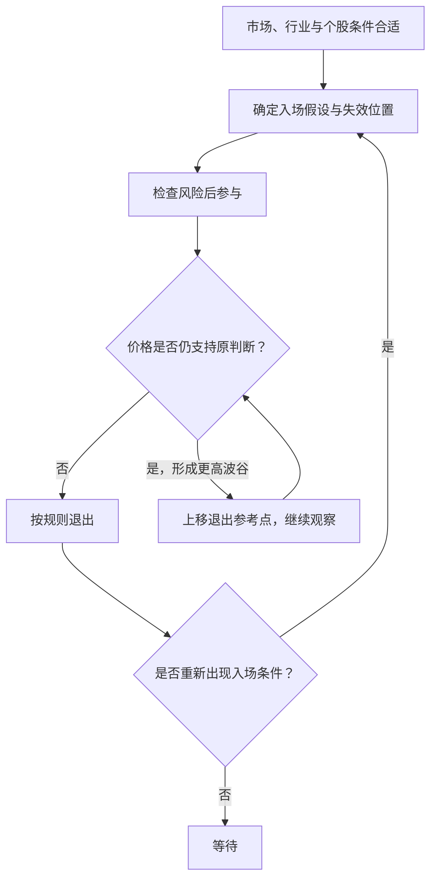

# 《炒股的智慧》第四章：何时买股票，何时卖股票——深度拆解

> 原始材料：用户提供的《炒股的智慧_第四章.pdf》，共17页；PDF第3—17页对应印刷页77—91。以下页码均指印刷页码。原文为扫描件，已逐页核读正文与图4-1至图4-18。
> 范围：只分析第四章。区分作者主张、作者用于解释的心理机制与本笔记的推论；实践部分用于理解和检验书中方法，不是针对具体证券的买卖建议。

## x → f → f(x)

- **x**：在无法提前知道最低价、最高价和下一步走势时，怎样决定入场、继续持有和退出，使一次错误不至于毁掉账户，同时给正确判断留下获利空间？
- **f**：围绕价格可能被市场重新评估的“临界点”组织交易：入场前规定判断失效的条件，用大市、行业和个股结构筛选机会；入场后只在原有依据继续成立时持有，并随有利走势上移退出位置。
- **f(x)**：把“这只股票还能涨多少”改成一组可检查的问题：什么事实支持入场，什么事实推翻判断，承担多大金额的风险，何时允许加仓，何时退出，以及退出后怎样依据新证据重新参与。

## 核心命题

**买点、止损点和获利退出点，必须属于同一个判断体系：条件出现时参与，条件失效时离开，条件持续时允许利润扩大。**

第三章已经提出错时亏小钱、对时赚大钱；第四章把这项原则落实到价格位置和操作顺序。它最有价值的贡献，是让交易者在下单前就面对“我可能错在哪里”，并让持有决策持续接受价格变化的检验。

本章没有证明某类图形必然盈利。临界点首先提供一个组织判断的位置；该位置是否具有可重复的收益优势，还需要另外检验。

## 关键洞见

### 1. 先有可辨认的错误，才有可管理的买点

77页一开头就要求先选择止损点。78—79页的升势例子把这个顺序说得更具体：前一波峰A为15元、波谷B为13元，价格越过A后买入，是在判断新一波升势可能开始；如果随后跌破B，这个升势判断就受到否定。

逻辑是：

**观察结构 → 提出上涨假设 → 指定否定条件 → 计算错误代价 → 决定是否参与。**

这和“买入后跌了再想办法”有根本的时间顺序差异。持仓后，人容易把同一条坏消息解释成暂时波动；事前写下否定条件，能减少临时修改理由的空间。

但必须区分两类止损：

| 类型 | 回答的问题 | 可能的缺陷 |
|---|---|---|
| 结构止损 | 哪个价格变化使原判断失效？ | 距离可能较远，金额风险过大 |
| 金额或比例止损 | 这次错误最多愿意承担多少？ | 可能在原结构仍成立时被正常波动触发 |

本笔记推论：先找有意义的失效位置，再判断相应风险是否可承受；不能为了买得更多而把止损随意贴近价格，也不能因为结构止损较远就无限扩大损失预算。

### 2. 临界点的用途是集中观察，不是宣布未来

78页把临界点解释为公众重新评估股价的位置。79—80页用突破阻力、支撑附近反弹、倒头肩突破等形式展示它的用法。

这些形态的共同结构是：此前某个区域反复引发买卖，价格离开或重新进入该区域，就提供了检验原判断的新事实。

**重复交易区域 → 市场参与者形成预期 → 越界或收复 → 检查预期是否发生变化。**

书中以水变成蒸汽类比临界点，但金融价格没有对应的固定物理阈值；同一条线可以被多次穿越。作者用“临界点”强调观察位置的重要性，不能据此推导价格一旦越线就必然发生质变。

还要看到两种入场逻辑不同：突破买入是在等待强势证据，支撑附近买入是在检验支撑是否有效。两者的确认条件与失效条件应分别记录，不能失败后临时互换解释。

### 3. 分段买入是在交换价格与信息

81—82页承认广为人知的突破可能是假信号。图4-6中，A点是第一次突破；略有回调后，再突破上一波高点的B点被作者视为更好的确认。

作者举例：计划买1000股，可以在A点先买200—300股，其余到B点再买。先买一部分，是为了保留对“突破后直接上涨”的参与；等B点，是为了获取更多持续走强的证据。

| 位置 | 获得什么 | 支付什么代价 |
|---|---|---|
| A点初次突破 | 较早参与，不完全错过直接上涨 | 假突破的不确定性较大 |
| B点再次突破 | 多一次走势确认 | 价格可能更高，部分行情已经过去 |

本笔记推论：分段买入是分配“证据不足时承担多少风险”，不是固定的二八配比。第二次买入后，必须重算全部持仓到退出位置的风险；证据增加不等于风险自动减小。

原文认为B点有助于辨别短线热钱，但仅凭价格突破无法确认哪些交易者已经离场。可以确认的是价格路径变化，资金身份仍属解释。

### 4. 同一个突破，放在不同背景里含义不同

84页的筛选顺序是大市 → 强势行业 → 行业内的代表性或特色个股。85页又比较两只阻力位同为20元的股票：图4-8此前上涨后整理，图4-9此前从高位下跌后整理。作者偏好前者，因为后者上方可能有等待解套的持有人。

这包含两层筛选：

- 外部环境：市场和行业是否支持当前交易方向。
- 内部历史：价格到达同一位置之前，经历了什么持仓与交易过程。

**当前价格相同 ≠ 历史路径相同 ≠ 潜在卖出动机相同。**

作者还比较三个月和半年整理，认为整理越久，原先套牢者可能越多地完成退出，上涨阻力随之减少。

这些心理解释有启发性，但不是对真实持仓结构的直接测量：图形看不见每个人的成本，新买家也可能随时卖出，长期整理也可能来自需求不足。因此，“套牢盘少”“蓄势更充分”应保留为待检验的假说，不能单靠故事把图形变成高胜率信号。

### 5. 让利润奔跑，需要不断更新退出依据

87页要求不执着于最高点，只要走势仍正常就不急于卖出；89—91页再用保本、暴涨转头、量增价滞与移动止损解释怎样离场。

图4-18提供了最连贯的实现：价格形成更高的波谷，退出参考点随之从A上移到B、C、D、E。仍在正常升势中，就给价格一定波动空间；升势结构被破坏，就接受离场。

这里的关键是：允许利润回吐一部分，换取参与更长走势的机会。移动止损无法同时做到“卖在最高点”和“不被普通回调洗出”。作者所说抓到波幅70%是经验目标，不是每次都能实现的比例。

“此刻还愿不愿买入”也不能机械代替持有判断：已有仓位涉及卖出和重新进入的成本，某处不适合新开仓，并不必然代表原持仓已经失效。作者在87页也提醒了频繁交易的费用问题。

## 实践指引：把阅读结论变成可检查的记录

以下是本笔记对作者思路的整理，适用于研究、复盘或模拟检验，不是原文给出的完整交易系统。

### 入场前的一页记录

| 项目 | 应写下的内容 | 暴露出的缺口 |
|---|---|---|
| 市场背景 | 用什么可观察标准判断大市方向 | 只有“我觉得市场不错” |
| 行业与个股 | 为什么选择这个行业和这只股票 | 只有消息、推荐或跌幅 |
| 图形条件 | 采用突破、支撑反弹还是其他结构 | 同时使用互相冲突的理由 |
| 入场触发 | 价格、时间尺度、量能要求 | 盘中一碰就算，事后收盘又改口 |
| 判断失效 | 什么事实出现就承认本次依据失效 | 只写“长期看好” |
| 风险规模 | 退出距离、持仓数量及预计损失金额 | 把股价跌幅当成账户损失比例 |
| 后续处理 | 何时加仓、何时上移退出参考点 | 只规划买入，没有持有规则 |

“放量”“很快弹回”“正常回调”等词，原文没有给出统一的可复现定义。研究时要提前明确观察周期和判定方法；否则同一段走势很容易事后被解释成任意一种形态。

### 用原文数字理解风险距离

78页给出15.10元或15.50元入场、14元或13元止损的例子。下面只用15.10元入场核验两种退出距离：

| 假设入场价 | 假设退出价 | 每股计划价差损失 | 占入场价比例 |
|---|---|---|---|
| 15.10元 | 14元 | 1.10元 | 约7.28% |
| 15.10元 | 13元 | 2.10元 | 约13.91% |

同样数量下，第二种方案的计划价差损失约为第一种的1.91倍。这说明“给股票更多空间”有明确的金额成本。

研究用关系：**计划价差损失 = 数量 × 入场价与计划退出价之差。** 这只是计划值，未包含交易费用，也不是实际损失上限；如果无法在计划价格成交，实际损失会不同。

原文的10%、20%是针对单笔头寸价格损失的经验表述，不应解读为每笔可以承受账户总资金20%的损失。89页还给5元买入、4.25元退出的例子，实际幅度为15%，说明作者自己也没有把10%当成完全统一的机械尺度。

### 持有和退出时的三问

1. **原判断还成立吗？** 对照事前写下的条件，避免用“已经亏了很多”或“才赚这么一点”替代事实。
2. **退出依据有无更新？** 若使用图4-18的思路，应明确新波谷何时算形成，并保留调整记录；不能事后挑选最漂亮的波谷。
3. **现在的动作属于原计划吗？** 因有效新条件重新入场，与因为不服上次止损而立刻买回，是两种不同动作。

### 复盘时检查方法，而非只检查输赢

把记录分成四类：按规则赚钱、按规则亏钱、违背规则赚钱、违背规则亏钱。这样可以识别一次偶然获利是否掩盖了过程问题。

再汇总全部出现过的信号，包含没有成功的突破，检查平均盈利、平均亏损、交易成本、连续亏损及不同市场背景下的表现。作者的个人经历可以提出研究方向，不能代替这些记录。

## 例子列表

- **先定止损再定买点（77页）**：把“可能错在哪里”放在下单之前，确定错误的退出依据。← 展示f。
- **A=15元、B=13元的升势（78—79页，图4-1）**：突破前峰提出新一波升势假设，跌破前谷则否定其结构。← 展示f。
- **突破阻力后跌回（79页，图4-2）**：突破可能是假信号，止损后也可能重新上涨。← 支撑x，展示f的纠错方式。
- **支撑反弹与跌破（79—80页，图4-3）**：同一区域既是提出反弹判断的依据，也是检查失败的位置。← 展示f。
- **正双肩与倒头肩（80页，图4-4、4-5）**：相似转折结构分别提示退出或潜在入场。← 展示f。
- **A点先买少量、B点再买其余（81—82页，图4-6）**：用分段参与平衡错过上涨和遭遇假突破的风险。← 展示f，说明f(x)。
- **跌破后快速收复支撑（82—83页，图4-7）**：作者把放量收复视为机会，并以大户制造恐慌解释；“十次九赚”是个人陈述。← 展示f的候选条件，不能充当统计证明。
- **相同20元阻力位，不同历史路径（84—85页，图4-8、4-9）**：此前下跌留下的潜在解套动机，可能改变突破压力。← 展示f的情境筛选。
- **三个月与半年整理（85页，图4-10、4-11）**：作者以持仓换手解释较长整理的潜在好处。← 展示f的心理假说。
- **多次被同一股票“烫伤”（86页）**：作者会回避反复无法理解的个股，把精力转向更适合自己的对象。← 说明f(x)，不证明三次就是最优阈值。
- **第二个波峰附近提前退出、突破后再买（88页，图4-12至4-15）**：更早退出可减少回吐，但也可能增加误判和重新入场成本。← 展示f的取舍。
- **两周由20元涨到40元（89—90页，图4-16）**：作者在急涨后首次转头时考虑兑现，而非等待无限上涨。← 展示f的异常情境处理。
- **高位量增价不升（90页，图4-17）**：作者视为潜在出货危险；图形本身不能证实卖方身份。← 展示f的警报条件。
- **A→B→C→D→E移动止损（90—91页，图4-18）**：随更高波谷更新退出位置，用部分利润回吐换取继续持有机会。← 展示f，说明f(x)。

## 结论列表

1. 买入之前应能说清楚，什么事实将推翻这次入场判断。
2. 低于过去的价格，只能证明跌过，不能单独证明便宜或值得买入。
3. 技术位置的价值需要结合此前路径和当前市场环境解释。
4. 等待更多确认通常意味着支付更高价格或错过部分机会。
5. 分段买入分配了不确定性，但不会自动减少全部持仓的风险。
6. 止损后上涨不自动证明止损规则错误，正如一次获利不证明入场规则有效。
7. 持有盈利交易的依据应来自仍然成立的条件，而不是对最高价的想象。
8. 移动退出位置，是在利润回吐与趋势参与之间作取舍。
9. 图形能记录成交结果，不能直接显示每个参与者的身份和意图。
10. 可解释的交易故事，需要完整记录与失败样本才能进一步成为可检验的方法。

## Q-A 问答链

### Q-A 问题结构图

### Q1：为什么先定卖点再买？

- **结论**：先定义错误的退出条件，才能判断这次入场的风险是否可承受。
- **形式化**：入场假设 → 失效条件 → 错误代价 → 是否买入。
- **论证**：①任何入场判断都可能出错。②没有退出条件，就无法在事前估计计划损失。③持仓后的自我辩护会增加临时改变标准的可能，所以应先写条件。
- **边界**：提前计划不能保证在预定价格成交，也不能证明入场本身有优势。

**Q1 → Q2**：Q1要求事前定义错误，但还没有说明什么价格变化足以构成依据，所以必须追问临界点的作用。

### Q2：临界点凭什么有用？

- **结论**：临界点把交易判断放在可观察、可重新评估的位置。
- **形式化**：反复交易区域 → 预期聚集 → 越界或收复 → 更新判断。
- **论证**：①某些区域此前多次引发买卖变化。②再次触及或穿越时，可以观察市场是否继续重复原有反应。③因此能围绕该位置同时制定入场与失效条件。
- **边界**：关注某个位置不等于那里必然有收益优势；图形的心理解释也不是物理定律。

**Q2 → Q3**：Q2说明了临界点便于判断，却没有排除越界后又退回的情况，所以必须处理假突破。

### Q3：既会假突破，为何还买？

- **结论**：作者通过有限试探和后续确认来承担不确定性，而非等待绝对正确。
- **形式化**：初次突破小量参与 + 再次走强后追加 + 失效退出。
- **论证**：①完全等到走势充分展开，可能错过部分机会。②第一次突破又可能失败。③分段买入让早期参与较少、追加依赖后续证据，同时保留退出机制。
- **边界**：分段无法消除失败；追加后的总风险、成本与更高入场价仍需计算。

**Q3 → Q4**：Q3提供了应对假突破的操作方式，但还未回答该把有限风险分配给哪些候选股票，所以需要比较背景。

### Q4：同样突破，怎样挑选？

- **结论**：作者按大市、行业、个股及其历史结构逐层筛选机会。
- **形式化**：市场方向 → 行业强弱 → 个股特征 → 具体触发。
- **论证**：①整体环境不利时，个股信号可能受到共同压力。②行业不同，相似个股图形的背景不同。③同一阻力位之前的上涨、下跌和整理，也可能对应不同卖出动机。
- **边界**：书中没有提供这些筛选条件的统一量化定义，也没有给出它们提高收益的统计幅度。

**Q4 → Q5**：Q4帮助选择入场对象，但入场后仍不知道应赚一点就走还是继续持有，所以必须明确获利退出的标准。

### Q5：赚钱后为什么不马上卖？

- **结论**：只因出现利润就卖，会切断仍然成立的上涨判断所能带来的后续收益。
- **形式化**：条件持续 → 持有；波谷抬高 → 上移退出点；条件失效 → 离场。
- **论证**：①买入针对的是某段可能持续的有利运动。②小幅盈利本身没有证明该运动结束。③随结构抬高退出位置，可以在保留参与机会的同时更新保护依据。
- **边界**：持有需要接受部分回吐；不同退出规则适合不同策略，移动止损也可能频繁触发。

**Q5 → Q6**：Q5用退出规则换取持续持有，却必然产生卖后继续上涨的机会成本，所以还要判断这种结果是否意味着做错。

### Q6：止损后涨了，要认错吗？

- **结论**：应先检查当时是否按有效规则行动，再决定是否需要修改规则或重新入场。
- **形式化**：单次结果 ≠ 规则质量；新条件出现 → 重新评估。
- **论证**：①退出时不知道后续路径。②某次卖后上涨，只能说明该次放弃了后续收益。③是否修改规则，需要观察完整样本；若新入场条件出现，也不必为了维护上次决定而拒绝重新判断。
- **边界**：不能拿“纪律”保护无效规则；持续被无意义波动触发的退出机制必须接受检验。

**Q6 → Q7**：Q6把单次结果与规则质量分开，却留下了怎样证明整套规则有效的问题，因此最后要检验长期盈利条件。

### Q7：照着做就能长期赚钱吗？

- **结论**：本章提供了决策与风险控制框架，没有完成长期盈利的证据证明。
- **形式化**：长期结果取决于胜率、盈亏幅度、成本、风险规模与执行，而非单一图形。
- **论证**：①作者的胜率描述没有完整样本。②即使经常赚钱，大额亏损仍可能吞掉收益。③即使亏损受控，缺少有效入场优势也可能在反复试错与成本中持续损耗。④因此需要明确规则并检验完整结果。
- **边界**：过去有效也不意味着未来不变；本章不能独立构成已经验证的自动交易系统。

## 局限与盲区

### 1. 胜率陈述超出了本章证据

78页将自身交易比作赌场，并声称每次胜率超过50%、久赌必赢；83页称某类收复支撑机会十次九赚。这些都是作者经验陈述，没有提供样本范围、失败记录、成本或风险分布。胜率高于50%也不单独决定盈利；亏损平均幅度可能大于盈利。

### 2. 把价格变化解释成大户操纵，可能形成无法证伪的故事

突破失败可以被解释为诱多，跌破后反弹可以被解释为恐慌吸筹，但这些路径也可能来自其他原因。若所有上涨和下跌都能被同一个故事解释，故事就难以约束行动。应记录实际价量条件，保留对资金身份的未知。

原文83页也提醒较长期投资者不必过度关注短期操纵，说明作者并未把这一解释当作所有时间尺度上的统一答案。

### 3. 某些表述之间存在需要明确的张力

- 作者既推荐突破买入，也允许支撑附近买入；两类方法应分别定义，不能混用失效条件。
- 作者既要求正常走势继续持有，也建议第二个波峰附近提前退出；提前退出与等待结构破坏之间存在误判率和利润回吐的交换。
- 作者既建议有利润后保护本金，也主张给升势足够空间；如何兼容取决于波动、时间尺度和退出距离，本章没有给统一答案。
- 作者强调经验与直觉，但没有区分稳定识别能力和对少数成功案例的记忆偏差。

### 4. 经验规则尚不是可复现系统

“强势行业”“龙头”“交易量很大”“很快弹回”“正常运动”都需要操作定义。图4-18的波谷也只有在部分后续价格出现后才可能确认。若事后标注时使用了当时尚不可见的信息，图上的效果会比实际可执行结果更漂亮。

因此，更严谨的学习顺序是：先理解机制 → 明确当时可见信息 → 定义规则 → 保存全部信号 → 检查失败与成本 → 再判断哪些部分值得保留。

## 与第三章的衔接

第三章回答的是“怎样让错误承受得起、让正确充分产生收益”；第四章进一步回答“把错误和正确放到哪些可观察的位置上”。从保本、等待、赚大钱，推进到事前止损、临界点入场、背景筛选和动态退出。

读完本章应能完整写出一句交易假设：**我因什么条件参与；若出现什么事实，就退出；若条件持续，我怎样继续持有并更新保护。** 写不出后两部分，说明尚未把买点理解成一笔完整交易。
