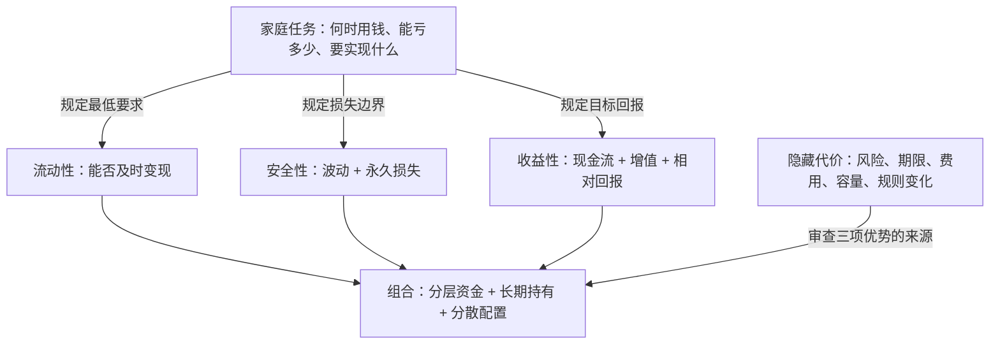

# 第九章《属性：是否存在安全、收益高、流动性好的投资》深度拆解

> **材料范围**：以下拆解严格基于用户提供材料中的第九章，止于第九章“延伸播客节目”。原文件末尾已出现第十章正文，未纳入本章分析。

## x → f → f(x)

- **x**：当所有人都想要高收益、高安全、高流动性，而真实资产无法稳定兼得三者时，普通投资者应该怎样判断一种资产是否“好”，并避免被看似完美的产品欺骗？
- **f**：面对这个问题，不应寻找脱离个人需求的“最佳资产”，而应把资产拆成**收益性、安全性、流动性**三个相互制约的属性，再把安全性拆为波动与永久损失风险，把收益放到无风险利率、通胀和个人目标下衡量；单项资产的短板则用期限分层、长期持有与分散配置在组合层面补偿。
- **f(x)**：接受这一框架后，投资者会先从未来用钱时间、可承受亏损和收益目标出发，为每笔钱规定职责，再选择属性匹配的资产；面对“三项全优”的稀缺机会，默认先查隐藏风险与营销伪装，而不是因为“稀缺”就追逐或重仓。

---

## 核心命题

资产没有脱离使用者的绝对好坏，只有属性与任务是否匹配。单一产品无法可靠地同时满足高收益、高安全和高流动性，普通人真正可行的道路，是让不同资产承担不同职责，在组合层面换取三项属性的平衡。

本章更深一层的意义是：投资选择不是给产品排总分，而是先辨认自己愿意牺牲什么。任何不说明代价的“完美收益”，都应被视为风险尚未显形，而不是规律被神奇打破。

## 关键洞见

### 1. “好资产”不是产品属性，而是资产与任务的关系

余额宝早期的成功并不来自某项指标极致领先。它的收益不如信托和部分银行理财，却超过大众的最低心理门槛；垫资机制提升了即时赎回能力；货币基金又提供了相对稳定的体验。三项属性同时达到“够用”，再加上支付场景的便利，便形成了强吸引力。

后来产品没有变得更不方便，安全体验也没有明显恶化，但随着收益率降至百分之一点几，“够用”的三角失去一角，吸引力随之下降。这说明：

`资产价值 ≠ 单项属性最高`

`资产价值 = 属性组合对特定任务的适配度`

它颠覆了“收益率越高，产品越好”的直觉。对日常备用金而言，随时可用可能比多一两个百分点更重要；对几十年后的养老金而言，过高流动性反而可能诱发提前消费。

### 2. 不可能三角的本质，是每项优势都需要有人承担成本

高收益通常来自承担风险、期限、流动性或复杂性；高安全需要放弃部分风险溢价；高流动性要求资产能迅速成交，并可能降低持有者可获得的期限补偿。所谓“不可能三角”不是严格的数学定理，而是一条审查原则：三项都很漂亮时，必须追问代价被放在哪里、由谁承担、何时显现。

`收益提升 ← 风险补偿 + 期限补偿 + 流动性补偿 + 能力优势`

如果产品声称收益高、安全、随取随用，却不解释收益来源，常见可能只有三类：

1. 安全性被误估，尾部风险尚未暴露；
2. 流动性是有条件的，压力时无法兑现；
3. 收益由新资金、补贴或监管套利暂时支撑，不可持续。

麦道夫骗局、失控的P2P、爆雷信托和踩雷债基都在提醒：安全性最容易被包装，因为它在事故发生前很难被直接观察。

### 3. 流动性既是选择权，也是一种行为诱惑

流动性高意味着资金可以快速变现，它为突发支出提供选择权；但同一选择权也让投资者更容易在上涨时追逐、下跌时退出，或把长期资金挪作短期用途。

作者用未能坚持二十年的基金定投说明：很多人不是选错长期资产，而是没有把长期目标转化为可执行的资金隔离。房产过去帮助家庭积累财富，也不只因为房价上涨，还因为低流动性和居住价值降低了频繁卖出的可能。

因此，牺牲流动性有两种完全不同的结果：

- **有补偿的牺牲**：投资者确实得到期限溢价、税收优惠或行为纪律；
- **无补偿的束缚**：产品只是难退出，却没有更高预期回报或其他价值。

真正重要的不是“锁得越久越好”，而是锁定期限必须与资金用途相符，且获得的补偿足以覆盖失去选择权的成本。

### 4. 安全性有两张脸，必须用不同工具处理

本章把安全问题分为波动与永久损失：

- **过山车型风险**：资产价格大幅波动，但广泛分散后全部归零的概率较低；
- **走钢丝型风险**：单一主体可能违约、破产或造成本金永久损失。

两者不能用同一个动作处理。长期持有可以减少投资者在不利时点兑现波动的概率，更适合应对有长期回报基础的分散权益资产；横向分散则降低单个标的失败对组合的破坏，更适合处理个股、个券等主体风险。

`波动风险 → 延长期限 + 降低被迫卖出概率`

`永久损失风险 → 分散暴露 + 限制单项仓位`

但要注意：时间不会自动把坏资产变安全，分散也不能消灭系统性风险。长期与分散只有在资产具备正向长期期望、风险来源不过度相关时才有效。

### 5. 收益不是名义数字，而是相对基准与个人目标

同样的股市上涨，对股息投资者与积极交易者意味着不同的收益机会；同样是4%，在余额宝兴起的高利率时代、在当前美国短期国债环境中，含金量也不同。

评价收益至少需要三把尺子：

1. **无风险利率**：不承担额外风险本来能获得多少；
2. **通货膨胀**：名义收益能否转化为购买力增长；
3. **个人目标**：需要现金流、资本增值，还是负债成本下降。

可以压缩为：

`收益含金量 ≈ 名义收益 − 无风险收益 − 通胀影响 − 承担风险的必要补偿`

提前还贷的例子尤其重要：它相当于获得等于贷款利率的确定性“反向收益”，但代价是资金一旦还给银行便失去流动性。当房贷利率下降，收益优势缩小，流动性成本便凸显出来。

### 6. 稀缺性不是免费的第四维，而是一种可能改变供需的条件

作者把稀缺性描述为可以暂时打破不可能三角的第四维：刚性兑付时期的银行理财、受存款保险保护且高息灵活的互联网存款、容量有限的量化策略，以及供给受限的黄金或核心城市房产，都可能在特定时空中呈现三项属性较优。

这一洞见有价值的部分是：市场规则、监管补贴、制度红利和容量约束，确实可能创造阶段性超额机会。但“稀缺”本身不会自动产生高收益，更不能保证安全与流动性：

`稀缺性 + 有效需求 + 合理买入价格 → 可能形成回报优势`

`只有稀缺性 − 需求/价格/退出机制 → 可能只是昂贵或难卖`

因此，本章最可靠的稀缺性原则不是“找到后下重注”，而是三个反诈骗问题：稀缺来自哪里？为什么轮到我？它用什么代价交换了完美？

## 理解阻力扫描：三种属性不是三个独立开关

三项属性会随持有期限、市场状态和个人负债变化，不能只给资产贴一个永久标签。

| 属性 | 不能只问 | 还要追问 | 常见改善方式 | 主要代价 |
|---|---|---|---|---|
| 流动性 | 多久能赎回？ | 压力时能否按合理价格卖出？ | 现金分层、期限梯队、可转让工具 | 收益可能下降，或需牺牲选择权 |
| 安全性 | 净值稳不稳？ | 会否永久损失？风险是否相关？ | 长期持有、分散、限仓、保险 | 机会成本、跟踪成本、回报被摊薄 |
| 收益性 | 标称收益多少？ | 相对无风险利率、通胀和目标还剩多少？ | 承担适量风险、延长期限、形成能力优势 | 波动、损失、锁定期或复杂性 |
| 稀缺性 | 数量少吗？ | 是否有真实需求？价格是否已经透支？ | 制度研究、容量纪律、估值约束 | 规则终止、替代品、退出困难、骗局 |

## 实践指引

### 场景一：先给钱分配任务，再选择资产

把家庭资金按用途而不是按产品名称分层：

- **即时层**：日常开支和小额意外，优先流动性与本金稳定；
- **缓冲层**：未来一至三年的确定支出，使用期限可匹配、波动较低的工具；
- **长期层**：五年以上且短期不会动用的资金，才有条件承担权益波动或流动性折价；
- **保障层**：用保险处理家庭无法凭资产组合承受的极端损失，而非把保险收益率与权益资产直接比较。

每一层先写明：最早用钱日期、最大可接受损失、目标收益与提前退出条件。产品只有满足任务约束后，才进入候选清单。

### 场景二：检查“锁定流动性”是否值得

购买年金险、长期存款、封闭基金或长期债券前，依次回答：

1. 这笔钱在锁定期内真的不会被用于买房、教育、医疗或赡养吗？
2. 锁定相比可随时退出的替代品，多获得了多少收益、税收优惠或行为保护？
3. 提前退出的损失是多少，是否可能伤害家庭现金流？
4. 产品承担的信用、利率和通胀风险是什么？

如果只有“不让自己乱花”的作用，却需要付出高费用或极差退保价值，应先尝试账户隔离、自动转账等更低成本的纪律工具。

### 场景三：用期限梯队兼顾收益与流动性

把待投资资金分批投入不同到期日的存款或债券，使资金陆续回流。这不是凭空提高收益，而是把一次性流动性缺口切成多个较小缺口。

执行前需要确认：

- 收益率曲线是否足够陡，长期限是否真的提供补偿；
- 到期现金流是否覆盖未来支出日期；
- 再投资时利率下降或上升分别会怎样影响组合；
- 产品是否可转让，以及转让时是否可能亏损。

### 场景四：分别处理波动与永久损失

- 对宽基指数等主要承担市场波动的资产：用长期资金、控制权益比例、避免被迫卖出；不能用“长期必涨”替代估值与承受能力评估。
- 对个股、个券、可转债等主体风险：限制单项仓位并跨主体、行业和风险来源分散；不能只增加数量而持有一批高度相关资产。
- 对不透明产品：如果无法说明底层资产、杠杆、托管、赎回和损失路径，不应因为净值平稳就视为安全。

### 场景五：评价收益时换成“相对尺”

比较产品时至少列出：预期名义收益、无风险基准、预期通胀、费用税收、最坏损失、资金锁定期。固定收益产品看持有到期收益与信用风险；权益资产看长期回报区间与现金流来源，而不是把历史最高涨幅当预期。

提前还贷则与同期限、同确定性的税后投资回报比较，同时为失去的流动性定价。只有“省下的利息”高于替代收益，并且还贷后应急资金仍充足，才更合理。

### 场景六：对“稀缺机会”执行默认怀疑

先做四步审查：

1. **来源**：稀缺来自制度、技术、容量、自然供给，还是人为限量？
2. **可持续性**：监管变化、扩容或替代品会不会迅速消灭稀缺？
3. **价格**：优势是否已经被高价全部透支？
4. **可达性**：如果机会广泛推销给普通人，销售方靠什么获利？

任何一项无法解释，就不因“限量”“内部额度”“仅限VIP”加快决策。越催促，越应暂停。

---

## 例子列表

- **余额宝早期以够用收益、即时赎回和货基稳定性走红**：三项属性不必各自最优，组合适配场景即可形成产品优势。← 支撑 **x：资产好坏取决于任务匹配**
- **余额宝收益下降后吸引力消退**：流动性与安全体验未变，收益短板仍能重塑整体评价。← 展示 **f：三属性共同决定质地**
- **麦道夫、P2P、爆雷信托与踩雷债基**：三项全优的承诺常把代价藏在安全性中。← 支撑 **x：完美产品可能掩盖风险**
- **基金定投为买房提前取出**：名义长期资金并不等于行为上真正长期。← 展示 **f：流动性必须与未来负债匹配**
- **房产因低流动性和居住价值更容易长期持有**：流动性短板有时构成行为约束。← 证明 **f(x)：适度锁定可能改善持有纪律**
- **年金险、增额寿险、401(k)与iDeCo**：通过退保代价或退休提取规则锁定长期用途。← 展示 **f：用制度换取期限纪律**
- **十二笔一年期存款与多期限美国国债滚动**：期限梯队在收益与现金回流之间折中。← 证明 **f(x)：组合可缓和单项取舍**
- **长期账户与流动性账户分开**：不同资产分别承担增值和应急职责。← 证明 **f(x)：用分层组合替代万能产品**
- **可转债“摊大饼”**：限制单一违约对整体组合的破坏。← 展示 **f：以横向分散应对永久损失**
- **股息投资者与积极交易者看待同一轮上涨不同**：收益评价受目标与策略影响。← 展示 **f：收益具有主观任务属性**
- **美国短期国债约4%仍未打破三角**：相对无风险利率与通胀衡量后，名义收益未必高。← 展示 **f：收益必须使用相对尺**
- **房贷利率下降改变提前还贷吸引力**：确定性收益下降后，资金不可逆流出的代价更突出。← 证明 **f(x)：三属性权重会随环境变化**
- **三年、五年定存收益低且流动性差**：两项明显短板使产品只适合极保守需求。← 证明 **f(x)：属性筛选可以排除不匹配资产**
- **刚性兑付银行理财与互联网高息存款**：制度、存款保险和渠道红利曾制造阶段性属性优势。← 展示 **f：稀缺性可能来自制度窗口**
- **量化策略限制规模**：策略容量使收益机会无法无限复制。← 展示 **f：稀缺性可能来自容量约束**
- **黄金、原油与核心城市房产可能失去稀缺性**：替代品、需求和城市兴衰会改变供需结构。← 支撑 **f(x)：稀缺必须动态验证**

## 结论列表

- ① 好资产不是三项属性都最高的资产，而是属性组合与资金任务最匹配的资产。
- ② 任何稳定的超额收益都需要来源，解释不出来源的收益通常只是尚未显形的代价。
- ③ 流动性既提供应急选择权，也放大短期诱惑，价值取决于资金用途。
- ④ 低流动性只有带来足够补偿或有效纪律时才有价值，难以退出本身不是优点。
- ⑤ 波动与永久损失是两种不同风险，前者依赖期限管理，后者依赖分散与限仓。
- ⑥ 长期持有不能修复坏资产，分散数量也不能消灭高度相关的系统性风险。
- ⑦ 名义收益必须相对无风险利率、通胀、费用和个人目标衡量。
- ⑧ 单一资产的不可能三角，可以通过分层与组合改善，但不能被彻底消灭。
- ⑨ 稀缺只有与持续需求和合理价格结合，才可能转化为投资回报。
- ⑩ 普通人识别伪稀缺的重要性，高于寻找转瞬即逝的真稀缺。

---

## Q-A 问答链

### Q-A 问题结构图

### Q1：好资产由谁定义？

- **结论**：资产的好坏由它能否完成投资者的具体任务决定，不由产品标签或单项收益率决定。
- **形式化**：`好资产 = 属性组合 ↔ 资金任务`
- **论证**：① 不同资金有不同使用日期；② 不同家庭可承受损失不同；③ 现金流与增值目标也不同；④ 同一产品因此会对不同人呈现不同价值；⑤ 脱离任务谈“最好”没有可执行意义。
- **边界**：欺诈、费用畸高或风险收益明显劣化的产品，不会因个体偏好而变成合理资产。

**Q1 → Q2**：因为 Q1 确认了资产评价必须服务具体任务，但尚未说明为何一个产品不能同时满足所有任务，所以必须追问三项属性之间的代价关系。

### Q2：为何三项不能全要？

- **结论**：高收益需要风险、期限或能力作为来源，而安全与流动性会减少投资者可获得的补偿。
- **形式化**：`高收益 = 承担代价后的补偿；无代价高收益 = 风险警报`
- **论证**：① 安全资产减少永久损失可能；② 流动资产保留随时退出权；③ 两种优势都对投资者有价值；④ 市场不会长期免费同时提供全部价值；⑤ 三项全优时，代价往往被隐藏、外部补贴或尚未暴露。
- **边界**：市场摩擦、制度补贴和短暂错误定价可能制造阶段性例外，但不代表约束永久失效。

**Q2 → Q3**：因为 Q2 将流动性视为需要付费的优势，但流动性也可能诱发错误行为，所以必须继续追问它究竟是不是越高越好。

### Q3：流动性越高越好吗？

- **结论**：流动性高能应急，却也降低长期持有的行为门槛；最优水平取决于资金何时使用。
- **形式化**：`流动性价值 = 应急选择权 − 短期诱惑成本`
- **论证**：① 家庭需要现金应对突发支出；② 过低流动性可能迫使贱卖其他资产；③ 过高流动性又让长期资金容易被挪用；④ 锁定若带来期限补偿或纪律，可能改善结果；⑤ 因此应按用途分层，而非把全部资金锁死或全部保持活期。
- **边界**：低流动性不自动创造收益；没有补偿、费用过高或期限错配时，它只是束缚。

**Q3 → Q4**：因为 Q3 说明长期资金可以牺牲部分流动性，但持有更久仍会面对亏损，所以必须区分哪些风险能被时间缓和、哪些不能。

### Q4：两种风险怎么区分？

- **结论**：价格波动是持有体验与兑现时点问题，永久损失是资产价值本身受损，必须分别处理。
- **形式化**：`波动 → 期限管理；永久损失 → 分散 + 限仓`
- **论证**：① 广泛分散的权益资产可能大幅波动；② 长期资金可减少在低点兑现的概率；③ 单一主体可能违约或归零；④ 延长持有并不会修复破产；⑤ 分散主体风险才能限制单项失败的破坏。
- **边界**：系统性下跌、估值过高或长期基本面恶化会让两类风险交叠，不能机械套用方法。

**Q4 → Q5**：因为 Q4 说明更高收益往往伴随不同风险，但仅知道风险仍无法判断补偿是否足够，所以必须建立收益的相对尺度。

### Q5：收益为何必须相对看？

- **结论**：收益只有超过无风险基准、通胀和承担风险所需补偿后，才具有真正含金量。
- **形式化**：`有效收益 = 名义收益 − 基准 − 通胀 − 成本`
- **论证**：① 相同4%在不同利率时代价值不同；② 通胀会侵蚀购买力；③ 费用税收减少可得收益；④ 风险更高的资产还应提供额外补偿；⑤ 个人需要现金流还是增值，也会改变评价标准。
- **边界**：未来通胀、权益收益和风险溢价都无法精确预测，相对评价仍是概率判断。

**Q5 → Q6**：因为 Q5 使每项资产的收益与代价可比较，但单一资产仍难同时完成家庭的多种任务，所以必须转向组合层面寻找解法。

### Q6：组合怎样改善三角？

- **结论**：组合通过分工而非魔法改善三角，让不同资产分别承担流动、稳健与增长职责。
- **形式化**：`组合优势 = 资产分工 + 期限分层 + 风险分散`
- **论证**：① 流动账户覆盖近期支出；② 稳健资产承担中期目标；③ 长期账户承受波动以争取增长；④ 分散限制单项永久损失；⑤ 家庭因此不必要求每个产品同时完成所有任务。
- **边界**：组合仍受整体市场风险、相关性上升和错误负债估计影响，只能改善权衡，不能消灭权衡。

**Q6 → Q7**：因为 Q6 给出了遵守三角约束的常规解法，但作者又提出稀缺性可能成为例外，所以必须检验这个第四维是否真的独立有效。

### Q7：稀缺真能打破三角吗？

- **结论**：稀缺性只能在制度补贴、容量约束或供需失衡尚未被价格反映时制造暂时优势，不能永久取消风险与代价。
- **形式化**：`稀缺 + 需求 + 合理价格 + 可退出 → 可能的阶段优势`
- **论证**：① 互联网存款曾受渠道与存款保险制度支持；② 容量有限的策略无法无限吸收资金；③ 机会扩大后收益会被竞争压低；④ 规则变化可能终止制度红利；⑤ 替代品和需求下降也会消灭自然稀缺。
- **边界**：普通人通常很难验证技术壁垒、真实容量和隐藏风险，因此理论上的例外未必是可投资机会。

**Q7 → Q8**：因为 Q7 说明稀缺优势短暂且难验证，而营销最喜欢借用这个标签，所以最后必须把理论判断转成一套防骗程序。

### Q8：普通人怎样识破伪稀缺？

- **结论**：先审查稀缺来源、获客逻辑、隐藏代价和退出条件，无法解释时默认放弃。
- **形式化**：`伪稀缺 = 人为限量 + 主动推销 + 完美承诺 − 可验证来源`
- **论证**：① 真正高质量且容量有限的机会通常不缺资金；② 大规模推销说明销售方需要普通人的本金；③ “仅限今天”利用的是决策压力而非经济稀缺；④ 三项全优往往把风险放在看不见之处；⑤ 暂停、核验与小仓位比害怕错过更重要。
- **边界**：谨慎会放弃少数真实机会，但对缺乏验证能力的普通人，这是用机会成本换取本金安全的合理选择。

---

## 局限与盲区

### 1. “不可能三角”是启发式框架，不是严格定律

收益、安全和流动性没有统一、静态的测量尺度，而且三者会随价格、持有期限和市场状态变化。某资产看似三项都好，可能只是评价口径不同；把框架说得过于绝对，会掩盖费用、税务、相关性和估值等同样关键的变量。

### 2. “长期持有熨平波动”容易被误读为时间消灭风险

长期持有只能降低短期噪声和错误择时的影响，不能保证在目标日期取得正收益，也不能挽救基本面恶化或买价过高的资产。真正关键的是资金期限、估值、资产长期正期望与不被迫卖出的能力同时成立。

### 3. 可转债“摊大饼”例子弱化了相关性与损失分布

同时买20只，并不意味着5%违约概率必然只违约一只。经济衰退时违约会相关聚集，回收率、持仓权重与其他标的收益也不会完全一致。分散有效的前提不是数量多，而是风险来源真正不同且单项仓位受控。

### 4. 收益公式仍缺少税费、估值与风险调整

本章强调无风险利率和通胀很有价值，但“超额收益”不能仅靠相减理解。不同资产的波动、尾部风险、税收、费用、期限和再投资风险不同。4%的短债和预期8%的股票不能只按四个百分点差值直接比较。

### 5. 把稀缺性称为第四维，容易混淆原因与属性

稀缺更像影响供给和竞争的条件，最终仍会通过价格、预期收益、风险和流动性体现出来。稀缺物可以没有需求，也可以因价格过高而回报很差；甚至越稀缺越难成交。因此，它未必是独立于三角的第四属性。

### 6. “真遇到稀缺资产要敢于下重注”与全章风控原则冲突

普通人最难确认的恰恰是真稀缺还是伪稀缺。鼓励重注会把识别误差放大为不可逆损失，也与本章提倡的分散配置相矛盾。更稳健的结论应是：即使确认存在优势，也先设仓位上限、验证流动性与退出机制，再随证据增强逐步配置。

### 7. 房产财富案例存在样本与时代依赖

过去二三十年家庭财富更多来自房产，既有低流动性的行为锁定，也有城镇化、信贷扩张、土地供给与人口流动等时代因素。不能只把结果归因于“拿得住”，更不能外推为低流动性资产天然更能创造财富。

## 一句话收束

不要寻找没有代价的完美资产：**先确定每笔钱的任务，再用收益、安全、流动性三把尺子检查候选产品，用组合分工修补短板；凡是声称靠“稀缺”同时解决三项矛盾的机会，都先按隐藏风险处理。**
