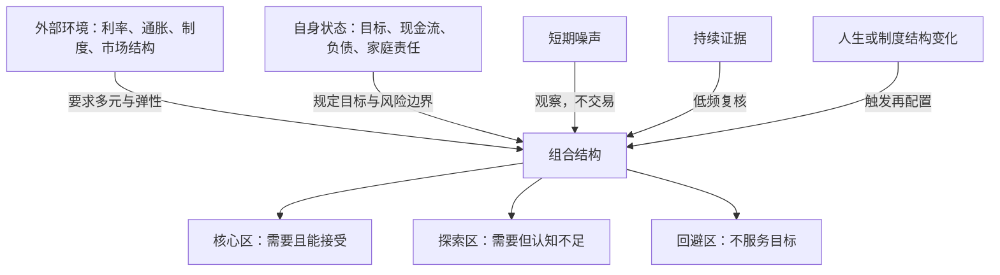

# 第十章《结构：判断投资组合是否适合自己》深度拆解

> **材料范围**：以下内容严格基于用户提供的《资产配置行动指南》第十章，不把延伸阅读或播客中的观点当作本章已经完成的论证。

## x → f → f(x)

- **x**：普通人既看不清长期市场，又会随人生阶段改变需求与承受能力，怎样构建一个不会因外部变化失灵、也不会与自身生活脱节的投资组合？
- **f**：面对这个问题，不应寻找跨时代、跨家庭通用的固定配比，而应让组合同时满足两种适应性：对外，用**多元化、流动性与低频调整**应对复杂系统；对内，用**“自己需要什么 × 自己能接受什么”**筛选资产，并把“能接受”继续拆成认知边界与风险承受边界。
- **f(x)**：接受这套方法后，投资者会把最多资金放在“需要且能接受”的核心区，用少量资金探索“需要但尚未理解”的领域，彻底回避“不服务目标”的资产；同时设置冷静期、换手约束和再平衡条件，让组合既不被新闻牵着跑，也能在人生目标或市场制度发生结构变化时调整。

---

## 核心命题

投资组合的优劣不取决于它是否符合某个流行模板，而取决于它是否同时适应所处环境和持有者本人。外部世界无法准确预测，所以组合要有韧性；自身状况相对可知，所以配置必须从目标、能力圈和承受边界出发。

本章把“最优组合”改写成“适合自己的可持续组合”：它不要求每次预测正确，而要求投资者在预测错误、环境变化和情绪波动时，仍能继续持有、保有选择并完成生活目标。

## 关键洞见

### 1. 组合首先要解决“适应”，而不是追求静态最优

作者用打包行李作比喻：去哪里决定外部环境，去做什么决定自身目的。哈尔滨与昆明需要不同衣物，出差与旅行也需要不同装备；同样，中国和美国的市场制度不同，单身者与负担家庭责任的中年人现金流不同，照搬一个标准比例必然水土不服。

由此得到两种适应性：

`组合适合度 = 外部环境适应性 × 自身状态适应性`

两者缺一不可。只看市场，会把家庭目标变成追逐热点；只看自身，又可能让组合停留在已经变化的利率、通胀或制度环境中。真正稳定的不是某个比例，而是一套能持续校准的结构。

### 2. 历史的价值在机制，不在形状复刻

“你能看到多远的过去，就能看到多远的未来”不是说历史会照原样重演，而是说对过去的理解越深入，越能分辨哪些机制仍在运行、哪些条件已经改变。

特朗普第二任期不会简单复刻第一任期，因为政策主体、目的、经济背景和市场预期都变了；即便政策完全相同，投资者提前布局也会使价格路径不同。把当下行情与“519”“杠杆牛”作K线类比，同样忽略了参与者、杠杆、估值、政策与资金结构的差异。

`低质量历史类比：表象相似 → 路径重复`

`高质量历史分析：条件比较 → 机制识别 → 情景推演`

这也解释了复杂系统的反身性：一旦某个规律被广泛识别，参与者会提前行动，从而改变规律本身的表现。

### 3. 普通人的外部优势不是预测，而是减少被噪声驱动的动作

普通人缺少时间、数据和模型，不适合靠频繁调整获得优势。“多看少动”不是拒绝信息，而是把信息与交易分开：新闻可以进入观察清单，只有持续、可验证并改变长期假设的变化，才进入配置决策。

作者提出两种行为阻力：

- 单笔投资金额达到流动资产的1%，强制冷静一天；2%则冷静两天，以此类推；
- 控制月度交易规模与长期换手率，避免组合因突发消息反复摇摆。

这些具体数值未必适合所有人，但其机制成立：

`决策摩擦 ↑ → 冲动操作 ↓ → 组合被噪声破坏的概率 ↓`

投资便利并非纯粹优势。下单越容易，越需要人为增加延迟、复核和理由记录。

### 4. 复杂系统适应性来自多样性与可调整性

作者把组合比作生态圈。生态圈要抵御极端气候，既需要物种多样，也需要随环境演化；组合则既需要多元资产和策略，也需要足够流动性保留调整空间。

第一层是**多样性**：任何单一资产、单一市场或单一策略都有失效条件，组合不能把命运押在一种未来上。

第二层是**弹性**：如果大量资金锁在8—10年的一级市场基金、封闭私募、长期年金或30年债券中，即使环境改变，投资者也无法调整。长期锁定利率看似解决了当下焦虑，却可能用今天的判断绑住未来二十年。

`韧性 = 风险来源多元 + 保留流动性 + 不把舵打满`

不过，多元化不能只数产品数量。十只同方向的资产仍可能是一个风险暴露；真正有效的是驱动回报的经济机制不同。

### 5. 自身适应性由“需要”与“能接受”共同决定

投资者最容易犯的错，是因为某个资产热门、交易方便或看似能赚钱，就忘记它是否服务自己的目标。作者用两条轴纠正这一点：

- **自己需要什么**：投资目的，包括流动资金、应急储备、养老、子女支持或被动收入；
- **自己能接受什么**：既包括是否理解产品，也包括能否承受它的损失与波动。

只有“需要”没有“接受”，组合可能在压力中被迫卖出；只有“接受”没有“需要”，就会把熟悉的产品当成目的本身。

`适配资产 = 服务目标 ∩ 认知边界内 ∩ 风险边界内`

作者据此形成三个区域：需要且能接受的是核心区；需要但认知不足的是探索区；不符合目标的资产，无论是否熟悉，都是回避区。

### 6. 风险边界不是问卷答案，而是财务能力与真实体验的交集

作者强调，风险承受边界往往要在真实波动中才会暴露。当仓位让人失眠、焦虑、坐立不安时，风险已经超出主观承受范围；“雪球”结构化产品的案例则说明，销售话术可能把认知边界外的产品伪装成类固定收益。

这里还应补充本章没有完全展开的一层：风险承受不仅是心理体验，也有客观能力。一个人心理上敢于冒险，不等于其现金流、负债和家庭责任允许他冒险。

`真实风险边界 = 主观容忍度 ∩ 客观承受力 ∩ 产品理解度`

投资经验最重要的产出，不一定是更会预测市场，而是更准确地认识这三条边界。

### 7. 人生阶段改变的是约束，不是机械年龄配方

作者提供三阶段画像：20—30岁重增长，30—50岁兼顾发动机、压舱石和消防栓，50岁以后重保本、流动与现金流。这个框架的价值，不在于年龄数字，而在于背后的约束变化：未来劳动收入、家庭责任、资金使用期和损失后的恢复能力。

年轻人不宜过早把全部目标设为被动收入，因为本金太小、低风险现金流资产回报有限，过度保守会拖慢资本积累；中年阶段必须同时覆盖长期增长与家庭突发支出；主动收入下降后，顺序风险和现金流稳定性会变得更重要。

正确的读取方式是：

`年龄只是代理变量；配置依据 = 人力资本 + 负债责任 + 使用期限 + 恢复能力`

## 理解阻力扫描：组合怎样实现双重适应

本章最难之处是“少动”与“适应变化”看似矛盾。关键是把变化分成噪声、持续变化和结构变化，并规定不同响应。

### “需要 × 接受”四象限

|  | 能接受：认知与风险边界内 | 不能接受：认知不足或风险过高 |
|---|---|---|
| **需要** | **核心区**：承担主要资金，服务明确目标 | **探索区**：先学习、模拟或小额验证，不急于扩大仓位 |
| **不需要** | **回避区**：懂也不等于该买，避免能力错配目标 | **绝对回避区**：既无用途又无法承受，没有配置理由 |

## 实践指引

### 场景一：建立组合前先写“双适应清单”

外部清单只记录会改变长期回报环境的变量：通胀与利率中枢、收入所在行业周期、主要负债币种、市场制度变化。自身清单则记录：未来三年大额支出、应急资金月数、家庭责任、投资期限、最大可承受亏损、熟悉的资产类型。

不要让外部判断直接生成买卖动作。先问它是否改变了家庭目标、资产长期回报假设或风险承受能力；只有至少一项发生实质变化，才进入组合复核。

### 场景二：为重大投资增加阻力

可把作者的百分比规则改造成更稳健的程序：

1. 单笔交易达到可投资资产的既定阈值，进入24—72小时冷静期；
2. 写下买入理由、收益来源、最大损失、退出条件和替代方案；
3. 冷静期后重新检查，若理由只剩“正在涨”“别人推荐”或“怕错过”，取消交易；
4. 对不可逆或长期锁定产品，冷静期应更长，并由家庭共同确认。

阈值应按决策不可逆性和家庭财务影响设置，而不是机械采用1%一天。

### 场景三：区分三类变化，解决“少动与适应”的矛盾

| 变化类型 | 识别方式 | 合理响应 |
|---|---|---|
| 新闻噪声 | 单次事件、标题驱动、机制不清 | 记录但不交易 |
| 持续变化 | 多期数据和多类行为证据同向 | 在固定复核日评估，不临时追涨杀跌 |
| 结构变化 | 长期回报机制、家庭目标或风险能力改变 | 逐步再平衡并更新配置政策 |

可设置季度观察、年度正式复核；只有结婚、生育、买房、失业、退休、重大疾病或制度突变等事件触发临时复核。

### 场景四：检查多元化是否真实

不要只统计基金或股票数量，而要穿透到底层风险：

- 是否都依赖同一国家、同一货币或同一经济周期？
- 是否同时受利率上升、房地产下跌或科技估值收缩影响？
- 压力状态下，平时低相关的资产会不会一起下跌？
- 是否保留足够现金与高流动性资产，避免在低点出售长期资产？

组合应按风险来源而不是产品名称分散，并为长期锁定资产设总比例上限。

### 场景五：绘制个人投资象限

为每个候选资产分别打三个标签：

1. 它服务哪个明确目标？
2. 我能否用自己的话解释其收益、损失和退出机制？
3. 在合理最坏情景下，我的家庭财务和情绪能否承受？

三问均通过才进入核心区；目标明确但理解不足的，先学习、用模拟账户或极小仓位验证；没有明确用途的，即使熟悉也不配置。

### 场景六：用约束而非年龄调整生命周期配置

- **积累期**：只有在收入较稳定、近期无大额支出、应急金充足时，才提高增长资产比例。
- **家庭责任期**：先覆盖保险、应急金和未来三年确定支出，再决定长期增长仓位。
- **提款期**：预留若干年生活支出，降低被迫在市场下跌时卖出的风险，同时保留应对长寿和通胀的增长资产。

每次人生阶段变化，不是把旧组合全部推倒重来，而是重新计算现金流、期限和风险容量后渐进再平衡。

---

## 例子列表

- **哈尔滨与昆明、出差与旅游需要不同装备**：外部环境与自身目的共同决定行囊。← 支撑 **x：不存在通用组合**
- **中国人与美国人不宜照搬同一比例**：经济阶段、市场制度和可得工具会改变配置条件。← 展示 **f：组合必须适应外部环境**
- **单身者、中年家庭、有房贷与无负债者的差异**：家庭责任和负债改变安全性与流动性要求。← 展示 **f：组合必须适应自身状态**
- **应急资金、医疗保险和黄金作为基础装备**：作者主张某些防御组件具有跨环境价值。← 支撑 **f(x)：组合需保留底层防护**
- **第二任特朗普交易不能复刻第一任期**：背景、政策目标与市场预期都会改变历史路径。← 展示 **f：历史要研究机制而非照搬结果**
- **把当前行情类比“519”或2015年杠杆牛**：只看走势形状容易陷入叙事谬误。← 支撑 **x：表象类比不能指导配置**
- **新闻标题触发频繁换仓**：外部噪声通过行动冲动侵蚀组合。← 展示 **f：用多看少动建立行为防线**
- **按投资金额设置冷静期**：用时间阻力减少冲动型投资。← 证明 **f(x)：行为规则可以替代临场自制力**
- **作者近五年换手率不超过20%**：以低换手约束对抗信息不足和情绪交易。← 证明 **f(x)：低频调整提升纪律**
- **生态圈需要多样物种**：单一资产或策略在极端环境中更脆弱。← 展示 **f：多元化提供韧性**
- **长期一级市场基金、封闭私募与年金降低组合弹性**：长期锁定会限制环境变化后的调整能力。← 支撑 **f：流动性是适应能力的一部分**
- **高利率时重仓30年美国国债**：今天看似优越的条件可能在长期中反转。← 展示 **f：不能用当前判断锁死全部未来**
- **雪球被当作类固定收益销售**：不理解底层敲入机制，会把认知边界外的风险误当成安全。← 支撑 **x：自身认知决定产品是否适合**
- **被动收入型组合服务作者的现金流目标**：目标与能力圈共同缩小候选资产范围。← 证明 **f(x)：核心区由需要与接受交集形成**
- **年轻人过早追求FIRE现金流**：本金不足时过度重视稳定收入，可能牺牲长期积累。← 展示 **f：人生约束改变收益目标**
- **中年组合的发动机、压舱石与消防栓**：增长、稳定与应急分别承担不同家庭任务。← 证明 **f(x)：组合结构来自功能分工**
- **退休后从做大蛋糕转向持续切蛋糕**：主动收入下降后，现金流与顺序风险的重要性上升。← 证明 **f(x)：配置需随提款状态改变**

## 结论列表

- ① 最适合的投资组合不是预测收益最高的组合，而是预测错误后仍能完成目标的组合。
- ② 历史提供的是机制与边界条件，不是可以原样复制的价格路径。
- ③ 信息进入视野不等于进入仓位，新闻与交易之间必须有决策阻力。
- ④ 组合韧性来自风险来源多元和调整空间，而不是产品数量众多。
- ⑤ 长期锁定既可能提高纪律，也可能剥夺未来适应新环境的能力。
- ⑥ 一项资产只有同时服务目标、位于认知边界内且风险可承受，才适合成为核心仓位。
- ⑦ 懂得某项投资不等于需要配置它，能力必须服从目标。
- ⑧ 风险承受力既是心理感受，也是现金流、负债与家庭责任构成的客观能力。
- ⑨ 年龄不是配置答案，只是投资期限、人力资本和家庭责任的粗略代理变量。
- ⑩ 少动不是永不调整，而是只对持续证据和结构变化作出低频响应。

---

## Q-A 问答链

### Q-A 问题结构图

### Q1：为何没有通用组合？

- **结论**：市场制度、家庭目标和风险能力不同，同一配置比例不可能对所有人同时适用。
- **形式化**：`组合适合度 = 环境匹配 × 个人匹配`
- **论证**：① 国家与市场提供的资产和风险不同；② 家庭负债与支出期限不同；③ 投资目标与可承受损失不同；④ 相同比例会产生不同现金流和行为结果；⑤ 所以模板只能提供起点，不能替代个人设计。
- **边界**：应急资金、基本保障和分散等原则具有较强普适性，但具体形式与比例仍需调整。

**Q1 → Q2**：因为 Q1 确认了组合必须适应环境，但当前环境只能借助历史理解，所以必须继续追问怎样使用历史才不会刻舟求剑。

### Q2：历史究竟该怎么用？

- **结论**：历史应用于识别因果机制和边界条件，不应用于复制价格图形与事件顺序。
- **形式化**：`有效历史：条件 → 机制 → 情景；无效类比：形状 → 重演`
- **论证**：① 相似事件可能发生在不同制度与估值背景；② 市场会提前交易已知经验；③ 参与者的行动反过来改变结果；④ 因而表象相同不代表路径相同；⑤ 只有仍然成立的机制才有推演价值。
- **边界**：机制本身也可能因技术、制度和行为改变而失效，历史只能提供概率，不提供保证。

**Q2 → Q3**：因为 Q2 要求深入识别机制，但普通人通常没有足够时间和能力完成这种研究，所以必须为无法看懂环境设计备用方法。

### Q3：看不懂环境怎么办？

- **结论**：承认预测能力有限，以多元配置、充足流动性和不满仓押注替代强行判断。
- **形式化**：`预测弱 → 分散未来 + 保留选择权`
- **论证**：① 单一预测可能错误；② 多元风险来源降低一种未来失败的破坏；③ 流动性让组合有能力响应长期变化；④ 不把舵打满为未知情景留出余地；⑤ 结构防御比临场预测更可复制。
- **边界**：过度分散会稀释有效暴露并增加管理成本，流动性过高也可能拖累长期收益。

**Q3 → Q4**：因为 Q3 强调组合要能响应变化，但投资者常把“响应”误解为追随每条新闻，所以必须区分适应性与频繁交易。

### Q4：少动为何反而更适应？

- **结论**：少动过滤短期噪声并保留交易能力，使调整集中在真正改变长期假设的变化上。
- **形式化**：`适应性 = 对结构变化能动 − 对新闻噪声乱动`
- **论证**：① 大多数突发新闻影响短暂；② 频繁换仓增加费用与错误时点；③ 冷静期让理由接受复核；④ 固定复盘降低情绪驱动；⑤ 当持续证据出现时，保留的流动性支持渐进调整。
- **边界**：欺诈暴露、流动性危机、人生重大变化等情况需要及时行动，不能把少动僵化为永不调整。

**Q4 → Q5**：因为 Q4 解决了何时动的问题，但还没有说明组合本身如何在不频繁交易时抵御变化，所以必须追问结构韧性的来源。

### Q5：韧性组合靠什么形成？

- **结论**：韧性来自风险来源的真实多元、资产之间的功能分工以及足够的调整空间。
- **形式化**：`韧性 = 多元驱动 + 功能分层 + 流动性弹性`
- **论证**：① 单一资产依赖一种未来；② 不同驱动降低共同失效概率；③ 应急、稳健和增长资产承担不同任务；④ 流动资产避免低点被迫出售；⑤ 长期锁定比例受控，组合才保有演化能力。
- **边界**：危机中相关性可能突然上升，分散不能消除所有系统风险。

**Q5 → Q6**：因为 Q5 只解决组合对外部环境的适应性，但资产最终由具体的人持有，所以必须进一步确定哪些暴露与个人目标和能力匹配。

### Q6：哪些资产该进核心区？

- **结论**：只有明确服务个人目标、能够理解且损失可以承受的资产，才适合承担主要仓位。
- **形式化**：`核心资产 = 需要 ∩ 理解 ∩ 承受`
- **论证**：① 目标决定资产承担的任务；② 理解决定能否识别收益与风险来源；③ 承受力决定压力下能否持续持有；④ 任一条件缺失都会造成错配；⑤ 需要但不理解的资产只能进入小额探索区。
- **边界**：理解与承受会随经验、财务状况和产品变化，核心区不是永久名单。

**Q6 → Q7**：因为 Q6 把风险承受作为核心条件，但人们常高估自己，问卷也难以揭示真实反应，所以必须继续追问边界如何验证。

### Q7：风险边界怎样确认？

- **结论**：风险边界要同时用压力情景、家庭财务数据和真实波动体验验证。
- **形式化**：`风险边界 = 心理容忍 ∩ 财务容量 ∩ 产品认知`
- **论证**：① 先计算收入中断和资产下跌对目标的影响；② 再模拟合理最坏损失；③ 用小仓位观察真实情绪与行为；④ 若影响睡眠或诱发错误卖出，说明仓位过大；⑤ 随生活责任变化持续更新。
- **边界**：过去体验无法覆盖所有尾部事件，未经历崩盘不等于能够承受崩盘。

**Q7 → Q8**：因为 Q7 说明风险边界会随现金流和责任变化，所以组合不能一次设定终身不变，最后必须把人生阶段转化为调整规则。

### Q8：人生阶段如何改变结构？

- **结论**：配置应随人力资本、家庭负债、提款需求和损失恢复能力变化，而不是机械按年龄切换。
- **形式化**：`结构变化 = 收入能力 + 责任期限 + 提款状态 + 恢复能力`
- **论证**：① 积累期未来收入可补充本金；② 家庭责任期需要同时承担增长和突发支出；③ 提款期主动收入下降，顺序风险上升；④ 各阶段因此需要不同增长、安全和流动结构；⑤ 变化应通过渐进再平衡完成。
- **边界**：年龄与财务阶段并不一致；高养老金老人可能比负债年轻人更有风险容量，必须以实际数据为准。

---

## 局限与盲区

### 1. “少动”与“适应性”之间缺少明确触发机制

本章一方面要求组合随环境演化，另一方面强调不要频繁调整，但没有清楚规定何种证据足以触发变化。缺少阈值会让投资者在行情好时把噪声说成趋势，在亏损时又以“长期持有”为由拒绝纠错。应补充固定复核周期、目标偏离幅度和结构变化清单。

### 2. 冷静期与换手率数字高度个人化

“1%冷静一天、2%两天”以及换手率低于20%是作者的行为工具，不是普遍最优标准。它没有区分买入、卖出、定投、再平衡和应急处置，也没有考虑组合规模。真正应与冷静期绑定的是不可逆性、复杂度和最坏财务影响。

### 3. 特朗普与美国市场的战术判断论证不足

从社会分化、技术革命推导到“区间交易加看涨波动率期权可能最优”，中间跨越了估值、期权价格、择时和风险管理等多个环节。这种具体战术与全章反对普通人强行预测的主旨存在张力，也缺少可验证证据。

### 4. 多元化被生态隐喻简化了

生态圈的物种越多通常越有韧性，但投资组合的品种更多不必然更分散。多只基金可能持有相同股票，不同资产在危机时可能共同受美元流动性或利率冲击。应从风险因子、相关性和压力情景检验真实多元化。

### 5. 风险偏好、风险容量与风险需求没有充分区分

作者把“能接受”主要解释为认知边界和风险承受边界，但心理愿意承受、财务有能力承受、为达到目标必须承担多少风险，是三个不同问题。过度保守也可能使长期目标无法实现，不能只以不焦虑为标准。

### 6. 生命周期蓝图过度依赖年龄

20—30岁并不必然收入稳定或没有短期支出，50岁以后也不必然风险容量低。职业稳定性、养老金、健康、房产、负债与遗产目标都可能改写年龄画像。年龄只能做提示，不能直接生成资产比例。

### 7. “黄金是压舱石”被当作普遍前提

黄金没有稳定现金流，其防御作用取决于通胀、实际利率、货币信用和买入价格。它可以是分散工具，但是否属于每个人的基础装备、应占多少比例，需要组合层面的证据，而不能仅凭“压舱石”隐喻确定。

### 8. 探索区直接使用真金白银并非唯一方法

“需要但认知不足”时，小仓位可以帮助学习，但复杂结构化产品可能小仓位也难揭示尾部风险。阅读条款、情景模拟、纸面组合和观察完整周期，往往应先于真实投资。

## 一句话收束

适合自己的组合不是一张固定比例表，而是一套能长期运行的校准机制：**对外不押单一未来、对内不越过目标与承受边界；用规则过滤噪声，用流动性保留选择，只在结构条件真正改变时低频调整。**
